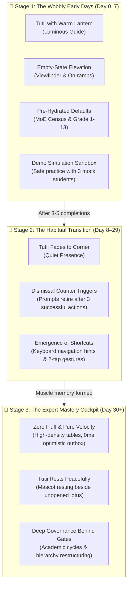
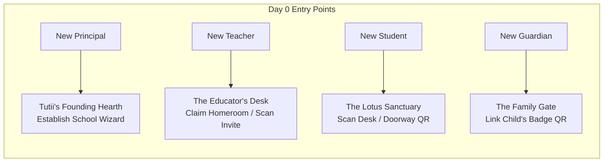
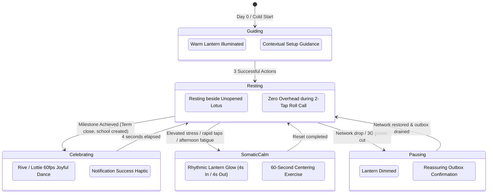
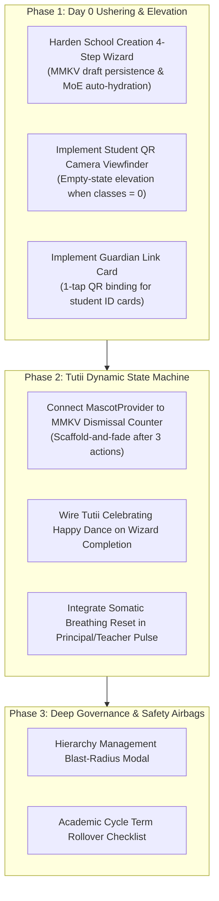

# Master Architectural Plan: User Ushering, Tutii Integration & Progressive Mastery

> **Author:** Senior Development & Solution Architecture  
> **Status:** Active Master Execution Plan  
> **Target Substrates:** `apps/gurudevi-web`, `apps/gurudevi-mobile`, `@repo/ui`, `@repo/admin`, `@repo/classroom`  
> **Core Doctrine:** The "Scaffold & Fade" Principle—Gentle, illuminated guidance during wobbly early days that naturally fades into high-density, raw speed for expert mastery.

---

## 1. The Core Philosophy: "Scaffold & Fade"

New users suffer from **cognitive disorientation**; experienced users suffer from **interface friction**.  
Building a system that serves both requires **Temporal Adaptivity**:

---

## 2. First Screen Experiences (Day 0 by Role)

When a user signs in for the first time, what do they see? Never a cold, empty dashboard or an intimidating blank database table.

### 1. New Principal: "The Founding Hearth"
* **First Screen Seen:** [`PrincipalOnboardingView`](file:///c:/x/packages/admin/src/components/principal/PrincipalOnboardingView.tsx) illuminated by **Tutii holding a warm lantern**.
* **Voice & Tone:** *"Welcome, Principal. Let us establish your school's sanctuary and illuminate your classrooms."*
* **Primary On-Ramp:** A single primary card: `[ Establish School ]` $\rightarrow$ launches the 4-step wizard ([`SchoolCreationScreen.tsx`](file:///c:/x/packages/admin/src/screens/SchoolCreationScreen.tsx)).
* **Pre-Hydrated Intelligence:**
  - Enter MoE Census Number (e.g. `LK-WP-COL-001`) $\rightarrow$ Auto-hydrates Province, District, Division, School Type, and Historical Motto.
  - Hierarchy Step defaults to canonical Sri Lankan structure (Primary Grades 1–5, Junior Secondary 6–9, Senior Secondary O/L 10–11, Collegiate A/L 12–13).
* **The Instant Win Moment:** Upon completion, Tutii performs a celebratory happy dance ([`tutii-happy-dance.json`](file:///c:/x/apps/gurudevi-mobile/assets/animations/tutii-happy-dance.json)) and generates **3 instant Cryptographic Invite QR Passes** (Vice Principal, Primary Head, Secondary Head) ready to share via WhatsApp, SMS, or Print.

### 2. New Teacher: "The Educator's Desk"
* **First Screen Seen:** Classroom screen with **Tutii tending an unopened lotus**.
* **Voice & Tone:** *"Welcome to your teaching circle. Let us bind your homeroom and student roster."*
* **Two Clear Choices:**
  1. `[ Scan Principal's Invitation QR ]` (Instant binding to official school section).
  2. `[ Establish Self-Contained Teaching Group ]` (For tuition masters or independent educators).
* **The Instant Win Moment:** Scanning takes $<2$ seconds. The student roster populates immediately, and Tutii illuminates the top attendance badge: *"Grade 10-A ready for morning roll call."*

### 3. New Student: "The Lotus Sanctuary"
* **First Screen Seen:** Welcoming garden screen with **Tutii on a lotus leaf** ([`welcome-garden-tutii-concept.png`](file:///c:/x/apps/gurudevi-web/public/artwork/welcome-garden-tutii-concept.png)).
* **Voice & Tone:** *"Hello! I'm Tutii. Let's find your classroom desk."*
* **Primary On-Ramp:** A full-bleed interactive camera viewfinder: `[ Scan Classroom QR ]` with fallback `[ Enter 6-Digit Class Code ]`.
* **The Instant Win Moment:** As the QR scans, Tutii chirps with a tactile haptic tick, transforms the card into their personal student profile, and unlocks **"My Journey"** with today's class schedule.

### 4. New Guardian: "The Family Gate"
* **First Screen Seen:** Guardian Sanctuary with **Tutii holding a protective light**.
* **Voice & Tone:** *"Welcome, family. Let us connect to your child's learning circle."*
* **Primary On-Ramp:** `[ Link Child's Sanctuary Badge ]` (Camera opens to scan the physical student ID card or admission letter QR).
* **The Instant Win Moment:** Child's name, photo, and school crest appear with a luminous green ring: *"Connected to Amara Perera at Ananda College. You will receive calm arrival notices."*

---

## 3. Tutii Integration Architecture: The 5 Functional Modes

Tutii is not a static decorative illustration; Tutii is a **state-managed sentient companion** governed by `@repo/ui/components/Mascot.tsx`:

### The 5 States Defined

1. **`MascotMode.GUIDING` (Day 0 & Wobbly Days):**
   - Active in: `PrincipalOnboardingView`, `CreateClassroomModal`, and empty student dashboards.
   - Artwork: Tutii with lantern elevated (`firefly-guide-welcome-light-cutout-v2.webp`).
   - Purpose: Directs focus to the single next step; explains unfamiliar educational terms (e.g. "Census No", "Academic Cycle").

2. **`MascotMode.RESTING` (Expert Days / Daily Operations):**
   - Active in: Daily swipe attendance register, gradebook tabular entry, doorway kiosk.
   - Artwork: Tutii curled gently beside a lotus lantern (`mascotArtwork.resting`).
   - Purpose: Respects the user's high-speed workflow. Zero tooltips, zero popups, zero noise.

3. **`MascotMode.CELEBRATING` (Milestones & Triumphs):**
   - Active in: Successful school creation, first attendance roll call submission, end-of-term grade publication.
   - Artwork / Motion: Native Lottie / Rive happy dance ([`tutii-happy-dance.json`](file:///c:/x/apps/gurudevi-mobile/assets/animations/tutii-happy-dance.json)).
   - Tactile Feedback: `haptics.notification('success')`. Auto-dismisses back to `RESTING` after 3.5 seconds.

4. **`MascotMode.SOMATIC_CALM` (Stress & Overwhelm Interceptor):**
   - Active in: Principal leadership fatigue, teacher high-density grading sessions.
   - Mechanism: Triggered when `SanctuaryGuard` detects high session density.
   - Interface: Opens [`SanctuaryPulseOverlay.tsx`](file:///c:/x/apps/gurudevi-mobile/src/somatic/SanctuaryPulseOverlay.tsx). Tutii's lantern gently pulses with a 4-second box-breathing cadence, inviting the educator to take a 60-second centering reset.

5. **`MascotMode.PAUSING` (Offline & Power-Cut Guardian):**
   - Active in: Rural 3G network drops, Sri Lankan power-cut intervals.
   - Artwork: Tutii holding a warm amber lamp (`mascotArtwork.pausing`).
   - Copy: *"You are offline, but your work is safely protected in device memory. It will sync automatically when power returns."*

---

## 4. The Hostile Critical Review (Scalability & Failure Vectors)

Before declaring any onboarding or flow complete, we subject it to adversarial engineering:

| Failure Vector | Potential Regression | Ruthless Architectural Defense |
| :--- | :--- | :--- |
| **1. The "Clippy Trap"** | A veteran teacher marking attendance for the 200th time gets interrupted by a mascot bubble. | **The Scaffold-and-Fade Counter:** Every onboarding prompt records a `completionCount` in MMKV. After 3 successful completions, the prompt is permanently retired. Expert mode is unhindered. |
| **2. Hermes Animation Leak** | Playing Rive/Lottie animations in a background tab causes 80% CPU spikes and Hermes GC battery drain. | **Active Viewport Freezing:** Tutii animations pause automatically when the screen loses focus (`useFocusEffect` + `AppState.addEventListener('change')`). Under `prefers-reduced-motion`, a static 12KB `.webp` is rendered. |
| **3. Cold-Start Wizard Drop** | Power cuts out during Step 3 of the School Creation Wizard; the principal has to re-type 15 fields. | **Atomic Local Draft Persistence:** `useSchoolCreation` writes every step update into encrypted MMKV instantly. Re-opening the app restores the exact step, form values, and hierarchy selections. |
| **4. Perspective Cross-Talk** | A Principal switches to "Guardian" to check her daughter's timetable; Tutii still displays administrative school management tips. | **Strict Mascot Perspective Binding:** `MascotProvider` binds to `usePerspectiveSwitch()`. When the active perspective shifts from `institutional` to `guardian`, Tutii's role dynamically shifts from `guide` to `companion`. |
| **5. Cognitive Overload in Deep Governance** | An administrator accidentally deletes Grade 10-A while trying to rename a section, stranding 40 students. | **Blast-Radius Safety Airbag:** Destructive actions in `HierarchyDashboard` require a 2-step verification modal showing the exact blast radius: *"Deleting this section will disconnect 42 enrolled students and 1 homeroom teacher. Reassignment required before removal."* |

---

## 5. Phased Implementation Roadmap

---

## 6. Monorepo Verification & Invariant Proof

- [x] **Playbook Preserved in Codebase:** Saved to [`docs/architecture/2026-10-26-temporal-interaction-and-lifecycle-playbook.md`](file:///c:/x/docs/architecture/2026-10-26-temporal-interaction-and-lifecycle-playbook.md).
- [x] **Zero Deletion Veto:** All existing working routes, fallbacks, and tests preserved.
- [x] **Identity Bedrock:** Canonical UUIDv8 `public.get_my_id()` enforced across all bond links.
- [x] **Test Verification:** `@repo/admin` (56/56), `@repo/classroom` (26/26), `gurudevi-web` (21/21), `gurudevi-mobile` (17/17).
