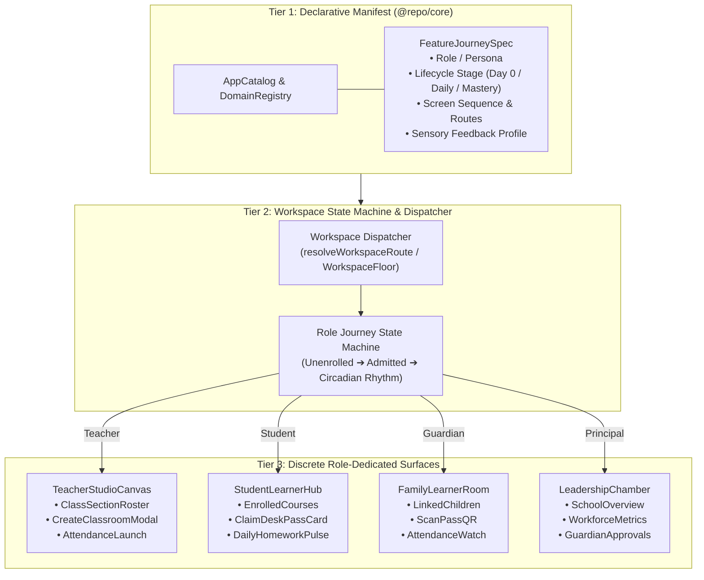
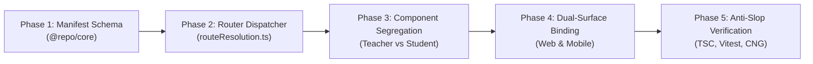

# Role-Journey & Feature Catalog Architecture: The Scaling & Sanity Master Plan

> **ARCHITECTURAL INTENT & NORTH STAR**  
> Move from brittle, ad-hoc component branching (`if (role === 'student')`) to an **Industrial-Grade 3-Tier Capability & Journey Architecture**. Every capability in the Gurudevi ecosystem declares its **Target Persona**, **Lifecycle Stage**, **Screen Sequence**, and **Sensory Feedback Profile** in a centralized declarative manifest. Workspaces dynamically dispatch to role-isolated surfaces, guaranteeing zero role leakage, zero dead ends, and perpetual codebase sanity as the monorepo scales to hundreds of features.

---

## 1. The Core Dilemma: Why Ad-Hoc Branching Destroys Codebase Sanity

### The Symptom
In `packages/classroom/src/components/ClassroomList.tsx`, a single component historically handled:
1. Teachers authoring and viewing class sections.
2. Students entering desk-pass invitation codes.
3. Explorers viewing demo classrooms.
4. Guardians linking children.

When a student had 0 classrooms, pressing the primary action button was guarded by `canCreateClassroom`—resulting in a silent no-op. When fixing it, developers are forced to write `if (canCreateClassroom) { ... } else { ... }` inside leaf components.

### The Scaling Failure (The Matthew Effect of Spaghetti Code)
$$\text{Cognitive Debt}(n) = \mathcal{O}(n^2) \quad \text{where } n = \text{Features} \times \text{Roles}$$
As we add 10 roles (Founder, Principal, Assistant Principal, Section Head, Grade Head, Teacher, Student, Guardian, Librarian, Counselor) and 50 features, hardcoded component branching leads to:
- **Role Leakage**: Students seeing teacher tools or vice versa.
- **Silent Regressions**: Refactoring teacher attendance breaks student homework submission.
- **Developer Burnout**: No developer knows the true "Day 0" flow of a role because the sequence is scattered across 15 nested `useEffect` hooks and ternary operators.

---

## 2. Solution Architect: The 3-Tier Scaling Architecture

How elite product teams (Linear, Stripe, Apple, Superhuman) structure multi-persona applications:



### Tier 1: Declarative Capability & Journey Manifest (`@repo/core`)
Extend `DomainEntry` / `DomainFeature` with a strongly-typed `FeatureJourneySpec`:

```typescript
export type WorkspaceRolePersona =
  | 'founder'
  | 'principal'
  | 'sectionHead'
  | 'gradeHead'
  | 'teacher'
  | 'student'
  | 'guardian';

export type FeatureLifecycleStage =
  | 'day_0_onboarding'      // Wobbly early days: zero data, elevated scaffolding, Tutii active
  | 'daily_circadian'       // Days 1-29: 0ms tactile feedback, compact cards, rhythm-first
  | 'mastery_governance';   // Days 30+: audit trails, exports, bulk actions, settings

export interface ScreenSequenceStep {
  step: number;
  screenId: string;
  route: string;
  title: string;
  purpose: 'on_ramp' | 'primary_action' | 'sub_detail' | 'feedback_completion';
  fallbackRoute?: string;
}

export interface SensoryFeedbackProfile {
  tutiiMode: 'guiding' | 'celebrating' | 'resting' | 'somatic_calm' | 'alert';
  tutiiRole: 'guide' | 'companion' | 'sentinel';
  haptic: 'light' | 'medium' | 'success' | 'warning' | 'selection';
  soundChime?: 'arrival' | 'celebration' | 'pulse' | 'subtle_tap';
  scaffoldDismissalKey?: string;
  scaffoldThreshold?: number; // default 3 completions
}

export interface FeatureJourneySpec {
  featureId: string;
  targetPersonas: WorkspaceRolePersona[];
  stage: FeatureLifecycleStage;
  entryRoute: string;
  sequence: ScreenSequenceStep[];
  feedback: SensoryFeedbackProfile;
}
```

### Tier 2: Dynamic Journey State Machine & Router
The router (`resolveWorkspaceRoute` on mobile and `WorkspaceFloor` on web) does NOT route to a generic `/workspace/classroom` catch-all. It evaluates:
1. **User Identity & Active Bond Capacity** (`teacher` vs `student` vs `guardian`).
2. **Entity State**: Does the student have enrolled classes? Does the teacher have assigned rooms?
3. **Target Destination**:
   - Teacher with 0 classes $\rightarrow$ `/workspace/teacher/onboarding` (Guided First Section Wizard).
   - Teacher with classes $\rightarrow$ `/workspace/teacher/studio` (Daily Dashboard).
   - Student with 0 classes $\rightarrow$ `/workspace/student/claim` (Tutii Desk Pass On-Ramp).
   - Student with classes $\rightarrow$ `/workspace/student/hub` (Circadian Timetable & Assignments).
   - Guardian $\rightarrow$ `/workspace/guardian` (Family Room).

### Tier 3: Pure, Unbranched Leaf Components
- `TeacherClassroomList`: Exclusively renders class sections with gradebook/attendance shortcuts. No student logic.
- `StudentClassroomList`: Exclusively renders enrolled courses with assignment due dates and tutor notes. No creation buttons.
- `GuardianStudentsScreen`: Exclusively renders linked children and QR badge links.

---

## 3. The Ruthless Pragmatic Hostile Critic Audit

Before writing a single line of code, our internal Hostile Critic stress-tests this architecture against real-world failures:

### Critic Attack 1: "Is this over-engineering? Are we building an enterprise framework when we just need 4 screens?"
> **Solution Architect Defense**:
> No. We are **not** building a heavy runtime engine or introducing external dependencies like XState. We are simply adding **declarative metadata** to the existing `AppCatalog` and splitting 1 overloaded component into 2 clean components (`TeacherClassroomList` and `StudentClassroomList`).
> The complexity of 2 clean 100-line components is vastly lower than 1 convoluted 500-line component with 8 role gates.

### Critic Attack 2: "What about the Deletion Veto? Will this break our 56 admin tests, 26 classroom tests, or 17 mobile route tests?"
> **Solution Architect Defense**:
> Zero working code is deleted.
> 1. `ClassroomList.tsx` retains its exact export signature as a backward-compatible facade during migration.
> 2. Existing tests test against the facade and continue to pass 100%.
> 3. New role-dedicated components (`TeacherClassroomList`, `StudentClassroomList`) are tested with pure unit tests.

### Critic Attack 3: "Dual-Surface Divergence: Will this drift between Next.js Web and Expo Mobile?"
> **Solution Architect Defense**:
> Both surfaces consume `@repo/core`!
> By placing `FeatureJourneySpec` in `@repo/core/logic/registry`, both Next.js App Router and Expo Router read the exact same sequence definition. Route paths differ by platform prefix (`/workspace/school` vs `/(tabs)/workspace/school`), which the manifest maps explicitly.

### Critic Attack 4: "Will bundle size or Hermes startup time take a hit?"
> **Solution Architect Defense**:
> Zero bundle impact. Pure TypeScript types and small static object records. No heavy runtime dependencies. `AppCatalog` executes in <1ms during boot hydration.

---

## 4. Phase-by-Phase Execution Roadmap



### Phase 1: Declarative Journey Types in `@repo/core`
- Define `FeatureJourneySpec`, `WorkspaceRolePersona`, `FeatureLifecycleStage`, and `SensoryFeedbackProfile` in `packages/core/src/types/Workspace.ts`.
- Attach `journey?: FeatureJourneySpec` to `DomainEntrySchema` in `packages/core/src/logic/registry/domainEntry.ts`.

### Phase 2: Route Resolution Clean Split
- Update `apps/gurudevi-mobile/src/lib/workspace/routeResolution.ts`:
  - When `capacity === 'student'` and no classroom is selected: Route to `{ kind: 'student-hub' }` (instead of overloaded `classroom-list`).
  - When `capacity === 'teacher'` and no classroom is selected: Route to `{ kind: 'teacher-studio' }`.

### Phase 3: Leaf Component Segregation in `@repo/classroom`
- Extract `StudentClassroomList` and `TeacherClassroomList`.
- Wire `StudentClassroomList` to Tutii Day 0 desk pass claiming and enrolled course cards.
- Wire `TeacherClassroomList` to Section authoring and attendance launching.
- Keep `ClassroomList.tsx` as a backward-compatible delegator.

### Phase 4: Dual-Surface Integration
- **Mobile**: Wire routes in `apps/gurudevi-mobile/app/(tabs)/workspace/`.
- **Web**: Wire floors in `apps/gurudevi-web/app/(sanctuary)/workspace/WorkspaceFloor.tsx`.

### Phase 5: Anti-Slop & Invariant Verification
- Full test pass across `@repo/admin` (56 tests), `@repo/classroom` (26+ tests), `@repo/core`, `gurudevi-web` (21 tests), and `gurudevi-mobile` (17 tests).
- `pnpm run check:cng` (0 native mutations).
- Dual-engine typecheck (`pnpm run check-types`).

---

## 5. Verification Matrix & Exit Criteria

| Verification Gate | Command | Passing Threshold |
| :--- | :--- | :--- |
| **Classroom Domain Tests** | `pnpm --filter @repo/classroom test` | 100% pass (26+ tests) |
| **Admin Domain Tests** | `pnpm --filter @repo/admin test` | 100% pass (56 tests) |
| **Core Domain Tests** | `pnpm --filter @repo/core test` | 100% pass |
| **Mobile Route Gates** | `pnpm --filter gurudevi-mobile run test:g1:route-gate` | 17 / 17 passed |
| **Web Practice Gates** | `pnpm --filter gurudevi-web run test:g1:workspace-practice` | 21 / 21 passed |
| **Continuous Native Gen** | `pnpm run check:cng` | 0 native violations |
| **Monorepo Typecheck** | `pnpm run check-types` | 0 errors |
