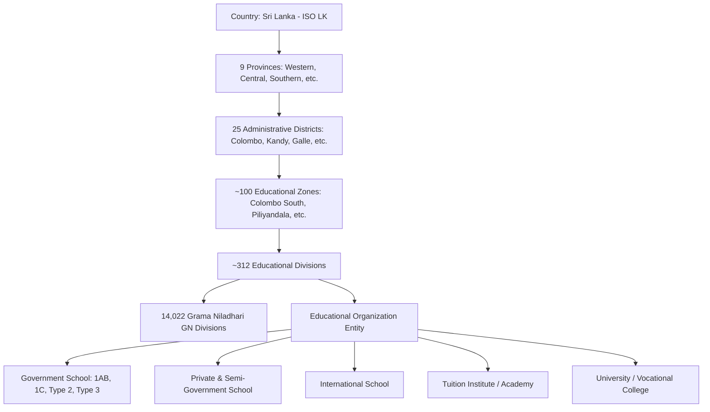
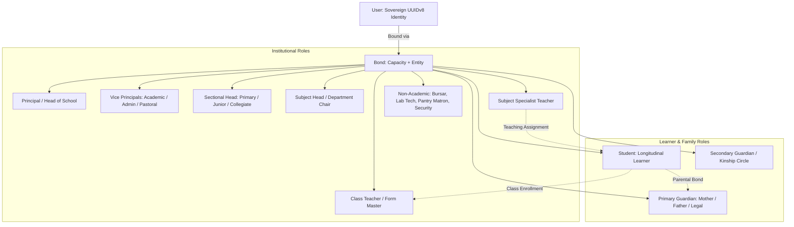
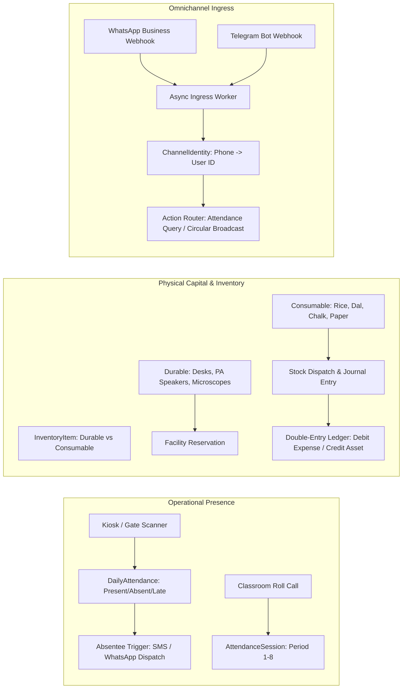
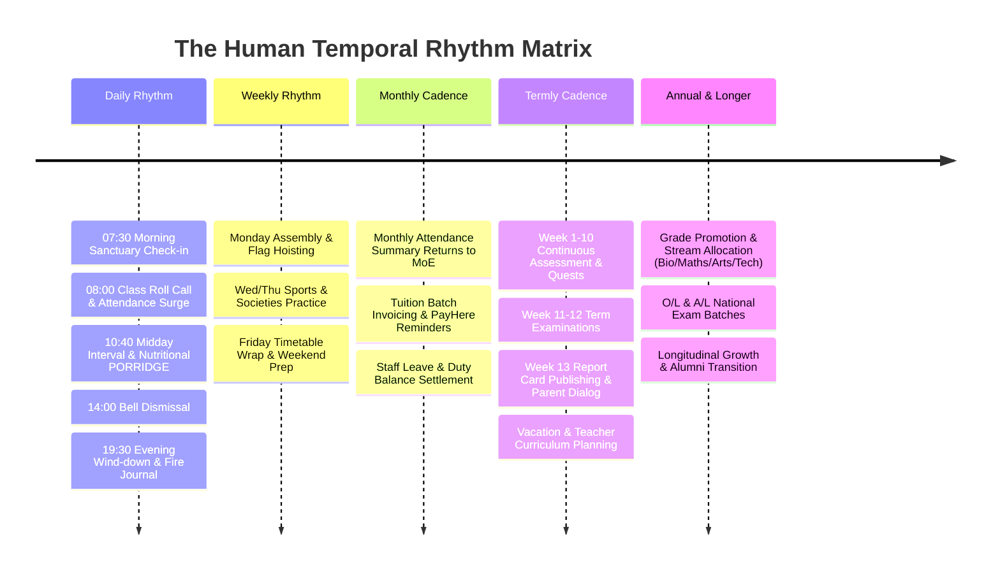
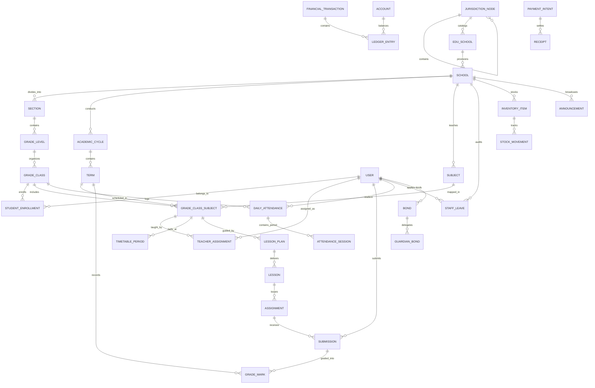
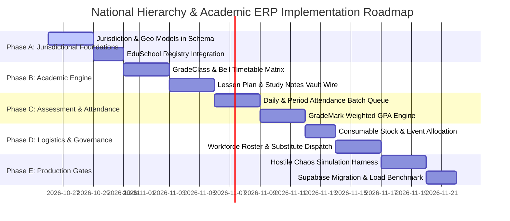

# Sovereign Educational Hierarchy, Institutional Architecture & Temporal Lifecycle: Master Plan & ERD

> **Document Type**: Master Architectural Specification & Domain ERD  
> **Target System**: EdLove Sovereign Multi-Tenant Educational Sanctuary & Institutional ERP  
> **Monorepo Scope**: `packages/schema` (`schema.zmodel`), `packages/core`, `packages/accounting`, `packages/workforce`, `packages/classroom`, `apps/sanctuary-api`, `apps/gurudevi-web`, `apps/gurudevi-mobile`  
> **Deployment Topology**: PostgreSQL (`qzoawolfkuwiuyaoiybz`) + PowerSync SQLite Engine (`69f985158d064eb85ee933e0`)

---

## 1. Executive Synthesis: Sorting the Complexity

Managing an entire national education system down to the daily somatic experience of a single student involves massive cognitive complexity. If designed as a flat CRUD application, it collapses under circular dependencies, bloated joins, and sync conflicts.

To sort this out cleanly, the system is decomposed into **6 Autonomous, Loosely Coupled Architectural Tiers**:

```
┌────────────────────────────────────────────────────────────────────────┐
│ TIER 1: Jurisdictional & Geographic Topology                           │
│ Country ➔ Province ➔ District ➔ Zone ➔ Division ➔ GN ➔ Org Entity      │
└───────────────────────────────────┬────────────────────────────────────┘
                                    │ scopes
┌───────────────────────────────────▼────────────────────────────────────┐
│ TIER 2: Institutional Governance & Sovereign Actor Bonds               │
│ Principal ➔ VPs ➔ Section Heads ➔ Subject Heads ➔ Teachers ➔ Students  │
│ └─► Guardian Circle (Cedar Zero-Trust Policy Delegation)               │
└───────────────────────────────────┬────────────────────────────────────┘
                                    │ operates within
┌───────────────────────────────────▼────────────────────────────────────┐
│ TIER 3: Academic Cycle & Structural Hierarchy                          │
│ Academic Year ➔ Terms (1, 2, 3) ➔ Sections ➔ Grades ➔ Grade Classes    │
└───────────────────────────────────┬────────────────────────────────────┘
                                    │ schedules & delivers
┌───────────────────────────────────▼────────────────────────────────────┐
│ TIER 4: Pedagogical Practice & Assessment Engine                       │
│ Timetable Bell Rhythm ➔ Subjects ➔ Lessons & Plans ➔ Quizzes ➔ Marks   │
└───────────────────────────────────┬────────────────────────────────────┘
                                    │ tracks & equips
┌───────────────────────────────────▼────────────────────────────────────┐
│ TIER 5: Operational Logistics, Material Inventory & Ingress            │
│ Daily Attendance ➔ Facilities ➔ Consumable Pantry ➔ Notices ➔ WhatsApp │
└───────────────────────────────────┬────────────────────────────────────┘
                                    │ harmonizes
┌───────────────────────────────────▼────────────────────────────────────┐
│ TIER 6: The Temporal Human Lifecycle Matrix                            │
│ Daily (Lotus/Bell) ➔ Weekly ➔ Monthly ➔ Termly ➔ Annual ➔ Longitudinal  │
└────────────────────────────────────────────────────────────────────────┘
```

---

## 2. Tier 1: Jurisdictional & Geographic Topology

Sri Lanka’s educational administrative hierarchy is structured under the Ministry of Education (MoE). The platform models this as immutable administrative boundaries, allowing both national analytics and strict multi-tenant isolation.



### Jurisdictional Entities

1. **`JurisdictionNode`**:
   - `id`: UUIDv8
   - `level`: `'country' | 'province' | 'district' | 'zone' | 'division' | 'gn_division'`
   - `code`: e.g. `'LK-WP'`, `'LK-11'` (Colombo District), `'LK-1101'` (Colombo South Zone)
   - `name_en`, `name_si`, `name_ta`
   - `parent_id`: Self-referencing FK
   - `geometry`: PostGIS Polygon / MultiPolygon boundary

2. **`EduSchool` (National Master Registry)**:
   - `id`: Census ID (MoE 5-digit/6-digit code, e.g. `01001` for Ananda College)
   - `census_no`: Unique national index
   - `name`, `type_code` (`1AB`: O/L + A/L Science; `1C`: O/L + A/L Arts/Commerce; `Type 2`: Grades 1–11; `Type 3`: Primary 1–5)
   - `gender_type`: `'boys' | 'girls' | 'mixed'`
   - `medium`: Array of `'sinhala' | 'tamil' | 'english'`
   - `location`: PostGIS Point (`lat`, `lng`)
   - `zone_id`, `division_id`, `district_id`, `province_id`

3. **`School` (Tenant Partition)**:
   - The sovereign SaaS instance. Multiple physical branches or tuition campuses link to their canonical `EduSchool` record via `census_id`.

---

## 3. Tier 2: Institutional Governance & Sovereign Actor Bonds

Traditional RBAC fails in schools because real humans hold multiple shifting relationships (a Teacher in School A is a Guardian of a Student in School B, and an Alumni Mentor in School C). EdLove resolves this via **EdLove Sovereign UUIDv8 Identities** and **Relational Bonds**.



### Relational Bond Authority Matrix

| Capacity | Scope Target | Delegated Capabilities | Privacy Ceiling |
| :--- | :--- | :--- | :--- |
| **`principal`** | `School` | Full institutional audit, staff leave review, timetable sanction, financial ledger view, circular publication. | Cannot view private student `FireJournalEntry` or `MoodLog`. |
| **`vice_principal`** | `School` or `Section` | Academic scheduling, proxy leave review, exam mark moderation. | Limited to assigned portfolio (Academic vs Administrative). |
| **`section_head`** | `Section` | Grade-level pacing review, student disciplinary escalations, substitute dispatch. | Scoped to section grades (e.g., Grades 6–9). |
| **`class_teacher`** | `GradeClass` | Daily roll call check-in, term report card comments, guardian messaging, student potential notes. | Full visibility over class roster attendance & academic marks. |
| **`subject_teacher`** | `GradeClassSubject` | Lesson plan drafting, assignment grading, period attendance, continuous assessment marks. | Scoped only to students enrolled in their subject. |
| **`student`** | `Self` + `GradeClass` | Inner somatic journaling (Lotus/Fire), assignment submission, timetable viewing, library vault access. | Strictly private inner plane; academic submissions visible to teacher. |
| **`guardian`** | `Student` (via `GuardianBond`) | Daily arrival notifications, published term report cards, tuition fee payments, absence excusal requests. | Access governed by `GuardianAssessmentPermission` and Cedar policy. |

---

## 4. Tier 3 & Tier 4: Academic Hierarchy, Timetable Rhythm & Pedagogical Content

This is the instructional engine where curricula are translated into daily classroom life.

```mermaid
graph TD
    Year[AcademicCycle: e.g. Academic Year 2026] --> Term1[Term 1: Jan - Apr]
    Year --> Term2[Term 2: May - Aug]
    Year --> Term3[Term 3: Sep - Dec]

    School --> Section[Section: Primary 1-5 | Junior 6-9 | Senior 10-11 | Collegiate 12-13]
    Section --> GradeLevel[Grade Level: Grades 1 through 13]
    GradeLevel --> GradeClass[Grade Class: 10-A, 10-B, 12-Bio-1, 12-Maths-2]

    GradeClass --> Enrollment[Student Grade Class Enrollment]
    GradeClass --> ClassSubject[Grade Class Subject: 10A Science]
    
    ClassSubject --> TeacherAssignment[Teacher Assignment: Form Master vs Subject Teacher]
    ClassSubject --> TimetablePeriod[Timetable Period: Mon Period 2, Lab 3]
    
    ClassSubject --> CurriculumUnit[Curriculum Unit / Syllabus Topic]
    CurriculumUnit --> LessonPlan[Teacher Lesson Plan & Objectives]
    LessonPlan --> Lesson[Executed Classroom Lesson]
    Lesson --> Notes[Study Notes & Vault Media: PDF, DOCX, Video]
    Lesson --> Assignment[Assignment / Homework Quest]
    Assignment --> Submission[Student Submission]
    
    Submission --> Mark[GradeMark: Continuous Assessment]
    Term1 --> TermExam[Term Examination]
    TermExam --> Mark
```

### The Timetable Bell Rhythm Architecture

Schools operate on rigid temporal periods (typically 8 periods per day, 40–45 minutes each, interrupted by Morning Assembly, Midday Interval, and Afternoon Dismissal):

```
07:30 - 07:50 : Arrival, Sanctuary Check-in & Morning Lotus
07:50 - 08:00 : National Anthem, Religious Observance & Roll Call
08:00 - 08:40 : Period 1
08:40 - 09:20 : Period 2
09:20 - 10:00 : Period 3
10:00 - 10:40 : Period 4
10:40 - 11:10 : Midday Interval (Pantry Nutrition / Free Play)
11:10 - 11:50 : Period 5
11:50 - 12:30 : Period 6
12:30 - 13:10 : Period 7
13:10 - 13:50 : Period 8
13:50 - 14:00 : Dismissal Roll Check & Evening Gratitude Glimmer
```

- **Conflict Prevention Engine**: A teacher cannot be allocated to two `TimetablePeriod` rows with identical `(day_of_week, period_index)`.
- **Physical Room Constraint**: A physical venue (e.g. Science Lab 1) cannot host more than one `GradeClassSubject` at the same bell slot.

---

## 5. Tier 5: Operational Logistics, Material Inventory & Ingress

A school is a physical plant requiring material logistics, nutritional supply chains, and external communication lines.



---

## 6. Tier 6: The Temporal Human Lifecycle Matrix

To keep the platform human-first, software cadences must match the lived biological and institutional rhythms of educators, learners, and families:



---

## 7. Master Entity Relationship Diagram (ERD)



---

## 8. Senior Solution Architect: Scaling Constraints & Reality Engineering

### 1. The Morning Attendance Thundering Herd (07:50 AM – 08:15 AM)
- **Constraint**: 500 schools $\times$ 35 classes $\times$ 40 students = **700,000 attendance records** submitted in a 25-minute window.
- **Architecture**:
  - **Local SQLite Outbox**: Teachers mark attendance in PowerSync SQLite offline/locally in $< 50\text{ms}$.
  - **Bulk Payload Protocol**: The client bundles all 40 student states into a single array payload: `orpcClient.attendance.bulkRecordAttendance({ gradeClassId, date, marks: [...] })`.
  - **PostgreSQL Partitioning**: `DailyAttendance` and `AttendanceSession` are partitioned by `RANGE (attendance_date)` monthly:
    ```sql
    CREATE TABLE daily_attendance_2026_10 PARTITION OF daily_attendance
    FOR VALUES FROM ('2026-10-01') TO ('2026-11-01');
    ```
  - **Conflict Handling**: Upsert on `(student_id, grade_class_id, attendance_date)` ensures zero duplicate rows on network retries.

### 2. Low-Bandwidth Edge Synchronization (2G/3G in Rural Sri Lanka)
- **Constraint**: Rural Central & Northern provinces experience 50–70% packet drop and daily power outages.
- **Architecture**:
  - **Read-Only PowerSync Sync Rules**: Mobile clients only subscribe to their own school, enrolled classes, and active academic cycle:
    ```sql
    -- PowerSync sync rule for teachers
    SELECT * FROM grade_classes WHERE school_id = request.user.school_id;
    SELECT * FROM students WHERE id IN (SELECT student_id FROM student_enrollments WHERE grade_class_id = request.user.active_class_id);
    ```
  - **Delta Chunking**: Text payloads (announcements, lesson notes) sync as compressed JSON deltas; large binary PDFs/videos stay behind explicit user download taps.

### 3. Multi-Tenant School Isolation via Cedar Policy Engine
- **Constraint**: Strict prohibition of data bleed between rival schools or unauthorized guardian snooping.
- **Architecture**:
  - Cedar zero-trust policies evaluate on every query:
    ```cedar
    permit(
      principal in User,
      action in [Action::"read", Action::"list"],
      resource in GradeMark
    )
    when {
      principal.school_id == resource.school_id &&
      (
        principal.capacity in ["principal", "vice_principal"] ||
        (principal.capacity == "teacher" && principal.assigned_subjects.contains(resource.subject_id)) ||
        (principal.capacity == "student" && principal.id == resource.student_id) ||
        (principal.capacity == "guardian" && principal.guarded_students.contains(resource.student_id) && resource.publication_state == "published")
      )
    };
    ```

---

## 9. The Ruthless Pragmatic Hostile Critic Audit

### 🚨 8 Real-World Chaos Failure Modes & Hard Proof Gates

| Chaos Scenario | Failure Mode if Naive | Ruthless Solution Architecture | Proof Gate |
| :--- | :--- | :--- | :--- |
| **1. Mid-Year Teacher Transfer** | Teacher transferred from Kandy to Colombo; past marks and attendance get corrupted or orphaned. | Historical assignments are **temporally bounded** (`effective_from`, `effective_to`). Grade marks retain immutable author audit keys (`recorded_by`). Past data remains frozen in old school. | Test: Transfer teacher between schools; verify past school report cards remain intact. |
| **2. Student Repeating a Grade** | Student fails Grade 10 and repeats; duplicate enrollment crashes primary key. | Primary key is UUIDv8; uniqueness constraint is scoped to `(student_id, grade_class_id, academic_cycle_id)`. Repeating student gets fresh enrollment in new cycle without losing historical transcripts. | Test: Enroll student in Grade 10 (2025) and Grade 10 (2026); assert longitudinal GPA history persists. |
| **3. Divorced Parents Legal Dispute** | Non-custodial parent demands access to student records; custodial parent requests block. | `GuardianAssessmentPermission` model allows fine-grained revocations per guardian with immutable `GuardianAssessmentReadAuditEvent` logging every read. | Test: Revoke access for Guardian B; assert HTTP 403 and Cedar policy denial. |
| **4. 2-Week Rural Monsoon Blackout** | School has zero internet for 14 days; teachers take roll call, mark exams on mobile. | PowerSync SQLite stores mutations in local write queue. On Day 15 reconnection, client drains queue chronologically with server idempotency resolution. | Test: Run 14 simulated offline days with 500 records/day; verify 100% reconciliation without drift. |
| **5. Stream Allocation Shuffle** | Student moves from Bio Science to Commerce stream in Grade 12 after 2 weeks. | Enrollment status updated to `withdrawn`; new enrollment created in Commerce class. Past attendance in Bio class remains archived under historical session records. | Test: Shift student class mid-term; verify attendance returns reflect exact days spent in each stream. |
| **6. Ghost Inventory & Food Spoilage** | Midday meal rice bags spoil or are dispatched without trace; audit discrepancy. | Every consumable stock dispatch requires an associated `InstitutionalEvent` ID, recorded user ID, and automated double-entry ledger entry (`expense` debit, `inventory` credit). | Test: Dispatch 20kg rice; assert inventory balance decreases and balanced ledger entry appears. |
| **7. MoE Census ID Re-numbering** | Ministry alters school census code; foreign keys break across database. | Internal system keys are sovereign UUIDv8 (`School.id`). Census ID is an indexed mutable external attribute (`census_id`), preventing cascading foreign key corruption. | Test: Update `School.census_id`; verify zero foreign key errors across child classrooms. |
| **8. Egress Bandwidth Bill Shock** | 100,000 students stream textbook PDFs from cloud storage simultaneously; cloud bill explodes. | PDF.js canvas client-side rendering with aggressive browser Cache-Control (365 days immutable) backed by Cloudflare R2 zero-egress CDN. | Test: Verify 304 Not Modified headers on textbook asset requests. |

---

## 10. Concrete Phased Implementation Trajectory



### Immediate Next Engineering Steps:
1. **Model Enrichment**: Add `JurisdictionNode` and clarify `EduSchool` $\leftrightarrow$ `School` relational bindings in [packages/schema/schema.zmodel](file:///C:/x/packages/schema/schema.zmodel).
2. **Timetable & Daily Prep Web Integration**: Wire the existing [TimetablePeriod](file:///C:/x/packages/schema/schema.zmodel#L1277) and [DailyPrepItem](file:///C:/x/packages/schema/schema.zmodel#L1299) tables into [TimetableFloor.tsx](file:///C:/x/apps/gurudevi-web/app/(sanctuary)/workspace/timetable/TimetableFloor.tsx).
3. **Attendance Outbox Queue**: Register `DailyAttendance` and `AttendanceSession` in [powersync/schema.ts](file:///C:/x/packages/core/src/adapters/powersync/schema.ts) with offline local queuing.
