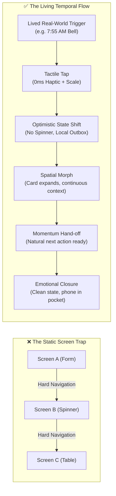
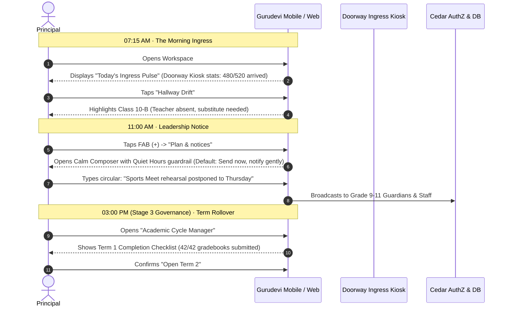
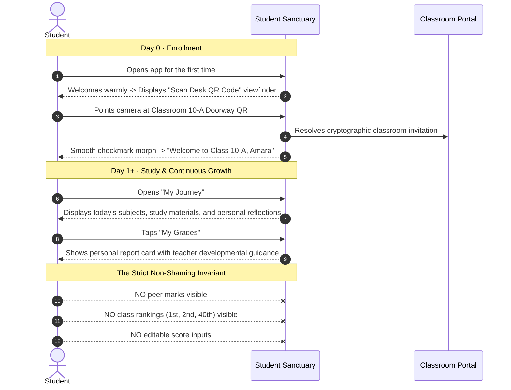
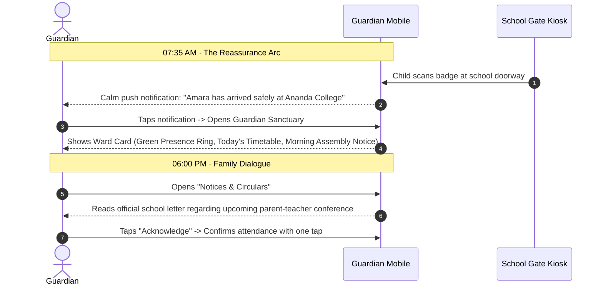

# The Living Flow: Temporal Interaction Choreography, Progressive Exposure & Lifecycle Architecture

> **Architectural Doctrine:**  
> Software does not exist as static screens or database rows; it is an unbroken, rhythmic continuum in clock time and human emotion. When an interface fails to connect tap-to-tap and hour-to-hour, it is like trying to sing when no sound comes out. This playbook defines the unified interaction design, temporal state management, and progressive disclosure standards across **Gurudevi Web** and **Gurudevi Mobile**.

---

## 1. The Interaction Glossary: From Static Screens to Living Flows

Traditional software specifications describe *what* screens exist. Human-centric software engineering describes *how time and momentum move through them*.



### Essential Lexicon

| Industry Term | Architectural Meaning in Gurudevi | Real-World Experience |
| :--- | :--- | :--- |
| **Critical User Journey (CUJ) / Golden Path** | The exact, unbroken tap-by-tap progression required to achieve a core human relief. | A teacher taking morning roll call in under 180 seconds with zero network friction. |
| **Day-in-the-Life (DiTL) Choreography** | The alignment of UI state and defaults with real circadian rhythms. | At 7:30 AM, the app defaults to Arrival/Kiosk; at 8:00 AM, to Attendance; at 2:00 PM, to Homework/Study. |
| **Progressive Disclosure / Exposure** | Showing only the minimum necessary controls on day 1; revealing advanced governance only as trust and complexity grow. | A new principal sees a 4-step school wizard; advanced academic cycle rollovers are hidden until needed. |
| **Kinetic Continuity & Spatial Consistency** | Visual and physical momentum where elements morph from their origin rather than flashing into existence. | Tapping a student card expands the card itself into their detail view; closing it collapses back to the grid. |
| **Tactile Acknowledgment (0ms Feedback)** | Confirming physical touch instantly via haptics and micro-scale ($0.97 \times$) before any network request starts. | When a teacher swipes "Present", the row clicks tactilely under the thumb instantly. |
| **Empty-State Elevation (Cold Start)** | Transforming empty screens from cold dead ends into warm, active on-ramps. | A student with no enrolled classes sees a prominent "Scan Desk QR" camera viewfinder, not "No data found." |
| **Temporal Posture (`Review` \| `Current` \| `Plan`)** | Shifting the interface's psychological mode based on whether the user is inspecting the past, acting today, or preparing tomorrow. | `Current` enables fast edits; `Review` seals records and hides edit inputs; `Plan` enables draft scheduling. |

---

## 2. The Tri-Stage User Lifecycle (Day 0 $\rightarrow$ Day 1+ $\rightarrow$ Day 30+)

User needs change radically across time. A screen built for Day 0 (configuration) will annoy a user on Day 100 (daily operational speed). We divide every institutional surface into three temporal stages:

```mermaid
stateDiagram-v2
    [*] --> Day0: First Launch / Enrollment
    Day0 --> Day1: Setup Complete & Verified
    
    state Day0 {
        direction LR
        Ushering: The Gentle Ushering
        Onboarding: Contextual Wizards
        EmptyElevate: Empty-State Elevation
        Ushering --> Onboarding --> EmptyElevate
    }

    state Day1 {
        direction LR
        Velocity: 2-Tap Rule (<180s)
        OfflineSync: Optimistic Outbox
        MuscleMemory: Zero-Clutter Focus
        Velocity --> OfflineSync --> MuscleMemory
    }

    state Day30 {
        direction LR
        Governance: Deep Structural Settings
        Cycles: Academic Term Rollover
        StaffShifts: Hierarchy Rebalancing
        Governance --> Cycles --> StaffShifts
    }

    Day1 --> Day30: Periodic Reconfiguration
    Day30 --> Day1: Return to Daily Rhythm
```

### Stage 1: Day 0 — The Gentle Ushering (First Run & Cold Start)
* **Goal:** Zero confusion, zero intimidation, warm human welcome.
* **Principles:**
  1. **Sensible Defaults over 50 Form Fields:** Auto-populate Sri Lankan national standards (Grade 1–13, Sections A/B/C, 3 Terms per Year). The user reviews and confirms rather than typing from scratch.
  2. **Step-by-Step State Preservation:** If the user gets interrupted on Step 3 of the School Creation Wizard, their drafts are saved locally in MMKV/localStorage. They never lose progress.
  3. **No Empty Dead Ends:** When an educator or student has zero classes, the UI elevates the setup action (e.g., `+ Create First Classroom`, `📱 Scan Classroom QR Code`) as the hero element.

### Stage 2: Day 1 to Day 365 — The High-Velocity Daily Rhythm (Habitual Practice)
* **Goal:** Maximum speed, zero latency, muscle memory, minimal battery/cognitive drain.
* **Principles:**
  1. **The 2-Tap Rule:** Any action repeated daily must be achievable in 2 taps from the app icon or home floor.
  2. **Offline-First Optimistic UI:** Never show a full-screen loading spinner for daily actions. Writes go to the local SQLite/MMKV buffer immediately; the UI acknowledges instantly and syncs in the background.
  3. **High-Density Focus:** Hide onboarding tutorials, welcome banners, and configuration links. Present only the operational active items for today.

### Stage 3: Day 30+ — On-Demand Governance (Deep Settings & Lifecycle Shifts)
* **Goal:** Structural safety, deliberate friction, non-destructive reversibility.
* **Principles:**
  1. **Tucked Away from Daily Friction:** Academic cycle management, term transitions, and faculty permissions are placed in the Principal's Management Station or Web Command Floor—never in the daily attendance or gradebook tabs.
  2. **Reversible Safety Gates:** Deleting a section, archiving a school year, or changing grade scales requires explicit confirmation and displays the blast radius ("This will affect 45 enrolled students").
  3. **Auditability:** Every structural change logs a transaction in the institutional audit ledger.

---

## 3. Role-by-Role Lived Interaction Choreographies

### A. The Principal & Institutional Leader



* **Tap-by-Tap Interaction Flow:**
  - **Launch:** Mobile opens directly to the Principal Cockpit. The top widget shows the **Real-Time Pulse** (arrived students, on-duty teachers).
  - **Action:** Floating Action Button (FAB) registers only high-level leadership options (`Manage Hierarchy`, `Manage Invites`, `School Logbook`, `Broadcast Notice`).
  - **Micro-Interaction:** Tapping `Manage Hierarchy` doesn't push a new route; it slides open the `HierarchyDashboard` with interactive level chips (Grades 1–13) that expand inline without context switching.

---

### B. The Teacher & Educator

```mermaid
sequenceDiagram
    autonumber
    actor T as Teacher
    participant M as Gurudevi Mobile
    participant Q as Offline Outbox Queue
    actor S as Student / Classroom

    Note over T, M: 07:55 AM · The 3-Minute Attendance Window
    T->>M: Enters Classroom 10-A, opens mobile app
    M-->>T: Detects 07:55 AM -> Instantly shows "Grade 10-A Attendance Register"
    T->>M: Swipes right on "Kavi Fernando" (Present)
    M-->>T: 0ms Haptic Tick + Row turns Saffron Green (Optimistic)
    T->>M: Swipes left on "Nila Sen" (Absent)
    M-->>T: Subtle dull haptic + Row turns soft amber
    M->>Q: Writes batch to local SQLite outbox (Zero network spinner)
    T->>M: Taps "Submit Roll Call" -> Pocket phone in under 60 seconds

    Note over T, M: 01:30 PM · Continuous Assessment Entry
    T->>M: Opens Gradebook tab
    M-->>T: Renders Assessment Grid with Sri Lankan O/L Scale (A, B, C, S, W)
    T->>M: Types marks on desktop keyboard (Up/Down arrow moves students; Enter commits)
```

* **Interaction & Ergonomic Craft:**
  - **Gesture Engine:** Swipe gestures run on the native UI thread via `Gesture.Pan()` and `react-native-worklets@0.13.0`—guaranteed 60fps even on a budget Android phone under hot battery conditions.
  - **Haptic Weight:** Present = `haptics.selection()` (crisp, positive tick); Absent = `haptics.notification('warning')` (soft, deliberate rumble).
  - **Desktop Keyboard Ergonomics:** In Web Gradebook, educators navigate using spreadsheet keys: `↑`/`↓` moves across rows, `Enter` confirms, `←`/`→` toggles between score and feedback columns. Zero mouse clicks required.

---

### C. The Student & Learner



* **Emotional Design & Non-Shaming Invariant:**
  - **Pedagogical Safety:** In line with Sri Lankan educational reform and modern pedagogical psychology, the student interface is completely sealed from competitive ranking. 
  - **Reflective Feedback:** Marks are accompanied by qualitative teacher feedback ("Demonstrated strong conceptual grasp in fraction geometry") and a quiet "Self-Reflection" button where the student can record private questions for tomorrow's teacher consultation.

---

### D. The Guardian & Family



* **Calm Technology & Reassurance:**
  - **Zero Alarmism:** The guardian app never presents red warning alerts for minor events. Absences are phrased constructively ("Amara has not been recorded at morning roll call. Tap here to submit an excuse note").
  - **Cryptographic Trust:** The guardian only ever sees their cryptographically bound wards. School-wide student lists, peer grades, and staff HR records are completely inaccessible.

---

## 4. Interaction Engineering & Feedback Decision Framework

Adopted from Emil Kowalski's Design Engineering philosophy and Apple Human Interface Guidelines:

### The Animation & Feedback Matrix

| Interaction Frequency | Visual Motion | Haptic Response | Audio / Sound |
| :--- | :--- | :--- | :--- |
| **High (100+/day)**<br>Keyboard nav, list scroll, tab switch | **Zero animation**.<br>Instant layout swap. | None | Silent |
| **Daily Habit (10–30/day)**<br>Swipe attendance, mark present, save mark | **Fast micro-motion** (120–160ms).<br>Scale $0.97 \rightarrow 1.0$ on active press. | `selection()` (crisp light tick) | Optional subtle tick |
| **Occasional (1–5/day)**<br>Modal open, notice compose, filter change | **Spatial spring** (200–260ms).<br>Elements expand from touch origin. | `impact('medium')` | Silent |
| **Rare / Milestone (Day 0, Term Rollover)**<br>School creation, term cycle close | **Celebratory narrative** (350–450ms).<br>Smooth checkmark morph, calm banner. | `notification('success')` | Gentle harmony |

### The Anti-Spinner Invariant

> **Law:** Never block the screen with a full-viewport spinning wheel for user-initiated writes.

1. **Optimistic Updates:** When an educator marks a student present, the UI updates *immediately* ($<16\text{ms}$).
2. **Local Outbox Queue:** The mutation is placed into the offline queue (`useMutationQueue`).
3. **Subtle Background Indicators:** If the connection is slow or offline, show a small, non-obtrusive badge in the header:  
   `[ ☁️ 3 changes pending sync ]`  
   The user never stops working or waits for a server response.
4. **Graceful Reconciliation:** If a mutation fails permanently (e.g. server validation conflict), surface a floating notification with an explicit `[ Review Conflict ]` CTA rather than blowing away local work.

---

## 5. Implementation Roadmap: Embedding in the Monorepo

| Target Package | Implementation Task | Substrate Files |
| :--- | :--- | :--- |
| **`@repo/ui`** | Implement `TactilePressable` with automatic scale ($0.97\times$) and platform-neutral haptics. | `packages/ui/src/primitives/Pressable.tsx`, `packages/ui/src/utils/haptics.ts` |
| **`@repo/classroom`** | Connect swipe attendance in `AttendanceScreen` to `useMutationQueue` with instant optimistic feedback. | `packages/classroom/src/screens/AttendanceScreen.tsx`, `packages/classroom/src/components/AttendanceSheet.tsx` |
| **`@repo/admin`** | Refactor `PrincipalDashboard` to prioritize **Today's Operational Pulse** during morning hours (07:00–09:00). | `packages/admin/src/screens/PrincipalDashboard.tsx`, `packages/admin/src/screens/PrincipalNativeWorkspace.tsx` |
| **`apps/gurudevi-web`** | Support spreadsheet keyboard ergonomics (`ArrowDown`, `Enter`, `ArrowRight`) across all tabular assessments. | `apps/gurudevi-web/app/(sanctuary)/workspace/gradebook/GradebookFloor.tsx` |
| **`apps/gurudevi-mobile`** | Elevate empty state in `StudentClassroomDashboard` to an interactive camera QR on-ramp when enrolled classes $= 0$. | `packages/classroom/src/screens/StudentClassroomDashboard.tsx`, `apps/gurudevi-mobile/src/lib/workspace/routeResolution.ts` |
