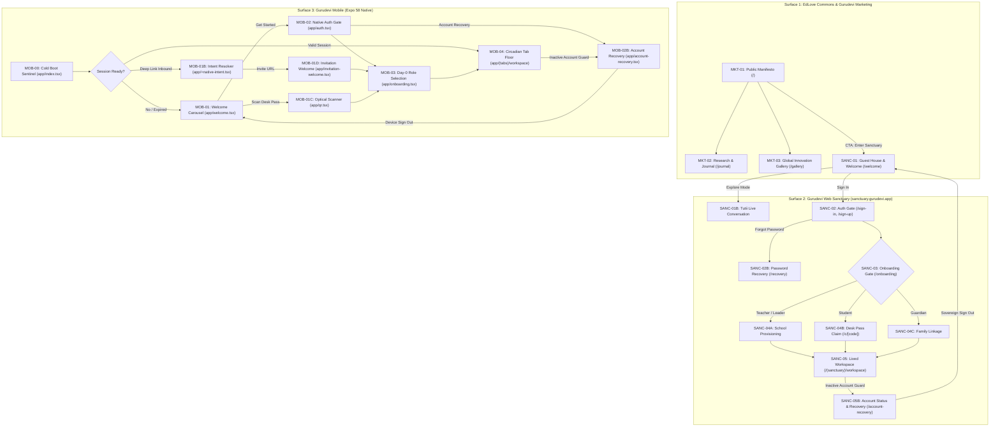

# Canonical Multi-Vector User Journey & Screen State Machine Architecture

> **THE CARDINAL INVARIANT: THE ROUTER IS A PASSIVE PROJECTION**  
> In modern multi-platform architectures (Next.js 16 App Router + Expo 58 React Native), the router is **never** the source of truth for journey logic. File-based routes (`page.tsx`, `screen.tsx`) and URLs are merely passive projections of a **Declarative State Machine (DAG)**.  
> Every screen exists in a multi-vector vector space: it has multiple inbound entry triggers, strict admission preconditions (guards), internal branched pathways (forks), and deterministic terminal convergence states.

---

## 1. The Anatomy of Screen Reality: Beyond Linear Assumptions

When developers or AI agents design software as linear checklists ("Screen 1 -> Screen 2 -> Screen 3"), software breaks. In production across web and native mobile, every screen is subject to four distinct topological dimensions:

```
                    ┌────────────────────────────────────────────────────────┐
                    │               1. INBOUND ENTRY VECTORS                 │
                    │  Cold Boot | Deep Link | Push Ping | QR Scan | In-App  │
                    └───────────────────────────┬────────────────────────────┘
                                                │
                                                ▼
                    ┌────────────────────────────────────────────────────────┐
                    │            2. ADMISSION GUARDS & BOUNCES               │
                    │    Authenticated? | Role Bonded? | Tenant Enrolled?    │
                    └───────┬────────────────────────────────────────┬───────┘
                            │ (Fail Guard)                           │ (Pass Guard)
                            ▼                                        ▼
             ┌──────────────────────────────┐         ┌──────────────────────────────┐
             │   RECOVERY / BOUNCE ROUTE    │         │      ACTIVE SCREEN STAGE     │
             │   (Auth Gate, Recovery, Pay) │         │   3. BRANCHED PATHWAYS (DAG) │
             └──────────────────────────────┘         │   • Primary Action           │
                                                      │   • Demo / Guest Exploration │
                                                      │   • Fallback / Retry Mode    │
                                                      └──────────────┬───────────────┘
                                                                     │
                                                                     ▼
                                                      ┌──────────────────────────────┐
                                                      │   4. TERMINAL CONVERGENCE    │
                                                      │   • Active Circadian Floor   │
                                                      │   • Sensory Celebration      │
                                                      │   • Clean Scaffold Dismissal │
                                                      └──────────────────────────────┘
```

### The 4 Topological Dimensions:
1. **Inbound Entry Vectors (Multi-Door Ingress):**
   A user never arrives only from "the previous screen". Ingress vectors include:
   - **Cold OS Launch:** App process spawned from scratch.
   - **Deep Link / Universal Link:** Inbound URL scheme (`gurudevi://invite/claim?code=ABC`, `https://sanctuary.gurudevi.app/c/ABC`).
   - **Push Notification:** User tapped a notification category (e.g. morning roll call).
   - **QR Sneakernet / Scanner:** Physical QR card scanned via camera or optical sneakernet.
   - **In-App Intent:** Navigating from GlobalHeader, Command Palette, or Tab Navigation.
   - **Auth Callback:** Redirect from OAuth (Google), magic link token, or password reset.
   - **Session Resume / Rehydrate:** App backgrounded for 4 hours, restored with stale or invalidated tokens.
   - **System Back / Hardware Gesture:** User swipes back on Android/iOS.

2. **Admission Preconditions (Guards & Gatekeeping):**
   Before a screen renders its primary UI, it must evaluate strict admission guards:
   - *Auth Guard:* Is there a valid active identity? (If not -> save intended destination to `redirectTo` and bounce to Auth Gate).
   - *Capacity / Bond Guard:* Does this user have the required role? (e.g. A Student attempting to load `/admin/analytics` fails closed -> bounce to `ForbiddenScreen` or default workspace).
   - *Data Prerequisite Guard:* Does this classroom have students? (If 0 -> render Day-0 Empty Scaffold; do not attempt to render uninitialized data grids).
   - *Hardware / Network Guard:* Requires camera for scanner? Offline and resource not cached? -> render graceful fallback view.

3. **Branched Pathways (Internal Flow DAGs):**
   Once admitted, user actions branch into mutually exclusive or concurrent states:
   - *Happy Path:* Complete action, mutate state, advance to next step.
   - *Exploratory / Guest Branch:* User selects "Try Demo" or "Guest House" -> renders mock or preview mode with Tutii accompaniment without mutating production DB.
   - *Failure / Retry Branch:* Offline submission stored in outbox -> displays pending badge and optimistic UI instead of throwing an unhandled exception.

4. **Terminal Convergence (Exit & Continuity):**
   Every journey must finish cleanly:
   - Transition to the active circadian floor (`/(tabs)/workspace`, `/(sanctuary)/workspace`).
   - Emit sensory feedback (Tutii glow, light haptic, subtle chime).
   - Update reactive scaffold storage (`useScaffoldDismissal`) so onboarding banners smoothly disappear and never haunt experienced users.

---

## 2. Real-World Engineering Benchmarks: How Elite Teams Manage This

How top engineering organizations (Stripe, Linear, Airbnb, Apple, Uber) prevent user journey chaos:

### A. The Actor-Authority / Passive Router Pattern
- **The Anti-Pattern (Spaghetti Navigation):** Leaf components calling `router.push('/target')` inside 40 different button handlers, with each component checking `if (!user) router.replace('/login')`.
- **The Elite Pattern:** An **Actor State Machine** (like XState or `@repo/core/flows`) owns the journey logic. The router is merely a passive renderer.
  - When a deep link arrives, the router dispatches `send({ type: 'DEEP_LINK_RECEIVED', url })`.
  - The state machine evaluates guards in a centralized transaction:
    ```typescript
    guards: {
      isEnrolled: ({ context }) => context.schoolId !== null,
      isAuthenticated: ({ context }) => context.session !== null,
    }
    ```
  - The UI subscribes to `currentStep` and displays the matching view.

### B. The Deep Link Intent Resolver (Stripe & Uber)
When a deep link arrives, Stripe/Uber do not blindly navigate to the target route. They pass the URL through an **Intent Resolver Pipeline**:
1. **Deconstruct Intent:** Parse target resource (`classroom:123`), action (`claim`), and auth tokens.
2. **Snapshot Context:** Check current active account on device.
3. **Resolve Intent:**
   - Case A: User logged in, account matches -> proceed directly to screen.
   - Case B: User logged in, account differs -> prompt account switch dialog ("Switch to School Account?").
   - Case C: User unauthenticated -> stash intent in encrypted local storage (`pending_deep_link`), route to Auth, resume immediately upon successful session creation.

### C. The Day 0 -> Day 1 Lifespan State Machine (Linear & Superhuman)
- **Day 0 (Scaffolded):** Heavy tooltips, Tutii guide mascot active, step-by-step progress cards.
- **Day 1–29 (Circadian):** Clean operational tools, 0ms latency, compact tables, minimal distraction.
- **Day 30+ (Mastery):** Keyboard shortcuts enabled, batch actions, audit logs visible.

---

## 3. The 7 Developer Cries & AI Era Pitfalls

Why user journeys break when AI agents generate code without architectural guardrails:

| # | The Dev Cry / Symptom | The Silent Mechanism (What Actually Happened) | The Architectural Remedy |
|---|---|---|---|
| **1** | *"Deep Link Hell: Users open an invite link and see a blank white screen."* | The leaf component tried to query Supabase/PowerSync before the root layout completed auth hydration. | **Intent Buffer**: Deep links are held in `PendingIntentQueue` until `AuthSessionState === 'ready'`. |
| **2** | *"Infinite Redirect Loop on Web."* | Page A redirects to Page B if `!role`, but Page B checks `!profile` and redirects to Page A. | **Hierarchical DAG Validator**: `audit-flow-dag.mjs` verifies that fallback edges never form cycles. |
| **3** | *"The Ghost Screen: Screen exists in code, but no user can ever reach it."* | Agent created `invitation-welcome.tsx`, but no button, link, or route manifest ever pushes to it. | **Unwired Route Sentinel**: Static analysis enforces that every route in `app/` is referenced by at least 1 flow trigger. |
| **4** | *"Back Button Trap on Android."* | User goes `Welcome -> Login -> Onboarding -> Workspace`. They press hardware back on Workspace and get sent back into Onboarding. | **Replace vs Push Invariant**: Transitions across lifecycle boundaries must use `router.replace()`, never `router.push()`. |
| **5** | *"OAuth Callback State Amnesia."* | User was in the middle of filling out a 3-step school setup, clicked "Sign in with Google", and post-redirect was dumped on the home screen, losing all form data. | **Draft Persistence**: Step context is saved to local-first storage (`MMKV`/`localStorage`) before leaving for external OAuth. |
| **6** | *"Role Leakage: Student sees teacher buttons."* | Guard logic was implemented as client-side CSS hiding (`display: none` or conditional button render) instead of route-level capability dispatch. | **Role-Dedicated Surfaces**: Separate `StudentLearnerHub` and `TeacherStudioCanvas` surfaces; never share branching monoliths. |
| **7** | *"The Zombie Onboarding Banner."* | User has been using the app for 6 months, but the "Welcome to Gurudevi! Click here to add your first student" banner still shows up every morning. | **Reactive Scaffold Dismissal**: `useScaffoldDismissal(key, threshold)` automatically sets persistent dismissal flags upon first successful mutation. |
| **8** | *"The Inactive Account Loop & Recovery Conflation."* | User with a server-deactivated account visits web or clicks account recovery and is either dumped into password reset or trapped on an inline error card with no way to sign out or switch accounts. | **Dual-Meaning Separation**: Separate Credential Recovery (`/recovery` email reset) from Account Lifecycle Recovery (`/account-recovery`), providing sovereign sign-out and retry controls. |

---

## 4. The Unified Gurudevi Ecosystem Entry Topology

Mapping the core platform surfaces into explicit entry state machines:



---

## 5. Implementation Standard for New Journeys

Whenever designing, reviewing, or implementing any user journey:

1. **Declare the Flow Spec First:** Create `packages/core/src/flows/<domain>/<name>.flow.ts` conforming to `FeatureJTBDGraph`.
2. **Register in `FLOW_REGISTRY`:** Add to `packages/core/src/flows/index.ts`.
3. **Verify Route DAG:** Run `node scripts/audit-flow-dag.mjs` to ensure zero broken links, zero orphan routes, and zero cyclic traps.
4. **Enforce Boundary Invariants:**
   - Inbound triggers declared and verified.
   - Admission guards tested with failure mock.
   - Terminal completion tied to `useScaffoldDismissal`.

