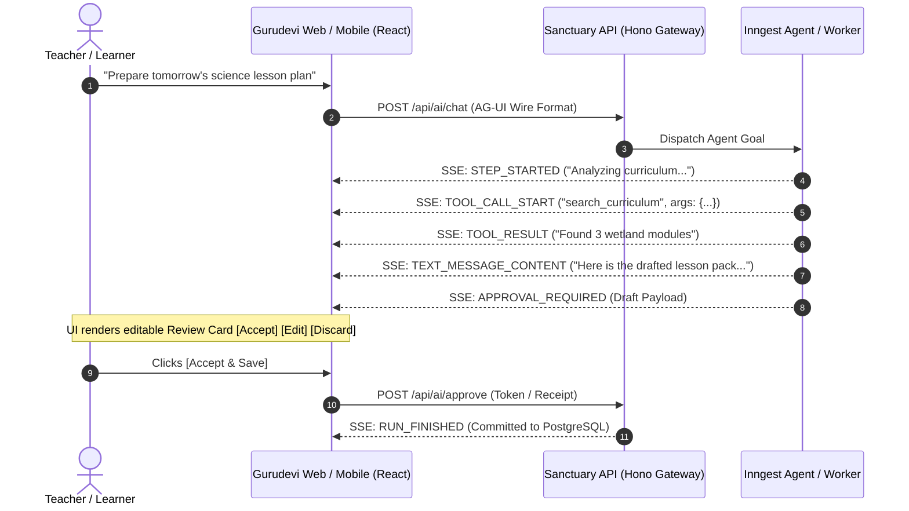

# The Architectural Blueprint: What AG-UI Is & How to Make Sense of the AI Stack

> **Canonical Architecture Guide**  
> **Status:** Active Standard  
> **Scope:** Cross-Platform Architecture (`apps/sanctuary-api`, `apps/gurudevi-mobile`, `apps/gurudevi-web`, `packages/ai`)  
> **Questions Answered:**
> 1. *What exactly is the AG-UI protocol and why does it exist?*
> 2. *With so many tools existing for every layer (infra, middleware, runtime, UI), how do we make sense of the layers, select tools without bloat, and wire them end-to-end to the user?*

---

## Part 1: What is the AG-UI Protocol?

### 1. The Core Problem: The Breakdown of Traditional Chat Streams
In Generation 2 (Chat), streaming text from an LLM to a frontend was simple:
$$\text{Server} \xrightarrow{\text{SSE Token Deltas}} \text{Client Markdown Renderer}$$

However, with **Generation 4 Autonomous Agents**, this simple text stream completely breaks down because agents do much more than output words:
* An agent runs multi-step planning loops.
* An agent executes tools (fetching database rows, calculating attendance, generating a rubric).
* An agent spawns subagents or delegates tasks.
* An agent pauses and waits for a human to approve an action.
* An agent updates application state (e.g. populating a form or changing a calendar).

Without a standard, every AI framework invented its own custom, brittle JSON dialect to transmit tool calls, thoughts, and approval gates. 

### 2. What AG-UI Actually Is
**AG-UI (Agent-User Interaction Protocol)** is an **open, lightweight, event-driven wire protocol** (standardized in late 2026 at `ag-ui.org` by CopilotKit, LangChain, CrewAI, Mastra, and Microsoft) that defines a universal language between **Any Agent Backend** and **Any Frontend Client**:

```
┌────────────────────────────────────────────────────────────────────────────────────────┐
│                               THE AG-UI PROTOCOL EVENT STREAM                          │
├────────────────────┬─────────────────────────────────┬─────────────────────────────────┤
│ Event Family       │ Event Name Examples             │ What It Tells the Client UI     │
├────────────────────┼─────────────────────────────────┼─────────────────────────────────┤
│ 1. Lifecycle       │ `RUN_STARTED`, `RUN_FINISHED`,  │ "Agent is working / finished;   │
│                    │ `STEP_STARTED`, `STEP_FINISHED` │ show progress bar & step time"  │
├────────────────────┼─────────────────────────────────┼─────────────────────────────────┤
│ 2. Text Stream     │ `TEXT_MESSAGE_START`,           │ "Stream this markdown text      │
│                    │ `TEXT_MESSAGE_CONTENT`          │ into the chat bubble"           │
├────────────────────┼─────────────────────────────────┼─────────────────────────────────┤
│ 3. Tool Calls      │ `TOOL_CALL_START`,              │ "Show a tool card: 'Searching   │
│                    │ `TOOL_CALL_ARGS`, `TOOL_RESULT` │ attendance records... [Done]'"  │
├────────────────────┼─────────────────────────────────┼─────────────────────────────────┤
│ 4. Human Approval  │ `APPROVAL_REQUIRED`,            │ "Halt execution; render review  │
│                    │ `APPROVAL_RESPONSE`             │ card with [Accept] / [Discard]" │
├────────────────────┼─────────────────────────────────┼─────────────────────────────────┤
│ 5. State Sync      │ `STATE_SNAPSHOT`, `STATE_DELTA` │ "Sync JSON state into the page; │
│                    │                                 │ update the form fields live"    │
└────────────────────┴─────────────────────────────────┴─────────────────────────────────┘
```



### 3. Why AG-UI Matters for the Polymath Platform
Notice in `apps/sanctuary-api/src/ai/routes.ts`:
* Today, we already parse `WireMessage` and look for `chunk.type === 'TEXT_MESSAGE_CONTENT'` and `RUN_FINISHED`.
* By aligning our streaming endpoints with the **AG-UI standard**, our backend can stream tool execution progress, thinking steps, and human-in-the-loop review cards to both Next.js Web and Expo Mobile without writing fragile, custom JSON parsers.

---

## Part 2: How to Make Sense of the Layers & Wire the Stack

The overwhelming number of tools in AI (Inngest, n8n, LangChain, Mastra, CopilotKit, oRPC, Hono, Supabase, ZenStack, PowerSync) occurs because developers confuse **where each tool belongs in the architectural stack**.

To bring total sanity to your architecture, we enforce **The 6-Layer Sovereign AI Stack**:

```
┌────────────────────────────────────────────────────────────────────────────────────────┐
│                              THE 6-LAYER SOVEREIGN AI STACK                            │
├────────────────────────────────┬───────────────────────────┬───────────────────────────┤
│ Layer                          │ Primary Responsibility    │ Approved Monorepo Tool    │
├────────────────────────────────┼───────────────────────────┼───────────────────────────┤
│ Layer 6: User Experience (UI)  │ Render screens, cards,    │ Expo 58 (Mobile RN 0.88), │
│                                │ review buttons, canvas    │ Next.js 16 (App Router)   │
├────────────────────────────────┼───────────────────────────┼───────────────────────────┤
│ Layer 5: Protocol & Bridge     │ Streaming wire events,    │ AG-UI Protocol (over SSE) │
│                                │ UI state synchronization  │ & oRPC Typed Procedures   │
├────────────────────────────────┼───────────────────────────┼───────────────────────────┤
│ Layer 4: Cognitive Brain       │ Intent understanding,     │ Multi-Provider Router:    │
│          (Intelligence)        │ reasoning, tool planning  │ Gemini, Claude, DeepSeek  │
├────────────────────────────────┼───────────────────────────┼───────────────────────────┤
│ Layer 3: Durable Execution     │ Background queues,        │ Inngest Core + AgentKit   │
│          (The Spine)           │ retries, checkpoints      │ (step.run, sleep, wait)   │
├────────────────────────────────┼───────────────────────────┼───────────────────────────┤
│ Layer 2: API Gateway & Policy  │ Auth, Cedar policy, rate  │ Hono + oRPC + Cedar Rust  │
│          (The Sovereign Gate)  │ limits, budget ledgers    │ (@repo/core, sanctuary-api)│
├────────────────────────────────┼───────────────────────────┼───────────────────────────┤
│ Layer 1: Data & Domain Core    │ Source of truth, tables,  │ PostgreSQL / Supabase,    │
│          (Physical Substrate)  │ offline local storage     │ ZenStack, PowerSync SQLite│
└────────────────────────────────┴───────────────────────────┴───────────────────────────┘
```

---

## Part 3: The 4 Golden Rules for Choosing Tools Without Bloat

Whenever a new tool or framework emerges on Twitter or Hacker News, test it against these four architectural filters before writing a single line of code:

### Rule 1: The Single-Owner Invariant (One Tool per Layer)
* **The Failure:** Using Inngest for queues, n8n for workflows, Mastra for agents, and Celery for tasks. You now have 4 state machines, 4 dashboards, and 4 failure points.
* **The Law:** **Pick exactly ONE champion per layer.**
  - *Layer 3 (Execution):* **Inngest** owns all asynchronous execution, period. Reject n8n, LangGraph, and Celery.
  - *Layer 1 (Database):* **PostgreSQL + SQLite (PowerSync)** owns all truth. Reject Neo4j / GraphRAG until relational indexing fails measurable benchmarks.

### Rule 2: The Inversion of Authority (Frameworks Never Touch Data)
* **The Failure:** Giving an agent library (Mastra or LangChain) direct credentials to your SQL database to run queries autonomously.
* **The Law:** **The Agent is a Client, not the Database Admin.**
  - An agent must talk to Layer 2 (The Sovereign Gate) using strictly typed procedures (oRPC / Capability Projections).
  - The API verifies Cedar permissions and school tenancy. The agent never bypasses domain logic.

### Rule 3: The Economic Feasibility Gate
* Before adopting any Layer 4 tool, classify its computational generation:
  - **Gen 1 (Inngest Worker):** Safe for mass usage ($O(1)$ flat compute).
  - **Gen 2/3 (Routed Stream):** Safe for all users with bounded token limits ($O(\text{Tokens})$).
  - **Gen 4 (Autonomous Loop):** Restrict to **Pro / Institutional tiers** with hard **Pre-Reserved Token Caps** to prevent platform bankruptcy.

### Rule 4: The Convivial Limit (Human In The Loop)
* An agent can search, read, calculate, and draft in the background.
* But when an action affects human lives (marking attendance, publishing grades, sending guardian notices), the system **MUST halt at Layer 5/6 and present an [Accept] / [Edit] / [Discard] Review Card**.
* A natural language sentence from an LLM is never an authoritative database commit.

---

## Part 4: How It All Wires Together End-to-End

Here is how data flows from the phone/browser all the way to the background models and back to the human:

```
[User on Phone / Web]
       │
       ▼ (Taps: "Draft Weekly Attendance & Lesson Pack")
[Layer 6: Mobile / Web UI]
       │
       ▼ (Sends typed RPC with Auth Token)
[Layer 2: Sanctuary API Gateway (Hono + oRPC)]
       │  ├── 1. Validates JWT & School Identity
       │  ├── 2. Checks Pro Entitlement (usePremiumStatus)
       │  └── 3. Pre-reserves 15,000 Token Cap in PostgreSQL Ledger
       │
       ▼ (Dispatches Event: "teacher.lesson_pack.requested")
[Layer 3: Inngest Durable Execution Spine]
       │
       ├── Step 1 (step.run): Queries PostgreSQL for Class Curriculum
       │
       ├── Step 2 (step.run): Invokes Layer 4 Model (Claude / Gemini)
       │   └── Cognitive Loop: Model reads curriculum, plans lesson, drafts check-ins
       │
       ├── Step 3 (step.waitForEvent): Pauses & Emits AG-UI Event
       │
       ▼ (Streams over SSE via Layer 5 AG-UI Protocol)
[Layer 6: Mobile / Web Screen Renders Review Card]
       │
       ├── Shows: Drafted 45-min lesson + 3 reflective check-in questions
       ├── Shows: Token cost & provider badge
       │
       ▼ (Teacher clicks: [Accept & Publish])
[Layer 2: Sovereign Gate Commits to PostgreSQL]
       │
       ▼ (Returns Signed Transaction Receipt)
[Teacher Continues Class with Complete Agency Restored]
```

By following this 6-layer architecture, every tool has an exact, non-overlapping job, and your platform remains secure, economically viable, and deeply aligned with human dignity.
