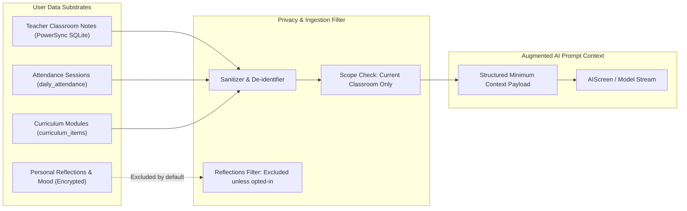

# Architectural Specification: AIScreen Ingress Vectors, FAB Rewind/Incognito, Community DM & User Data Ingestion

> **Scope:** Cross-Platform Architecture (`apps/gurudevi-mobile`, `apps/gurudevi-web`, `packages/ui`, `packages/schema`, `apps/sanctuary-api`)  
> **Status:** Implementation Blueprint  
> **Core Directives Codified:**
> 1. **Screen Naming Mandate:** The screen is named strictly **`AIScreen`** (route `/ai-assistant` or `/ai`). Do NOT create a "Tutii" named screen. Tutii is solely an ambient visual mascot, and durable agent mechanisms remain internal platform infrastructure.
> 2. **Two Primary Ingress Vectors:**
>    - **Vector A: The Global FAB (Floating Action Button):** Ephemeral & quick-access overlay with **Session History / Rewind Clock** and **Incognito Mode**.
>    - **Vector B: Community Direct Message (DM):** Persistent, long-term conversational memory with an AI persona inside `DirectConversation`.
> 3. **The User Data Ingestion Pipeline:** Unlocking the least-developed part of the application—ingesting user notes, reflection journals, and classroom context into bounded AI assistance without privacy leaks.

---

## 1. Naming & Boundary Architecture (The "No Tutii Screen" Rule)

```
┌────────────────────────────────────────────────────────────────────────┐
│                        SCREEN & PERSONA BOUNDARIES                     │
├─────────────────────┬──────────────────────────────────────────────────┤
│ Concept             │ Approved Naming & Location                       │
├─────────────────────┼──────────────────────────────────────────────────┤
│ Screen Component    │ `AIScreen.tsx` (in `@repo/ai` or `@repo/ui`)     │
│ Mobile Route        │ `apps/gurudevi-mobile/app/a-i-assistant.tsx`     │
│ Web Route           │ `apps/gurudevi-web/app/(sanctuary)/ai/page.tsx`  │
│ Visual Mascot       │ Tutii is only an *avatar/mascot* rendered inside │
│                     │ the screen (resting, thinking, guiding states).  │
│ Durable Workflows   │ Strictly internal platform plumbing (Inngest).   │
│                     │ Never expose raw "durable-agents" jargon to user.│
└─────────────────────┴──────────────────────────────────────────────────┘
```

---

## 2. Ingress Vector A: The Global Floating Action Button (FAB)

The Floating Action Button (`packages/ui/src/components/LotusPetalFAB.tsx` and `FABContext.tsx`) provides universal, ambient access across all screens.

```
┌────────────────────────────────────────────────────────────────────────┐
│                        FAB QUICK-ACCESS OVERLAY                        │
├────────────────────────────────────────────────────────────────────────┤
│  [⏪ History / Rewind Clock]   [🕵️ Incognito Toggle]       [✕ Close]   │
├────────────────────────────────────────────────────────────────────────┤
│                                                                        │
│                ┌───────────────────────────────────┐                   │
│                │   [ Chat ]    │   [⚡ Agent 🔒]   │                   │
│                └───────────────────────────────────┘                   │
│                                                                        │
│  [Tutii Avatar: Attentive Gaze]                                        │
│  "What can I help you work through right now?"                         │
│                                                                        │
│  [Quick Action Pills: Rewind, Summarize Today, Brainstorm Lesson]      │
│                                                                        │
│  ┌──────────────────────────────────────────────────────────────────┐  │
│  │ 💬 Ask anything or assign a task...                 [🎙️]  [➤]    │  │
│  └──────────────────────────────────────────────────────────────────┘  │
└────────────────────────────────────────────────────────────────────────┘
```

### Key FAB Features:
1. **The Rewind Clock (`⏪ History`):**
   - Clicking the rewind clock opens a slide-over panel displaying past ephemeral sessions from `model AiMessage`.
   - Allows users to jump back in time to inspect or resume an earlier brainstorming thread.
2. **Incognito Mode Toggle (`🕵️ Incognito`):**
   - Toggling Incognito sets `privacy_mode = "incognito"` in the request context (`aiStreamClient.ts` / `useAIAgent.ts`).
   - In Incognito mode:
     - No messages are written to the `ai_messages` table.
     - The AI context window runs strictly in-memory and is discarded when the FAB closes.
     - Protects sensitive personal reflections and student private journals from persistent logging.
3. **Top Segmented Pill:**
   - **`[ Chat ]`**: Instant conversational responses (Gen 2/3).
   - **`[ ⚡ Agent 🔒 ]`**: Gated behind `usePremiumStatus()`. If unlocked, allows delegating a multi-step background mission with an Inngest checkpoint.

---

## 3. Ingress Vector B: Community Direct Message (DM to AI)

Unlike the quick-access FAB overlay, the **Community DM** is designed for **deep, persistent, long-term conversations**.

```
┌────────────────────────────────────────────────────────────────────────┐
│                   COMMUNITY DIRECT MESSAGES (DM VIEW)                  │
├────────────────────────────────────────────────────────────────────────┤
│  [← Back]               Tutii Assistant              [ℹ️ Info / Clear] │
├────────────────────────────────────────────────────────────────────────┤
│                                                                        │
│  [Yesterday, 4:15 PM]                                                  │
│  Teacher: "Can you help me design a rubric for fraction word problems?"│
│                                                                        │
│  Tutii: "Here is a 4-tier rubric focusing on concept, computation,     │
│          and real-world modeling: [View Rubric Card]"                  │
│                                                                        │
│  [Today, 8:30 AM]                                                      │
│  Teacher: "Grade 5 struggled with question 3 on the rain gauge data."  │
│                                                                        │
│  Tutii: "I noticed that. Based on yesterday's rubric, here is a quick  │
│          5-minute review prompt you can use at the start of class..."  │
│                                                                        │
│  ┌──────────────────────────────────────────────────────────────────┐  │
│  │ Message Tutii...                                          [Send] │  │
│  └──────────────────────────────────────────────────────────────────┘  │
└────────────────────────────────────────────────────────────────────────┘
```

### Schema & Data Mechanics for DM:
* **Reuses `model DirectConversation` & `model DirectMessage`:**
  - In `schema.zmodel`, `DirectConversation` links `user1_id` and `user2_id`.
  - A reserved system bot ID (e.g., `00000000-0000-0000-0000-000000000001` or `auth_identities` AI subject) represents the AI companion.
  - Every message sent in this thread persists into `direct_messages`, allowing full conversation persistence across devices via PowerSync.
* **Persistent Memory:**
  - When the user sends a message in this DM, the server pulls the last 15 messages from `direct_messages` as conversation context.
  - Feels like messaging a trusted mentor colleague who remembers previous discussions.

---

## 4. The User Data Ingestion Pipeline (The Missing Pillar)

You accurately noted that **user data ingestion** is the least developed part of the application. Today, the AI does not know what is in the teacher's lesson notes, attendance logs, or student journals.

To solve this safely without violating student privacy or leaking secrets, we define the **Bounded Ingestion Seam**:



### Ingestion Rules:
1. **Curated Scope:** When a teacher opens the AI from the Classroom tab, the client injects only the active `classroomId`, current term, and recent attendance statistics into the request context.
2. **Private Reflections are Sacrosanct:** Personal mood entries and private reflections in `packages/self` are **never** ingested into institutional AI prompts by default.
3. **Structured Context Injection:** Data is passed as verified JSON metadata inside `RequestContext` (in `apps/sanctuary-api/src/ai/routes.ts`), so the model does not have to guess names or dates.

---

## 5. Implementation Order

1. **Step 1: AIScreen Core Component**  
   Create the unified `AIScreen.tsx` in `@repo/ui` with the top segmented pill (`Chat` vs. `Agent 🔒`), Rewind history drawer, and Incognito mode toggle.
2. **Step 2: Connect the Global FAB**  
   Update `packages/ui/src/context/FABContext.tsx` and `LotusPetalFAB.tsx` to provide a direct trigger to open `AIScreen`.
3. **Step 3: Wire Community DM Bot**  
   Add a default "Tutii Assistant" conversation thread inside the Community Direct Messages view, persisting messages to `direct_messages`.
4. **Step 4: Connect User Data Context**  
   Allow `AIScreen` to accept an optional `classroomContext` or `lessonContext` prop so that opening it from a classroom automatically injects current curriculum data.
