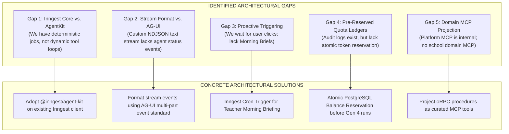

# Temporal Grounded Audit: The Agentic State-of-the-Art vs. The Polymath Platform

> **Temporal Baseline:** October 29, 2026  
> **Grounding Method:** Temporal Grounded Search (Velocity Surfaces, Official Release Logs, Commit Diff Histories, RFC Specifications)  
> **Substrates Inspected:**
> - `inngest/agent-kit` & Inngest Durable Execution Engine
> - `mastra-ai/mastra` 1.0.0 & Server Adapters (`@mastra/hono`)
> - `rivet-dev/rivet` Actors & `@rivet-dev/workflows`
> - `CopilotKit/OpenDuet`, `CopilotKit/CopilotKit` & AG-UI 1.0 Protocol
> - Anthropic Claude Duet (Announced Oct 21, 2026)
> - Cursor Agent SDK (`@cursor/agent-sdk`)
> - Polymath Monorepo (`apps/sanctuary-api`, `apps/gurudevi-mobile`, `apps/gurudevi-web`, `packages/ai`, `docs/Core/`)

---

## 1. Executive Ground Truth: The Late-October 2026 Wave

Between September and October 2026, the artificial intelligence landscape completed a decisive phase transition from **Generation 2 (Synchronous Ping-Pong Chat)** to **Generation 4 (Proactive, Enduring Autonomous Agents)**:

```
┌────────────────────────────────────────────────────────────────────────────────────────┐
│                        THE OCTOBER 2026 AGENTIC PHASE TRANSITION                       │
├─────────────────────────┬──────────────────────────────┬───────────────────────────────┤
│ Dimension               │ Traditional LLM Chat (Gen 2) │ Proactive Autonomous (Gen 4)  │
├─────────────────────────┼──────────────────────────────┼───────────────────────────────┤
│ Initiation              │ Reactive (User types prompt) │ Proactive (Morning Briefs)    │
│ Presence                │ Ephemeral (Dies on close)    │ Cloud VM / Durable Worker     │
│ Work Duration           │ Seconds (Single turn)        │ Hours / Days (Long-running)   │
│ Tooling Standard        │ Ad-hoc function calling JSON │ Model Context Protocol (MCP)  │
│ UI Protocol             │ Plain markdown SSE stream    │ AG-UI Protocol (Multi-part)   │
│ Economic Guardrail      │ Simple token counter         │ Pre-reserved Task Budgets     │
│ Authority Boundary      │ Model claims it "did it"     │ Human-in-the-Loop Review Card │
└─────────────────────────┴──────────────────────────────┴───────────────────────────────┘
```

---

## 2. Deep Dive: Facts, Modernity & Future Directions of Key Frameworks

### A. Inngest & AgentKit (`@inngest/agent-kit`)
* **Current Modernity (Late 2026):**
  Inngest released **AgentKit** (`@inngest/agent-kit`), an open-source TypeScript agent framework built directly on top of Inngest’s durable execution engine.
* **Core Technological Facts:**
  1. **Dual Routing (Deterministic + Autonomous):** Instead of choosing between a rigid workflow and a wild agent, AgentKit allows developers to construct **Networks** managed by routers with shared network states.
  2. **Model Agnostic & Native MCP:** Native integration with OpenAI, Anthropic, Gemini, and seamless loading of **Model Context Protocol (MCP)** tools.
  3. **UI Streaming Hook (`useAgent` / `useChat`):** Uses `@inngest/use-agent` to stream intermediate thoughts, tool execution cards, and token deltas directly to React frontends.
  4. **Durable Recovery:** If an agent loop crashes on step 8 due to a model rate limit or network drop, it resumes execution from step 8 using Inngest’s memoized checkpoints.
* **Future Direction:**
  Deepening multi-agent network topologies where specialist agents collaborate asynchronously, with automated trace-level eval benchmarks and human-in-the-loop approvals (`step.waitForEvent`).
* **Fit for Gurudevi:** **Exceptional.** The Sanctuary API already has Inngest installed. Adopting `@inngest/agent-kit` requires **zero new runtime infrastructure**.

---

### B. Mastra 1.0 (`@mastra/core`, `@mastra/hono`)
* **Current Modernity (Late 2026):**
  Mastra evolved from early v0 drafts into a modular 1.0 framework with first-class server adapters (`@mastra/hono`, `@mastra/express`).
* **Core Technological Facts:**
  1. **In-Process Embeddability:** Can be mounted directly inside our Hono application without running a separate orchestrator server.
  2. **Supervisor Pattern:** Supports supervisor agents that delegate sub-tasks to specialized worker agents, managing loops and shared memory via `stream()` and `generate()`.
  3. **`@mastra/connect`:** End-user OAuth connections allowing agents to access third-party services on behalf of specific users with strict token isolation.
  4. **Workspace API:** Provides sandbox execution, keyword/semantic search, and `SKILL.md` parsing with approval gates.
* **Future Direction:**
  Enterprise observational memory with token-threshold routing (swapping cheaper models dynamically based on context size) and span metric analytics.
* **Fit for Gurudevi:** **Redundant with Inngest.** While Mastra’s Hono adapter is clean, adopting Mastra alongside Inngest creates duplicate workflow and state-management engines. Inngest already owns our background execution spine.

---

### C. Rivet (Actors & Workflows)
* **Current Modernity (Late 2026):**
  Rivet (`rivet.dev` / `rivet-dev/rivet`) is **not** a visual prompt editor; it is a high-density **Actor runtime** and durable workflow system (`@rivet-dev/workflows`).
* **Core Technological Facts:**
  1. **Stateful Micro-Actors:** Pack state, an embedded SQLite database, a messaging queue, and real-time connectivity into a single addressable entity (6.9 ms cold starts, ~72 KB RAM overhead).
  2. **Durable Workflows:** Written as standard asynchronous TypeScript functions where `ctx.step(...)` results are cached, allowing crash replays to pick up exactly where they stopped.
  3. **Hibernation:** Actors automatically hibernate when idle and wake on inbound webhooks or socket messages.
* **Future Direction:**
  Edge deployment on Cloudflare Workers / Fly.io as a lightweight alternative to heavy Kubernetes actor clusters.
* **Fit for Gurudevi:** **Niche / Defer.** While technically impressive, our local-first persistence is already owned by **PowerSync + SQLite (op-sqlite/wa-sqlite)** and our cloud backend runs on PostgreSQL. Introducing a third stateful actor substrate is an anti-pattern.

---

### D. CopilotKit, AG-UI & OpenDuet
* **Current Modernity (Late 2026):**
  CopilotKit spearheaded the **AG-UI (Agent-User Interaction) 1.0 Protocol** and released **OpenDuet** (Oct 27, 2026), an open-source template for proactive AI coworkers.
* **Core Technological Facts:**
  1. **AG-UI Protocol:** An open standard using Server-Sent Events (SSE) to stream structured agent events: status shifts, tool call visualizations, human approval cards, and partial generative UI diffs.
  2. **OpenDuet Architecture:** Built on OpenBot, Docker-based bot computers, and CopilotKit Intelligence. Designed to connect to user accounts and execute long-running background tasks.
  3. **Human-in-the-Loop Action Cards:** First-class UI primitives for requesting human confirmation before executing sensitive mutations.
* **Future Direction:**
  Standardizing cross-platform agent UI components across Web, React Native, Slack, and Microsoft Teams.
* **Fit for Gurudevi:** **Adopt the Protocol Patterns, Reject the Docker Bloat.** OpenDuet’s assumption of heavy Docker "bot computers" is completely incompatible with mobile devices (Samsung Galaxy A52) and local-first schools. However, its **AG-UI event protocol** and **proposal-review interaction cards** are ideal blueprints for our client UI.

---

### E. Claude Duet (Anthropic, Oct 21, 2026)
* **Current Modernity (Late 2026):**
  Anthropic's flagship proactive consumer agent, operating on **Claude Opus 5.5** in a dedicated cloud VM with browser access.
* **Core Technological Facts:**
  1. **The Morning Brief:** Duet scans connected channels (Gmail, Slack, Calendar) at dawn and presents a synthesized briefing card of items requiring human decision.
  2. **Continuous Background Execution:** Runs on cloud VMs even when the user’s phone is off or disconnected.
  3. **Mandatory Approval Gates:** Automatically refuses to perform irreversible mutations (sending emails, deleting files, processing payments) without explicit human confirmation.
  4. **Plan Limit Economics:** Background monitoring and tasks consume the user’s standard Pro/Max plan quota.
* **Fit for Gurudevi:** **The Benchmark Product Model.** Claude Duet proves that the "Proactive Morning Brief + Human Approval Gate + Pro Quota Gating" model is the gold standard for user trust and financial viability.

---

### F. Cursor Agent SDK (`@cursor/agent-sdk`)
* **Current Modernity (Late 2026):**
  Cursor formalized agent development into **Agents as Code**, providing local testing harnesses and CI evaluation suites.
* **Core Technological Facts:**
  1. **Declarative Definitions:** Agents defined via structured folders with Markdown instructions (`instructions.md`), typed TypeScript tools, and MCP connections.
  2. **CI Evals (`agent-sdk eval`):** Asserting that prompt changes do not cause tool-calling regressions by replaying historical test runs.
* **Fit for Gurudevi:** **Internal Developer Standard.** Highly valuable for hardening our sovereign dev tools (`@repo/platform-mcp`), but not intended as an end-user educational agent runtime.

---

## 3. The Comprehensive Technology Matrix

| Technology | Category | Architectural Stance | Production Modernity | Gurudevi Platform Recommendation |
| :--- | :--- | :--- | :--- | :--- |
| **Inngest AgentKit** | Agent Runtime & Durable Engine | Durable event-driven step loops + MCP | **High (Late 2026)** | ✅ **Primary Agent Runtime:** Extends our existing Inngest substrate with zero added infrastructure. |
| **Mastra 1.0** | Agent Orchestration Framework | In-process server adapter + Supervisor | **High (1.0 Release)** | ⏸️ **Reject/Defer:** Redundant with Inngest; avoid dual-engine sprawl. |
| **Rivet Workflows** | Virtual Actor Runtime | SQLite-backed micro-actors + steps | **Moderate** | ⏸️ **Reject:** PowerSync + Postgres already own data persistence. |
| **CopilotKit / AG-UI** | Agent-User Interaction Protocol | SSE event stream for agent state/cards | **High (AG-UI 1.0)** | 💡 **Adopt Pattern:** Implement AG-UI style proposal cards in `@repo/ui`. |
| **OpenDuet** | Proactive Coworker Template | Docker bot computers + OpenBot | **Experimental (Oct 2026)**| 💡 **Reference Only:** Emulate morning brief pattern; reject Docker cloud VMs. |
| **Claude Duet** | Proactive Consumer Agent | Cloud VM + Morning Brief + Approval | **State-of-the-Art** | 🎯 **Product North Star:** The model for our Default Gurudevi Agent (Pro tier). |
| **Cursor Agent SDK**| Agent Engineering Harness | Declarative Markdown + CI evaluations | **High (Oct 2026)** | 🛠️ **Internal Dev Tooling:** Use for CI evaluations of our platform prompts. |

---

## 4. Gap Analysis: Where is Polymath Lacking & What Must We Update?

By benchmarking our repository against this October 2026 reality, we identify **five exact architectural gaps**:



### Gap 1: Inngest Core vs. Inngest AgentKit
* **The Reality:** Our `apps/sanctuary-api/src/agents/studentSupport.ts` uses basic `step.run()` for hardcoded sequential database queries and a single OpenAI call.
* **What is Lacking:** It is not an autonomous agent. It lacks dynamic tool selection, autonomous multi-step reasoning, and dynamic replanning upon tool failure.
* **Modern Solution:** Upgrade to `@inngest/agent-kit` on top of our existing Inngest client to gain native agent routing, MCP tool compatibility, and structured tool loops.

### Gap 2: Raw Chat Streaming vs. AG-UI Multi-Part Events
* **The Reality:** `apps/gurudevi-web/lib/sanctuary/aiStreamClient.ts` expects raw text deltas and JSON strings.
* **What is Lacking:** When an agent thinks, calls a tool, waits for an Inngest checkpoint, or requests human confirmation, our stream protocol cannot cleanly express these state transitions without custom hacks.
* **Modern Solution:** Adopt the **AG-UI event protocol specification** over SSE, standardizing events like `STEP_STARTED`, `TOOL_INVOCATION`, `APPROVAL_REQUIRED`, and `TEXT_DELTA`.

### Gap 3: Reactive Chat vs. Proactive Morning Briefs (The Claude Duet Lesson)
* **The Reality:** Gurudevi Mobile's assistant sits completely dormant until a user taps on the `/a-i-assistant` tab.
* **What is Lacking:** Teachers do not have time to sit in an app typing long prompts. They need the agent to have already reviewed yesterday's attendance, flagged struggling students, and prepared draft morning check-ins before school starts.
* **Modern Solution:** Introduce an Inngest cron trigger (e.g. 6:30 AM local school time) that executes a bounded Gen 4 run, preparing a **"Morning Sanctuary Briefing"** card displayed on the Self floor upon launch.

### Gap 4: Best-Effort Billing vs. Atomic Pre-Reservation Ledgers
* **The Reality:** `DbBillingAdapter.ts` only writes best-effort audit logs *after* stream completion. If a background agent loops repeatedly, it can exhaust API quotas without restriction.
* **What is Lacking:** No authoritative reservation of tokens occurs before work starts.
* **Modern Solution:** Enforce the **Atomic Pre-Reservation Pattern**: reserve a maximum token cap (e.g., 20,000 tokens) in PostgreSQL before the Inngest run starts; reconcile actual usage when the task completes or pauses.

### Gap 5: Sovereign Dev MCP vs. Domain Tool Projection
* **The Reality:** Our monorepo has an advanced `@repo/platform-mcp` (`sovereign_discovery`, `sovereign_audit`), but it is strictly an engineering tool for AI coding assistants.
* **What is Lacking:** The educational domain has no client-facing MCP projection. Agents cannot discover school capabilities uniformly.
* **Modern Solution:** Use `@orpc/mcp` to project curated school procedures (attendance, library search, lesson templates) as secure MCP tools.

---

## 5. Strategic Roadmap: The Next Practical Steps

1. **Step 1: Formalize Inngest AgentKit in Sanctuary API**
   - Install `@inngest/agent-kit` alongside our existing `inngest` package.
   - Refactor `studentSupport.ts` from a hardcoded script into an AgentKit network with typed tools.
2. **Step 2: Implement the Morning Sanctuary Briefing (Gen 4 Pro Feature)**
   - Wire a scheduled Inngest function that compiles attendance and reflection evidence at 6:30 AM for Pro teachers.
   - Deliver the result as an editable draft review card on the `SelfFloor` and mobile `Self` screen.
3. **Step 3: Standardize Client Proposal Cards (AG-UI Alignment)**
   - Create unified `@repo/ui` proposal cards with explicit **[Accept]**, **[Edit]**, and **[Discard]** buttons, guaranteeing that no AI suggestion commits to the database without human sign-off.
4. **Step 4: Wire the Atomic Token Pre-Reservation Ledger**
   - Implement `reserveTaskBudget()` in `DbBillingAdapter.ts` to enforce strict financial ceilings on all background tasks.
