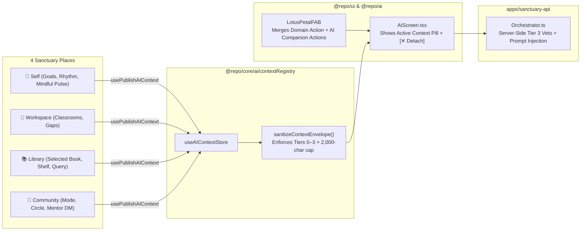

# Universal LotusPetalFAB & Policy-Driven AI Context Ingestion Engine

> **CANONICAL SPECIFICATION**  
> **Date:** October 29, 2026  
> **Scope:** `@repo/core/ai/contextRegistry`, `LotusPetalFAB` (`@repo/ui`), `useAIAgent` & `AIScreen` (`@repo/ai`), `Orchestrator` (`apps/sanctuary-api`), and the 4 Sanctuary Places (`Self`, `Workspace`, `Library`, `Community`).

---

## 1. Architectural Problem Statement

1. **The FAB Hijack & Invisibility Problem:**
   - Previously, `SelfScreen` did not register `useRegisterFAB`, leaving `LotusPetalFAB` invisible on the `Self` tab.
   - Meanwhile, `Workspace`, `Library`, and `Community` registered a single `onPress` callback (e.g., "+ Add Resource" or "+ Create Post") with `actions: []`, which hijacked the entire FAB tap and prevented users from summoning the AI Companion from `LotusPetalFAB`.
2. **All-or-Nothing Context Blindness:**
   - Treating `Self` as a monolithic black box prevented the LLM from seeing helpful `today`-zone signals (such as **Personal Goals, Study Rhythm, Reminders, or Mindful Minutes**), while `Library` and `Community` had no standardized seam to pass the currently viewed book, resource, or circle into the AI Companion.
3. **Community Dual-Door Requirement:**
   - In `Community`, users need both a **1-tap AI Companion button** on the main Community surface (`Feed` / `Circles`), a **pinned AI Assistant thread** in `DirectMessagesListScreen`, and **FAB spin-up** supporting both persistent Mentor DM and contextual post/circle assistance.

---

## 2. The 4-Tier Context Policy Registry (`@repo/core/ai/contextRegistry`)

Every piece of contextual data published by a domain screen is tagged with an explicit **`AIContextSlotId`** and governed by a **`ContextSensitivityTier`**:

| Sensitivity Tier | Policy Rule | Canonical Slots |
| :--- | :--- | :--- |
| **Tier 0: `always_safe`** | Always permitted in normal chat | `platform.active_tab`, `platform.user_role`, `platform.moon_phase` |
| **Tier 1: `configurable_default_on`** | Enabled by default; runtime-toggleable per slot via `setSlotEnabled(slotId, boolean)` | • **Self (`today` zone):** `self.goals_and_reminders`, `self.study_rhythm`, `self.mindful_pulse`, `self.active_spaces`, `self.orientation_seeds` • **Workspace:** `workspace.active_classroom`, `workspace.coordination_gaps`, `workspace.timetable_summary` • **Library:** `library.active_resource`, `library.search_filter` • **Community:** `community.active_mode`, `community.active_circle` |
| **Tier 2: `explicit_attach_only`** | Blocked unless the user explicitly attaches the item (`explicitlyAttached: true`) | `self.tomorrow_prep_draft`, `self.thought_reframe_card`, `community.post_draft` |
| **Tier 3: `sacred_never_ingest`** | **Hard Code Veto** on both client and server (`Orchestrator.ts`) — cannot be enabled even by config override | `self.fire_journal`, `self.voice_journal`, `admin.safeguarding_cases`, `auth.raw_credentials` |

---

## 3. End-to-End Data Flow

