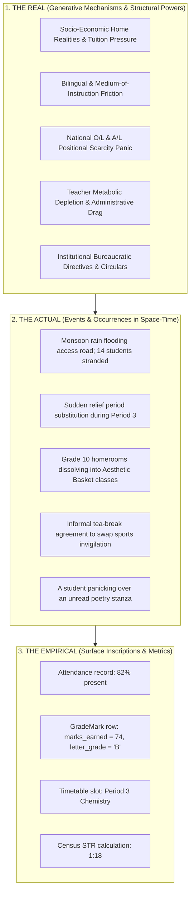
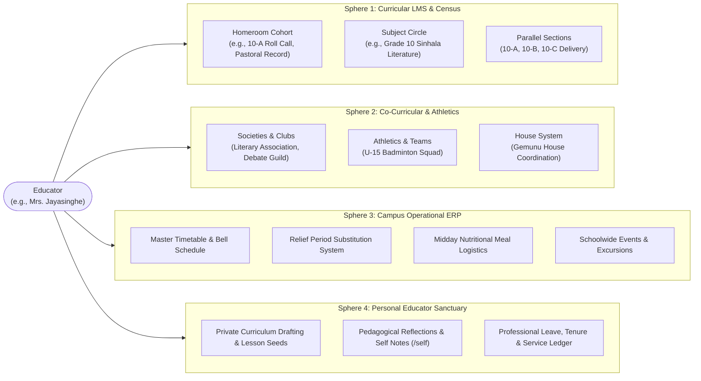
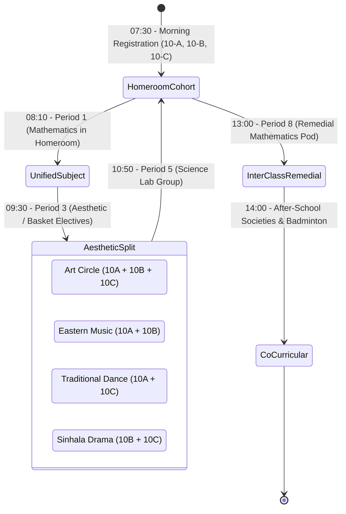
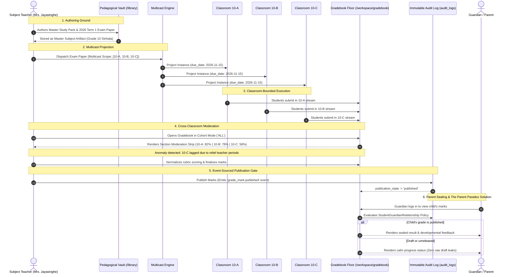
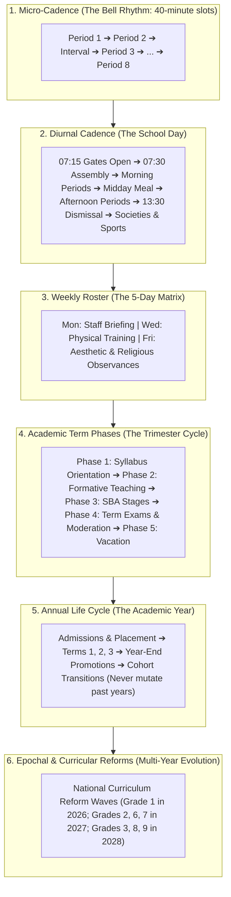
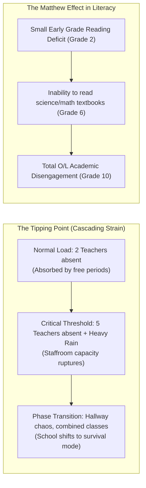

# Requisite Variety and the Poly-Sphere Educational Reality: Canonical Architecture

> **THE CONSTITUTIONAL CYBERNETIC INVARIANT (W. Ross Ashby):**  
> $$V_{\text{regulator}} \ge V_{\text{disturbances}}$$  
> *Only variety can absorb variety.* A flat, static, or naive CRUD architecture possesses far fewer internal states than the living, volatile, multi-stakeholder ecosystem of a real school. When software lacks requisite variety, it collapses into "systems-washing"—imposing rigid, technocratic straitjackets that alienate educators, falsify academic truth, and break down under ordinary human friction.

---

## 1. Executive Summary & Epistemic Grounding

Conventional educational software fails because of **The Technocratic Fallacy**: it treats an educational institution as a static hierarchical tree:

$$\text{School} \longrightarrow \text{GradeLevel} \longrightarrow \text{Classroom} \longrightarrow \text{Student}$$

In this caricature, a teacher is reduced to an instructor trapped in a single room, students are static rows in a register, and learning is a series of point-in-time score submissions. 

In actual human reality—whether in a Sri Lankan Type 1AB national school, a rural provincial outpost, or an international college—a school is a **poly-temporal, poly-sphere, multi-membership ecology**.

This specification codifies the complete architectural canon that grants the Polymath Platform **Requisite Variety**. It bridges historical monorepo audits ([`10-classroom-academic-domain-audit.md`](file:///c:/x/docs/files/specialized/10-classroom-academic-domain-audit.md), [`2026-08-12-grade-school-grade-marks-domain.md`](file:///c:/x/docs/decisions/2026-08-12-grade-school-grade-marks-domain.md), [`2026-10-20-institutional-structure-canonical-model.md`](file:///c:/x/docs/decisions/2026-10-20-institutional-structure-canonical-model.md)) and integrates Layer 0 depth realism ([`2026-10-11-the-upstream-epistemic-and-systemic-invariants.md`](file:///c:/x/docs/architecture/2026-10-11-the-upstream-epistemic-and-systemic-invariants.md)) with the live web and native substrates.

---

## 2. Ontological Stratification (Roy Bhaskar's Depth Realism)

Software must never commit the **Epistemic Fallacy** by confusing what is recorded in a database with what is actually happening in a school, or with the generative mechanisms creating those phenomena.



### The Architectural Invariant:
* **The Empirical is a Projection, Never Ground Truth**: An attendance table or grade record is an inscription. The system must never assume an unrecorded event did not occur, or that an entered mark fully captures a child's understanding.
* **Non-Enclosure Law**: The platform must allow for annotations, qualitative somatic feedback, offline fallback captures, and post-hoc reconciliations.

---

## 3. The Poly-Sphere Matrix: Ashby's Law in Educator Life

An educator does not have a single job; they exist across four distinct, simultaneous operational spheres. A system that collapses these four spheres into a generic "classroom view" generates endless cognitive friction.



| Sphere | Primary Intent | Core Substrate Entities | Failure Mode of Flat Systems |
| :--- | :--- | :--- | :--- |
| **1. Curricular LMS** | Syllabus mastery, formative checks, summative certification | `grade_classes`, `academic_subjects`, `assignments`, `grade_marks` | Forcing cross-classroom subject teaching into a single homeroom silo. |
| **2. Co-Curricular** | Character formation, creative expression, athletic rigor | `co_curricular_units`, `activity_rosters`, `inventory_items` | Treating club attendance as identical to academic period attendance. |
| **3. Campus ERP** | Resource equilibrium, safety, daily operational coordination | `timetable_slots`, `relief_assignments`, `school_events` | Leaving teachers stranded when colleagues take emergency medical leave. |
| **4. Personal Sanctuary** | Mental restoration, unmonitored preparation, reflective agency | `user_compass`, `teacher_notes` (private), `reflections` | Turning software into a panopticon that inspects unfinished teacher drafts. |

---

## 4. Fluid Instructional Geometries (Beyond Rigid Classrooms)

A fatal flaw in legacy LMS design is assuming students remain in fixed cohorts throughout the school day. In reality, schooling consists of continuous phase shifts in **instructional geometry**:



### The Architectural Canon:
1. **The Registration Cohort (`grade_classes`)**: The legal and census anchor (e.g., 10-A with 35 students under class teacher Mrs. Jayasinghe). Daily roll call, official notices, and pastoral custody live here.
2. **The Instructional Teaching Group (`classrooms`)**: The flexible instructional venue. It carries a typed `kind`:
   - `kind: 'homeroom'`: Tied 1:1 with a `grade_class`.
   - `kind: 'subject'`: Formed for specific subjects, linking across multiple grade classes (e.g., Sinhala Drama linking 12 students from 10-A, 8 from 10-B, and 14 from 10-C).
   - `kind: 'cohort'`: Ad-hoc, temporary, or dynamic grouping (remedial clinic, Olympiad training, project team).
3. **Student Subject Choice (`student_subject_choices`)**: Tracks each student's elective selections (Religion, Aesthetic, Basket Subject 1, 2, 3), ensuring attendance and marks are routed to the proper instructional group.

---

## 5. Cross-Classroom Artifact Lifecycle: Authoring to Moderation

In subject-based secondary schooling, an educator teaching Grade 10 Sinhala across parallel sections 10-A, 10-B, and 10-C must never be forced to copy-paste notes, assignments, or quizzes three times. 

The platform implements the **Master-Instance Projection & Moderation Lifecycle**:



### The Assessment Taxonomy:
1. **Continuous Formative Tasks**: Informal homework, somatic observations, and reflective journal entries.
2. **Diagnostic Quizzes**: Rapid, low-stakes checks designed to identify misconception clusters (e.g., Sinhala sandhi rules or algebra factorizations).
3. **School-Based Assessment (SBA - Circular 23/2017)**: Formal national continuous assessment protocol with five certified stages for G.C.E. O/L candidates.
4. **Summative Common Examination Papers**: Standardized end-of-term papers administered synchronously across all parallel cohorts, graded against a centralized marking scheme.

---

## 6. Nested Poly-Temporal Clocks: From the Bell to the Reform

Time in an educational sanctuary is not a flat linear sequence of seconds. It is a set of **nested concentric cycles**:



### The Architectural Rule of Immutability:
* **Past Academic Years are Never Mutated**: Upgrading to a new year (e.g., 2026 $\rightarrow$ 2027) does not edit the `GradeClass` or `GradeMark` records of the previous year. New cycle-bound instances are instantiated, preserving the historical truth of past academic cycles for institutional audit and longitudinal research.

---

## 7. The Convivial Limit & Shadow Operating Systems (Ivan Illich)

Ivan Illich's *Tools for Conviviality* (1973) established that tools become destructive when their scale and rigidity enclose human agency and turn users into servants of the machine.

In a healthy school, an **Informal Shadow Operating System** always runs alongside the formal bureaucratic rules:
* **The Staffroom Relief Trade**: Mr. Bandara has a medical appointment; he agrees over a morning cup of plain tea with Mrs. Jayasinghe that she will cover his Period 4 Physics class in exchange for him taking her Friday Period 7 duty.
* **The Paper Ledger Buffer**: A veteran teacher records marks in their physical CR register book first, holding them close while observing student effort, before transcribing them into the digital platform.
* **The Shadow Student**: A child arrives from a distant displaced district without official birth certification or national census index number. The school admits them in compassion before the ministry paperwork is cleared.

### Convivial Architecture Invariants:
1. **Never Criminalize Informal Human Adaptations**: The platform must support peer relief swaps without requiring three levels of bureaucratic approval before a teacher can enter a room.
2. **Support Provisional / Shadow Identities**: Allow student placeholders with local IDs (`stu-shadow-xxx`) that can be seamlessly unified with canonical UUIDv8 identities once paperwork arrives, without dropping attendance history.
3. **Draft Privacy is Sacred**: A teacher's preliminary marks and qualitative somatic observations must remain strictly unreleased until the teacher explicitly triggers the publication gate.

---

## 8. Non-Linear Phase Thresholds & Systemic Fragility

Real educational systems exhibit non-linear dynamics governed by **Thresholds** and the **Matthew Effect** ($gap(t) = gap_0 \cdot e^{\lambda t}$):



### Architectural Sentinels:
* **Pattern 5 Consecutive-Day Gating**: As discovered in [`attendanceProjectionRepository.ts`](file:///c:/x/packages/classroom/src/logic/attendance/attendanceProjectionRepository.ts), students are never flagged "at-risk" on a single isolated absence; the system checks consecutive-window patterns to avoid false alarms while catching real distress signals.
* **Relief Burnout Warning**: The system monitors cumulative relief substitution load on teachers to prevent metabolic collapse during seasonal sickness waves.

---

## 9. Monorepo Substrate Mapping & Implementation Ledger

This architecture is not aspirational poetry; it is grounded directly in the polymath monorepo substrate:

| Architectural Concept | Substrate Implementation & File Paths |
| :--- | :--- |
| **Institutional Entities & Census** | [`packages/schema/schema.zmodel`](file:///c:/x/packages/schema/schema.zmodel) (`School`, `AcademicCycle`, `Section`, `GradeLevel`, `GradeClass`) |
| **Instructional Teaching Groups** | [`packages/schema/schema.zmodel`](file:///c:/x/packages/schema/schema.zmodel) (`Classroom`, `ClassroomStudent`, `Lesson`, `Material`) |
| **Assessment & Marks** | [`packages/schema/schema.zmodel`](file:///c:/x/packages/schema/schema.zmodel#L2121-L2156) (`GradeMark`, `Assignment`, `AssignmentSubmission`) |
| **Cross-Classroom Web Delivery** | [`apps/gurudevi-web/app/(sanctuary)/workspace/classroom/[id]/ClassroomDetailFloor.tsx`](file:///c:/x/apps/gurudevi-web/app/(sanctuary)/workspace/classroom/[id]/ClassroomDetailFloor.tsx) |
| **Cross-Classroom Moderation Floor** | [`apps/gurudevi-web/app/(sanctuary)/workspace/gradebook/GradebookFloor.tsx`](file:///c:/x/apps/gurudevi-web/app/(sanctuary)/workspace/gradebook/GradebookFloor.tsx) |
| **Hexagonal Academic Domain Port** | [`apps/gurudevi-web/lib/domain/ports/academic.port.ts`](file:///c:/x/apps/gurudevi-web/lib/domain/ports/academic.port.ts) & [`academicHexagonalService.ts`](file:///c:/x/apps/gurudevi-web/lib/domain/adapters/academic/academicHexagonalService.ts) |
| **Subject Library Vault** | [`apps/gurudevi-web/app/(sanctuary)/library/LibraryFloor.tsx`](file:///c:/x/apps/gurudevi-web/app/(sanctuary)/library/LibraryFloor.tsx) |
| **Event-Sourced Publication** | [`audit_logs`](file:///c:/x/packages/schema/schema.zmodel) with `selectLatestPublishedSnapshots()` replay projection |
| **Parent Sealing & CASL/RLS Boundary** | [`StudentGuardianRelationship`](file:///c:/x/packages/schema/schema.zmodel#L1851) & [`gradeVisibility.ts`](file:///c:/x/packages/core/src/logic/domains/guardian/gradeVisibility.ts) |

---

## 10. Verification & Maintenance Mandate

Any future agent or engineer proposing modifications to the academic domain, teacher workflows, or grading pipelines must verify compliance against this document before declaring completion:

1. **Verify Requisite Variety**: Does the proposed feature account for multiple sections, relief substitutions, and co-curricular realities, or does it assume a single static classroom?
2. **Verify Epistemic Depth**: Does the data model distinguish between drafts, published records, and the append-only audit trail?
3. **Verify the Convivial Limit**: Does the UI provide offline-first resilience and non-punitive fallbacks?
4. **Pass Monorepo Verification**:
   - `$OutputEncoding = [System.Text.Encoding]::UTF8; pnpm --filter gurudevi-web check-types`
   - `$OutputEncoding = [System.Text.Encoding]::UTF8; pnpm --filter @repo/core exec tsc --noEmit`
   - `$OutputEncoding = [System.Text.Encoding]::UTF8; pnpm --filter @repo/classroom exec tsc --noEmit`
   - Zero modifications to deprecated `*.web.tsx` files.

---

## 11. Global & National LMS Interoperability Mapping

To prevent the "isolated island" anti-pattern and guarantee long-term sovereign mobility, the polymath educational architecture conforms directly to international open interoperability standards (**1EdTech OneRoster 1.2/1.3**, **LTI 1.3 Advantage**, and **QTI 3.0**) as well as the **Sri Lanka Ministry of Education (MoE) NEMIS / SBA Circular 23/2017** frameworks.

### 11.1 Standard Specifications Matrix

```
┌───────────────────────────────────────────────────────────────────────────────────┐
│                    INTERNATIONAL & NATIONAL INTEROPERABILITY STANDARDS            │
├───────────────────────┬─────────────────────────────┬─────────────────────────────┤
│ Standard / Authority  │ Domain Scope                │ Architectural Translation   │
├───────────────────────┼─────────────────────────────┼─────────────────────────────┤
│ 1EdTech OneRoster 1.2 │ Rostering & Grade Exchange  │ REST API & CSV Ingestion    │
│ LTI 1.3 Advantage     │ Tool Launch, AGS & NRPS     │ OAuth2/OIDC Deep Linking    │
│ 1EdTech QTI 3.0       │ Formative/Summative Testing │ XML/JSON Item Bank Schema   │
│ Ed-Fi Data Standard 5 │ CEDS State Reporting        │ Longitudinal Census Model   │
│ MoE SBA Circular 23   │ School-Based Assessment     │ 5-Stage O/L Rubric & Audit  │
└───────────────────────┴─────────────────────────────┴─────────────────────────────┘
```

### 11.2 Bidirectional Schema Cross-Map (OneRoster 1.2 vs. Monorepo Substrate)

| OneRoster 1.2 Entity / Endpoint | Monorepo Physical Substrate | Mapping Semantics & Cardinality |
| :--- | :--- | :--- |
| **`org`** (type: `school`)<br>`GET /orgs`, `GET /schools/{id}` | [`School`](file:///c:/x/packages/schema/schema.zmodel#L240) | 1:1 mapping. Represents the physical institution (`school-ananda-colombo`). |
| **`academicSession`** (type: `schoolYear` / `term`)<br>`GET /academicSessions` | [`AcademicCycle`](file:///c:/x/packages/schema/schema.zmodel#L280) & `Term` | Maps annual cycles and 3 national trimesters. |
| **`course`**<br>`GET /courses`, `GET /courses/{id}` | [`Subject`](file:///c:/x/packages/schema/schema.zmodel) (`title`, `code`, `gradeLevelId`) | Master syllabus curriculum catalog entity. |
| **`class`** (type: `homeroom`)<br>`GET /classes` | [`GradeClass`](file:///c:/x/packages/schema/schema.zmodel#L350) (`10-A`, `10-B`, `10-C`) | Cohort pastoral unit for census and morning roll call. |
| **`class`** (type: `scheduled`)<br>`GET /classes/{id}` | [`Classroom`](file:///c:/x/packages/schema/schema.zmodel#L1720) (`kind: 'subject'`) | Active instructional group (e.g., Period 3 Grade 10 Sinhala Language). |
| **`lineItem`**<br>`POST /classes/{classId}/lineItems`<br>`GET /lineItems/{id}` | [`Assignment`](file:///c:/x/packages/schema/schema.zmodel#L2121) (`AssignmentQuest`) | Assessment column. Extended with `kind` (`assignment`, `quiz`, `exam_paper`, `sba`) and `targetClassrooms`. |
| **`result`**<br>`POST /lineItems/{lineItemId}/results`<br>`GET /results/{id}` | [`GradeMark`](file:///c:/x/packages/schema/schema.zmodel#L2140) (`StudentGradeResult`) | `score` $\leftrightarrow$ `marks_earned`, `resultScore` $\leftrightarrow$ `max_points`, `scoreStatus` $\leftrightarrow$ `publication_state`. |

### 11.3 LTI 1.3 Advantage Integration: AGS and NRPS

1. **Assignment and Grade Services (AGS 2.0)**:
   - When an educator creates a multi-section quiz or exam in [`ClassroomDetailFloor.tsx`](file:///c:/x/apps/gurudevi-web/app/(sanctuary)/workspace/classroom/[id]/ClassroomDetailFloor.tsx), the system generates an LTI `LineItem` resource.
   - When students submit and teachers grade via [`academicHexagonalService.ts`](file:///c:/x/apps/gurudevi-web/lib/domain/adapters/academic/academicHexagonalService.ts), scores are dispatched using the canonical LTI score schema:
     ```json
     {
       "userId": "usr-student-sanduni",
       "scoreGiven": 88.0,
       "scoreMaximum": 100.0,
       "activityProgress": "Completed",
       "gradingProgress": "FullyGraded",
       "comment": "Excellent textual analysis of classical Sinhala verse."
     }
     ```
2. **Names and Role Provisioning Services (NRPS 2.0)**:
   - Class rosters are synced with LTI context membership roles:
     - `http://purl.imsglobal.org/vocab/lis/v2/membership#Instructor`
     - `http://purl.imsglobal.org/vocab/lis/v2/membership#Learner`

### 11.4 1EdTech QTI 3.0 Item Banking Translation

For quizzes and exam papers authored across sections:
- Items conform to `<qti-assessment-item>` XML and JSON-LD representations.
- Response declarations map question interactions (`<qti-choice-interaction>`, `<qti-text-entry-interaction>`) into structured evaluation rules.
- Outcome values (`<qti-outcome-declaration identifier="SCORE">`) feed directly into `marks_earned` in the Gradebook.

### 11.5 National Curriculum & Circular 23/2017 Compliance

Under MoE Circular 23/2017:
- School-Based Assessment (SBA) records are maintained across 5 mandatory stages for Grades 10 & 11.
- Marks are classified into national performance bands:
  - **A** (Distinction): $\ge 75\%$
  - **B** (Very Good): $65\% - 74\%$
  - **C** (Credit): $50\% - 64\%$
  - **S** (Ordinary Pass): $35\% - 49\%$
  - **W** (Weak / Remedial Required): $< 35\%$
- The moderation balance strip on [`GradebookFloor.tsx`](file:///c:/x/apps/gurudevi-web/app/(sanctuary)/workspace/gradebook/GradebookFloor.tsx) prevents section-level grading drift ($10\text{-A} \approx 82\%$, $10\text{-B} \approx 78\%$, $10\text{-C} \approx 58\%$), flagging anomalies prior to parent portal publication and NEMIS reporting.

---

## 12. Cybernetic Attenuation: The 5-Stage Orthogonal Pipeline

A living educational ecology presents immense environmental variety: multiple capacities, diverse channels, shifting device trusts, varying civic relationships, and progressive onboarding stages.

If software models these dimensions as a naive Cartesian product:
$$3 \text{ Citizenships} \times 4 \text{ Channels} \times 3 \text{ Trust Levels} \times 8 \text{ Capacities} \times 3 \text{ Onboarding Stages} = \mathbf{864\text{ combinatorial states}}$$
The resulting codebase collapses under branching complexity.

### Stafford Beer's Law of Attenuation:
Polymath Platform achieves **Requisite Variety without Combinatorial Chaos** by decomposing the operational evaluation into an **Orthogonal Sequential Pipeline**:

```text
[Incoming Intent]
       │
       ▼
1. INGRESS & ASSURANCE FILTER:
   Does this channel/device meet the required security level for this action?
       │ (Pass / Step-up)
       ▼
2. CIVIC & CAPACITY FILTER (ReBAC + Cedar):
   Does this Principal have the Capacity and Bond Citizenship in this Scope?
       │ (Allow / Deny)
       ▼
3. COMMERCIAL ENTITLEMENT FILTER:
   Is this capability active under the tenant's commercial tier?
       │ (Active / Upgrade)
       ▼
4. CHANNEL AFFORDANCE FILTER:
   Is this interaction viable on this door (e.g. Web, Mobile, WhatsApp, Agent)?
       │ (Viable / Redirect Door)
       ▼
5. PRESENTATION & SCAFFOLDING FILTER (Pure UI Glass):
   How dense should the UI be for this user's screen and onboarding stage?
```

By decoupling these 5 axes into independent, sequential filters, the total rule count collapses from $864$ cross-products to $3 + 4 + 3 + 8 + 3 = \mathbf{21\text{ isolated, testable rules}}$, perfectly satisfying Ashby's condition ($V_{\text{regulator}} \ge V_{\text{disturbances}}$).


