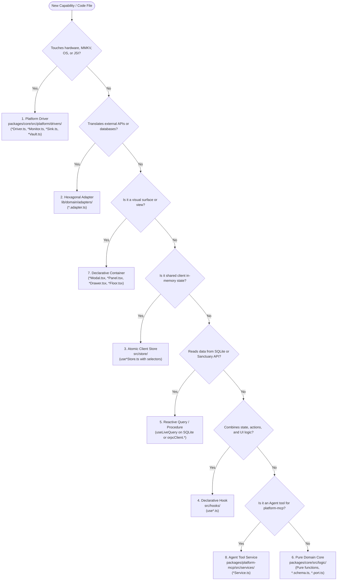

# 2026 Polymath Monorepo Naming Conventions & Archetype Consistency Rules

> **PRIME DIRECTIVE**: In the 2026 React 19.3+ and React Native 0.88+ era, our codebase rejects Java Spring Boot OOP ceremony (`*Manager`, `*Service`, `*Repository`, `*Factory`, GoF static singletons, and static container classes). Software is structured as **Functional Cores with Imperative Shells**—comprising pure domain types, typed RPC procedures, reactive live queries, and declarative UI containers.

---

## 1. The 8 Sovereign Archetypes Taxonomy

Every file in the monorepo must belong to exactly one of the **8 Sovereign Archetypes**. Never invent ad-hoc suffixes or hybrid "catch-all" files.

| Archetype | Naming Pattern | Canonical Location | Permitted Role | Strictly Forbidden |
| :--- | :--- | :--- | :--- | :--- |
| **1. Platform Driver** | `*Driver.ts`<br>`*Monitor.ts`<br>`*Sink.ts`<br>`*Vault.ts` | `packages/core/src/platform/drivers/` | Low-level hardware, JSI, Nitro ABI, and platform runtime I/O (MMKV, SecureStore, NetInfo, Sentry, Web APIs). | No business logic. No React hooks. No direct database queries. |
| **2. Hexagonal Adapter** | `*.adapter.ts`<br>`[name]Adapter` | `lib/domain/adapters/`<br>`packages/core/src/adapters/` | Translation boundary bridging external protocols, APIs, or database records to typed domain models. | No React component rendering. No global UI state. |
| **3. Atomic Client Store** | `use*Store.ts`<br>`*.slice.ts` | `src/store/`<br>`lib/store/` | Shared in-memory UI and session state (Zustand) consumed via atomic selectors. | No server cache (use SQLite / TanStack Query). No full-store destructuring (`use*Store()`). |
| **4. Declarative Hook** | `use*.ts` | `src/hooks/`<br>`lib/hooks/` | Reusable UI logic, lifecycle bindings, and React 19 actions (`useActionState`, `useTransition`, `useOptimistic`). | No static state. Never name a hook a "Repository" or "Manager". |
| **5. Live Query / Procedure** | `*.query.ts`<br>`*.orpc.ts`<br>`useLiveQuery()` | `src/queries/`<br>`src/api/v1/` | Reactive Local-First SQLite queries (PowerSync WAL) and typed oRPC v2 client procedures. | No imperative "Repository" classes. Zero boilerplate wrapper layers. |
| **6. Pure Domain Core** | `*.port.ts`<br>`*.schema.ts`<br>`*.types.ts` | `packages/core/src/logic/`<br>`lib/domain/ports/` | Pure deterministic business rules, Zod/ZModel validation schemas, and inbound port contracts. | Zero external I/O. No network calls. No React or Native dependencies. |
| **7. Spatial UI Container** | `*Modal.tsx`<br>`*Panel.tsx`<br>`*Drawer.tsx`<br>`*Sheet.tsx`<br>`*Floor.tsx`<br>`*Screen.tsx` | `apps/*/app/`<br>`packages/ui/src/components/` | Visual presentation and container surfaces. Named strictly by physical/spatial intent. | Never name a component `*Manager` or `*Coordinator`. No inline raw API mutations without hooks. |
| **8. Agent Tool Service** | `*Service.ts`<br>`*Tool.ts` | `packages/platform-mcp/src/services/` | **The ONLY approved use of the word `Service`** in the monorepo: Sovereign Agent MCP tool handlers (`DiscoveryService`, `ScoutService`). | Cannot be imported by Web, Mobile, or Core runtime apps. |

---

## 2. The Zero-Tolerance Anti-Pattern Ledger (Banned Java OOP Dialects)

Introducing any of the following triggers an instant gate veto in `check-architectural-contamination.mjs`:

```
┌───────────────────────────────────────┬──────────────────────────────────────────────┐
│ ❌ BANNED JAVA OOP PATTERN            │ ✅ 2026 IDIOMATIC REPLACEMENT                │
├───────────────────────────────────────┼──────────────────────────────────────────────┤
│ *Manager.ts (e.g. StorageManager)     │ storageDriver, networkMonitor, cryptoVault   │
│ *Service.ts (in UI/Web/Core)          │ *.adapter.ts, use*.ts, or functional modules │
│ *Repository.ts (e.g. ProfileRepo)     │ useLiveQuery() (SQLite) or orpcClient.*.*   │
│ *Factory.ts                           │ Pure factory functions (create*Adapter())    │
│ GoF static getInstance() Singleton    │ Native ES Module singleton exports           │
│ Java Static Container Class           │ Exported standalone functions in module      │
│ Component named *Manager.tsx          │ *Modal.tsx, *Panel.tsx, *Drawer.tsx          │
│ Full Zustand Destructuring            │ Atomic selector: `useStore((s) => s.field)`  │
│ React.forwardRef                      │ Standard `ref` prop (React 19)               │
└───────────────────────────────────────┴──────────────────────────────────────────────┘
```

---

## 3. Decision Tree: "Where Does My Code Belong?"



---

## 4. Deep Dive: The 8 Sovereign Archetypes

### 1. Platform Drivers (`*Driver`, `*Monitor`, `*Sink`, `*Vault`)
- **Intent**: Low-level technology integration. Wraps JSI, C++ Nitro modules, MMKV, SecureStore, NetInfo, WebSocket, and Sentry.
- **Rules**:
  - Implements a pure interface contract from `packages/core/src/logic/interfaces/`.
  - Holds zero business logic.
  - Exposes deterministic methods (`getString`, `setAsync`, `isConnected`, `captureException`).
- **Standard Exports**:
  - `storageDriver` (KV storage via Port/Adapter)
  - `networkMonitor` (Network reachability snapshot monitor)
  - `telemetrySink` (Observability stream sink)
  - `cryptoVault` (Biometric & Secure Enclave vault)
  - `deviceIdentityDriver` (Attestation & hardware identity driver)

### 2. Hexagonal Adapters (`*.adapter.ts`)
- **Intent**: Translation boundaries. Shields domain logic from remote wire changes, GraphQL/REST schema mutations, or third-party vendor APIs.
- **Rules**:
  - Suffix must always be `*.adapter.ts`.
  - Exports a named object matching the domain: `academicAdapter`, `editorialAdapter`, `erpAdapter`, `schoolAdapter`, `tuitionAdapter`, `workspaceAdapter`.
  - May define fallback datasets for offline resilience.

### 3. Atomic Client Stores (`use*Store.ts`)
- **Intent**: Reactive in-memory client state using Zustand.
- **Rules**:
  - Suffix must always be `Store.ts` and prefix must be `use`.
  - **Selector Invariant**: Callers must NEVER destructure the store root (`const { a, b } = useMyStore()`). Callers MUST use atomic selectors (`const a = useMyStore((s) => s.a)`).
  - Never store server query results in Zustand—server cache belongs in local SQLite (PowerSync) or TanStack Query.

### 4. Declarative Hooks (`use*.ts`)
- **Intent**: Encapsulate reusable React state, lifecycle effects, and React 19 Action transitions (`useActionState`, `useOptimistic`).
- **Rules**:
  - Suffix must always be `.ts` or `.tsx` and prefix must be `use`.
  - Connects Adapters, Stores, and Drivers to UI components.
  - Never named `*Repository` (e.g. `climateSensingRepository.ts` was an anti-pattern; it is now `useClimateSensing.ts`).

### 5. Reactive Queries & Procedures (`useLiveQuery()`, `orpcClient.*.*`)
- **Intent**: Data retrieval and remote procedure execution.
- **Rules**:
  - **Local-First Mobile**: Directly executes `useLiveQuery(query)` against local SQLite. SQLite WAL updates trigger automatic UI re-renders. No imperative repository wrappers allowed.
  - **API-First Sanctuary**: Directly invokes typed procedures via `orpcClient.<domain>.<capability>({ body, params })`.

### 6. Pure Domain Cores (`*.schema.ts`, `*.port.ts`)
- **Intent**: High-integrity business rules, Cedar authority policies, and Zod/ZModel schemas.
- **Rules**:
  - 100% pure functional code. Zero side effects.
  - Zero imports from React, React Native, Expo, or Skia.
  - High unit-test coverage.

### 7. Declarative Presentation Containers (`*Modal`, `*Panel`, `*Drawer`, `*Sheet`, `*Floor`)
- **Intent**: Physical and spatial UI surfaces.
- **Rules**:
  - Suffix must reflect its visual/spatial container role:
    - `*Modal.tsx` for centered dialogs and blocking prompts.
    - `*Panel.tsx` for sidebars, settings panes, and collapsible sections.
    - `*Drawer.tsx` for slide-over navigation or agent drawers.
    - `*Sheet.tsx` for bottom sheets (mobile/web).
    - `*Floor.tsx` for sanctuary spatial floor surfaces in `gurudevi-web`.
    - `*Screen.tsx` for top-level routes in `gurudevi-mobile`.
  - Never name UI components `*Manager` (e.g. `DeviceAccountManager` is now `DeviceAccountModal`; `RemindersManager` is now `RemindersPanel`).

### 8. Agent Tool Services (`packages/platform-mcp/src/services/*Service.ts`)
- **Intent**: The **sole legitimate exception** for the word `Service`. Encapsulates LLM agent discovery, AST indexing, and code auditing tools.
- **Rules**:
  - Strictly confined to `packages/platform-mcp/`.
  - Never exposed to application runtime code.

---

## 5. Ledger of Tech Debt Purged (November 2, 2026)

On November 2, 2026, the monorepo underwent a complete eradication of legacy Java OOP artifacts:

1. **41 Legacy Files Outright Deleted**:
   - `packages/core/src/logic/managers/` (7 files deleted: `StorageManager`, `NetworkManager`, `TelemetryManager`, `CryptoManager`, `DeviceIdentityManager`, and test suites).
   - `apps/gurudevi-web/lib/domain/adapters/*/*HexagonalService.ts` (6 files deleted).
   - `packages/core/src/spatial/spatialService.ts` (1 file deleted).
   - `apps/gurudevi-web/lib/repositories/` (4 files deleted: `academicSubmissionsRepository`, `tuitionRepository`, `climateSensingRepository`, `communityChatRepository`).
   - `packages/core/src/native/guestDataManager.ts` (1 file deleted $\rightarrow$ replaced by `guestStorage.ts`).
   - `packages/core/src/logic/forms/form-manager.ts` (1 file deleted $\rightarrow$ replaced by `form-engine.ts`).
   - `packages/core/src/adapters/supabase/` (24 dead uncalled repository files deleted).
2. **6 UI Components Renamed to Declarative Containers**:
   - `DeviceAccountManager.tsx` $\rightarrow$ `DeviceAccountModal.tsx`
   - `WebDeviceAccountManager.tsx` $\rightarrow$ `WebDeviceAccountModal.tsx`
   - `RemindersManager.tsx` & `.web.tsx` $\rightarrow$ `RemindersPanel.tsx` & `.web.tsx`
   - `SyncManager.tsx` $\rightarrow$ `SyncOrchestrator.tsx`
3. **Automated Verification Sentinel**:
   - `node scripts/check-architectural-contamination.mjs` enforces this taxonomy on all changed files with zero waiving.
