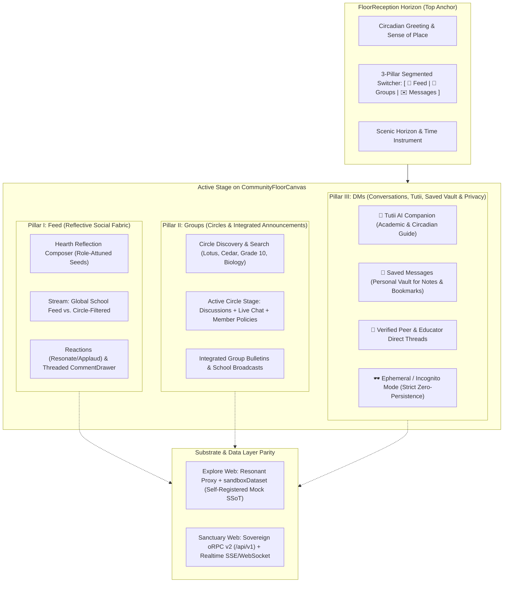

# Gurudevi Community Domain: Core Architecture, Triad Alignment, and Scaling Blueprint

## 1. Executive Summary & Holistic Integrative Vision

The Gurudevi Community domain is the social, reflective, and conversational spine of the Polymath Platform. During the brownfield migration from React Native Web shims (`*.web.tsx`) into Next.js 16 (`apps/gurudevi-web`), the holistic mental model was fragmented across isolated URLs and empty sandbox states.

This document establishes the canonical **Triad Architecture** for Community across both **Explore Web** (zero-write guest sandbox) and **Sanctuary Web** (authenticated sovereign oRPC v2), governed by national scaling constraints (~10,000 Sri Lankan schools, ~4.2M learners, rural bandwidth scarcity, and morning synchronization bursts).



---

## 2. The Triad Architecture: 3 Pillars Instead of 5 Fragmented Pages

Historically, community attempted to maintain independent pages for `/community`, `/community/announcements`, `/community/chat/[groupId]`, `/community/dm/[userId]`, and `/community/forest`. This created jarring navigational disjunction and broke the spatial immersion of the Sanctuary.

The platform aligns around **Three Integrated Pillars**:

### Pillar I: Feed (Reflective Social Fabric)
- **Hearth Composer (`WebPostComposer`)**: Pinned at the top. Rather than an unstructured "tweet box", it provides educational reflection seeds attuned to the user's role (Teacher lesson spark, Student query, Seeker reflection).
- **Scope Filter**: A frictionless filter pill: `"All Updates"` (unified school cohort) vs. individual joined circles.
- **Engagement**: Resonate reactions and drawer-based discussions (`CommentDrawer`) without full-page navigation.

### Pillar II: Groups (Circles & Context-Anchored Announcements)
- **Circle Registry**: Master-detail catalog of study cohorts, classrooms, sports clubs, and subject guilds.
- **Integrated Group Announcements**: Announcements do not float as an unrelated top-level page; they are anchored to the issuing authority:
  - *School-wide circulars* live in the School Sanctuary Group.
  - *Grade 10 Exam notices* live in the Grade 10 Group.
  - Urgent or pinned announcements bubble into the Feed header as high-priority alert cards.
- **Circle Chat Deeplink**: Seamless drill-down into synchronous circle conversations.

### Pillar III: DMs (Conversations, Tutii AI Companion, Saved Notes & Ephemeral Privacy)
- **Pinned Companion 1: 🌟 Tutii AI Guide**:
  - Context-aware firefly mascot acting as an academic companion.
  - Socratic tutor, reflection prompter, and calm study assistant.
  - Bounded prompt generation with graceful offline/sandbox fallbacks.
- **Pinned Companion 2: 📌 Saved Messages (Personal Vault)**:
  - Dedicated self-chat thread for bookmarks, draft lesson notes, personal reflections, and saved posts.
- **Verified Direct Messages**:
  - One-on-one threads between students, teachers, and guardians with verified badge indicators.
- **🕶️ Ephemeral / Incognito Chat Mode**:
  - A toggleable privacy shield directly in the DM header.
  - When enabled, message states exist exclusively in React volatile memory (`useState`). Zero writes to IndexedDB, LocalStorage, MMKV, or remote databases.
  - When the tab, browser, or conversation closes, the transcript evaporates immediately.

---

## 3. FloorReception Horizon Integration

`FloorReception` implements the Dual-Anchor Horizon Split:
- **Left Anchor**: Circadian greeting (`timeGreeting`) + Sense of Place (`breadcrumb`).
- **Center**: Unobstructed scenic horizon wallpaper.
- **Horizon Segmented Pill**: A lightweight, accessible tablist in the horizon extra slot:
  ```tsx
  <div className={styles.pillarSegmentedPill} role="tablist" aria-label="Community Pillars">
    <button role="tab" aria-selected={activePillar === 'feed'} onClick={() => setActivePillar('feed')}>
      💬 Feed
    </button>
    <button role="tab" aria-selected={activePillar === 'groups'} onClick={() => setActivePillar('groups')}>
      👥 Groups
    </button>
    <button role="tab" aria-selected={activePillar === 'dm'} onClick={() => setActivePillar('dm')}>
      ✉️ Messages {unreadCount > 0 && <span className={styles.badge}>{unreadCount}</span>}
    </button>
  </div>
  ```
- Adheres to UI Kit Rule 6 (CSS Container Queries): On narrow mobile viewports, the pills collapse gracefully into iconic representations (`💬`, `👥`, `✉️`).

---

## 4. Substrate & Data Plumbing: Explore Web vs. Sanctuary Web Parity

To prevent parity drift, both surfaces use the **same UI component substrate**, differing solely in their data adapters:

```
┌────────────────────────────────────────────────────────┐
│               CommunityFeedFloor (UI)                  │
└──────────────────────────┬─────────────────────────────┘
                           │
             ┌─────────────┴─────────────┐
             ▼                           ▼
    [Explore Web Adapter]       [Sanctuary Web Adapter]
             │                           │
             ▼                           ▼
    Resonant Proxy / SSoT        Sovereign oRPC v2 Client
     (sandboxDataset.ts)             (/api/v1/community)
             │                           │
             ▼                           ▼
    Local In-Memory Cache         Postgres / PowerSync DB
```

### The Explore Bug Remediation
In `apps/gurudevi-web/app/(sanctuary)/community/exploreGroups.ts`:
- Domain self-registration via `registerSandboxDomain` in `@repo/core/api/community.ts` must be explicitly triggered.
- Importing `@repo/core/api/community` guarantees `getSandboxSamples('community', 'getGroups', [], [])` hydrates `MOCK_COMMUNITY_GROUPS` and `MOCK_COMMUNITY_POSTS`.

---

## 5. Senior Solutions Architect Analysis: National Scale Constraints

Designing for Sri Lanka's educational substrate (~10,000 schools, ~4.2M students) demands strict architectural guardrails:

1. **Peak Morning Burst (8:00 AM Concurrency Spike)**:
   - Synchronized morning assembly announcements and attendance roll-call cause massive simultaneous read traffic.
   - *Mitigation*: Feed and group announcements use stale-while-revalidate (`staleTime: 60s`) and strict edge-caching headers on Cloudflare/Vercel.
2. **Rural Bandwidth & High Latency (2G/3G Substrate)**:
   - Full post payloads with uncompressed images will crash low-tier devices.
   - *Mitigation*:
     - Pagination chunk limit pinned to `limit = 20`.
     - Message payloads use trimmed text representations; rich attachments are loaded lazily on demand.
     - Avatars use CSS generative gradients based on user UUIDs rather than roundtripping image CDNs.
3. **Local-First & Offline Resilience**:
   - Rural areas experience rolling power cuts and intermittent signal drops.
   - *Mitigation*: Mutations route through `@repo/core/lib/sync/useMutationQueue`. If offline, mutations queue locally with clear UI indicators (`pending_sync`), avoiding dropped student work.

---

## 6. Ruthless Pragmatic Hostile Critique & Risk Matrix

| Risk Vector | Hostile Critic Observation | Architectural Defense / Hardened Mitigation |
| :--- | :--- | :--- |
| **"Don't Build Discord" (Scope Creep)** | Chat apps easily bloat into complex IRC/Slack clones with unmaintainable websocket machinery. | Strict containment: Circle chat is lightweight linear text with zero nested threads. Voice/video channels are completely out of scope. |
| **Incognito Memory Leak Traps** | "Unpersisting" chats often leak into browser memory dumps, service worker caches, or React DevTools state. | When Incognito mode is active: 1) Strictly bypass `storage.set`; 2) Set component-level unmount cleanup (`useEffect(() => () => setMessages([]), [])`); 3) Disable HTTP request logging for ephemeral payloads. |
| **Tutii LLM Token Drain & Latency** | Calling external Gemini/OpenAI endpoints on every Tutii message in high-volume classrooms will explode inference costs and fail on rural networks. | 1) Dual-tier response engine: heuristic/local rule-based template reflections for standard prompts; 2) Throttled API calling (max 1 turn / 5s); 3) Explore Web runs 100% on local deterministic companion prompts. |
| **FloorReception Layout Collisions** | Shoving 3 large button pills into `FloorReception` will collide with the time control clock or cause line-wraps on 375px mobile screens. | The pill switcher uses CSS container queries with `@container (max-width: 520px)`: text hides, showing compact SVG icons only. |
| **Dual-Path Drifts** | Maintaining separate Explore and Sanctuary codebases leads to one rotting while the other advances. | A single `CommunityFeedFloor.tsx` component is used for both modes. It accepts `mode: 'explore' | 'account'` and dynamically branches only at the I/O boundary. |

---

## 7. Migration & Verification Roadmap

1. **Phase 1: Substrate Repair (Day 1)**:
   - Fix `exploreGroups.ts` sandbox registration import.
   - Verify `EXPLORE_COMMUNITY_GROUPS` yields mock data in Explore Web.
2. **Phase 2: Triad Floor Assembly (Days 1–2)**:
   - Implement `activePillar: 'feed' | 'groups' | 'dm'` in `CommunityFeedFloor.tsx`.
   - Embed pill switcher in `FloorReception`.
   - Assemble Pillar 1 (`CirclePostStream` + `WebPostComposer`).
   - Assemble Pillar 2 (`CommunityGroupCard` + Group Announcements drawer/panel).
   - Assemble Pillar 3 (`DirectMessageFloor` with Tutii, Saved Messages, and Incognito Mode).
3. **Phase 3: Automated Anti-Slop & Static Verification**:
   - Run UTF-8 typecheck: `pnpm --filter gurudevi-web check-types`.
   - Execute Playwright integration checks on `/community?mode=explore`.
