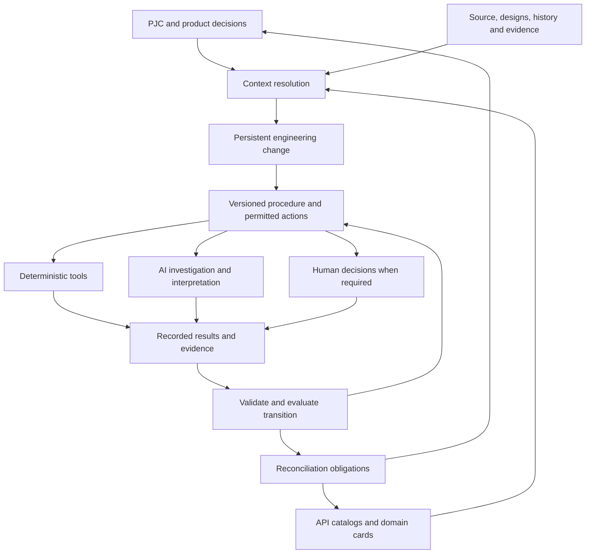
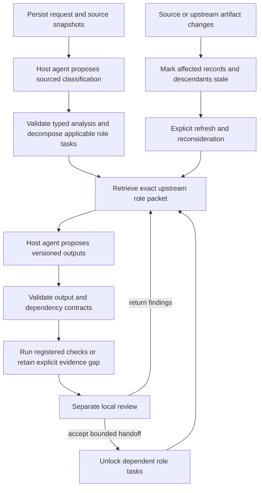

# Persistent coordination for AI development

This study examines how project knowledge, responsibilities, procedures, and execution history can be connected for AI-assisted engineering. It contains a proposed architecture and an isolated controller. Neither is a production service or a replacement for existing product authorities. All 36 trial responses were collected and independently reviewed. The study supports specific mechanical checks, but does not establish a general reasoning advantage from the added procedures.

The study artifacts are in [research/coordination-study](../../research/coordination-study/). The [protocol](../../research/coordination-study/protocol.json), [amendments](../../research/coordination-study/protocol-amendments.json), and [decision trail](../../research/coordination-study/decisions.tsv) record scope and consequential changes. The user requested reuse of investigators and cheaper models where sufficient. Controlled trial contexts remain fresh. Comparisons are grouped by case and model.

## What exists and where the connections stop

The [knowledge investigation](../../research/coordination-study/knowledge-findings.json) and [procedure investigation](../../research/coordination-study/procedure-findings.json) preserve source locators, evidence classifications, history, and limitations. These are observations of a changing working tree. Git HEAD changed during the study because other work continued. Each snapshot's own revision, timestamp, and content hashes apply; the report does not assume one immutable repository revision.

| Existing authority or mechanism | What it represents | Observed boundary |
| --- | --- | --- |
| PJC | Feature, intent, journey, requirements, scenarios, implementation bindings, observations, impacts, and evidence | Generic links do not express scoped expansion, clarification, or supersession. Static validity does not establish current prose or behavioral truth. |
| API module and capability catalog | Declared admission, kind, channel, assurance, and required evidence | Does not grant permission to invent product policy or establish successful execution. |
| API conformance | Joins declared capabilities with cards, selected document tables, contract/router, tagged evidence, callers, and channels | PJC narrative is outside this join. Handler-related freshness uses filesystem modification times, which differ from content-version semantics. |
| Domain cards and architectural decisions | Human decisions about ownership, authority, boundaries, and sequencing | Proposal, implementation description, and governing decision can coexist in a document and require scope-aware interpretation. |
| Platform discovery and Scout | Source and dependency discovery | Some caught discovery failures can be rendered as no traces. No measured recall for the whole study was established. |
| Product FlowDAGs | Product journey structure and validation | Product journey state is not an engineering run or developer workflow execution. |
| Agent workflow documents and pstack | Procedures interpreted by an agent | Numbered steps and instructions are not an executing state machine. |
| Local gates, receipts, and CI | Selected dialect, dependency, evidence, and architecture checks | Invocation, payload compatibility, coverage, and failure behavior must be tested independently of comments and configuration. |

The observed PJC check returned zero structural errors, 428 gap entries, and 113 bindings. This is a G0 declaration check, not 428 independently confirmed defects or proof of working application journeys. See investigation command records for the exact scope.

Two source cases illustrate why relationships need scope. The Covenant expands the introduction and explicitly supersedes only overlapping pillar definitions. Both relations are valid simultaneously. The API PJC narrative describes an empty v1 contract, while the supplied router and catalog declare six foundation capabilities. An empty business contract is a separate qualification and does not conflict with horizontal identity and authority admission.

## Proposed architecture

The project needs a connection between the existing knowledge authorities and a persistent record of engineering work. A context result is a projection with provenance and gaps. It is not a new source of product truth.

### Knowledge and source identity

Keep PJC record IDs, API capability names, domain-card/module identities, source paths and symbols, and scenario IDs as distinct references to their respective authorities. Record cross-system associations explicitly. A shared display name is not an identity join.

A source reference contains its locator, exact content hash or provider version, observed revision, observation time, and scope. A relationship contains subject, predicate, object, scope, source references, classification, and temporal applicability. Classifications are declared, mechanically extracted, inferred, and unresolved. The last two must not silently become accepted decisions.

Relations include ownership, dependency, implementation, verification, clarification, expansion, supersession, and historical applicability. Supersession names the affected statement or section. It does not retire the entire source unless the authorizing decision has that scope. Observation time and a document's effective time are separate.

### Responsibilities and authority

The coordinator owns the change's goal, dependencies, integration, and handoff. Investigators provide source-backed observations. Implementers produce scoped changes. Verifiers evaluate outputs and claims independently. A product owner supplies decisions requiring product authority. Graph ownership is a maintenance/contact relation, not runtime permission.

AI can propose an interpretation, discover an unrecorded dependency, or identify a suspected conflict. It cannot promote its own inference to an accepted owner decision. A valid structured record is not evidence of a correct interpretation. Missing source access remains an explicit coverage gap.

### Proposed interfaces

These contracts are design outputs for future tooling, not added public application endpoints.

| Interface | Input | Output and rule |
| --- | --- | --- |
| `resolveContext` | Explicit selectors such as PJC IDs, capability names, files, symbols, and required evidence categories | Source snapshots, classified relations, applicable decisions, existing behavior, declared dependencies, and coverage gaps. Natural-language matching first produces recorded candidate selectors. |
| `createChange` | Goal, scope, authorizing source, context snapshot, procedure ID and version | Persistent change ID, run ID, initial state, dependencies, and completion criteria. The procedure version is pinned for the run. |
| `recordAction` | Change/run/action ID, action kind, typed input/output, source dependencies, evidence, actor identity, and outcome | Append-only event or explicit rejection. Identical retries are idempotent; conflicting payloads under an existing action ID are rejected. |
| `evaluateNext` | Recorded events, pinned procedure, current source versions, and authority | Allowed actions, blocked prerequisites, invalidated work, and unresolved decisions. It does not infer that an omitted relationship is absent. |
| `resumeChange` | Change ID and current source observations | Valid completed work, invalidated dependent work, retained history, and next permitted actions. |
| `reconcileChange` | Changed artifacts, declared relationships, and check evidence | Obligations to update, reverify, or explicitly review affected records. Prose drift candidates require interpretation. |

Procedure definitions specify required inputs and outputs, permissible transitions, dependencies, retry boundaries, failure outcomes, and completion criteria. Production design must add authenticated decision resolution, trusted persistence, concurrent-writer handling, and runtime adapters. The isolated prototype intentionally does not implement those mechanisms.

### Persistence and change propagation

Persist engineering changes and runs separately from product journey state. Record decisions and action events with evidence. Derive status from events rather than trusting a mutable `done` flag. Preserve earlier decisions and invalidate only the dependent work affected by new inputs. A changed source set also requires context reconsideration.

Start integration in developer tooling through existing PJC and conformance readers. Developer coordination belongs outside product screens and the Sanctuary business API. Before choosing its permanent module, inspect the platform-MCP package's current service contracts and testable entry points. The report recommends that seam, not a new parallel product namespace or database platform.

## Experiment method and evidence

The prepared suite contains six cases, three conditions, and two repetitions, for 36 fresh contexts. Every case's source extracts are frozen and hashed once, then copied identically across conditions. Two cases use synthetic handoffs or competing proposals. The tasks inspect bounded source packets rather than discover an entire repository. That isolates reasoning about supplied relationships but does not measure discovery recall.

Condition X uses the current project context. Condition Y adds explicit pstack-derived recovery, investigation, and reconciliation instructions. It is a bounded procedural treatment, not the full pstack multi-agent stack. Condition Z adds actual local controller calls. All conditions can access the same provided tools. The existing root already activates pstack, so X is not a clean no-pstack baseline.

Document and API case groups use Sol. After the user's model preference, the remaining complete case groups use Luna. Effective model and reasoning settings are taken from scoped transcripts. Comparison across these strata cannot establish a model-independent treatment effect. Token records report runtime usage including cached input; monetary cost is unknown.

Candidate directories and work IDs are neutral. Candidates do not receive the condition mapping or evaluation oracle. Root instructions and tool metadata are shared, so blinding and filesystem isolation are partial. Source boundaries are instructed rather than enforced by a sandbox. Transcript checks must distinguish actual reading and controller invocation from self-report.

The [collector](../../research/coordination-study/experiment/collect.mjs) extracts task messages, actual tool calls and outputs, final responses, model settings, and usage from only matching child sessions of this coordinator. It excludes private reasoning and system/developer instruction text. It preserves raw final text separately from parsed responses and copies each completed work directory into the study. Tool counts are model-visible invocations, not arbitrary subprocess actions inside a shell command. One initial usage-limit failure was retried once before a usable response; the trial transcript retains both task starts.

Source-fidelity criteria were formalized from the approved case goals after the coordinator had seen early outputs. The Terra reviewer received all 36 outputs under neutral labels before inspecting their model/condition mapping. Response wording can reveal methodology, so this is partial blinding and engineering judgment, not a preregistered causal experiment. Execution fields were examined separately after that semantic review.

### Local controller checks

The frozen controller supplied to candidates is preserved as [controller.frozen.mjs](../../research/coordination-study/experiment/controller.frozen.mjs). A hardened version is [controller.mjs](../../research/coordination-study/experiment/controller.mjs). They have separate evidence and must not be conflated.

G1 local boundary and subprocess checks ran against 13 scenarios. The frozen version passed 10 and failed three: payload-key reorder idempotency, changed source-set membership, and silently clearing a prior unresolved decision. The hardened version passed all 13. The [raw verification record](../../research/coordination-study/local-verification.json) includes both results. These tests use synthetic state with real Node processes and local files. They do not prove production operation, model reasoning, human authority, concurrency safety, or automatic hook interception.

The hardened controller preserves unresolved declarations across later stages. It has no authenticated resolution action, so unresolved decisions remain blocked rather than being cleared through a new interpretation. It checks declared source hashes and stage order, but an owner of its local files can manufacture coherent history. An explicit test demonstrates that bypass. Source hashing also cannot prove a source was read or understood.

### Existing gate canaries

Nine G1 isolated subprocess canaries reproduced the investigator's exit-code observations. The [reproduction script](../../research/coordination-study/experiment/canaries.mjs) copies the existing scripts into temporary directories and uses synthetic content with real Node and Git. The [raw reproduction](../../research/coordination-study/canary-reproduction.json) records stdout and stderr.

| Boundary | Observed result |
| --- | --- |
| Recognized `input.file_path/content`, truncating 60 lines | Rejects with exit 2 |
| Same truncation under `tool_input` | Exits 0 without the expected check |
| Missing path/input | Exits 0 |
| Native input without a receipt | Rejects with exit 2 |
| Same input with `--auto-ground` | Exits 0 and creates a fresh receipt |
| Receipt with invalid timestamp | Exits 0 |
| Stop script outside Git | Exits 0 |
| Native violation in a nested untracked directory | Reports clean and exits 0 |
| Same violation staged | Rejects with exit 2 |

These results establish specific script behavior, not live hook registration. The inspected Codex CLI supports hooks, but current-session automatic interception remains unobserved. The Claude configuration declares pre-write and completion actions; actual compatibility with the installed runtime must be verified separately. No claim is made that Codex lacks hooks.

## Results and interpretation

All 36 responses are preserved with source packets, raw final text, actual tool calls, model settings, and available token records. All post-run source and controller hashes match their prepared snapshots. Each case group used one model and effort setting across all conditions. Every trial stayed within 20 model-visible tool calls. See the [artifact audit](../../research/coordination-study/artifact-audit.json), [comparison](../../research/coordination-study/comparison.json), and [trial manifest](../../research/coordination-study/trial-manifest.json).

| Case and model | Structural checks X / Y / Z | Main-answer review X / Y / Z |
| --- | --- | --- |
| Introduction and Covenant, Sol | 2 / 2 / 2 | 2 supported / 2 supported / 2 supported |
| API scope, Sol | 2 / 2 / 2 | 2 supported / 2 supported / 2 supported |
| Older instructions, Luna | 2 / 1 / 2 | 1 supported and 1 partial in each condition |
| Hook observation, Luna | 2 / 2 / 2 | 2 supported / 2 supported / 2 supported |
| Resume, Luna | 1 / 1 / 2 | 2 partial / 2 supported / 2 supported |
| Missing authority, Luna | 2 / 0 / 2 | 2 supported / 2 supported / 2 supported |

Each cell covers two repetitions. Structural and semantic outcomes are separate. The limited structural checker accepted 31 responses and flagged five: two wrong work IDs and three findings without source IDs. The latter include unknown/absence claims, so the flags reflect a source-reference policy rather than proof of incorrect reasoning. Original responses were not repaired to pass.

The static artifact review also found that the original local `resume-Y-1/work/response.json` ends with a literal backslash-n outside its JSON object. That malformed local file is retained unchanged as negative evidence. The separately captured final response parses as JSON but still has the wrong work ID. The limited structural score uses the captured final response and does not count this separate file-format failure. A coordinator-authored syntax error in `source-coverage.json` was corrected; it was not candidate evidence.

The independent source-fidelity review classified 31 main answers as supported and five as partial. These are not the same 31 responses as the structural passes. Two resume answers claimed a matching historical handoff hash that the synthetic handoff did not contain. Three older-instruction answers overextended the conflict, treating compatible package placement or resource constraints as contradicted, or omitting the world-recipe boundary. The correct main direction did not justify those extra claims. See the [semantic review](../../research/coordination-study/semantic-review.json).

All 12 Z runs invoked the controller and persisted four stage records. A direct projection of their saved states showed seven `canComplete: true` and five blocked by declared unresolved items. These values describe the controller's local review procedure, not completion of the underlying product work. The [saved-state projection](../../research/coordination-study/controller-run-status.json) and transcripts permit independent checking.

The resume fixture supplied a written handoff rather than the prior persisted controller state or historical source bytes. Consequently the agent trials tested reasoning about that handoff. They did not demonstrate actual cross-session rebase of that interrupted change. Real subprocess restart and stale-prefix recovery were exercised separately in the G1 controller tests. Several trial execution fields also called verification/reconciliation stages complete while the underlying change remained unverified. The independent review flags those as review-stage declarations, not product-work evidence; some next actions omitted explicit reconciliation.

In these curated packets, the baseline already reached the main document, API, hook, and owner-authority conclusions. Added procedures did not eliminate unsupported claims. The controller made declared transitions and evidence inspectable and rejected modeled violations in local tests. The evidence does not establish a general semantic improvement, discovery completeness, or production-ready enforcement. The useful next investment is stronger authority and evidence connections at specific boundaries, rather than adding another broad prompt or declaring the prototype a complete organization model.

### Independent verification and quality gate

Terra checked selected source citations, independently reran the hardened controller's 13 tests, reviewed all neutral response labels, and challenged the reproduction path. It found that the runner initially copied the hardened controller for new preparations while integrity checks expected the frozen version. The runner was corrected to use the frozen file. A fresh preparation then matched its hash, and all 36 unrun entries scored inconclusive. Existing results were not regenerated or replaced. See [verification.json](../../research/coordination-study/verification.json).

This is G0 source/configuration inspection and G1 synthetic boundaries with real local Node/Git subprocesses. It does not establish deployed API behavior, device behavior, automatic Codex hook interception, authenticated decision approval, concurrent writers, or exhaustive citation/relationship coverage. The independent reviewer is a separate model execution, not a deterministic oracle.

The required broader anti-slop run exited 1 at aislop with 48 errors and 1,304 warnings across the then-current working tree. CNG, native-slop, and hollow-stub stages exited zero; later chained stages did not run. The extracted study diagnostics contained no errors and 72 formatting warnings, including preserved trial artifacts. This does not attribute the whole-tree failures to this study or waive them. See [gate result](../../research/coordination-study/anti-slop-result.json), [full output](../../research/coordination-study/anti-slop-output.txt), and [scoped diagnostics](../../research/coordination-study/anti-slop-diagnostics.json).

## Prioritized implementation handoff

Retain PJC, domain cards, capability declarations, conformance readers, and their existing authorities. Keep engineering execution state separate from product journey state. The following are proposed future changes, not implemented production mechanisms.

| Priority | Existing seam and proposed change | Acceptance evidence |
| --- | --- | --- |
| P0 | Discovery/Scout result contracts distinguish available, empty, partial, and failed source searches | Inject provider/process failure and prove it cannot be rendered as a verified empty result; retain underlying diagnostics. |
| P0 | Hook adapters validate actual installed-runtime payloads and registration separately from scanning | Harmless automatic edit and completion canaries in Codex; missing paths, unknown envelopes, failed scanners, invalid receipt dates, and nested untracked files cannot claim a completed check. |
| P1 | Developer context projection joins explicit PJC IDs, capability names, scoped source claims, and evidence | The known empty-v1 narrative is surfaced for review after its bound contract changes, while business-admission deferral is retained. |
| P1 | Persistent engineering change/run/action records and final-output validation | Wrong work IDs and conflicting duplicate actions are rejected; a restart retains valid work; content and source-set changes invalidate dependents. |
| P1 | Scoped decision and reconciliation records preserve owner authority and unresolved dependencies | Introduction expansion and partial supersession coexist; an agent cannot clear an owner decision merely by submitting an empty unresolved list. Authenticated resolution requires a distinct action. |
| P2 | Runtime integration and broader evidence | Demonstrate the same contracts on real authoring boundaries, concurrent runs, representative changes, and realistic incomplete discovery before wider adoption. |

Place a context projection behind the existing developer gateway only after grounding its current callable contract. Use PJC's existing filesystem loader and journey projection and conformance's typed readers as sources. Do not copy their declarations into a parallel product catalog. Permanent persistence, authorization integration, and runtime hook deployment remain separate implementation work requiring their own bounded design and verification.

To reproduce local boundary checks, run `node research/coordination-study/experiment/verify-local.mjs` and `node research/coordination-study/experiment/canaries.mjs`. To prepare another fresh agent matrix, run `node research/coordination-study/experiment/runner.mjs prepare` and use the resulting neutral work packets. Dispatch one fresh context per packet, limit active workers to three, preserve raw results, and apply the same case/model grouping. `score` only checks recorded outputs; it never runs or fabricates an agent response. A new preparation observes current repository sources, so use the archived trial work folders for exact replay of this study's source bytes.

Connected source limitations are in [source-coverage.json](../../research/coordination-study/source-coverage.json). Public Slack and Linear calls failed, Graphify required reauthentication, and no production observability, error-tracker, or analytics evidence was evaluated. Prior Codex message records are preserved as source claims, not accepted runtime proof.

## Developer integration after the study

The owner subsequently requested inspection of the recent Claude CLI installations and
an integrated deterministic workflow. This extends the earlier investigation with a bounded
developer tooling pilot. It does not roll out product behavior or automatic agent interception.
The original 36-trial results remain unchanged and do not evaluate this later implementation.

[Claude installation findings](../../research/coordination-study/cli-history-findings.json)
trace scoped user prompts, commands and results from the current project's Claude history.
The current [runtime inventory](../../research/coordination-study/integration-runtime.json)
separately probes availability. In particular, a historical canceled k6 install and a stale
model README saying it is absent do not override the current working k6 executable.
The later installation's provenance remains untraced.

| Tool | Observed version | Integration scope |
| --- | --- | --- |
| LikeC4 | 1.60.0 | Existing model validation is an executable prerequisite |
| Squawk | 2.72.0 | Existing changed-migration wrapper is an executable prerequisite |
| Spectral | 6.17.1 | Discovery; needs an explicit ruleset and document |
| k6 | 2.3.0 | Discovery; needs a defined workload, thresholds and scoped target |
| Syft | 1.55.0 | Discovery; can describe a selected dependency inventory |
| Gitleaks | 8.30.1 | Discovery; scoped security adapter remains unimplemented |
| OSV-Scanner | 2.7.0 | Discovery; needs dependency input and advisory review policy |
| Schemathesis | 4.33.1 | Discovery; needs a supported schema and scoped target |

Installed tools have different proof obligations. k6 assertions alone do not fail a run;
its [thresholds](https://grafana.com/docs/k6/latest/using-k6/thresholds/) determine failure.
The installed 2.3.0 version is grounded against its [release](https://github.com/grafana/k6/releases/tag/v2.3.0).
[Spectral](https://github.com/stoplightio/spectral/blob/develop/docs/getting-started/3-rulesets.md)
requires rules; its presence does not define the project's API policy. Do not invent an
OpenAPI transport alongside the approved native oRPC contract to make a tool usable.
The [LikeC4 1.60.0 release](https://github.com/likec4/likec4/releases/tag/v1.60.0)
and actual package binaries ground the model validator. These are tool contracts,
not evidence that the repository meets a business requirement.

Two grounded designs are preserved in
[Terra's sketch](../../research/coordination-study/integration-design-terra.md) and
[Luna's sketch](../../research/coordination-study/integration-design-luna.md).
Both favor a narrow receipt and prerequisite mechanism before a general scheduler.
The installed LangGraph dependency is retained; this pilot does not need graph scheduling
to record one finite local procedure. Foundational Thinking drove the strict source,
event and check shapes; Prove It Works drove direct CLI/MCP and SQLite checks.

### Implemented boundary

`@repo/platform-mcp` now exposes `sovereign_coordination` in gateway mode and the
`coordination` package CLI. Both use the same strict schema, evaluator, adapters and
SQLite store. The [operating guide](../../packages/platform-mcp/docs/developer-coordination.md)
contains runnable requests and the affected-layer check matrix.

The pilot pins explicit source hashes and procedure implementation identity, persists
check intent before execution, records real command results, rejects conflicting action
IDs and unsupported observed-result fields, and evaluates prerequisites. Changed sources
or procedure bytes block readiness. Unresolved decisions cannot disappear through an empty
later record. Interrupted invocation remains pending/unknown; a retry does not rerun it.
Reconciliation yields `ready-for-review`, with no claim of product approval.

An explicit PJC journey reader returns the existing projection with hashed adjacent sources
and coverage gaps. Philosophy-to-decision-to-requirement-to-code relationships can be recorded
as classified, sourced links. Their completeness and meaning still require review. PJC,
C4, capability catalogs and owner decisions keep their respective authority; this is not
a parallel product catalog. The source snapshot is a declared set, not a dependency closure.

The same-host store uses SQLite transactions and a busy timeout. The local owner can edit
it or bypass the tool. There is no authenticated approval, automatic hook enforcement,
multi-host scheduler, automatic rebase or proof that the declared impacts are complete.
Source changes currently require a new change ID after reconsideration. Responsibilities
remain procedure/review responsibilities; authenticated role assignment is follow-up work.

### Current check results and integration gaps

[Actual check output](../../research/coordination-study/integration-checks.json) records
seven current adapter invocations. PJC, LikeC4, capability conformance, UI boundaries,
changed-migration lint and dependency cohorts returned exit 0. API composition returned
exit 1 with legacy-source findings; API/integration records therefore remain blocked.
Conformance's zero exit means no gap count exceeded its ceiling, not zero gaps. The migration
wrapper found no changed migrations, so it produced no SQL runtime evidence.

The CLI/MCP scenario creates a change through one process, analyzes it through MCP,
runs the actual C4 validator through the CLI, reconciles through MCP and reopens it through
the CLI. It also resolves an actual journey and rejects forged result input. SQLite tests
cover stale input, implementation changes, sticky uncertainty, failed and interrupted
checks, prerequisites, idempotency, and concurrent same-ID records from two Node processes.
These are local developer execution checks, not device or production verification.

A concurrent `src/pipeline` implementation was also observed. At inspection its E2E node
returned `passed: true` without invoking a device, and its headless node checked an embedded
example reducer. Those receipts were not admitted to this pilot as observed feature evidence.
That code was preserved. Integrating it requires real stage adapters, source applicability,
failure receipts and restart semantics before its status can support a verification claim.

Retain existing PJC, C4, capability conformance, checks and pstack investigation practices.
Next priorities are: independently confirm the affected-layer policy; add scoped security
and runtime adapters; define authenticated decision/responsibility records; support explicit
source reconsideration and run linkage; and only then evaluate scheduler and hook integration.
No full-system deterministic workflow claim follows from this first local slice.

Validation: the package build and typecheck completed at G0. The package's G1-labelled
Vitest run completed 51 checks across 10 files, including the CLI/MCP scenario and the
two-process record test. The first full run timed out on live version probing; its output
is retained in `integration-test-first-failure.log`. The live-probe test now has an explicit
60-second runtime bound matching its sequence of individually bounded subprocesses;
assertions and global gates were retained. Scoped Biome checks completed on the eight new
TypeScript files, with repository configuration notices about its schema version.

The wider anti-slop run stopped at `aislop`: 19 errors and 1,442 warnings across its changed
tree snapshot; later chained gates did not execute. The integration files had no reported
errors in that snapshot, with formatting, exported-type and function-length warnings.
Formatting and the unused type export were subsequently corrected; the function-length
warning remains a maintainability limitation. See `integration-anti-slop.txt` and
`integration-gate-diagnostics.json`. The whole repository is not green. Independent Luna
review is preserved in `integration-verification.json`; it confirms the bounded rejection
behavior and explicitly rejects completeness and automatic hook-enforcement claims.

The shared-store scenario was also executed against compiled CLI and gateway entrypoints.
The package command uses the compiled CLI so normal compiled gateway sessions share the
same procedure identity. Source-mode and compiled-mode records intentionally have distinct
implementation hashes; mixing those modes blocks a run. The first real local record,
`coordination-foundation-20261111`, retains current blockers and can be resumed through
`status`. Its exported observation is `integration-pilot-state.json`.

Late workspace change: a subsequent typecheck at 18:07 Sri Lanka time reported eight
errors in concurrently edited `src/pipeline/nodes/groundingNode.ts` and
`src/pipeline/tools/sovereignTools.ts` (constructor arguments, unavailable methods and
command options). The earlier successful G0/G1 snapshots therefore do not certify the
latest whole-package state. Those concurrent files were not modified by this workstream.
The failure is preserved in `integration-check-types-final.log`. This report update also
changes a pinned pilot source; `status` must invalidate that source while retaining the
completed action history. The pilot is blocked, not accepted or ready for rollout.
An additional G0 check of the eight new coordination files and their imports, extending
the actual package configuration with an explicit include set, completed successfully;
`integration-tsconfig.json` and `integration-scoped-types.log` preserve that limited check.
It is additional evidence, not a replacement or waiver for the failed package gate.

## Executable feature lifecycle

The owner clarified that the missing capability was the development lifecycle itself:
classifying and decomposing requests, choosing tools, preserving requirements and
invariants, handing precise context between responsibilities, and reconsidering work.
The new `lifecycle` action implements those contracts in the existing coordination CLI,
MCP tool and SQLite store. It does not implement or admit the chat feature.

The [operating protocol](../../packages/platform-mcp/docs/feature-lifecycle.md) describes
the requests and host-agent procedure. The implementation is in
[`model.ts`](../../packages/platform-mcp/src/lifecycle/model.ts),
[`evaluate.ts`](../../packages/platform-mcp/src/lifecycle/evaluate.ts),
[`runtime.ts`](../../packages/platform-mcp/src/lifecycle/runtime.ts), and
[`store.ts`](../../packages/platform-mcp/src/lifecycle/store.ts).
Existing receipt-pilot actions remain supported. The old `agent:pipeline` implementation
was preserved, and its stage names are not consumed as observed feature evidence.

### What is mechanically implemented

The host supplies model judgment as a structured proposal. Analysis requires sourced
applicability for 14 dimensions: UX, screens, state, errors, feedback, motion,
accessibility, data, API, database, dependencies, security, offline behavior and reuse.
The planner uses the classification: feature and defect profiles require requirements,
invariants and scenarios; refactors preserve invariants and scenarios; investigations
produce findings and scenarios without an implementation task. Unknown coverage remains
visible. The workflow cannot prove that a model chose the correct classification.

Role tasks cover product, UX, visual-motion, architecture, dependencies, implementation
and verification when applicable. Refinements may create smaller tasks under different
roles while preserving the parent's output/check obligations. Missing dependencies and
cycles reject; replanning cannot silently erase a refined obligation. Registered local
actors can be added as work develops. Those claims are not authenticated identities.

Artifact variants contain structured requirements and acceptance criteria, scoped
invariants, screens and independent state axes, transitions/guards/effects/feedback/
recovery, motion references and reduced-motion/cancellation requirements, directed
data/API flows, owned schemas, dependency versions, scenarios, implementation references,
findings, decisions and verification. Their IDs and versions remain queryable through
status, context and history. Inventory discovers saved lifecycle IDs and labels stored
task statuses as unevaluated until a fresh status query.

Submission checks exact current upstream versions and required output kinds. Review
requires a different local verification actor. Returned findings and previous outputs
are included in the next role packet. Acceptance means a bounded handoff, not approval
of a business policy. Dependency/version changes make dependent outputs and reviews
stale, preserving independent branches and historical states. Source refresh retains
the original artifact snapshots; it does not transfer their acceptance.

The actual LangGraph routes are `recover → apply → project`, or
`recover → begin_tool → execute_tool → finish_tool → project`. SQLite commits provide
durability between invocations; no in-memory checkpointer is claimed as persistence.
An interrupted invocation stays pending/unknown and an identical retry does not rerun it.
New read-only attempts require an explicit new operation ID. CAS revisions, canonical
parsed retries and operation conflicts protect the tested local transaction boundary.

Relevant existing checks are selected from applicable API, database, architecture and
dependency concerns. Missing feature/motion/security/data/reuse checks require an
explicit tool decision. Scoped manual evidence can support permitted judgment obligations
only with a separate review; it cannot waive a registered mandatory executable check.
Public requests cannot forge observed tool results. Failed observations remain recordable
but cannot substantiate a passed verification claim.

`impact` searches other local lifecycles sharing declared source paths and reports
possible impacts and transitive staleness. Its 1,000-record bound and dependency coverage
limits are returned explicitly. It is not an automatic semantic or whole-repository
dependency discovery mechanism.

### Actual worked handoff and changes over time

`chat-specification-20261111` is stored in the local SQLite database. The source-mode
record and [raw role outputs](../../research/coordination-study/lifecycle/chat/) preserve
an actual product-agent analysis, requirement, invariant and scenario; an independent
review; and a UX proposal consuming the exact reviewed versions. The UX proposal has two
screens, six independent state axes, twelve transitions and four journeys. Those are
proposed contract elements, not tested screen behavior.

Procedure hardening invalidated version 1 records. An explicit refresh and product-agent
reconsideration produced version 2 inputs and outputs, with another independent review.
The old versions were retained as stale. Product acceptance was limited to the proposed
UX handoff; privacy, API admission and runtime behavior remained unresolved. UX submission
retained a feature-behavior checker gap rather than becoming a verified feature. Other
applicable roles remain work, not fabricated outputs.

The creation metadata mistakenly declared PJC ID `feature:ai.assistant`; the source file's
ID is `feature:ai.assistant_companion`. A later sourced correction artifact preserves that
mistake and the correct identifier. External authority references are still declared
metadata rather than automatically reconciled catalog identities. This is an explicit
integration gap, not an accepted authority claim.

After the owner supplied updated AGENTS.md instructions, a fresh source-mode status query
detected the changed file, retained revision 24 and marked the dependent version 2 product
records and UX proposal stale. The final status also reports a changed procedure identity
during active development; neither earlier acceptance is transferred to the current inputs.
The current observation is
[`status-current.json`](../../research/coordination-study/lifecycle/chat/status-current.json).
The earlier `final-state.json` remains a historical snapshot. No completion or readiness
claim is made for that worked chat specification.

### Evidence and remaining limits

An earlier package G1 run completed 87 checks across 16 files at its recorded snapshot.
The final package G1 run completed 99 checks across 18 files, and the independent compiled
lifecycle suite completed 32 checks across five files. Final package G0 typecheck and build
both exited 0. The lifecycle-specific CLI/MCP integration runs
through real process transports in both source and compiled modes, hands product records
to UX, and invokes the real PJC adapter. Runtime tests also invoke the real C4 validator;
other cases use explicitly injected boundary results. A first full run timed out on a
live C4 subprocess; the fixture's explicit 30-second integration bound retains its
assertions and the original failure log. Later concurrent flow edits and final checks are
recorded separately in the lifecycle validation artifact rather than silently covered by
the earlier result.

Independent review is in
[`lifecycle-verification.json`](../../research/coordination-study/lifecycle-verification.json).
Its adversarial cases found and then rechecked the failed-verification, motion-reference
and dropped-refinement gaps. G0 package compile/build outcomes and final run logs are
preserved in `research/coordination-study/lifecycle/`. The broader anti-slop snapshot
remained red at `aislop`: 48 errors and 1,482 warnings across 4,200 changed-tree files.
The lifecycle subset had zero reported errors and ten warnings, including unused public
exports/test helpers and file/function size. No gate was waived; later chained checks
did not run. These warnings and evaluator/runtime size remain maintenance follow-up.

This implements a local first version of the lifecycle, not a complete software company
or autonomous development service. The Codex host actually executes role reasoning through
available agent tools; the repository does not secretly configure or call a model provider.
Local roles and SQLite records are not authentication, mandatory editor interception or
tamper resistance. Typed completeness is not semantic completeness. External catalog-ID
resolution, discovered impact coverage, broader adapters, trusted approvals, persistent
schema migrations and production/runtime evidence need further bounded work. PJC, C4,
capability conformance, existing rules and their authorities must continue to be used.

## Radar pilot and shared feedback integration — 2026-11-16

The next real feature was used to exercise the lifecycle: a shared multidimensional
radar experience over distinct measures and separately attributed self/other observations.
The owner's follow-up requires reuse of shared world-shaped loading and soulful Tutii
feedback. Intake and findings are in `research/coordination-study/lifecycle/radar/`.

### Recovered terrain and chosen seam

Student potential, personal growth, teacher vitality and exploratory teacher-profile
research describe different constructs. They are not interchangeable axes of a universal
score. Existing chart scaffolding also has concrete limitations: `RadarSpiderChart`
ignores point values in its radial positioning, legacy `InteractiveRadarChart` does not
invoke its editing callback, and `radarLayout` substitutes sample attributes when absent.
These implementations were preserved, not silently retired. The PJC binding to
`ClassroomHolisticInsights.tsx` was not backed by that file in this checkout.

The additive prototype lives in the owned native/web UI kit with a platform-neutral
`RadarObservation` contract and `projectRadar`. UI does not import graphics, which already
depends on UI. It renders one identified measure/version, subject and perspective at a
time. Missing values remain null, zero remains zero, invalid ranges/values are rejected,
and missing vertices are not bridged. Plotting defaults to values-only; an explicit
`declared-comparable` caller assertion enables a radar. This assertion does not establish
semantic comparability, valid assessment, authorization or trusted provenance.

Both development galleries use visibly synthetic examples. The web route is `/kit/radar`
and rejects production rendering. It demonstrates separate measure/perspective selection,
partial and historical values, loading, empty, denied, unavailable, error and retry. No
live data adapter, profile route, backend capability, database migration or access rule was
introduced. Production entry points and observation-history journeys remain proposals.

### Shared states and Tutii

Owned `WorldLoading` already draws each world's waiting sign. Owned `EmptyState` and
`ErrorState` had only Tutii's perch. A shared static fallback geometry and two owned
`FeedbackScene` ports now combine the existing fallback glow with the world-shaped perch.
The radar composes these shared states, and existing empty/error callers receive the
same decorative scene while retaining their words/actions. No frozen legacy UI import
or new dependency was added. `packages/ui/assets/mascot/manifest.json` still records
`awaiting-vector-master-approval`; the fallback is not approved artwork. It is static,
and the scene is hidden from accessibility while meaningful text/actions remain exposed.

### Evidence and durable status

The independent report is `radar/feedback-review.json`; it records G1-only verification
and caller-authority limits. Its filled-polygon parity finding was subsequently fixed in
the web renderer. Two native test failures came from querying decorative hidden elements;
queries now explicitly include hidden elements without exposing decoration to assistive
technology. Final logs and limits are summarized in `radar/validation.json`.

The earlier browser session visibly exercised loading, empty states, world/dark-mode
switching, error retry, measure/perspective switching and a 360px layout. Its retained
`wewa-dark-empty.png` predates the final scene/typography changes; it is limited historical
G4 evidence, not final visual sign-off. The resumed browser check timed out. No G5 device,
VoiceOver/TalkBack, live authorization, offline persistence or end-to-end data proof exists.

The persistent record `multidimensional-radar-20261111` contains original source-backed
analysis, reviewed product artifacts, a refined presentation task, 54 registered source
fingerprints, supplemental presentation analysis and implementation output. At revision46,
the prototype is submitted; the feature remains blocked with `feature-behavior: checker-gap`.
The 28 new sources were explicitly assessed; earlier accepted artifacts were not silently
replaced. Later review/checkpoint events appear in `radar/status-current.json` and the local
SQLite history. UX/architecture/dependency JSON drafts remain proposals, not accepted role
handoffs or product policy. This demonstrates durable accounting, not automatic semantic
completeness or universal interception of agent edits.

### Next bounded work

1. Reproduce final native/web visuals and assistive-technology behavior, and add a real
   bounded feature-behavior checker instead of treating gallery/unit checks as acceptance.
2. Independently review the UX, visual/motion, architecture and dependency drafts under
   correctly assigned role packets; the latest version/channel and compatibility coverage
   is incomplete. Existing foundation and API admission obligations remain in force.
3. Resolve the first production host and measure-owned observation contract, missingness
   reasons, provenance, access/relationship rules, history and offline semantics. Reuse
   admitted domain capabilities after those decisions; do not revive frozen database paths.
4. Address broader typecheck/world/anti-slop failures in their actual owners. Keep their
   failing results visible; no ratchet or gate was relaxed for this prototype.

Final checkpoint: revision48 records the independent return verdict. Expanded G1 verification passes 34 shared/native checks across five files and 11 web checks across two files. The mobile typecheck and UI boundary check pass; web/UI typechecks, the world ratchet and the anti-slop chain remain red as detailed in validation.json. The native dev gallery is one of the anti-slop findings, including an existing ScrollView/map pattern, so the touched gallery is not exempted from that failure. No current browser/device pass is claimed.
