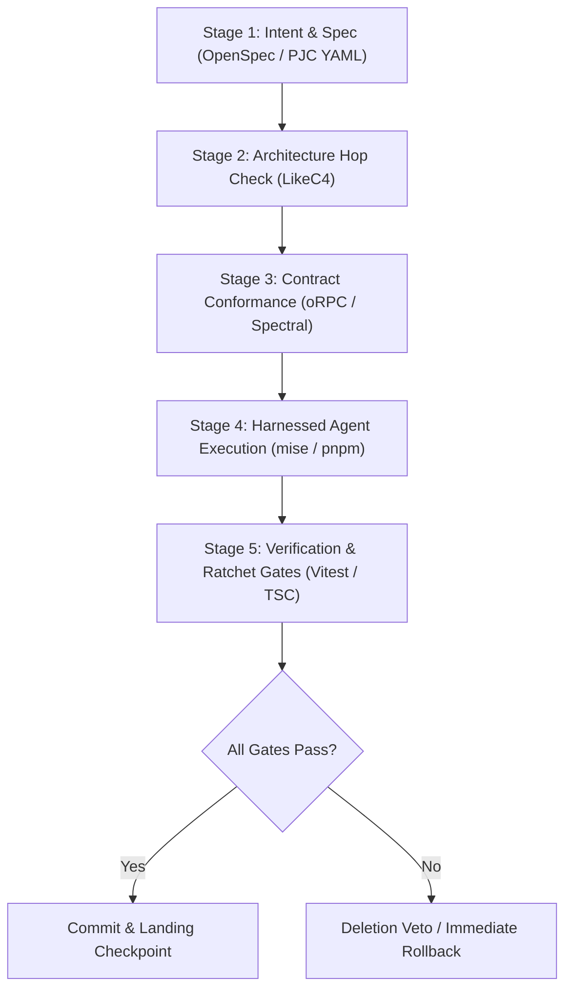

# Sovereign Engineering Guide: Software Roles, Deterministic CLI Tooling, and End-to-End Wiring

## Executive Mandate: Monorepo Discipline
In strict compliance with our monorepo invariants:
1. **Tool Discipline**: All runtime tools and environment versions are managed exclusively via `mise` (`mise.toml`: Node 24, pnpm 12, Bun 1.4).
2. **Zero Global Pollution**: Never pollute global system directories with ad-hoc packages (`npm install -g`). All external agentic CLI harnesses are invoked deterministically through `pnpm dlx` or declared project dependencies.
3. **Real Weight Over Text Projections**: Every role owns concrete, version-controlled artifacts and deterministic verification commands.

---

## 1. Software Team Roles & Their Canonical CLI Harnesses

```
┌────────────────────────────────────────────────────────────────────────────────────────┐
│                                 THE PRODUCTION PIPELINE                                │
├─────────────────────────┬──────────────────────────┬───────────────────────────────────┤
│ Role                    │ Owned Artifact           │ Canonical CLI Harness (mise/pnpm) │
├─────────────────────────┼──────────────────────────┼───────────────────────────────────┤
│ 1. Product / Spec Owner │ PJC YAML & Statecharts   │ pnpm pjc check                    │
│                         │ OpenSpec Changesets      │ pnpm dlx @fission-ai/openspec     │
├─────────────────────────┼──────────────────────────┼───────────────────────────────────┤
│ 2. System Architect     │ LikeC4 Graph Model       │ pnpm exec likec4 validate         │
│                         │ Protocol Schemas         │ pnpm dlx @stoplight/spectral-cli  │
├─────────────────────────┼──────────────────────────┼───────────────────────────────────┤
│ 3. API & Core Engineer  │ oRPC v2 & Zod Schemas    │ pnpm audit:conformance            │
│                         │ PowerSync Drizzle Models │ pnpm audit:api-composition        │
├─────────────────────────┼──────────────────────────┼───────────────────────────────────┤
│ 4. Design & UI Engineer │ Route Catalog & Kit      │ node scripts/route-catalog.mjs    │
│                         │ Navigators & Theme       │ pnpm check:anti-slop              │
├─────────────────────────┼──────────────────────────┼───────────────────────────────────┤
│ 5. Autonomous Agent     │ Multi-file refactors     │ pnpm exec tsc                     │
│                         │ Evidence harvesting      │ pnpm --filter @repo/core test     │
└─────────────────────────┴──────────────────────────┴───────────────────────────────────┘
```

---

## 2. Deep Dive by Role: Responsibilities & Tooling

### Role 1: Product & Spec Architect
- **Mission**: Ground user intent, situation, acceptance criteria, and interaction transitions. Eliminate "vibe coding" by defining specs before code.
- **Artifacts**:
  - `packages/core/src/flows/pjc/*.yaml`: Human- and agent-readable journey definitions.
  - `openspec/`: Delta-based change proposals for brownfield features.
- **Commands**:
  - `pnpm exec tsx --tsconfig packages/core/tsconfig.json scripts/pjc.ts check`: Asserts complete continuity, unique IDs, and zero broken references across all 10 canonical modules.
  - `pnpm dlx @fission-ai/openspec@latest propose`: Generates a structured change specification without mutating working code.

### Role 2: System Architect
- **Mission**: Enforce system topology, trust boundaries, channel models, and zero-island protocol invariants.
- **Artifacts**:
  - `docs/architecture/model/gurudevi.c4`: The single source of truth for all system containers and relationships.
- **Commands**:
  - `pnpm exec likec4 validate docs/architecture/model`: Performs layout AST and hop validation.
  - `pnpm dlx @stoplight/spectral-cli@latest lint <schema>`: Lints OpenAPI, JSON-RPC, and async channel contracts.

### Role 3: API & Protocol Engineer
- **Mission**: Implement type-safe domain procedures, SQLite WAL synchronization, and authorization policies.
- **Artifacts**:
  - `apps/sanctuary-api/src/modules/`: Module-based monolithic procedures.
  - `packages/core/src/api/v1/`: Native oRPC v2 contracts.
- **Commands**:
  - `pnpm --filter @repo/sanctuary-api audit:conformance`: Compares module capability cards, router procedures, and tests, failing if gap counts increase.
  - `pnpm audit:api-composition`: Enforces horizontal foundation boundaries without admitting ad-hoc legacy procedures.

### Role 4: Design & Frontend Engineer
- **Mission**: Build deterministic screens and layout sync across Mobile (Expo 58 / React Native 0.88) and Web (TanStack Router).
- **Artifacts**:
  - `packages/core/src/flows/navigationPolicy.ts`: Taste decisions, presentation rules (compact vs. regular).
  - `packages/core/src/routing/routeCatalog.generated.ts`: Mechanically compiled route trees.
- **Commands**:
  - `node scripts/route-catalog.mjs --check`: Asserts that compiled routes match physical file trees.
  - `pnpm check:anti-slop`: Enforces UI boundaries, forbidding legacy UI imports and raw color styling.

### Role 5: Autonomous Agent & Gatekeeper
- **Mission**: Execute scoped, bounded implementation loops and verify against all non-negotiable monorepo gates.
- **Artifacts**:
  - `reports/`: Audit logs, test results, and evidence.
  - `tooling/ratchet.json`: Monotonically non-decreasing quality ratchets.
- **Commands**:
  - `pnpm --filter @repo/core exec vitest run src/flows/pjc`: Asserts 100% test integrity.
  - `pnpm exec tsc`: Zero unverified TypeScript types.

---

## 3. End-to-End Verification Pipeline (How It Wires Together)



1. **Spec Ingestion**: When a new feature or change is requested, it starts as an OpenSpec proposal or PJC YAML module.
2. **Hop Verification**: Before generating code, `likec4 validate` ensures the requested communication path doesn't violate container boundaries.
3. **Route & Screen Sync**: `scripts/pjc.ts check` cross-references step bindings against `routeCatalog.generated.ts`.
4. **Agent Self-Healing**: The agent runs scoped `vitest` and `tsc` runs locally using `pnpm`.
5. **Ratchet Gatekeeper**: The CI ratchet guarantees zero legacy regressions, zero unannotated deprecations, and zero silent deletions.
