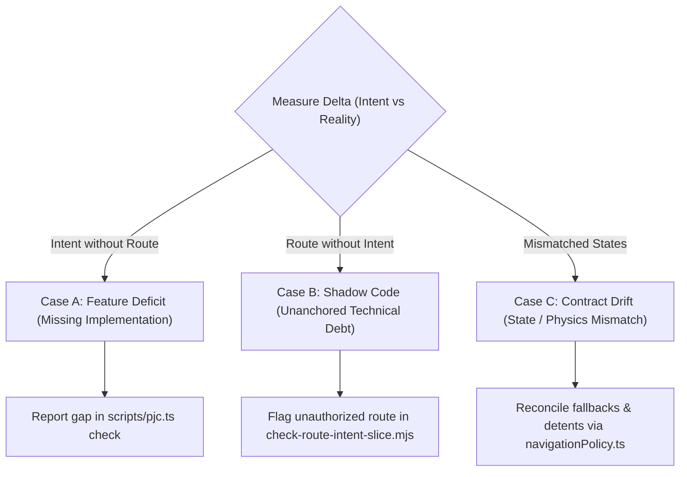
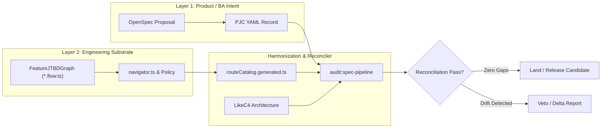

# Two-Layer Systemic Harmonization & Monorepo Tool Registry

**Date**: 2026-11-18  
**Status**: Canonical Standard  
**Governing Invariant**: *Intent and Execution are two distinct layers that drift by default. Software architecture exists to continuously measure and harmonize the delta between them.*

---

## 1. The Two-Layer Epistemic Model

```
┌────────────────────────────────────────────────────────────────────────────────────────┐
│                        LAYER 1: INTENT & SPECIFICATION LAYER                           │
│   Owned by: Product Manager, Business Analyst, QA Lead, Auditor                        │
│   Substrate: PJC YAML (`packages/core/src/flows/pjc/*.yaml`), OpenSpec deltas          │
│   Vocabulary: Situations, Desired Outcomes, Legal Preconditions, Evidence Tiers        │
└───────────────────────────────────┬────────────────────────────────────────────────────┘
                                    │
                         THE HARMONIZATION SEAM
                 "Continuous Delta & Drift Measurement"
                         Intent - Reality = Gap
                                    │
┌───────────────────────────────────▼────────────────────────────────────────────────────┐
│                        LAYER 2: SUBSTRATE & EXECUTION LAYER                            │
│   Owned by: Systems Architect, UI/UX Engineer, Core Runtime Developer                 │
│   Substrate: `FLOW_REGISTRY` (`*.flow.ts`), `navigator.ts`, `navigationPolicy.ts`       │
│   Vocabulary: Route patterns, Screen detents (0.5/1.0), Layout split-views, NavOps     │
└────────────────────────────────────────────────────────────────────────────────────────┘
```

### Why They Cannot Be Collapsed Into One:
- **Layer 1 (The Intent Layer)** must express what *should* happen in human, business, and regulatory terms. It owns user outcomes, GDPR/PDPA compliance, and evidence tiers (`G0` through `R1`).
- **Layer 2 (The Substrate Layer)** must express how it physically executes in silicon and pixels: Reanimated spring physics, gesture interruptions, tablet split-outlets, and SQLite WAL sync.
- Trying to force Layer 2 into Layer 1 makes the spec unreadable to product owners. Trying to force Layer 1 into Layer 2 pollutes the runtime engine with non-executable prose. They must co-exist as equals.

---

## 2. Handling Default Drift: The Reconciliation Engine

Because software naturally drifts, our toolchain assumes deviation by default. We categorize and handle drift via three mechanical patterns:



1. **Case A: Feature Deficit (Intent > Reality)**:
   - *Symptom*: Layer 1 declares a journey step that has no corresponding screen in Layer 2.
   - *Resolution*: `scripts/pjc.ts check` reports a `binding: missing` gap. The scenario remains unverified.
2. **Case B: Shadow Code (Reality > Intent)**:
   - *Symptom*: Layer 2 exports routes or procedures that have no link in Layer 1.
   - *Resolution*: `scripts/check-route-intent-slice.mjs` identifies unauthorized routes and prevents unmonitored feature bloat.
3. **Case C: Contract & Physics Drift (Intent $\neq$ Reality)**:
   - *Symptom*: Layer 1 assumes an instant transition, but Layer 2 implements a modal sheet with an offline fallback.
   - *Resolution*: Harmonize Layer 1 scenarios with the physical `FlowNodeStep` fallback conditions and `NAVIGATION_POLICY` presentation rules.

---

## 3. Comprehensive Monorepo Tool & Script Registry

To prevent tools, scripts, and duplicate capabilities from being lost or reinvented across sessions, all relevant assets are indexed below:

| Layer / Category | Tool / Script | Location | Purpose & Role |
| :--- | :--- | :--- | :--- |
| **Layer 1: Intent** | PJC YAML Modules | `packages/core/src/flows/pjc/*.yaml` | 10 canonical modules modeling product features and actor journeys. |
| **Layer 1: Intent** | PJC Hierarchy & Query | `packages/core/src/flows/pjc/hierarchy.ts`, `hierarchyQuery.ts` | Validates YAML schemas, projects journeys, and outputs Mermaid statecharts. |
| **Layer 1: Intent** | PJC CLI Harness | `scripts/pjc.ts` | Primary CLI command (`tree`, `list`, `journey`, `trace`, `check`). |
| **Layer 1: Intent** | OpenSpec CLI | `@fission-ai/openspec` (pnpm) | Manages delta change proposals before promotion to canonical PJC. |
| **Layer 2: Execution**| Flow Registry | `packages/core/src/flows/*.flow.ts` | 15 live `FeatureJTBDGraph` definitions with triggers and fallbacks. |
| **Layer 2: Execution**| Navigation Policy | `packages/core/src/flows/navigationPolicy.ts` | Taste decisions, sheet detents `[0.5, 1.0]`, size-class breakpoints, NavOps. |
| **Layer 2: Execution**| Flow Navigator | `packages/core/src/flows/navigator.ts` | Pure function resolving `(flowId, stepId) -> ResolvedStep`. |
| **Layer 2: Execution**| Route Catalog | `scripts/route-catalog.mjs` | Compiles physical Expo 58 & TanStack routes into `routeCatalog.generated.ts`. |
| **Seam / Reconciler** | Flow DAG Audit | `scripts/audit-flow-dag.mjs` | Verifies that live routes satisfy the `FeatureJTBDGraph` nodes. |
| **Seam / Reconciler** | Route Intent Slice | `scripts/check-route-intent-slice.mjs` | Asserts physical routes map back to intentional product slices. |
| **Seam / Reconciler** | Journey Pilot Checker| `packages/core/src/flows/journeyPilot.ts` | Validates transition reachability, cycles, and disconnects. |
| **Seam / Reconciler** | Architecture Scout | `packages/platform-mcp/src/services/ScoutService.ts` | Ingests LikeC4 models and file graphs into unified agent dossiers. |
| **Gatekeeper** | Spec Pipeline | `pnpm run audit:spec-pipeline` | Single root command validating PJC, LikeC4, Spectral, and Route Catalog. |

---

## 4. Operational Harmonization Workflow


