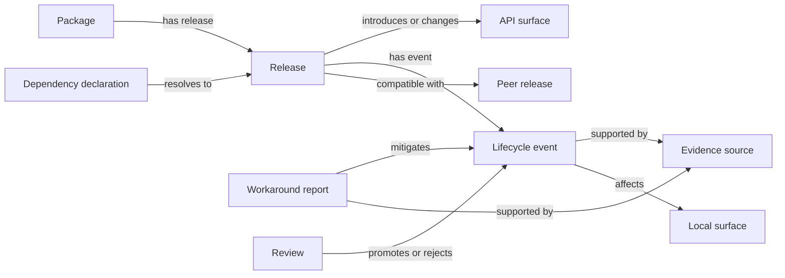

# Dependency Intelligence Graph

## Layer and reading order

> **Layer**: B (Persistence + Access) of a two-layer system.
> **Read first**: [dependency-intelligence-master.md](./dependency-intelligence-master.md) — the highest-level integration document.
> **Layer A** (Knowledge Model): [changelog-intelligence-universal-architecture.md](../../projects/rn-terrain/docs/architecture/changelog-intelligence-universal-architecture.md) — role taxonomy, entry schema, seeding protocol.
>
> This document owns: Supabase schema, evidence policy, evidence tiers, review lifecycle, RPC functions, MCP tools, local scanner, upgrade gate, and operational cadence.
> It does NOT own: role taxonomy, tier algorithm, impact type vocabulary, or seeding protocol (those are Layer A).

## Purpose and reading contract

This is the canonical specification for the Layer B persistence and access system. It exists because package manifests and lockfiles say what is installed, but do not tell an engineer or agent what changed between releases, which APIs are no longer safe, which compatibility trains must move together, or where the application relies on an upstream behaviour.

Read this document before proposing, reviewing, or implementing a mobile-native dependency upgrade. It is written for a developer or agent starting with no prior conversation context. The system must let that reader answer these questions with dated, cited evidence:

- What version is actually resolved and why is it present?
- Is this package foundational to boot, native builds, data correctness, functional capability, or UX only?
- Which releases in the current and preceding major changed its contract?
- What was added, deprecated, removed, broken, fixed, or made incompatible?
- What changes together with it, and what local code/configuration is exposed?
- Which mitigation is official guidance, and which is a field workaround reported by the community?

The system is an engineering memory and decision-support surface. It does not grant permission to upgrade dependencies, change pins, use pre-releases, alter generated native projects, or bypass the rules in the repository `AGENTS.md`.

## Canonical decisions

| Decision | Rule |
|---|---|
| System of record | A restricted `dependency_intelligence` schema in the existing Supabase project is the durable graph. |
| Human and agent access | Supabase GraphQL exposes relationship data; read-only Platform MCP tools expose safe, task-oriented queries; generated Markdown and JSON snapshots are committed review mirrors. |
| Search | Structured graph filters and chronological queries are authoritative. PostgreSQL full-text search and pgvector embeddings improve discovery but never override an exact version, source, or compatibility result. |
| Scope | Every direct, production mobile-native dependency in `apps/gurudevi-mobile/package.json`, including Expo modules. Root dependencies are included when they resolve into the mobile runtime. Relevant transitive native packages become graph nodes when a direct package or compatibility claim depends on them. |
| Historical window | For every scoped upstream package, ingest every stable release in the installed major and its immediately preceding major, including patches. Older releases are added only when they explain a still-active migration, deprecation, or compatibility constraint. |
| Evidence | Official sources establish facts. Community material is retained as separately labelled field evidence and never silently becomes an official compatibility claim. |
| Community retention | Store URL, author/source metadata, timestamp, content hash, normalized excerpt, retrieval time, applicable version range, and review state. Do not archive complete third-party content by default. |
| Operations | Automated collection runs continuously; humans promote or reject candidate claims in a weekly review queue. |
| Security | Ingestion uses server credentials. The mobile application receives no graph write access and does not depend on the graph at runtime. |

## Scope and boundaries

### In scope

The initial release inventories every direct dependency that is native-capable or configures the mobile runtime, plus the supporting compatibility chain. This includes the Expo SDK/modules, React, React Native, Metro/config plugins where they determine native behaviour, Expo Router and navigation peers, gesture/animation/worklet packages, native-module infrastructure, storage/sync, rendering, screens/safe areas, release/update infrastructure, observability SDKs, and feature-specific native integrations such as camera, maps, payments, notifications, media, authentication, and web views.

The initial analysis begins with the platform spine:

```text
Expo SDK ── React Native ── React
    │             │
    │             ├── Gesture Handler ── Reanimated ── Worklets
    │             ├── Nitro Modules ── MMKV and Nitro consumers
    │             ├── Screens ── Safe Area ── Router/navigation
    │             └── Skia / SVG / graphics dependencies
    │
    ├── Expo Router, Metro, config plugins, dev client, updates
    └── Expo native modules and platform configuration
```

The system also records local workspace packages as *local surfaces* and ownership boundaries. They are not automatically treated as upstream packages with an external changelog.

### Out of scope

- Blindly changing a dependency version, adopting an upstream migration, or changing application code.
- Replacing package security/SBOM, license-compliance, vulnerability, or standard dependency-health tooling.
- Treating a Reddit thread, X post, GitHub issue, or blog post as an official guarantee.
- Copying complete third-party pages or posts into the database.
- Making the graph a production application dependency, client-side feature, authorization store, or runtime configuration authority.
- Replacing the generated stack map, technology radar, or the existing lockfile as their respective sources of truth.

## Importance and impact taxonomy

Every scoped dependency receives both a functional role and an impact vector. A package may be critical in one dimension and non-critical in another; a single “critical/non-critical” label is too coarse.

| Dimension | Meaning | Typical consequence if incompatible |
|---|---|---|
| Runtime | App boot, JavaScript runtime, navigation root, provider initialization, New Architecture execution | App cannot start, a root route fails, or a native module cannot load. |
| Build and release | Prebuild/config plugins, Gradle/Xcode, codegen, dev client, OTA/update compatibility | Debug/release build fails, store binary is invalid, or an OTA is unsafe. |
| Data and correctness | Persistence, encryption, offline synchronization, authentication, payment, device/security state | Data loss, inconsistent state, privacy/security failure, or incorrect business behaviour. |
| Functional capability | A product feature can no longer be used while the app otherwise works | Camera, maps, login, notification, payment, or media function is unavailable. |
| UX and accessibility | Gestures, animation, layout, rendering, keyboard, lists, visual behaviour, assistive interaction | The product works but interaction, performance, accessibility, or visual fidelity regresses. |
| Observability and recovery | Crash capture, telemetry, updates, background tasks, recovery paths | Regressions become invisible or a recovery path cannot run. |

Each dimension is scored `none`, `low`, `material`, or `blocking`. The package profile records the evidence behind every non-`none` score. A package is foundational when a supported version mismatch can block runtime/build/data integrity or controls a compatibility train for packages that do.

The profile must separately state:

1. **Hard functional dependency** — a user capability cannot operate without it.
2. **Hard platform dependency** — a build, boot path, native bridge, release path, or correctness boundary cannot operate without it.
3. **UX dependency** — it primarily changes interaction/rendering quality, while a degraded but correct fallback may exist.
4. **Optional enhancement** — it has no known blocking path and can be analysed after higher-risk packages.

No tier authorizes removal of a dependency or fallback. Existing callers, recovery behaviour, platform variants, and tests still require separate review.

## Baseline and authoritative local inputs

The first inventory is calculated, not guessed, from these sources in priority order:

1. `pnpm-lock.yaml` for resolved versions and the actual peer/dependency graph.
2. `apps/gurudevi-mobile/package.json` for declared runtime dependencies and intentional Expo exclusions.
3. Root `package.json` and workspace manifests where mobile resolution is controlled outside the app manifest.
4. `apps/gurudevi-mobile/app.json`, config plugins, Metro/Babel configuration, and generated configuration output for native build influence.
5. Source imports, call sites, platform files, tests, and package ownership for local impact.
6. `docs/stack-map/landscape/dependency-annotations.yaml` and generated catalog for current curated context.

The graph records both **declared version**, **resolved version**, and **evaluation date**. A declaration is not proof that the correct peer tree installed. Conflicts between these inputs become a review finding, not a guessed correction.

Historical documents may describe older SDK trains. They remain useful evidence of past decisions but cannot override this graph’s resolved baseline. A current document must explicitly link to any older guidance it supersedes or narrows.

## Graph data model

Postgres is used as a relational property graph. Tables provide integrity, auditing, filtering, and RLS; typed edge rows provide graph traversal without requiring a separate graph database.



### Required entities

| Entity | Required fields | Responsibility |
|---|---|---|
| `packages` | canonical npm name, publisher, ecosystem, repository/docs URLs, category, active state | One identity per upstream package. |
| `releases` | package, exact semver, release date, prerelease flag, registry/release URL, normalized notes, source hash | One row for every collected release. |
| `dependency_declarations` | workspace/app owner, manifest path, declared range, dependency kind, observation date | What the repository declared at a point in time. |
| `resolved_packages` | lockfile snapshot, package/version, integrity/peer context, observation date | What pnpm actually resolved. |
| `api_surfaces` | package, stable symbol/path/config/API name, platform, lifecycle state | The upstream public surface being discussed. |
| `lifecycle_events` | release, event class, severity, summary, version range, official/field status, migration action, review state | Added, changed, deprecated, removed, breaking, fixed, regression, security, compatibility, or documentation correction. |
| `compatibility_claims` | source release/range, target package/range, platform/runtime condition, direction, confidence, source tier | Exact compatibility facts and constraints. |
| `local_surfaces` | workspace package/app, path, symbol/config/route/build surface, owner, platform, import/use kind | Local exposure and impact evidence. |
| `evidence_sources` | URL, source class, publisher/author, publication and retrieval timestamps, license/retention state, hash | Provenance independent of an event. |
| `evidence_items` | source, normalized excerpt, claim role, applicable range, extraction method, confidence | Citable evidence associated with graph claims. |
| `workaround_reports` | problem signature, affected range, workaround, outcome, confidence, source tier, status | Community and local field experience, never an official fact by implication. |
| `reviews` | candidate, reviewer, verdict, rationale, timestamp, supersession link | Human promotion, correction, or rejection audit trail. |
| `graph_edges` | from entity/type, relation, to entity/type, range/condition, evidence, status | Cross-entity traversal and provenance. |

IDs are stable UUIDs internally. Public query filters use package name, exact semver, version range, API key, and repository-relative local path; no caller depends on a generated UUID.

### Event vocabulary

`added`, `changed`, `deprecated`, `removed`, `breaking`, `fixed`, `regression`, `compatibility`, `security`, `performance`, `build`, `runtime`, `data`, `accessibility`, and `documentation` are the controlled event classes. An event may have several impact dimensions but exactly one primary class. Free-form labels do not replace the controlled vocabulary.

Every event must say whether action is `none`, `observe`, `prepare`, `required-before-upgrade`, `required-now`, or `blocked-awaiting-upstream`. “Breaking” without a version range, source, and concrete impacted surface is an incomplete candidate, not a trusted event.

## Evidence policy

### Source tiers

| Tier | Examples | Permitted conclusion |
|---|---|---|
| Official | Maintainer release notes, official docs/migration guides, official compatibility matrices, package source, verified maintainer issue response | Establishes release/API/compatibility facts when cited to an exact version or range. |
| First-party operational | This repository’s lockfile, code/config scan, build/test/device evidence, internal decision record | Establishes local usage and observed local effect; does not prove an upstream guarantee. |
| Community field evidence | GitHub issues/discussions, Reddit, X/public posts, Stack Overflow, blogs, reproducible external reports | Identifies symptoms, workarounds, and possible regressions. Requires visible uncertainty and review. |
| Unverified | Aggregators, snippets without a reachable source, anonymous claims without a reproducible path | Remains a discovery lead and is not shown as upgrade guidance. |

Official and field evidence must be visually distinct in GraphQL responses, MCP output, and generated docs. A community workaround must include its applicable version range, platform/environment when known, and failure signature. If these are unknown, the item remains a candidate.

### Collection and retention

Collectors may query public, permitted sources. They store metadata and a bounded normalized excerpt sufficient for review, along with a content hash and retrieval date. They do not evade login walls, access controls, robots policy, rate limits, terms of service, or copyright restrictions. Source links remain the route to complete third-party context.

Repeated reports are clustered by normalized package, version range, platform, error signature, and content similarity. Clustering never merges contrary reports into a single asserted fact. A source that disappears remains represented by its captured metadata/excerpt and is marked unavailable at last verification.

## Ingestion and review operation

The ingestion service is server-side and durable. It belongs with the existing server/worker topology, not the Expo client and not shared domain code. It uses idempotency keys based on source URL plus content hash, and it records every fetch outcome.

| Cadence | Job | Output |
|---|---|---|
| Every 6 hours | Official release/feed scan for tracked packages | New release candidates, changed notes, compatibility candidates. |
| Daily | Community discovery for tracked package/version/error terms | Candidate field reports and deduplicated clusters. |
| Daily | Local graph scan | Lockfile/manifests/import inventory drift candidates. |
| Weekly | Human review queue | Promoted, corrected, rejected, or deferred claims with rationale. |
| Per dependency change proposal | Upgrade gate refresh | Fresh profile, affected local surfaces, compatibility path, and unresolved candidates. |

The collector must be restart-safe and idempotent. Fetch failure, rate limiting, malformed semver, deleted content, contradictory sources, embedding failure, and vector-index lag are recorded as operational events; they must not erase prior reviewed evidence or prevent exact graph queries.

Promotion rules:

1. Official facts are promoted only when the cited source and exact release/range are stored.
2. Field reports are promoted only to `reviewed workaround` or `reviewed regression signal`, never to official compatibility.
3. A reviewer may downgrade, split, supersede, or reject a claim; prior decisions stay auditable.
4. A new release never automatically changes the repository’s dependency declaration or pin.

## Query surfaces

### Supabase GraphQL and traversal functions

Generated GraphQL supports normal entity and relationship exploration. Read-only SQL/RPC functions provide the recursive and chronology-specific queries GraphQL alone should not improvise:

| Function | Required input | Result |
|---|---|---|
| `dependency_profile` | package, optional resolved version | Importance matrix, local adoption, current constraints, review state. |
| `dependency_timeline` | package, from/to major or exact range | Ordered releases and classified events with citations. |
| `dependency_compatibility_path` | package/version, target package/version/platform | Typed compatibility edges, conditions, and gaps. |
| `dependency_local_impact` | package/version or event | Affected repository surfaces, configuration, owners, and evidence. |
| `dependency_workarounds` | package, version range, optional failure signature | Official guidance first, then labelled field reports. |
| `dependency_search` | natural-language query plus package/range/type filters | Hybrid full-text/vector results with source tier and exact-match explanation. |
| `dependency_coverage` | optional category | Inventory and historical-window completeness, unreviewed candidates, stale local scans. |

All functions are read-only and parameterized. They return citations, source tier, confidence, and review status with every claim. Direct raw table access is not the default agent interface.

### Platform MCP

`@repo/platform-mcp` exposes the same read-only queries as explicit tools: `dependency_profile`, `dependency_timeline`, `dependency_compatibility_path`, `dependency_local_impact`, `dependency_workarounds`, `dependency_search`, and `dependency_coverage`.

Tool responses must lead with exact package/version facts, distinguish declared from resolved versions, group official and field evidence separately, and include limitations. For example, a semantic match must state that it is a retrieval suggestion rather than a compatibility determination. MCP does not expose write, promotion, migration, or package-update actions.

## Generated documentation contract

The database is durable source of truth; committed outputs are reviewable mirrors. A documented export job writes a dated, deterministic graph snapshot and regenerates only the dependency-intelligence documentation below. Generated files are never hand-edited.

```text
docs/stack-map/dependency-intelligence/
  README.md                         # generated entry point and freshness metadata
  coverage.md                       # scope, gaps, review state, and stale scans
  taxonomy.md                       # category and impact matrix
  graph.md                          # package and compatibility-train views
  timelines/                        # one chronological dossier per upstream package
  indexes/
    breaking-deprecated-removed.md
    compatibility-trains.md
    community-workarounds.md
    local-impact.md
  snapshots/                        # dated JSON export, schema-versioned
```

Each package dossier includes current declaration/resolution, tier and impact vector, dependency/compatibility edges, two-major timeline, API lifecycle index, relevant local surfaces, source citations, official migration actions, reviewed workarounds, unknowns, and last-review timestamp.

`docs/stack-map/README.md` remains the navigation boundary for stack-map material. `dependency-annotations.yaml` continues to own curated dependency annotations. The dependency intelligence generator may consume those annotations but must not silently overwrite their human decisions.

## Upgrade and agent workflow

Before an agent proposes an upgrade to any scoped package it must:

1. Query the profile for the actual resolved baseline and impact vector.
2. Query the timeline from the installed release through the proposed target.
3. Query the compatibility path for Expo/React Native/New Architecture/native peers and platform constraints.
4. Query local surfaces and inspect the named callers, config, platform variants, tests, and recovery paths.
5. Read official migration guidance and separately consider reviewed field reports.
6. State which changes are required, which are preparatory, which are unproven, and which require a product decision.
7. Preserve current behavior until the approved migration has evidence at the required test/runtime level.

An upgrade PR must attach the query snapshot or generated dossier revision used for its decision. If coverage is incomplete, the PR is blocked for foundational packages and carries an explicit risk exception for lower-tier packages. The graph is a planning gate, not a substitute for type checks, lint, tests, Metro, native builds, or device validation.

## Implementation and acceptance sequence

1. **Foundation and schema:** add migration, RLS, controlled vocabularies, indexes, full-text/vector fields, read-only views/functions, and a schema-versioned export contract.
2. **Inventory:** parse manifests/lockfile/configuration into all scoped packages, declarations, resolved nodes, and baseline local surfaces. Record gaps rather than guessing.
3. **Release history:** ingest the complete current-major and prior-major stable timeline for every scoped package, then model compatibility trains and API lifecycle events.
4. **Evidence and review:** ingest official sources and community candidates, configure deduplication, establish the weekly review workflow, and publish the first review ledger.
5. **Access:** expose GraphQL relationships, RPC traversal, MCP tools, and generated documentation/snapshot outputs.
6. **Upgrade integration:** add coverage/freshness checks to the dependency-change workflow without weakening existing dependency, native-build, or quality gates.

Completion criteria for the initial release:

- 100% of scoped mobile-native direct dependencies have package profiles and impact classification.
- Every scoped package has all stable releases for its installed and preceding major represented, or a documented collection gap.
- Every trusted event has exact version applicability and cited evidence.
- Every foundational package has compatibility edges and a current local-impact inventory.
- Official facts and community reports are segregated in all query and documentation surfaces.
- GraphQL, RPC, MCP, snapshot, and documentation generation have automated contract coverage.
- A developer can answer the opening questions from a clean checkout and a generated dossier without relying on an agent’s training memory.

## Verification requirements

The implementation must include database migration/constraint tests, RLS tests, ingestion idempotency and retry tests, semver/range tests, source-tier and review-state tests, graph traversal tests, GraphQL/RPC contract tests, MCP contract tests, deterministic documentation snapshot tests, and search-ranking tests.

Scenario tests must demonstrate at least one known multi-package compatibility path, one deprecation-to-removal timeline, one local-surface query, one official migration result, and one separately labelled community workaround. Test reports must use the repository evidence protocol: exact command/configuration, evidence level, engine/runtime, files and counts, what assertions prove, and what they do not prove. A green unit fixture does not prove a native build, Metro runtime, device interaction, or production safety.

## Relationship to existing documentation

- `AGENTS.md` remains binding for Expo, React Native, Gradle, generated native directories, sacred pins, and quality gates.
- `docs/stack-map/README.md` explains the generated architecture map and technology radar; this specification adds a historical/lifecycle intelligence layer rather than replacing it.
- Existing dated dependency audits remain historical evidence. They should be linked as source material where useful, not rewritten to appear current.
- Existing active lifecycle/update guides must be reviewed against this document’s current baseline. If they conflict, update the living guide or add an explicit supersession link; do not leave silent contradictory instructions.

## Maintenance ownership

The platform owner is accountable for the schema, collector, review queue, exports, and MCP access policy. Dependency owners are accountable for confirming local-surface impact and validating upgrade migrations. Reviewers are accountable for evidence promotion quality. Agents may collect candidates and draft analyses but may not promote their own unreviewed community evidence into a trusted compatibility or migration claim.

This document is living. Update its `updated` date only after a real review or a change to scope, trust policy, data model, query contract, operational cadence, or ownership boundary.