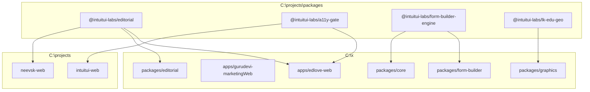

# Multi-Workspace Package Strategy & Open-Source Auditing Playbook

## 1. Executive Summary & Topology

This repository (`c:\x` / Polymath Platform) operates in tandem with external packages developed under the `@intuitui-labs/` namespace located in `c:\projects\packages\`.

Instead of duplicating code or publishing prematurely to public npm, all 4 shared domain packages are canonically maintained under `C:\projects\packages\`:

| Package Name | Canonical Path | Description | Consumers |
| :--- | :--- | :--- | :--- |
| **`@intuitui-labs/editorial`** | `C:\projects\packages\editorial` | Editorial publishing contracts, Git provenance, syndication, distribution ledger | `edlove-web`, `gurudevi-marketingWeb`, `neevsk-web` |
| **`@intuitui-labs/a11y-gate`** | `C:\projects\packages\a11y-gate` | APCA contrast math, CVD simulation, spatial grid, motion/tactile CSS | `edlove-web`, `intuitui-web` |
| **`@intuitui-labs/form-builder-engine`** | `C:\projects\packages\form-builder-engine` | Headless offline-first form builder state engine | `packages/core`, `packages/form-builder` |
| **`@intuitui-labs/lk-edu-geo`** | `C:\projects\packages\lk-edu-geo` | Sri Lanka education & administrative geo boundaries | `packages/graphics` |



---

## 2. The "Open-Source Stranger Test" (Audit & Verdict for All 28 Packages)

### The Stranger Test Rubric
If someone on GitHub discovers this repo, forks it, and tries to understand or extract a package:
1. **Zero Secret Coupling**: Can it run without private company intranet credentials, hardcoded paths, or unknown sibling folders?
2. **Blast Radius / Context Tax**: Does using this package force the developer to import your entire database, auth lifecycle, and mobile app?
3. **Engine vs. Organ**: Is this a **General Engine** (standalone tool) or an **Organ of EdLove** (internal domain logic)?

---

### Package Audit Table

| # | Package | Status / Scope | Stranger Test Verdict | Architectural Rationale |
|---|:---|:---|:---:|:---|
| 1 | **`a11y-gate`** | `@intuitui-labs/a11y-gate` | 🟢 **PASS (A+)** | **Pure Math & Design System Engine**. Zero business bias. APCA contrast, CVD simulation, spatial harmony. Extracted to `c:\projects\packages\a11y-gate`. |
| 2 | **`editorial`** | `@intuitui-labs/editorial` | 🟢 **PASS (A)** | **Agnostic Publishing Contracts & Ledger**. Git provenance timestamps and distribution adapters. Extracted to `c:\projects\packages\editorial`. |
| 3 | **`lk-edu-geo`** | `@intuitui-labs/lk-edu-geo` | 🟢 **PASS (A-)** | **Open Data Asset**. Standalone geo dataset for Sri Lanka administrative and educational zones. Extracted to `c:\projects\packages\lk-edu-geo`. |
| 4 | **`form-builder-engine`** | `@intuitui-labs/form-builder-engine` | 🟡 **PASS (B+)** | **Headless State & Schema Engine**. Extracted to `c:\projects\packages\form-builder-engine`. Builds on `@tanstack/form-core`. Highly valuable if kept unopinionated. |
| 5 | **`scanner-kit`** | `@repo/scanner-kit` | 🟡 **CONDITIONAL (B)** | **Hardware / ML Tooling**. Wraps ML Kit barcode and QR tools. High candidate for future extraction if mobile screens are decoupled from `@repo/core` / `@repo/ui`. |
| 6 | **`graphics`** | `@repo/graphics` | 🟡 **CONDITIONAL (B)** | **Visual Knowledge Topology**. Candidate for extraction once domain-specific charts are moved to feature packages. |
| 7 | **`analytics`** | `@repo/analytics` | 🟡 **CONDITIONAL (B-)** | **Telemetry Pipeline**. Currently coupled to `@repo/core` and `@repo/ui`. To pass as a standalone package, telemetry dispatching must be provider-neutral. |
| 8 | **`payments`** | `@repo/payments` | 🔴 **INTERNAL ONLY** | **App Organ**. Directly depends on `@repo/accounting`, `@repo/core`, and Supabase payment ledger tables. Must remain in the monorepo. |
| 9 | **`accounting`** | `@repo/accounting` | 🔴 **INTERNAL ONLY** | **App Organ**. Double-entry accounting ledger tied to school fee schedules and student billing entities. |
| 10 | **`classroom`** | `@repo/classroom` | 🔴 **INTERNAL ONLY** | **Domain Module**. Attendance, grading, syllabus, student profiles. Deeply coupled to ZenStack models. |
| 11 | **`community`** | `@repo/community` | 🔴 **INTERNAL ONLY** | **Domain Module**. Posts, reactions, moderation policies, and feed rendering for the Gurudevi community. |
| 12 | **`library`** | `@repo/library` | 🔴 **INTERNAL ONLY** | **Domain Module**. Digital media catalog, loans, and returns tied to student IDs. |
| 13 | **`people`** | `@repo/people` | 🔴 **INTERNAL ONLY** | **Domain Module**. Guardians, teachers, students, staff identity records. |
| 14 | **`profile`** | `@repo/profile` | 🔴 **INTERNAL ONLY** | **Domain Module**. User settings, avatar uploads, and public linktree. |
| 15 | **`workforce`** | `@repo/workforce` | 🔴 **INTERNAL ONLY** | **Domain Module**. Staff scheduling, leaves, payroll timecards. |
| 16 | **`policies`** | `@repo/policies` | 🔴 **INTERNAL ONLY** | **Domain Security**. Institutional compliance, child safety, data retention rules. |
| 17 | **`self`** | `@repo/self` | 🔴 **INTERNAL ONLY** | **Domain Module**. Personal wellbeing, reflection, and student self-assessment logs. |
| 18 | **`core`** | `@repo/core` | 🔴 **INTERNAL CORE** | **App Foundation**. Auth providers, device security, stores, ports & adapters for EdLove and Gurudevi. |
| 19 | **`ui`** | `@repo/ui` | 🔴 **INTERNAL CORE** | **Design System Implementation**. Brand tokens (Lotus, Saffron, Charcoal) and mobile/web navigation shells. |
| 20 | **`database`** | `@repo/database` | 🔴 **INTERNAL INFRA** | **ZenStack & Prisma ORM**. Schema definitions, migrations, and database clients. |
| 21 | **`schema`** | `@repo/schema` | 🔴 **INTERNAL INFRA** | **Zod Contracts & Type Guards** generated from database models. |
| 22 | **`ai`** | `@repo/ai` | 🔴 **INTERNAL ONLY** | **Feature Module**. Gurudevi AI assistant screens, chat streams, prompt engineering. |
| 23 | **`admin`** | `@repo/admin` | 🔴 **INTERNAL ONLY** | **Back-office Shell**. School administration dashboard and reports. |
| 24 | **`platform-mcp`** | `@repo/platform-mcp` | 🔴 **INTERNAL TOOLING** | **Agent Tooling**. Model Context Protocol server for sovereign device control and workspace audits. |
| 25 | **`form-builder`** | `@repo/form-builder` | 🔴 **INTERNAL UI** | **UI Implementation**. React Native & Web visual form components that consume `form-builder-engine`. |
| 26 | **`scripts`** | `@repo/scripts` | 🔴 **INTERNAL TOOLING** | Workspace refactoring, test runners, and sovereign cycle checkers. |
| 27 | **`types-shim`** | `@repo/types-shim` | 🔴 **INTERNAL TOOLING** | React Native type compatibility layer for Expo 57 / React 19. |
| 28 | **`typescript-config`**| `@repo/typescript-config` | 🔴 **INTERNAL TOOLING** | Workspace-wide base tsconfig compiler options. |

---

## 3. How Real Big Companies Operate (Monorepo vs. External Packages)

A common trap is the **Premature Abstraction Illusion**: assuming that because a feature looks clean, it must be an independent npm package.

### The Standard Industry Playbook (Google, Meta, Vercel, Supabase):
1. **Batteries-Included Monorepo (Cal.com, Ghost, Supabase)**:
   - When users clone an open-source platform, they want **one repo** that boots the entire product (`pnpm dev`).
   - Domain packages (`payments`, `classroom`, `accounting`) are **internal monorepo workspaces**, not separate repositories. This allows atomic commits, unified type-checking, and zero version-mismatch bugs.
2. **The "Rule of Three" for Extraction**:
   - Extract to `c:\projects\packages\` (or publish as `@intuitui-labs/*`) **only** when 2 or more completely unrelated applications demand the exact same capability without any shared business domain.
3. **Domain vs. Tooling Boundary**:
   - **Externalize**: Math, parsers, protocols, headless state machines, datasets (`a11y-gate`, `editorial`, `form-builder-engine`, `lk-edu-geo`).
   - **Internalize**: Anything touching ZenStack, Supabase RLS, business workflows, or branded UI components.

---

## 4. Local Linking & Live Editing Operations

### A. The Multi-Root Workspace (One Window)
Open `c:\x\polymath.code-workspace` in your IDE:
- Loads `c:\x` together with all 4 canonical packages from `c:\projects\packages` in the same Explorer tree.
- Edits made to canonical files update the source directly on disk.

### B. Watching & Auto-Compiling
```powershell
# Background watch compiler for active package development
pnpm --dir "C:\projects\packages\editorial" exec tsc --watch
pnpm --dir "C:\projects\packages\a11y-gate" exec tsc --watch
pnpm --dir "C:\projects\packages\form-builder-engine" exec tsc --watch
pnpm --dir "C:\projects\packages\lk-edu-geo" exec tsc --watch
```

### C. Future Public Open-Source Release
When `EdLove` is published to public GitHub:
1. Publish the 4 canonical packages to npm under `@intuitui-labs/*`.
2. In `c:\x`, replace `"link:C:/projects/..."` with semantic versions:
   ```json
   "@intuitui-labs/a11y-gate": "^1.0.0",
   "@intuitui-labs/editorial": "^1.0.0",
   "@intuitui-labs/form-builder-engine": "^1.0.0",
   "@intuitui-labs/lk-edu-geo": "^1.0.0"
   ```
3. Any open-source stranger anywhere in the world can run `git clone`, `pnpm install`, and `pnpm dev` without needing local folders or proprietary links.
