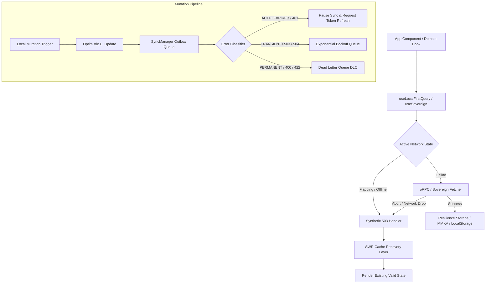
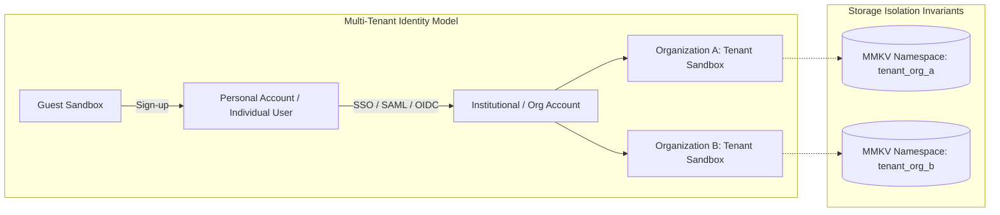

# Resilient State & Offline-First Engineering SOP

## 1. Executive Summary & Objective

The **Polymath Platform** is engineered to operate seamlessly across high-latency, unreliable, and fully offline environments while maintaining strict data integrity, zero UI freeze, predictable state convergence, and secure transition boundaries between guest and authenticated users.

This Standard Operating Procedure (SOP) formalizes the design patterns, failure recovery protocols, cross-platform invariants, and architectural decisions established during kernel-grade stress testing.

---

## 2. Core Architectural Pillars & Philosophy



### Pillar 1: Anti-Fragile Network Boundary
- **Never Throw Raw Network Exceptions to UI:** Uncaught fetch errors (`DOMException: AbortError`, `TypeError: Failed to fetch`, connection resets) are intercepted in `authenticatedSovereignFetch` and synthesized into clean HTTP `503 Service Unavailable` responses.
- **Immediate Failure Fast Path on Offline:** When a 503 occurs, retry layers (e.g. `ClientRetryPlugin`) must immediately bypass heavy exponential backoffs (avoiding 7+ second UI freezes) and return existing cached state.

### Pillar 2: Monotonic Sequence Inverted-Latency Shield
- **Race Condition Prevention:** Under erratic network conditions (e.g. slow 2G where query $N$ arrives after query $N+1$), all data hooks (`useLocalFirstQuery`) track a strictly increasing sequence counter (`sequenceRef`). Stale network resolutions that resolve out-of-order are silently dropped.

### Pillar 3: Non-Destructive Auth Expiration Handling
- **Separation of Permanent vs Auth Failures:** Expired JWTs (401) are explicitly classified under `AUTH_EXPIRED`. The `SyncManager` outbox immediately pauses execution, preserves all pending offline mutations in order, and emits a `sync:auth_required` event rather than dumping mutations into the Dead Letter Queue (DLQ).

### Pillar 4: SWR Cache Poisoning Defense
- **Preserve Stale Over Corrupt:** If a background revalidation receives a 500/503 or encounters a corrupted response, `withResilience` safely discards the failed payload and serves the previously validated cache without crashing or clearing local records.

### Pillar 5: Seamless Guest-to-Authenticated Identity Migration
- **Zero Loss User Transition:** When a guest logs in or signs up, local identity records, offline outbox intents, and local ReBAC bonds are re-keyed to the authenticated user ID via `migrateGuestDataToAuthenticatedUser`.

---

## 3. Developer Glossary & Mental Models

| Term | Definition & Context in Polymath Platform |
| :--- | :--- |
| **SWR (Stale-While-Revalidate)** | A caching strategy where the UI immediately serves cached data from fast local storage (MMKV / LocalStorage) while revalidating fresh data over the network asynchronously. |
| **Synthetic 503** | An artificial HTTP 503 response generated at the fetch wrapper when a network failure or abort occurs, standardizing error shapes across Web and React Native. |
| **Monotonic Sequence Counter** | An integer counter incremented per request that guarantees responses from older, slower requests are discarded if a newer request has already initiated. |
| **Outbox Pattern** | An asynchronous state queue where local write mutations are persisted to disk immediately and dispatched to the server when network connectivity is healthy. |
| **DLQ (Dead Letter Queue)** | A quarantine storage for mutations that failed due to permanent business logic violations (e.g., 400 Bad Request, 422 Unprocessable Entity, Schema mismatch). |
| **Head-of-Line (HoL) Blocking** | An outbox blockage caused when a failing item blocks all subsequent mutations. Solved by segregating transient errors (retried with backoff) and permanent errors (moved to DLQ). |
| **AUTH_EXPIRED Category** | A specialized sync error classification that temporarily pauses the outbox sync queue until the auth token is refreshed, preventing valid mutations from being marked as dead. |
| **Idempotency Key & Salt** | A unique, stable hash generated from request payload, timestamp bucket, and domain salt to ensure identical requests cannot be processed multiple times by the server. |
| **Storage Quota Degradation** | An adaptive eviction mechanism (LRU/TTL) that clears non-critical query caches before storage reaches physical capacity (MMKV limit or browser quota). |
| **Guest Identity Bond** | A local session token and device ID assigned to unauthenticated users, allowing offline interactions that seamlessly merge upon authentication. |

---

## 4. Standard Operating Procedures (SOP) for Domain Developers

### Guideline 1: Creating a Resilient Query Hook
When building any data-fetching hook in `@repo/core` or app packages:
1. Wrap network calls with `withResilience(cacheKey, fetcher, { ttlMs })`.
2. Ensure state hooks implement a monotonic `sequenceRef` counter if maintaining active subscription state.
3. Handle 503 responses as offline indicators, rendering local fallback data.

### Guideline 2: Queueing Mutations in the Outbox
When writing mutations that must succeed offline:
1. Provide a unique, reproducible `idempotencyKey`.
2. Use optimistic UI updates before queuing to `SyncManager`.
3. Never use raw `try / catch` blocks that swallow permanent errors.

### Guideline 3: Handling Auth Refreshes
1. Listen to `SyncManager` events:
```typescript
syncManager.on('sync:auth_required', async () => {
  const refreshed = await refreshToken();
  if (refreshed) {
    syncManager.resume();
  }
});
```

---

## 5. Staff Prompt Blueprint & Intuition-to-Engineering Translation

### The Master "Single-Prompt" Staff Engineer Directive
When prompting an AI agent or delegating to senior engineers to scaffold and harden full-stack resilience in one shot:

```markdown
Build an end-to-end, production-grade offline-first sync engine and query resilience layer for @repo/core and gurudevi-mobile with comprehensive chaos/disaster test coverage.

Key Invariants to Enforce:
1. Transport Resilience: Intercept DOMException/AbortError and network failures in the fetch client; synthesize standard HTTP 503s and short-circuit retry backoffs so offline requests fail fast without blocking UI threads.
2. Inverted Latency Defense: Add monotonic sequence tracking in useLocalFirstQuery so stale, slow responses from prior requests never overwrite fresher state.
3. Outbox & DLQ Lifecycle: Distinguish transient network errors, permanent schema/validation failures (moved to DLQ to prevent Head-of-Line blocking), and AUTH_EXPIRED / 401s (pause outbox drain and emit auth refresh events instead of corrupting or discarding queued mutations).
4. Cache Integrity: Enforce Stale-While-Revalidate (SWR) cache poisoning defense in withResilience so 500/503 server errors or corrupted payloads preserve existing valid local cache.
5. Storage & Quota Degradation: Implement graceful LRU/TTL cache degradation under quota exhaustion and corrupt storage recovery.
6. Identity Migration: Provide transactional re-keying of local guest identity, offline mutation outbox intents, and ReBAC bonds when transitioning to an authenticated session.
7. Verification & Docs: Write full Vitest scenario test suites for all chaos/edge cases, verify check-types passes with zero errors, and document the architectural pillars, SOP, and developer glossary in docs/architecture.
```

### Intuition-to-Terminology Dictionary

| Intuitive Sensation | Senior Systems Engineering Term | Technical Action |
| :--- | :--- | :--- |
| *"App freezes for seconds when Wi-Fi drops"* | **Offline Fast-Fail & Retry Short-Circuiting** | Return synthetic 503; bypass exponential backoff retry loops on UI thread. |
| *"Old search results pop up over fresh query results"* | **Inverted-Latency Race Condition** | Monotonic sequence counters or `AbortController` signal cancellation. |
| *"Token expired and offline mutations got deleted"* | **Auth Expiration DLQ Misclassification** | Classify 401s as `AUTH_EXPIRED`, pause outbox queue drain, fire auth refresh event. |
| *"500 error wiped the screen blank"* | **SWR Cache Poisoning** | Discard failed revalidation payload and retain previously validated local cache. |
| *"One invalid offline change blocked all subsequent ones"* | **Head-of-Line (HoL) Blocking** | Isolate non-retryable 4xx/validation errors into a Dead Letter Queue (DLQ). |
| *"Guest user signed in and lost their unauthenticated state"* | **Identity Reconciliation & Bond Re-keying** | Atomically migrate local identity tokens, outbox intents, and ReBAC graph relationships. |
| *"Database schema changed on server and old app is corrupting data"* | **App Version Gating (HARD_BLOCK / SOFT_NUDGE)** | Evaluate semver against remote manifest; freeze mutation outbox on HARD_BLOCK. |

---

## 6. Beyond B2C: Institutional Accounts & Multi-Tenant Switching

Transitioning to Pro / Enterprise / Institutional tiers introduces multi-tenancy and partition isolation:



### Invariants for Institutional / Multi-Tenant State:
1. **Isolated Storage Namespaces:** Every organization/institutional account must maintain isolated local storage partitions (e.g. `mmkv:tenant_<orgId>`) to prevent cross-tenant data leakage.
2. **Account Switching Without Storage Flush:** Switching from Personal to Institutional should pause active outboxes, flush in-flight personal mutations, switch storage contexts, and mount the institutional outbox.
3. **SSO / SAML / OIDC Token Refresh:** Institutional tokens often enforce strict session lifetimes (e.g., 15-minute IdP re-auth). `AUTH_EXPIRED` pause mechanisms ensure seamless IdP background token refresh without outbox loss.
4. **ReBAC Context Partitioning:** Institutional permissions (roles, team bonds, clearance levels) are scoped strictly to the tenant's relation tuple graph.

---

## 7. Verification & Test Suite Reference

All resilience invariants are enforced by automated test suites in `@repo/core` and `apps/gurudevi-mobile`:

- `packages/core/src/__tests__/scenarios/chaos-network-degradation.test.ts`
- `packages/core/src/__tests__/scenarios/concurrent-outbox-stress.test.ts`
- `packages/core/src/__tests__/scenarios/storage-quota-exhaustion.test.ts`
- `packages/core/src/__tests__/scenarios/storage-corruption-recovery.test.ts`
- `packages/core/src/__tests__/scenarios/stale-query-race-condition.test.ts`
- `packages/core/src/__tests__/scenarios/temporal-mutation-shield.test.ts`
- `packages/core/src/__tests__/scenarios/mutation-outbox-replay.test.ts`
- `packages/core/src/__tests__/scenarios/token-expiration-outbox.test.ts`
- `packages/core/src/__tests__/scenarios/idempotency-deep-collision.test.ts`
- `packages/core/src/__tests__/scenarios/swr-cache-poisoning-defense.test.ts`
- `packages/core/src/__tests__/scenarios/clock-skew-schema-lease-recovery.test.ts`
- `packages/core/src/__tests__/scenarios/multi-tenant-isolation.test.ts`
- `packages/core/src/__tests__/scenarios/app-version-gating.test.ts`
- `apps/gurudevi-mobile/src/__tests__/integration/guest-to-authenticated-pipeline.test.ts`
- `apps/gurudevi-mobile/src/__tests__/integration/guest-traversal-scenario.test.ts`
- `apps/gurudevi-mobile/src/__tests__/integration/network-flap-resilience.test.ts`
- `apps/gurudevi-mobile/src/__tests__/integration/reality-signals.test.ts`
- `apps/gurudevi-mobile/src/__tests__/integration/app-bootstrap-hydration.test.ts`
