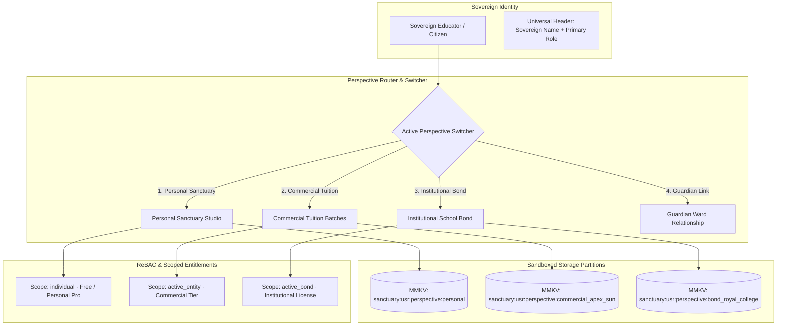
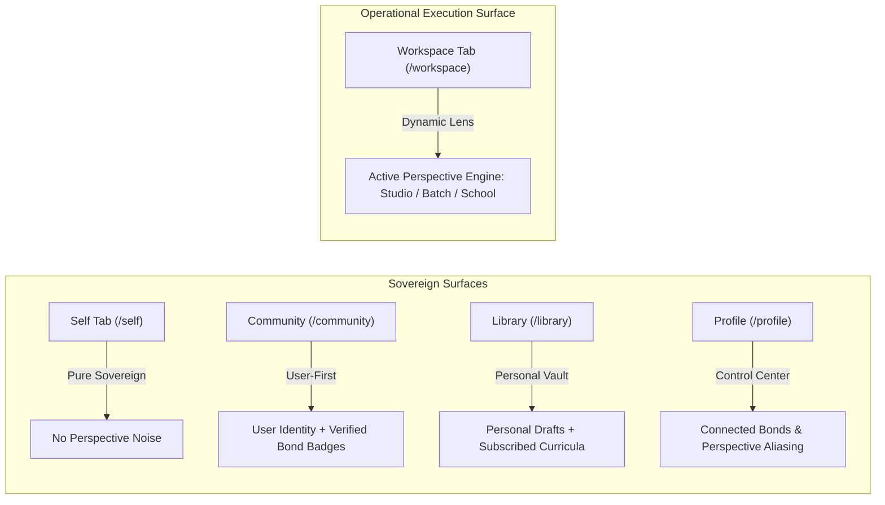

# Tripartite Multi-Perspective Architecture: Personal Sanctuary, Commercial Tuition & Institutional Bonds

## 1. Executive Summary & Problem Space

In conventional school ERPs, users are trapped in artificial "tenant silos":
- A teacher who works at a government school (e.g. Royal College) is forced into a flat institutional account.
- If that teacher also creates her own **master lesson drafts**, curates personal **question banks**, conducts **private tutoring batches** (e.g. at Apex Institute or home), or has children attending another school, standard multi-tenant software breaks down into multi-login friction, IP expropriation, or dangerous data cross-bleed.

**Gurudevi resolves this through the Sovereign Tripartite Perspective Model**:
1. **The User belongs to the Sovereign Sanctuary First** (`User` is sovereign).
2. **Institutions & Commercial Batches are Relational Bonds (ReBAC)**, not authorization silos.
3. **Data & Storage are Partitioned Sandboxes** (`sanctuary:<userId>:perspective:<perspectiveId>:<key>`).

---

## 2. The Tripartite Matrix

### Tripartite Comparison:

| Dimension | 1. Personal Sanctuary | 2. Commercial Tuition | 3. Institutional Bond |
| :--- | :--- | :--- | :--- |
| **Domain Scope** | Private craft, lesson studio, question vault, personal wellbeing | Independent classes, tuition halls (Apex, Rotary), private batches | Formal public/private schools (Royal College, CIS) |
| **Citizenship** | `SECOND_CLASS` (Authenticated individual) | `SECOND_CLASS` (or `FIRST_CLASS` verified entity) | `FIRST_CLASS` (Bonded to registered institution) |
| **Entitlement Scope** | `scope: 'individual'` (Free / Personal Pro) | `scope: 'active_entity'` (Commercial Starter/Pro/Enterprise) | `scope: 'active_bond'` (Institutional MoE License) |
| **Who Pays?** | The individual educator | The tutor or private tuition institute | The school / Ministry of Education |
| **Authority & Roles** | Creator & Owner of personal drafts | `founder`, `lead_tutor`, `assistant_tutor`, `paper_marker` | `teacher`, `gradeHead`, `sectionHead`, `principal` |
| **Data Visibility** | **Nobody but user** (Portable across career) | Enrolled commercial students & authorized staff markers | School teachers, students, parents, administrators |

---

## 3. Commercial Granularity & Personal Convenience

Commercial classes require a multi-dimensional matrix:
1. **Institute Entity**: Real DB entity (`Apex Institute - Nugegoda`) or Dummy/Independent Entity (`Private Online Studio`).
2. **Subject**: e.g., `Physics`, `Combined Mathematics`, `Sinhala`.
3. **Target Grade / Exam**: e.g., `2026 A/L`, `2027 A/L`, `Grade 11 (O/L)`.
4. **Medium of Instruction**: `Sinhala` | `English` | `Tamil`.
5. **Batch Slot**: e.g., `Sunday Morning (7.30 AM - 12.30 PM)`.
6. **Personal Custom Alias**: An editable convenience name set by the teacher (e.g. *"My Nugegoda Main Theory 🚀"*), overriding the canonical system name.

---

## 4. ReBAC Sub-Roles & Anti-Abuse Resource Auditing

### A. Commercial ReBAC Sub-Roles
A lead tutor can bond assistants to a specific batch without granting broad institute access:
- `lead_tutor`: Full batch authority (schedule, roster, fees, materials).
- `assistant_tutor`: Can broadcast announcements and take batch attendance.
- `paper_marker`: Can only view assigned student answer sheets for that specific batch.

### B. Anti-Abuse & AI Resource Ledger
When an institution (like Royal College) provides institutional AI budgets (e.g. automated quiz generation, exam paper grading):
1. **Perspective Stamping**: Every resource consumption records `perspectiveId`, `entityId`, `scope`, and `targetClassroomId`.
2. **Strict Boundary Validation**: A teacher cannot submit commercial tuition papers to Royal College's AI endpoint because the student IDs do not match the school's roster.
3. **Audit Ledger**: Principals/Admins inspect department consumption to eliminate off-duty or unauthorized usage.

## 5. UI Surface Integration & Non-Conflation Rules

To prevent confusing perspective operational tools with sovereign human identity, the app enforces a strict **Workspace-Scoped vs. Tagged-Identity Boundary**:

### Explicit Surface Rules:

1. **Workspace Tab (`/workspace`) — The Sole Operational Execution Lens**:
   - Perspective switching is strictly an **operational state** that governs `/workspace`.
   - The `/workspace` surface mutates completely based on the active perspective:
     - **Personal Perspective**: Renders the **Personal Studio Workbench** (Draft Lesson Studio, Question Bank).
     - **Commercial Perspective**: Renders the **Commercial Batch Workbench** (Batch Roster, Attendance, Submissions).
     - **Institutional Perspective**: Renders the **School Operations Dashboard** (Official Classrooms, Principal Hierarchy).
   - The Workspace Header displays the **Active Perspective Context Pill** (`[🏫 Royal College]` or `[💼 Apex 2026 Physics]`), which serves as the primary switcher trigger.

2. **Self Tab (`/self`) — Invariant Sanctuary (Zero Operational Bleed)**:
   - Contains **zero perspective noise**.
   - A teacher is a human being first: breath resets, morning reflection, personal habits, and daily wellbeing remain 100% invariant, regardless of which school or commercial batch she was just managing.

3. **Community Tab (`/community`) — Sovereign User with Contextual Bond Badges**:
   - The user never posts *as* "Royal College" or *as* "Apex Institute" in general community circles; the user posts as **themselves** (`User`).
   - Their active bonds and institutional affiliations render cleanly as **Verified Contextual Badges / Tags** (e.g. `Naveen [Royal College · Teacher] [Apex · Physics Lead]`).
   - This prevents identity conflation while preserving trust, academic authority, and authenticity.

4. **Library Tab (`/library`) — Personal Master Vault + Subscribed Curricula**:
   - Default view is the educator's **Personal Knowledge Vault** (saved resources, personal templates).
   - Institutional or commercial curricula appear as distinct, read-only subscribed shelves tagged by entity.

## 6. Relational Entity Primary Keys & Zero String-Packing Standard

To ensure high-performance SQL indexing, PowerSync replication, and database normalization (1NF), perspectives and bonds are never identified by colon-delimited string hacks (e.g. `persp:comm:inst:phys:2026`).

### Canonical Relational Entity Mapping:

| Perspective Category | Primary Key Entity | Foreign Keys & Indexed Columns | Storage Partition Key |
| :--- | :--- | :--- | :--- |
| **1. Personal Sanctuary** | `user_id` (UUIDv7) | `users.id`, `is_personal: true` | `sanctuary:<userId>:personal:<key>` |
| **2. Commercial Batch** | `batch_id` (UUIDv7) | `institute_id`, `subject_id`, `academic_year`, `medium` | `sanctuary:<userId>:batch:<batchId>:<key>` |
| **3. Institutional Bond** | `bond_id` (UUIDv7) | `school_id`, `user_id`, `capacity`, `academic_cycle_id` | `sanctuary:<userId>:school:<schoolId>:<capacity>:<key>` |
| **4. Guardian Bond** | `bond_id` (UUIDv7) | `user_id` (parent), `ward_user_id` (child) | `sanctuary:<userId>:ward:<wardUserId>:<key>` |

### Database Indexing & Query Isolation Invariants:
1. **B-Tree Composite Indexing**: All local SQLite and Postgres queries filter directly on foreign key UUID columns (`school_id`, `batch_id`, `user_id`), hitting composite indexes (e.g. `classrooms_school_academic_year_idx`, `attendance_classroom_date_status_idx`) in $O(\log N)$ time.
2. **Immutable Identity, Mutable Presentation**: When a tutor modifies a custom alias, subject name, or schedule, the `batch_id` remains immutable. Cached drafts, student marks, and attendance records remain 100% stable.
3. **Clean RLS & ReBAC Policy Evaluation**: Supabase RLS and Cedar policies evaluate relational joins (`EXISTS (SELECT 1 FROM bonds WHERE id = :activeBondId AND user_id = auth.uid())`) without regex splitting or string extraction.

