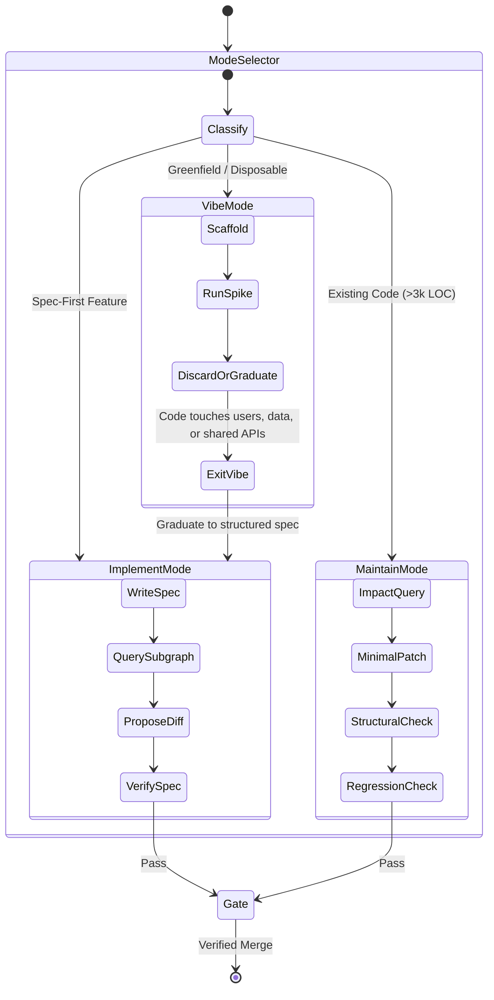

# The Recursive Agent Architecture: Substrate, Harness, Reasoner & Verification Engineering (2026)

> **"Treat the model as a reasoner, not a memory. Knowledge rot is what happens when structure, intent, and constraints live only inside a context window. The fix is a harness that externalizes those, then lets the model reason over a small, verified slice."**

---

## 1. The Three Layers, One Loop

Production agentic engineering is structured into three strictly decoupled layers operating in a closed loop:

```mermaid
graph TD
    classDef substrate fill:#1e1e2e,stroke:#89b4fa,stroke-width:2px,color:#cdd6f4;
    classDef harness fill:#181825,stroke:#a6e3a1,stroke-width:2px,color:#cdd6f4;
    classDef reasoner fill:#313244,stroke:#f38ba8,stroke-width:2px,color:#cdd6f4;

    subgraph Layer1 ["1. Durable Substrate (System of Record - Not the LLM)"]
        CG[("Code Knowledge Graph<br/>Tree-sitter + SQLite/Kuzu<br/>(Symbols, Calls, Imports, Blast Radius)")]:::substrate
        ADR["Specs, ADRs, Golden Schemas"]:::substrate
        Rules["Thin Versioned Policy Files (AGENTS.md)"]:::substrate
    end

    subgraph Layer2 ["2. Harness (Control Plane & Gatekeeper)"]
        Router["Task Router & Mode Selector<br/>(Vibe | Implement | Maintain)"]:::harness
        ContextAssembly["Context Assembler<br/>(Loads bounded 1-hop subgraph + Spec)"]:::harness
        VerEngine["Verification Engine<br/>(Structural + Behavioral + Contract)"]:::harness
        Gate["Dual-Pass Auditor / Human Veto"]:::harness
    end

    subgraph Layer3 ["3. Reasoner (The Model - Stateless CPU)"]
        Model["LLM Reasoning Engine<br/>(Plans, proposes diffs, reasons on delta)"]:::reasoner
    end

    %% Flow
    Router -->|Selects Mode & Subgraph| ContextAssembly
    CG <-->|MCP Queries: callers, callees, impact| ContextAssembly
    ADR --> ContextAssembly
    Rules --> ContextAssembly
    ContextAssembly -->|Bounded Slice (Sub-2k Tokens)| Model
    Model -->|Proposes Minimal AST Diff| VerEngine
    VerEngine -->|Impact Check & Golden Tests| Gate
    Gate -->|Rejected: Backpressure Loop| Model
    Gate -->|Verified Settlement| CG
```

### Layer 1: The Durable Substrate (System of Record)
* **What it is:** The code graph, AST symbol tables, specs, tests, architectural decision records (ADRs), and versioned policy files.
* **The Rule:** The LLM does *not* remember the codebase across sessions. The substrate is the sole external memory.
* **Mechanism:** Open-source Code Graph servers exposed via **Model Context Protocol (MCP)** using `tree-sitter` + SQLite/Kuzu (e.g. `codegraph-rust`, `stakgraph`, `codebase-memory-mcp`). It provides deterministic answers to:
  * `get_callers(symbol)`
  * `get_callees(symbol)`
  * `get_blast_radius(symbol)`
  * `find_references(symbol)`

### Layer 2: The Harness (Control Plane)
* **What it is:** The deterministic execution environment that routes tasks, assemblies bounded subgraphs, enforces sandbox permissions, and runs multi-level verification.
* **The Rule:** Refuses to merge or ship code without passing structural containment, behavioral tests, and invariant checks.

### Layer 3: The Reasoner (The Model)
* **What it is:** The stateless CPU. It plans, crafts minimal diffs, explains trade-offs, and diagnoses test/graph failures.
* **The Rule:** Reasoning is spent strictly on the **unverified delta**, never on memorizing the repository.

---

## 2. The Tri-Modal State Machine

Agents must never operate in an unconstrained, one-size-fits-all loop. Every task must be classified into one of three explicit operational modes:

| Mode | Target Scope | Inputs Provided | Verification Level | Exit Condition |
| :--- | :--- | :--- | :--- | :--- |
| **`Vibe`** | Greenfield, prototypes, throwaway spikes | High-level outcome + constraints | Human visual review, runtime runs | Exit immediately once code has real users, data, or shared contracts. |
| **`Implement`** | Feature additions, domain logic, new endpoints | Spec-first (invariants, non-goals, behavior) + bounded subgraph | Spec compliance, unit contracts, static types | Diff satisfies spec; tests and typechecks pass. |
| **`Maintain`** | **Default on all code >3,000 lines** | Impact query result (callers, dependents, tests) + minimal context | Structural containment + regression suites + golden checks | Blast-radius check clean; no invariant breaks; zero unexpected file touch. |



---

## 3. Multi-Dimensional Verification (Stopping Knowledge Rot)

Verification is the architectural pillar that prevents AI-generated code from decaying into unmaintainable slop. It consists of four distinct filters:

### 1. Structural Verification (The Impact-Set Containment Invariant)
Before running a single test, the harness queries the code graph to compute the formal impact set of the targeted symbols.
$$\text{If } \text{Diff}(\text{TouchedSymbols}) \not\subseteq \text{ImpactSet}(\text{TargetSymbols}) \implies \mathbf{REJECT}$$
* **The Invariant:** If an agent is assigned to modify authentication headers in `apiClient.ts`, but its diff touches an unrelated file in `navigation/`, the harness **mechanically rejects the diff**.
* **Impact:** Eliminates scope creep and accidental side-effect mutations.

### 2. Behavioral Verification (Fail-to-Pass Protocols)
* **The Invariant:** No greenfield "it runs on my prompt."
* **The Protocol:**
  1. For bugfixes or new features, a **fail-to-pass test** must fail on the baseline state and pass on the proposed diff.
  2. The impacted test suite must demonstrate **pass-to-pass stability** across the entire blast radius.

### 3. Contract Verification (Golden Surfaces)
* **The Invariant:** Public APIs, database schemas, and React Native package surfaces have immutable golden checks.
* **Mechanism:** Types, export snapshots, and deprecation lists are grounded facts in the substrate, not facts the model recalls from parametric memory.

### 4. Dual-Pass Invariant Audit (Adversarial Review)
For risky edits (touching authorization, state, payments, or cross-package boundaries):
* **Agent 1 (The Author):** Writes the minimal patch to satisfy the requirement.
* **Agent 2 (The Invariant Auditor):** An independent model instance whose sole instruction is:
  > *"Analyze this diff against the declared system invariants. Does it silently delete any fallback, route, handler, or working behavior? Does it introduce duplicate utilities?"*
* **The Rule:** Disagreement between Agent 1 and Agent 2 blocks merge and escalates to the human.

---

## 4. The 5 Anti-Rot Invariants

1. **Never Store Architecture in Chat:**
   * Architecture, domain boundaries, and rules live in specs, ADRs, or graph edges on disk. Sessions start cold.
2. **Incremental AST Indexing over Stale Embeddings:**
   * Vector embeddings go stale immediately after Git pulls or local refactors.
   * The substrate relies on **file-watch incremental AST parsing via tree-sitter**, maintaining a live SQLite/Kuzu graph.
3. **Token Budget is an Architectural Feature:**
   * Dumping entire files into the context window causes attention dilution and hallucinations.
   * Context assembly returns only the bounded 1-hop subgraph. If the model needs deeper context, it must explicitly request another hop via graph traversal tools.
4. **Reasoning is Reserved for the Delta:**
   * Model reasoning must be spent answering: *"Why this edge? What fails if this assumption is wrong? Which test catches it?"* Generation without that reasoning step is rejected.
5. **Human-Curated Policy Files:**
   * Knowledge that cannot be mechanically verified (cultural rules, product taste, *"we don't do X"*) lives in a short, versioned policy file (`AGENTS.md`) maintained exclusively by humans.

---

## 5. Sequence Connections: From Intent to Verified Settlement

The deterministic execution sequence for every non-trivial task:

```
[Prompt Intake]
      │
      ▼
1. Classify Mode (Vibe | Implement | Maintain)
      │
      ▼
2. Query Code Graph (Callers, callees, blast-radius impact set)
      │
      ▼
3. Assemble Bounded Context (Target symbols + Spec + Thin Policy)
      │
      ▼
4. Model Reasoner Generates Delta (Minimal additive patch)
      │
      ▼
5. Structural Check: Diff ⊆ ImpactSet? ──(No)──> REJECT (Back to 4)
      │ (Yes)
      ▼
6. Behavioral & Contract Check: Fail-to-Pass + Golden Tests
      │
      ▼
7. Dual-Pass Invariant Audit: Silent deletions or regression breaks?
      │ (Passed)
      ▼
8. Settlement: Commit, Re-index Code Graph, Update Spec
```

---

## 6. Implementation Blueprint for This Monorepo

1. **MCP Code Graph Server:**
   * Integrate an open-source code graph MCP server (`codegraph-rust` or `codebase-memory-mcp`) indexing TypeScript/Rust/Kotlin symbols into SQLite.
2. **Lean `AGENTS.md` Policy:**
   * Retain `AGENTS.md` strictly as the Layer 1 Policy File (<150 lines): defining monorepo boundaries, sacred package pins, and the Tri-Modal gates.
3. **Pre-Commit Verification Harness:**
   * Wire structural impact checks (`pnpm run check:impact`) and graduated test evidence (`pnpm run check:test-evidence`) into the CI/CD pipeline.
