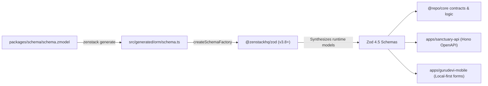

# Zod 4.5 Capabilities & Monorepo Architecture Guide

This document outlines the architecture, performance characteristics, and usage guidelines for **Zod 4.5** across the Polymath Platform codebase (`@repo/schema`, `@repo/core`, `@repo/database`, `apps/sanctuary-api`, `apps/gurudevi-mobile`, etc.).

---

## 1. Executive Summary & Core Upgrades

The monorepo standardizes on **Zod 4.5.x** (pinned workspace-wide) paired with **ZenStack V3** (`@zenstackhq/zod`). Zod 4.5 introduces foundational runtime optimizations, ahead-of-time schema compilation, lighter bundles, and rich schema introspection tools.

| Capability / Metric | Zod 3 / Early 4 | Zod 4.5 | Impact in Monorepo |
|---|---|---|---|
| **Hot-Path Parsing** | Standard JIT / Recursive parse | `z.compile()` AOT Engine | **3x – 9x faster** validation throughput in API route boundaries & mutations |
| **Boolean Checks** | `schema.safeParse().success` | `z.validate(schema, input)` | **Up to 16x faster** rejection path without allocating error AST objects |
| **Instance Memory** | ~7.5 KB per basic schema | < 800 bytes per schema | **~9x reduction** in memory footprint via deferred method memoization |
| **Mobile / Edge Bundle** | Full monolithic bundle | `@zod/mini` (~1.9 KB gzipped) | Ultra-light payload for React Native / Expo bundles |
| **TypeScript Compiler** | High type instantiation count | Optimized generic engine | **Up to 100x fewer** type instantiations, significantly accelerating `tsc --build` |
| **Unicode Code Points** | UTF-16 character length | Unicode code point counting | Correct string boundary validation for emojis and non-Latin scripts |

---

## 2. Key New Capabilities & How to Use Them

### 2.1 Pre-Compiled Schemas with `z.compile()`

When validating high-volume API requests or repetitive data sync payloads (e.g. Hono routes in `apps/sanctuary-api` or PowerSync batch processing), pre-compile schemas ahead of time to eliminate interpretive parsing overhead.

```typescript
import { z } from 'zod';

export const UserPayloadSchema = z.object({
  id: z.string().uuid(),
  email: z.string().email(),
  role: z.enum(['STUDENT', 'TEACHER', 'ADMIN']),
});

// Compile into an optimized, loop-free JavaScript validation function
export const validateUserPayload = z.compile(UserPayloadSchema);

// Hot-path usage:
const result = validateUserPayload.parse(incomingData);
```

### 2.2 Instant Boolean Validation with `z.validate()`

When checking preconditions or filtering records where error messages are not needed, use `z.validate()` instead of `safeParse().success`.

```typescript
import { z } from 'zod';
import { PostSchema } from '@repo/schema';

// Fast-path: returns boolean directly without allocating error structures
if (z.validate(PostSchema, data)) {
  processValidPost(data);
}
```

### 2.3 Lightweight Bundle: `@zod/mini`

For mobile packages (`apps/gurudevi-mobile`) or micro-libraries where bundle size is critical:

```typescript
import { z } from 'zod/mini';

// Includes core primitives (string, number, boolean, object, array, etc.) in ~1.9KB
const BasicSettingSchema = z.object({
  enabled: z.boolean(),
  theme: z.string(),
});
```

### 2.4 New Built-in Validators & Types

- **Credit Cards**: `z.creditCard()` validates 12–19 digit card numbers with built-in Luhn checksum verification.
- **Deep & Exact Partial**:
  - `schema.deepPartial()` recursively marks nested object properties as optional.
  - `schema.exactPartial()` enforces optionality without accepting `undefined` where explicit values are expected.
- **Properties Introspection**: `z.properties(schema)` enables clean multi-property schema transformations and metadata inspection.
- **Built-in Locale Support**: Native error internationalization for multilingual educational contexts (Hindi `hi`, Bengali `bn`, Portuguese `pt-BR`, etc.).

---

## 3. ZenStack V3 & Zod Runtime Integration

In this repository, `@repo/schema` serves as the single source of truth (L0 kernel). The ZenStack schema factory dynamically synthesizes Zod schemas from `schema.zmodel`:

```typescript
// packages/schema/src/index.ts
import { createSchemaFactory } from '@zenstackhq/zod';
import { schema } from '@repo/schema/generated/orm/schema';

const factory = createSchemaFactory(schema);

export const makeModelSchema = factory.makeModelSchema.bind(factory);
export const makeTypeSchema = factory.makeTypeSchema.bind(factory);
export const makeEnumSchema = factory.makeEnumSchema.bind(factory);
```

### Schema Lifecycle Flow



---

## 4. Migration & Maintenance Guidelines

1. **Keep Versions Pinned**:
   Always maintain matching Zod 4.5.x versions across all workspace packages (`package.json`, `packages/*/package.json`, `apps/*/package.json`).
2. **Never Suppress Strict Types**:
   Zod 4.5 inference aligns with TypeScript `strict` and `noUncheckedIndexedAccess` compiler options configured in `packages/typescript-config/base.json`.
3. **Regenerating Schemas**:
   Whenever `schema.zmodel` changes, run:
   ```powershell
   pnpm --filter @repo/schema run generate
   pnpm run check-types
   ```
