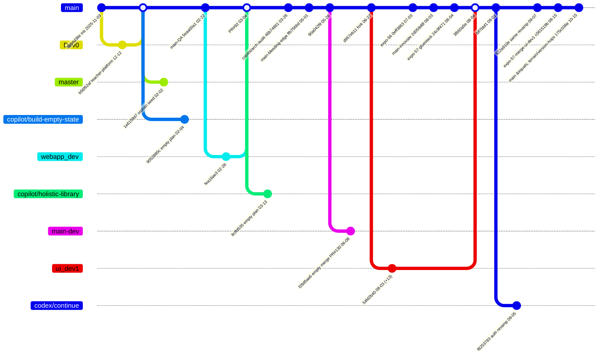

# EdLove branch topology — 2026-10-16

_All times are Asia/Colombo. Source: branches.yaml. This covers pushed refs only; Naveen's unpushed laptop work isn't visible here._

## Verdict
**`main` is the latest line**, both by timestamp (175c036e, 2026-10-15 19:19) and by commits: every other branch is either an ancestor of main or 1 commit off it. `terrain/version-hops` points at the same sha. `main-innovate` stopped on 2026-08-03 and is 211 commits behind; it was the PR-source line (PRs #78–#126) and is fully merged. None of the 18 branches has unmerged work worth recovering.

## Table
| Branch | Tip | Tip date (commit = author) | Merge-base w/ main | +ahead / −behind | Merged into main? | Unique work | Last author | Verdict |
|---|---|---|---|---|---|---|---|---|
| main | 175c036e | 2026-10-15 19:19 | — | 0/0 | — | — | Naveen | **latest** |
| terrain/version-hops | 175c036e | 2026-10-15 19:19 | same | 0/0 | = main | — | Naveen | alias |
| expo-57-merge-ui-dev1 | c061519b | 2026-09-15 00:36 | tip | 0/−31 | yes (FF) | — | Naveen | merged |
| codex/expo-57-merge-ui-dev1-continue | f8253783 | 2026-09-05 15:03 | bff7bbf1 09-01 | +1/−89 | no | 1 commit: Auth/Onboarding web revamp | Prageeth H. | stale (re-applied as 522a910e) |
| expo-57-gluestack-v5-rngh-v3 | 24c9f471 | 2026-08-04 20:08 | tip | 0/−198 | yes | — | Naveen | merged |
| ui_dev1 | 54fd2b40 | 2026-08-03 23:05 | tip | 0/−247 | yes (3fb50a5e) | — | Prageeth H. | merged |
| main-innovate | 2d059d8f | 2026-08-03 12:18 | tip | 0/−211 | yes | — | Naveen | merged |
| expo-56-expo-router-migration | 0eff3863 | 2026-07-03 05:33 | tip | 0/−264 | yes | — | Naveen | merged |
| main-dev | f28d5ae6 | 2026-06-08 17:40 | 90a042f9 05-26 | +1/−302 | no | empty merge of PR #130 (tree = 90a042f9) | Naveen | stale |
| main-bleeding-edge | ffb7566d | 2026-05-01 17:55 | tip | 0/−354 | yes | — | Naveen | stale |
| copilot/architectural-audit-database-schema | 46b74861 | 2026-03-26 00:18 | tip | 0/−480 | yes | — | Prageeth H. U. K. | stale |
| copilot/create-holistic-digital-library | 8cffd535 | 2026-03-13 16:23 | ad154bf9 03-13 | +1/−556 | no | empty "Initial plan" | copilot bot | abandoned |
| webapp_dev | fea16ae3 | 2026-02-28 15:45 | tip | 0/−849 | yes (PR #92) | — | prageeth | stale |
| main-QA | 5eaa00a1 | 2026-02-22 12:15 | tip | 0/−975 | yes | — | Naveen | stale |
| copilot/build-empty-state-component | 9052880c | 2026-02-04 10:56 | 743364ec 02-04 | +1/−1396 | no | empty "Initial plan" | copilot bot | abandoned |
| master | 1e6159d7 | 2026-02-02 14:50 | **none (orphan)** | +1/−1468 | no | seed apps/mobile; its blobs also appear in main history | prageeth | orphan |
| Dev0 | b56f62af | 2025-12-12 10:41 | tip | 0/−1459 | yes | — (tip = Gemini-key commit) | prageeth | stale |

Between branches that matter: ui_dev1 and main-innovate forked at d957eb11 (2026-06-27 22:06); ui_dev1 is +13 and main-innovate is +49 relative to that point. expo-57-gluestack (+62) sits on top of main-innovate. expo-57-merge-ui-dev1 = expo-57-gluestack + 167 commits, including the ui_dev1 merge. codex forked from that line at bff7bbf1 (09-01), and the merge line then added 58 more commits.

## Diagram

_The diagram is simplified. main-innovate, expo-56 and expo-57-* were separate refs that main was fast-forwarded through, so they are drawn as points on main. The real merge commits are listed in branches.yaml._

## Recoverable unmerged work
None of substance.
- **codex/…-continue f8253783**: its Auth/Onboarding web revamp was re-applied on main as 522a910e two days later (same subject, near-identical patch), and main kept editing those files through 10-06. At most, compare the two for any small piece of polish that main lacks.
- **main-dev**: the only unique commit is a merge whose tree equals main's 90a042f9.
- **copilot/* (2 branches)**: each holds one empty "Initial plan" commit.
- **master**: an orphan seed copy of gurudevi-mobile.

## Duplicates and date skew
- 5 exact patch-id pairs, all 2026-03-08 i18n "Update …" commits; both copies of each pair are on main. They are harmless.
- One near-duplicate: f8253783 ≈ 522a910e.
- Committer-vs-author skew over 1 day affects only 2 commits (1c51bb2d and 301e327b, copilot bot, authored 2026-02-22 and committed 2026-02-25 22:44). This is a rebase and doesn't change the ordering of any branch tip.

## Cleanup candidates (not done; deleting branches needs Naveen's OK)
Dev0, master, main-QA, webapp_dev, main-bleeding-edge, main-dev, copilot/* (3), expo-56-expo-router-migration, expo-57-gluestack-v5-rngh-v3, ui_dev1, codex/*. Keep Dev0 until the Gemini key is confirmed revoked; it doesn't matter for history, since the commit is reachable from main.
