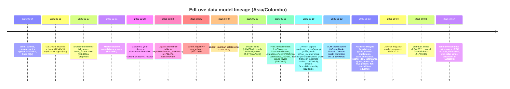
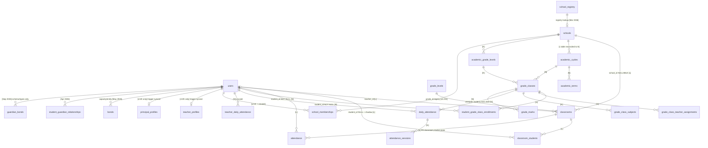

# EdLove: data model lineage (attendance, classes, people)

Branch `terrain/version-hops` @ `50fb1b9e`, plus full history of all refs. Read-only investigation; the repo was not modified.
All times are Asia/Colombo (UTC+5:30). The author is Naveen Sandeepa Kumara unless noted.
Machine-readable evidence: `v6/lineage.json` (first CREATE TABLE per table across all refs, first zmodel `@@map`, and the HEAD migrations touching each table).
Path shorthand: `M/` = `apps/gurudevi-mobile/supabase/migrations/`, `B` = `apps/gurudevi-mobile/supabase/backups/remote_schema_backup.sql`.

## TL;DR
* There are **two class models**, built six months apart and **both still live**.
  * **Legacy (Feb 2026):** `classrooms` + `classroom_students` (including shadow students) + `attendance`.
  * **Intended future (Aug 2026):** the academic lifecycle (`academic_cycles` → `academic_grade_levels` → `grade_classes` → `student_grade_class_enrollments` → `daily_attendance`).
* The Aug model was introduced **on purpose, next to the old one, not instead of it**. The migration header and the ADR `docs/decisions/2026-08-12-grade-school-grade-marks-domain.md` both say so. The ADR's verdict on classrooms: *"retain only if it means an instructional subject/group context; otherwise migrate the current classroom concept to `grade_classes` explicitly"*. It also states that `classroom_id` "cannot be assumed to be a valid GradeClass identity".
* The **server attendance and grading handlers are already on the new model**: `attendance.ts` uses dailyAttendance and gradeClass, and `grading.ts`/`gradingAuthority.ts` use gradeMark and gradeClassTeacherAssignment. **Every screen, the web, PowerSync and the rest of the classroom domain** (assignments, materials, lessons, notes, shadow students) are still on `classrooms`.
* Attendance (web sends `classroom.id` as `gradeClassId`) and the gradebook (`useGradebook(classroomId)`, which needs a GradeMark lifecycle context) both fail for the **same reason**: nothing maps "the class the teacher opened" to a `grade_class_id`.
* **Recommendation: A** (grade_classes + daily_attendance) as the model, **reached by an explicit mapping**: a grade-class-scoped entry point, or a nullable C-style link used only as a transitional resolver. **Not B.** Shadow students are the one real cost of A; see §4 and §5.

## 1. Timeline

## 2. Current state ER diagram
Legend: **[L]** legacy (Feb–May 2026); **[N]** new academic lifecycle (Aug 2026); **[LIVE]** exists only in the live DB (captured in `B`), not in any HEAD migration or zmodel.

**There is no FK between the two clusters.** The only cross-link is the seed draft, which writes the same 4 students into both `classroom_students` and `student_grade_class_enrollments` by hand.

## 3. Per-entity lineage

| Entity | First appearance | Changes | Why (evidence) | Used now | Lives in |
|---|---|---|---|---|---|
| classrooms | 80e388ca, 2026-02-04 18:20, "file changes to help and optimize" (Docs SQL); migration baseline fdb3a463, 2026-02-11 | +academic_year (20260228105055); zmodel 7bfb70d1 (2026-05-25); soft-delete/handle columns | Original teacher-owned "class space" (Google-Classroom-like: `subject`, `color_theme`, nullable `school_id`). The ADR (08-12) notes that live rows mix cohort-like ("10B") and subject-like ("10 / Bio") rows | Heaviest: srv ORM 8, raw 5, client supabase 16; PowerSync classroom_roster; educational.ts (assignments, materials, lessons, notes, resources); mobile route `classroom/[classroomId]` | migrations + zmodel + live |
| classroom_students | 76941430, 2026-02-05 03:01, copilot-swe-agent[bot], "Add classrooms database schema SQL file" | Shadow enrollment by bb84202a (prageeth, 2026-02-07 00:58): migration `20260207_shadow_enrollment.sql` adds full_name, invite_code, claimed_at + AddStudentModal/ClaimInviteModal | A teacher adds a roster before students have accounts; a student later claims the row with the invite code | srv 3/3, client 4, PowerSync identity + roster streams; procs educational.addShadowStudent (UI-UNWIRED), claimShadowStudent (BACKEND-ONLY); OCRStudentImport | migrations + zmodel + live |
| attendance (legacy) | c174247a, 2026-03-02 20:10, main-innovate, migrations/master_baseline.sql | Now only in `M/archive/master_baseline.sql`; zmodel AttendanceRecord `@@map("attendance")` with 2 @@allow (classroom teacher / principal / platform admin) | Classroom-scoped roll call | Legacy Hono `packages/core/src/api/handlers/operations.ts` (attendanceRecord upsert); client supabase 9; local SQLite table `attendance` (powersync/schema.ts:137) with **no** sync stream; present in live `B:10477` | zmodel + live + archive (no active migration) |
| academic_cycles | Live legacy table first captured 299009c5, 2026-08-10 (start_date, end_date, is_current) | 1d5a9fc6 (08-13): CREATE IF NOT EXISTS + reconciling ALTER adding starts_at/ends_at/status → **duplicate date columns**; zmodel has only starts_at/ends_at | The ADR makes the cycle the top-level operational scope; reconciled in place because the live table already existed | Client schoolRepository.ts reads **legacy** `start_date`/`is_current`; AttendanceScreen → academicCyclesAPI.getCurrent; seed writes both pairs | live + migration + zmodel (partial) |
| grade_levels (legacy) / academic_grade_levels | Legacy: live, first captured 08-10; zmodel 7bfb70d1. New: 1d5a9fc6 | Two tables for one concept | ADR: "grade = level, class = time-bound cohort" | academic_grade_levels: seed only | legacy live/zmodel; new migration/zmodel |
| academic_terms / academic_subjects | 1d5a9fc6 | — | ADR terms/subject offerings | Unused by code (GradeMark context needs termId/subjectId) | migration + zmodel |
| grade_classes | 1d5a9fc6, 2026-08-13 07:25 | Idempotent constraints db943f13 (09-04) | ADR GradeClass = "6A for 2026", UNIQUE(cycle, level, name) | attendance.ts, gradingAuthority.ts; seed 5A | migration + zmodel (0 @@allow) + RLS |
| student_grade_class_enrollments | 1d5a9fc6 | — | Cycle-scoped placement with effective dates/transfer history | 0 code; seed only | same |
| grade_class_teacher_assignments | 1d5a9fc6 | — | Homeroom/subject/assistant roles; basis for RLS `academic_lifecycle_is_assigned_teacher` | gradingAuthority; seed | same |
| daily_attendance (+ attendance_sessions) | 1d5a9fc6 | — | ADR §Attendance model: daily roll-up + session evidence; audit/correction | attendance.ts (oRPC, upsert on student+class+date); no PowerSync stream; no non-web UI caller | same |
| teacher_daily_attendance (+ sessions) | 1d5a9fc6 | — | ADR: teacher self-arrival with approval | 0 code | same |
| school_memberships | Live, first captured 299009c5 (08-10); zmodel a12dc78e (08-10 22:44) | Not created by any migration | Role per school (user, school, role, status, is_primary) | PowerSync identity stream, schema.ts, seed; no server ORM hit | live + zmodel |
| teacher_profiles / principal_profiles / student_profiles | Live, first captured 08-10 | Triggers `handle_school_membership_sync` (B:3975) and `handle_user_profile_sync_after` are in no migration | Role-specific profile data (NIC, staff_id, designation…) | 0 code hits | **live only** |
| users | 80e388ca (02-04) | Many | Identity | Everywhere (srv 17/9, client 25) | all |
| schools / school_registry / edu_schools | schools 02-04; registry 92227a6f (2026-03-25 15:47); edu_schools same day | — | Registry = national school directory used to create or claim schools | schools: srv 4, client 8; registry: 0 direct hits (may be accessed under another name; unverified) | migrations + zmodel |
| bonds | zmodel b6bd32cd (05-06); table dea7e43f (2026-05-07 08:55) | — | Generic capacity/entity relation; used by zmodel/Cedar authz | srv 8/4, client 4, PowerSync | all |
| student_guardian_relationships | 32e176b3, 2026-04-07 23:30 (`20260406220000_student_record_access_control.sql`) | — | Guardian access to records | srv 1/1, client 1 | migration |
| guardian_bonds | fd061031, 2026-09-08 00:57 (root `supabase/migrations/…multi_perspective_tables.sql`); zmodel 517072d3 | — | Multi-perspective guardian model | powersync/schema.ts + types only | root migration + zmodel |

Three things never got a CREATE TABLE in any ref: `terms`, `subjects` and `attendance_records`. Any code or docs that name them are stale.

## 4. The story in plain words
1. **Feb 2026: teacher-first app.** EdLove started as a teacher tool. A teacher makes a *classroom* (optionally tied to a school), adds students, even ones without accounts (**shadow students**, who claim their seat later with an invite code), and takes classroom-level attendance. This is the model the whole UI, PowerSync and most handlers were built on.
2. **Feb–May: patches on top.** `academic_year` became a text column. Bonds arrived for authz. ZenStack models were written for the existing tables in May.
3. **Aug 10: drift discovered.** A remote schema backup showed tables that existed only on the live DB: legacy `academic_cycles`, `grade_levels`, `school_memberships`, profile tables and sync triggers. They had been created by hand or by tools, never by a migration.
4. **Aug 12–13: the school model.** The ADR reframed EdLove as a *school academic lifecycle system*: School → Cycle → Level → GradeClass (5A) → enrollments, assignments, daily attendance, grade marks. The new tables were added **next to** the old ones on purpose, with Postgres RLS. The stated plan was to migrate consumers, then reset the demo data, then retire the legacy tables. The ADR also says the remote rows are **demo data, not a migration constraint**.
5. **Aug–Oct: the consumer migration stalled halfway.** Server attendance and grading moved to the new model, and so did the seed. The screens, web lists, PowerSync streams and the rest of the classroom domain did not. Result: the client hands a `classrooms.id` to an API that wants a `grade_classes.id`, which breaks both attendance and the gradebook.

**Overlaps and duplications to keep in mind:**
* roster: `classroom_students` vs `student_grade_class_enrollments`;
* attendance: `attendance` vs `daily_attendance`, plus the local SQLite `attendance`;
* grade level: `grade_levels` vs `academic_grade_levels`;
* cycle dates: `start_date/end_date/is_current` vs `starts_at/ends_at/status` in one table;
* role: `bonds` vs `school_memberships` vs profile `school_id`;
* guardian: `student_guardian_relationships` vs `guardian_bonds`;
* year: `classrooms.academic_year` text vs `academic_cycle_id`.

**Authorization is split three ways:**
* The legacy tables have zmodel `@@allow`.
* The new tables have 0 `@@allow` but 28 RLS policies.
* The server's ZenStack client has **no PolicyPlugin**, so `@@allow` is not enforced at runtime, and the real gate is Cedar meta in orpcMiddleware.ts.
* Whether RLS applies to server queries depends on the DATABASE_URL role, which is unverified.

## 5. Options

| Criterion | **A**: grade_classes + daily_attendance | **B**: classrooms + new classroom_attendance | **C**: `grade_class_id` bridge on classrooms |
|---|---|---|---|
| Fit with direction (ADR, migration header) | **Best.** It is the documented target, and the server handler and seed already exist | **Against.** It adds a 4th attendance table on the model the ADR says to narrow or retire | Partial. The ADR forbids *implicitly* treating classroom as GradeClass. An explicit, nullable, classified link is consistent with "classify or retire", as long as it is transitional |
| Shadow students | **Gap.** `student_id` NOT NULL → users; shadows can't be marked until claimed or provisioned | Native (key on classroom_students.id) | Same gap as A (writes still go to daily_attendance) |
| Migration cost | Low for data (demo reset allowed), medium for consumers (classroom-entered screens must resolve a grade class) | New migration, RLS, zmodel, handler, stream; low data cost but all-new code | One nullable column + backfill/classification + resolver; low |
| Demo effort | Seed already has 5A, enrollments and a teacher assignment. Need: web list grade classes (or resolve), mobile use oRPC instead of the dead facade, fix academic_cycles column read | Highest: rebuild what A already has | Lowest if the demo must stay inside the classroom screen: resolve classroom → grade_class, then call the existing A endpoint |
| Sync (PowerSync) | No stream yet; a grade_class/daily_attendance stream must be written (the RLS helpers suggest the bucket rule) | Classroom roster stream exists; an attendance stream is still needed | Same as A |
| RLS / policies | 28 RLS policies exist; zmodel has no @@allow; Cedar meta exists in the handler | Must write all new | As A |
| Retirement debt | Retires `attendance` + local SQLite attendance; classrooms stays as a subject/instruction context | **Adds** debt: a second live attendance model to retire later | A temporary column to drop later; low if time-boxed |

**Recommendation: A, with the mapping solved once and explicitly.**
* **Preferred path:**
  * attendance and the gradebook enter from the teacher's grade classes (`grade_class_teacher_assignments`);
  * classrooms stay as subject/instruction spaces;
  * the web list comes from grade classes, not `/educational/classrooms/by-teacher`.
* **If** the demo must keep the current classroom-first navigation, add C as a *time-boxed resolver*: a nullable `classrooms.grade_class_id`, set only for rows explicitly classified as cohort classes, with the server rejecting unmapped rows (fail closed, as it does now). This one fix unblocks both attendance and the gradebook.
* **Avoid B:** it rebuilds what A already has and moves away from the documented direction.

**Uncertainties (honest):**
* Whether `20260813010000_academic_lifecycle_foundation.sql` has been applied to the live project is **unverified**. The 08-10 backup predates it, though the in-place reconcile suggests it was written for the linked DB.
* RLS bypass depends on the server DB role (DATABASE_URL), which is unverified.
* Whether shadow students matter for school-operated classes is a product call.
* The `school_registry` usage scan may have missed renamed accessors.
* The migration replay is partial (branch 138/188 ok), so DDL behaviour of later migrations is not fully proven.

## 6. Questions only Naveen can answer
1. **Are shadow students a real product concept for school classes,** or only for teacher-owned or tuition classrooms? If they are needed for 5A attendance, should schools pre-provision student `users` (no login), or should `daily_attendance` accept an enrollment id?
2. **What is a `classrooms` row going forward:** a subject or instruction group, a teacher's personal space, or a cohort? Can the live cohort-like rows ("10B") be classified, or should they be reset per the ADR's demo-reset clause?
3. Is the live data still disposable demo data, so that a reset and reseed is allowed?
4. **For the demo,** should teachers take attendance from the class (5A) or from inside a subject classroom? Is daily roll-call enough, or are period/session attendance (`attendance_sessions`) needed?
5. Has the academic lifecycle migration been applied to the live Supabase project? Which role does sanctuary-api connect as (is RLS bypassed)?
6. Which role source is canonical: `bonds`, `school_memberships` or the profile tables? Should the live-only profile tables and triggers be captured in a migration or dropped?
7. Which guardian model wins: `student_guardian_relationships` or `guardian_bonds`?
8. Is teacher self-attendance (`teacher_daily_attendance`) in scope for Gurudevi now?
