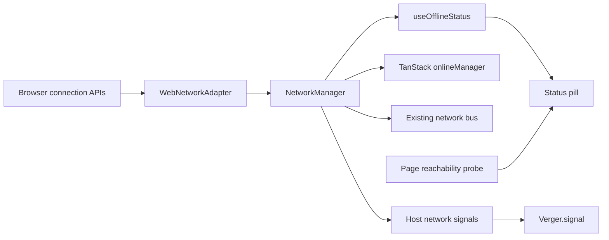

# Implementation and integration status

The browser now shares one connection observation between React readers, TanStack Query, the existing network bus, and Gurudevi's Verger host. Page reachability remains separate from device connectivity. The upstream branch was fetched again and remains at `eaa6d6c2f`; the earlier integration is present locally, with subsequent oRPC build-boundary repairs retained.

## Network seam

- WebNetworkAdapter owns online/offline and Network Information listeners. Stable snapshots include optional effective type, RTT, downlink, and Data Saver. Missing/invalid estimates stay unknown; browser hints never become metering or validated internet access.
- `subscribeToNetwork` reuses the hook's existing lazy browser setup and bus bridge for imperative consumers. Native setup is preserved.
- Generic VergerBrowser accepts optional host network signals. Gurudevi supplies the shared observation; standalone consumers retain original browser sampling. Other sensors and kill-switch/reduced-motion behavior remain. Device events still enter through `Verger.signal`.
- Browser query scheduling matches mobile: confirmed offline pauses scheduling; unknown permits an attempt. Offline-first cache behavior, account isolation, retry defaults, and server QueryClient isolation remain.
- SyncStatusPill reads connection state/estimates from the shared snapshot. Its existing credential-free no-cors page probe retains timeout, periodic retry, visibility/focus handling, overlap suppression, cancellation, and reprobe on estimate changes. Failure reads “Site unavailable” and never changes device connectivity. An opaque success establishes page reachability, not authenticated API health or completed sync. The probe was retained rather than replaced by an invented health contract.

The existing pill tests asserted the obsolete word “Synced.” Their online/offline/reconnect cases now assert connection labels and explicitly reject a sync-completion claim. Added cases cover failure/recovery, timeout, late completion after abort, hidden pages, cleanup, and changing estimates. No existing test case or fallback was removed.

## World UI

The pill uses World semantic colors and caption typography. Web pre-hydration bootstrap now reads canonical WORLD_IDS: the previous six-value list omitted five of the eleven shipped Worlds. Tests exercise all eleven saved choices plus invalid-value/legacy-mode handling.

Native entry mounts WorldFonts and CircadianProvider, which supplies WorldContext. NativeShellTabs reads the World's ground, ink, label face and tab colors. Shared primitives and designated shell/header surfaces are covered by the World guardrail and component suites.

Every screen is not yet migrated. The current guardrail reports 4,514 raw hex colors against the unchanged 4,139 budget. Dressed files are clean; legacy surfaces remain. No full screenshot or physical-device visual audit is claimed.

## Verger and Expo Modules 2.0

Installed expo-modules-core 58.0.24 physically contains legacy Kotlin Module/ModuleDefinition and the newer ExpoModulesV2Host integration. Verger still uses the supported legacy DSL. Its sensing and lifecycle logic live outside the binding, including platform activity callbacks, so a future authoring migration can preserve the JS contract.

Expo's [SDK 58 release](https://expo.dev/changelog/sdk-58) describes Modules 2.0 as beta on both platforms. Its [Modules 2.0 article](https://expo.dev/blog/an-early-look-at-expo-modules-2-0) preserves existing 1.0 modules and describes incremental migration. SDK 58 does not mean Verger has adopted the new authoring API. No unverified Kotlin annotation migration or native dependency bump was made.

The native module is Android-only. iOS and clients without it use JS signals, with unavailable facts remaining unknown. Production without a configured launch preset still runs policy floors; the active loop and provisional thresholds were not silently enabled or calibrated. Data allowance and release preset remain explicit host choices.

The current binding still needs an exact-source Gradle build and phone evidence. The existing WSL checkout has a different, older VergerModule and its own dirty changes; building it would not verify current C:/x sources. It was inspected without overwriting it. The earlier successful Metro/Hermes export proves JavaScript bundling, not Kotlin compilation, autolinking, sensor accuracy, or native thread behavior.

## Evidence

| Level / engine | Result | Limit |
| --- | --- | --- |
| G0 / TypeScript | Core/mobile checks succeeded; final Next build completed its TypeScript step. | No native ABI proof. |
| G1/G2/G3 / Verger gate | Serialized final gate: ALL_PASS=1, 517 cases across core, Android mapping, browser, host, UI and apps. | Native sensors/bridges substituted; simulator phones provisional. |
| G1 / core network Vitest | 25/25 cases across five files. | Platform observations substituted. |
| G1/G2/G3 / browser Vitest | 33/33 across seven files: shared signals, pill lifecycle, World bootstrap, query defaults/offline behavior, provider and account isolation. | jsdom and substituted network/storage. |
| G1/G3 / World Vitest | 1,492/1,492 across four files. | Contrast/recipes/primitives, not whole-app screenshots. |
| G4 / Next 16.4.2 Turbopack | Final production build compiled and generated 97/97 pages. | No production traffic or native-device proof. |

An earlier concurrent Verger run timed out in `high · edge · seed 3`; its log is retained. The isolated case completed under the existing timeout, then the full serialized gate succeeded. No timeout, assertion, simulator bound, or threshold was weakened.

Broad anti-slop still exits 1 across the dirty checkout (38 errors, 1,193 warnings in that run). CNG, native-slop and hollow-stub stages completed; later chained stages were not reached. Evidence classification succeeds. Known version-drift findings and the World budget failure remain visible; no gate or budget was raised.

Logs: `reports/network-world-verger-before.log`, `network-world-verger-after.log`, `network-world-stability-timeout-check.log`, `network-world-verger-serialized.log`, `network-world-core-types.log`, `network-world-mobile-types.log`, `network-world-browser-final-tests.log`, `network-world-world-tests.log`, `network-world-web-build-final.log`, `network-world-anti-slop.log`, and `network-world-current-guardrail.log`. Reviewed delta: `reports/network-world-reviewed-delta.patch`.

No commit, push, deployment, or new G5/R1 claim was made. Earlier successful build-boundary repairs are in [the oRPC repair record](2026-10-27-orpc-build-boundary-repair.md).
