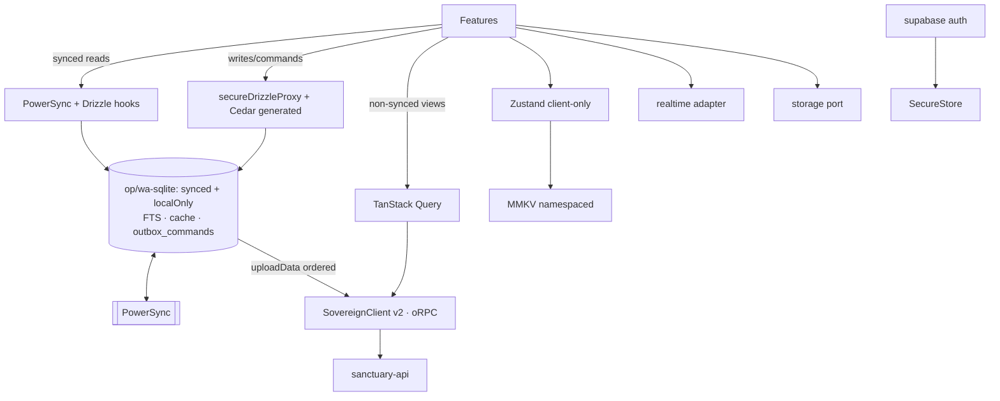
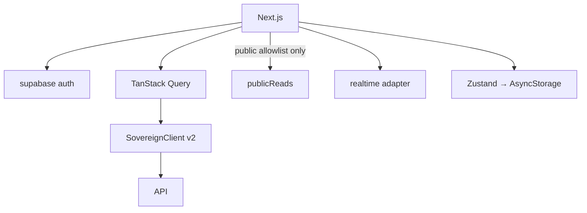
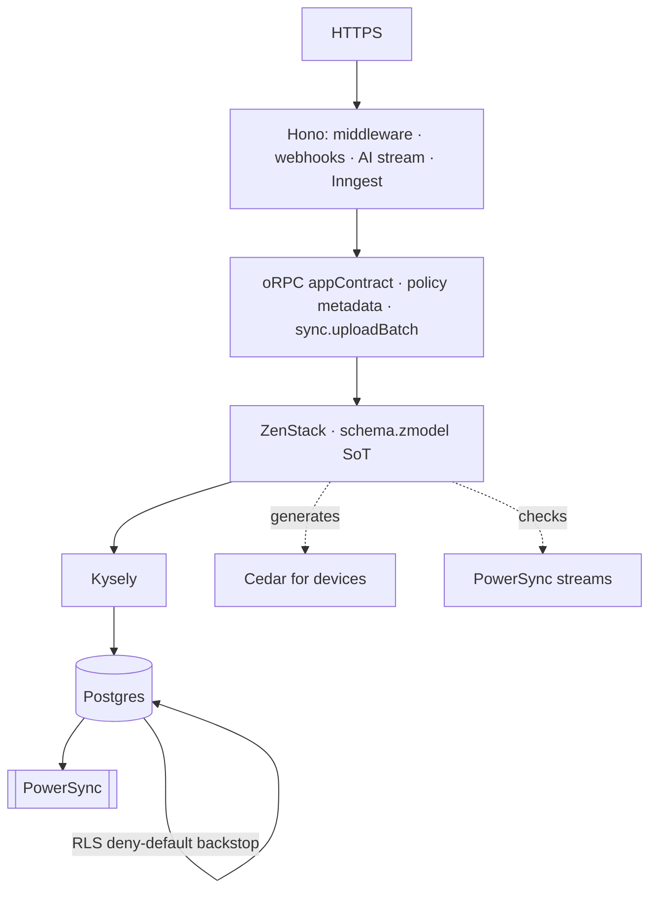

# EdLove Integrated Plan
*Canonical. Repo: NeevSK/EdLove · 2026-10-15 · Author: Grok Bot for Naveen*

> **Poetry in names, truth in behavior.** Issues remain. The first audit overstated layer redundancy and understated access-policy fragmentation.
>
> Supporting docs (do not supersede this): `DATA_LAYERS_CASE_FOR.md`, `DATA_LAYERS_CASE_AGAINST.md`, `EDLOVE_DEFLATION_PLAN.md` (detail).

---

## 1. What changed from the first audit

| First claim | Corrected finding | Why |
|---|---|---|
| "Too many data layers = architectural mud" | Layers do **separate jobs** (device SQLite vs server Postgres vs online cache vs ephemeral realtime). The mud is **policy written four times**, not six ORMs doing one job. | Steelman showed Drizzle≠ZenStack, PowerSync≠TanStack Query, Zustand≠TQ. |
| Drop ZenStack / pick one of Kysely vs ZenStack | **ZenStack is the chosen server layer**; Kysely is its engine (v3), pg is the wire driver. They stack. | Naveen; `schema.zmodel` 94 models / 156 `@@allow`; 36 api files use `ctx.db`. |
| Drizzle is redundant with ZenStack | Drizzle is **mobile-local** over PowerSync SQLite (`@powersync/drizzle-driver`). ZenStack cannot run on device. | `adapters/powersync/hooks.ts`, `secureDrizzleProxy.ts`. |
| Split `packages/schema/schema.ts` (5,383 LOC) by hand | It is **generated** from `schema.zmodel`. Exclude from lint/LOC; don't hand-split. | `schema.zmodel` → generated orm artifacts. |
| "core↔ui cycle" as mutual imports | `core` has **0** `@repo/ui` imports; **92** `ui` files import `@repo/core`. Cycle, if any, is manifests/tsconfig — confirm with depcruise. | Re-check. |
| Fix BYOK fail-fast | `crypto.ts` **already throws** when `BYOK_ENCRYPTION_SECRET` is missing. Add **boot-time** assert + test only. | `apps/sanctuary-api/src/ai/utils/crypto.ts`. |
| Debug keystore in tree | **No keystore at HEAD.** Check history + gitleaks rule; confirm release signing. | `git ls-files` empty for keystore. |
| Rename sanctuary / sovereign / grove | **Keep poetic names.** Make each earn meaning (behavior + glossary TSDoc). | Naveen: "nothing is defaults." |
| Delete `reports/` forever | Move generated output to **gitignored `.reports/`**; tooling still writes locally. | Naveen. |
| SovereignClient: fail-fast missing URL always | Fail-fast **outside** `__DEV__`; localhost / 127.0.0.1 / 10.0.2.2 / LAN **OK in development**. | Naveen clarification. |

**Bottom line:** Issues remain. First pass mistook *many specialized layers* for *redundant mud*, and underweighted that the Law of Different Views is hand-authored in ZenStack **and** Cedar **and** RLS **and** sync streams, while **534** client `.from(` sites (243 writes) bypass the trusted API.

---

## 2. Remaining issues (ranked)

| Sev | Issue | Evidence | Target |
|---|---|---|---|
| **P0** | Inngest event key in mobile public env | `apps/gurudevi-mobile/src/lib/inngest.ts` uses `EXPO_PUBLIC_INNGEST_EVENT_KEY` → ships in APK; anyone can inject agent events | Rotate key; remove mobile Inngest; server emits only after oRPC |
| **P0** | Gemini API key in public git history | Commit `b56f62a` (`apps/teacher-platform/lib/aiService.ts`, Dec 2025); file gone, key still in history | Revoke/regenerate; confirm dead; no history rewrite needed |
| **P0–P1** | 534 supabase `.from(` sites / 243 writes bypass ZenStack policy, Idempotency-Key, audit, oRPC `metadata.policy` | Screens query DB directly (`community/…/GroupDetailsScreen.tsx`, `admin/…/CurriculumPulse.tsx`, …) | Migrate → oRPC/ZenStack + PowerSync reads; allowlist edge + public reads |
| **P1** | Dual hand-written data policy (13 `.cedar` + 156 ZenStack rules); + RLS + streams = four authors | `packages/policies/src/policies/school/*.cedar` vs `schema.zmodel` | ZenStack SoT; generate Cedar for offline-writable models; parity test |
| **P1** | Type escapes on the main path | `createORPCClient<any>`; PowerSync upload via `hc` + `as unknown as`; `createSovereignClient(): any` | Typed `appContract`; upload via `sync.uploadBatch`; SovereignClient v2 |
| **P2** | Effect: three lockfile versions (3.21 / 3.22 / 4.0); mobile declares effect, **0 source imports** | `pnpm-lock.yaml`; only `docs/Core/effect-ts-coding-guide.md` in mobile | Pin effect@4; drop mobile dep; zone-limit imports |
| **P2** | Docs / agent-config / tooling inflation | ~301k md LOC; 117 root scripts; 3 linters; committed `reports/` ~52k | ≤60k md; ≤20 scripts; Biome+minimal ESLint; `.reports/` gitignored |
| **P2** | `@repo/core` ~68k LOC hub | 22 packages import it; holds api+adapters+effect+store+native+… | Split via ports: contracts, sovereign-client, data, auth, platform, domain-kit, observability |
| **P2** | Stubs + demo in prod paths | payments returns fake `st_${Math.random()}`; `demoProvider.ts`; `CollaborativeGrove` mock metrics; 81 mock ids | Gate stubs; demo only under `EDLOVE_DEMO=1`; bundle-guard |
| **P3** | Huge source files | `atlas/page.tsx` 5603; `FounderDashboard.web.tsx` 1552; … | ≤800 LOC/file (generated excluded) |
| **P3** | `any` sprawl | 1,836 in src | Ratchet → 200 → 50 |

---

## 3. Target architecture (final)

### Principles
1. Poetry in names / truth in behavior (glossary + TSDoc).
2. **`schema.zmodel` is the single author of the Law of Different Views.** Cedar (device), sync streams, and RLS are generated from or checked against it.
3. Mobile local: **PowerSync + Drizzle** (op-sqlite / wa-sqlite). Commands and row CRUD share **one** upload queue.
4. Client↔server: **oRPC only**, via **SovereignClient v2** (localhost OK in `__DEV__`; HTTPS + fail-fast outside).
5. Server: **ZenStack → Kysely → pg**. Hono hosts HTTP (webhooks, streaming, Inngest).
6. Core stays elegant through **ports + adapters** (mobile and web share contracts; platforms swap only adapters).

### Mobile


### Web


### API


---

## 4. Verdict table (final)

| Layer | Verdict |
|---|---|
| ZenStack + Kysely + pg | **KEEP** (ZenStack = policy SoT; Kysely raw only in `sanctuary-api/src/db/raw/**`) |
| PowerSync, op-sqlite, wa-sqlite | **KEEP** (streams CI-checked vs ZenStack reads) |
| Drizzle | **KEEP-but-contain** (`adapters/powersync/**` + localEvaluator; schema generated from zmodel) |
| expo-sqlite | **MERGE → PowerSync localOnly** (library cache, self FTS5) |
| supabase auth | **KEEP** |
| supabase storage / realtime | **KEEP-but-contain** (adapters / typed channel registry only) |
| supabase `.from/.rpc` | **MERGE → oRPC/ZenStack + PowerSync reads** (allowlist: edge functions + public reads) |
| oRPC | **KEEP** sole client↔server API; typed `appContract` |
| Hono server | **KEEP-but-contain** (host, webhooks, streaming, Inngest) |
| Hono RPC client (`hc`) | **REMOVE → oRPC `sync.uploadBatch`** |
| ZenStack client profile repo | **REMOVE → `apps/sanctuary-api`** |
| Sovereign client | **KEEP**, rebuild v2 |
| Mutation queue | **MERGE → PowerSync `outbox_commands`**; registry KEEP typed from contracts |
| Effect | **KEEP-but-contain** (single 4.x; sync/agents zone; drop mobile phantom) |
| Cedar | **KEEP** device runtime; **generate** school policies from ZenStack |
| TanStack Query | **KEEP-but-contain** (mobile: never over synced tables) |
| Zustand / MMKV / SecureStore / AsyncStorage | **KEEP-but-contain** (persist client-originated only; secrets in SecureStore) |
| Inngest | **KEEP server-only**; **REMOVE from mobile** (rotate key) |
| Legend List | **KEEP** |

---

## 5. Integrated phased roadmap

### Phase 0 — This week (safety) · Effort S · Risk L
**Goals:** kill live secrets; stop new policy bypasses.
| Workstream | Steps |
|---|---|
| Secrets | Revoke Gemini from `b56f62a`; rotate Inngest event key; remove `EXPO_PUBLIC_INNGEST_EVENT_KEY` and `apps/gurudevi-mobile/src/lib/{inngest,inngestEvents}.ts`; server emits Inngest only after oRPC |
| Boot assert | `assertEnv()` in `load-env.ts` for staging/prod; `crypto.test.ts` for BYOK at boot |
| History | Full-history gitleaks; keystore rule; confirm release signing ≠ debug keystore |
| Freeze | Lint/depcruise: no *new* `.from(`/`.rpc(` outside allowlist (ratchet grandfather); ban new `hono/client`, client `@zenstackhq/orm`, `effect` outside zone |

**Exit:** keys dead/rotated; mobile has 0 Inngest; CI blocks regressions; Phase 0 checklist green.

### Phase 1 — Clear the floor (weeks 1–2) · Effort M · Risk L
| Workstream | Steps |
|---|---|
| Clutter | All report writers → `EDLOVE_REPORTS_DIR` / `.reports/`; gitignore; `git rm --cached` `reports/`, `report/`, `temp/`, `scratch/`, `old_docs/` |
| Toolchain | Align engines / `packageManager` / `.nvmrc` / `mise`; `corepack enable`; pin effect@4, one `@zenstackhq/*`, one `@orpc/*` major; drop mobile `effect` |
| Scripts | Root scripts ≤ 25; PowerShell → `.mjs`; Biome primary + minimal ESLint; one cycle checker (depcruise); knip for unused |
| Quick removals | Move ZenStack profile repo to api; upload via `orpcClient.sync.uploadBatch`; delete `hc` / `AppType` / dual-origin URL from `base.ts`/`clientRuntime.ts` |

**Exit:** Linux/macOS `pnpm i && pnpm check` works; 0 `hono/client`; 0 client `@zenstackhq/orm`; 0 committed reports.

### Phase 2 — Green gate (weeks 2–4) · Effort M–L · Risk M
| Workstream | Steps |
|---|---|
| Typecheck | Record baseline; fix package-by-package; required on `main` |
| Ratchet | Commit `tooling/ratchet.json` (any, docs LOC, `.from` sites, scripts, Effect versions, huge files) |
| Cycles / layers | depcruise: no-circular; packages↛apps; deep-import ban; confirm core↔ui edges |

**Exit:** typecheck 0 errors; 0 cycles; ratchet cannot rise.

### Phase 3 — True Sovereign + typed API (weeks 3–6) · Effort L · Risk M
| Workstream | Steps |
|---|---|
| Contracts | `@repo/contracts` from `*.orpc.contract.ts`; fold duplicate `*.contract.ts` |
| SovereignClient v2 | Env table (dev localhost/LAN OK; staging/prod HTTPS + fail-fast); auth + bond-id; Idempotency-Key; timeout; retry; offline handoff; mobile pinning; tracing — see deflation WS-4 sketch |
| oRPC hygiene | `ContractRouterClient<typeof appContract>`; ≤50 `any` in `sanctuary-api/src/core` |

**Exit:** all client calls through `@repo/sovereign-client`; 0 `createORPCClient<any>`; contract coverage ≥95%.

### Phase 4 — One queue, one policy author (weeks 5–10) · Effort L · Risk H for query migration
| Workstream | Steps |
|---|---|
| Outbox merge | `outbox_commands` localOnly table; `uploadData` drains CRUD+commands in commit order; type registry from contracts; migrate zustand outbox; drop mobile Inngest dispatch leftovers |
| expo-sqlite merge | library cache + self FTS5 as localOnly; account-wipe test; remove `expo-sqlite` |
| Drizzle contain | Generate schema from zmodel; type `secureDrizzleProxy`; depcruise allowlist |
| Cedar from ZenStack | Generate `school/*.cedar` for `@@offlineWritable`; parity test (start: attendance, student_observations, grades); hand-write only `platform/*.cedar` |
| Streams / RLS | CI: streams ≤ ZenStack read; as each table loses client `.from`, tighten RLS deny-default |
| supabase migration | Domain order: self → library → community → classroom → admin → people → core/adapters; UI components first; allowlist = edge functions + ADR-listed public reads |

**Exit:** one device queue; Cedar↔ZenStack parity green; `.from(` only on allowlist; no `expo-sqlite`.

### Phase 5 — Core elegance + product hygiene (weeks 8–14) · Effort L · Risk M
| Workstream | Steps |
|---|---|
| Core split | Extract via ports (§6): contracts → sovereign-client → data → auth → platform → domain-kit → observability → i18n → test-kit; facade then delete |
| TQ / Zustand rules | Mobile: no TQ over synced tables; persist ≤7 client-originated stores, `acct:<id>:` keys; secrets only SecureStore |
| Stubs | payments: throw outside demos; fold accounting/workforce/types-shim; dedupe `useSchoolStats` |
| Demo gate | Move demos to `@repo/test-kit`; `EDLOVE_DEMO=1`; bundle-guard |
| Huge files | Split atlas / dashboards / screens; exclude generated schema from LOC |
| `any` | Biome noExplicitAny on new files; kill root causes first |

**Exit:** `@repo/core` ≤5k facade or gone; no demo in prod bundles; files ≤800 LOC (excl. generated); `any` ≤200.

### Phase 6 — Make names true + docs (closes ~week 14) · Effort M · Risk L
| Workstream | Steps |
|---|---|
| Glossary | `GLOSSARY.md` + TSDoc `/** Plain: … */` for sanctuary, sovereign, grove, atlas, thuthimal, …; CI check |
| Docs | One `ARCHITECTURE.md` + ADRs; one `AGENTS.md` + `.agents/`; shrink mobile docs; md ≤60k |
| CollaborativeGrove | Real analytics via oRPC (earn the name) |

**Exit:** glossary 100%; one agent root; md ratchet met.

---

## 6. How core stays elegant

**Problem:** `@repo/core` (~68k) is a hub: api, adapters, effect, store, native, routing, monitoring — every feature imports everything.

**Pattern: ports in, adapters out.**

```
Feature (classroom, library, self)
    ↓ depends on ports (interfaces) + contracts
@repo/domain-kit          pure logic, useDomainFeature
@repo/contracts           oRPC + zod (from zmodel)
@repo/sovereign-client    typed transport
@repo/data                PowerSync/Drizzle adapters, sync, offline queue
@repo/auth                session, bond, Cedar runtime (generated policies)
@repo/platform            MMKV/SecureStore/native/web
@repo/ui                  primitives only — no data, no auth
Apps wire adapters once   (PowerSyncProvider, AuthProvider, …)
```

| Lives IN shared packages | Lives OUT (app or server only) |
|---|---|
| Port interfaces (`LibraryRepo`, `IFileStoragePort`, authz port) | Hono app, webhooks, Inngest agents |
| Contract types | ZenStack DB client (`@repo/database` → api) |
| Pure domain (`logic/grading`, permissions evaluators) | Next/Expo entry, Doppler wiring |
| SovereignClient, PowerSync hooks | Demo/mock (`@repo/test-kit`) |

**Example:** `LibraryRepo` port in domain-kit; mobile adapter reads PowerSync/Drizzle; web adapter calls `orpc.library.*`; both apps inject the adapter. `ui` never imports `@repo/data`.

**Layer rule (depcruise):**  
`contracts → sovereign-client → data/auth → domain-kit → ui → features → apps`  
(imports only left→right; `ui` ↛ `data`/`auth`).

---

## 7. Metrics ratchet (`tooling/ratchet.json`)

| Metric | Now | Phase 2 | Phase 5 | Final |
|---|---|---|---|---|
| Inngest in mobile / public env | yes | 0 | 0 | 0 |
| Live Gemini key in history | yes | revoked | revoked | revoked |
| supabase `.from(` outside allowlist | 534 sites | ≤534 (frozen) | ≤100 | 0 |
| Effect versions in lockfile | 3 | 1 | 1 | 1 |
| `createORPCClient<any>` / `hc` | yes / yes | 0 / 0 | 0 | 0 |
| Typecheck errors | unknown | baseline | 0 | 0 |
| Cycles | unverified | 0 | 0 | 0 |
| `any` in src | 1,836 | ≤1,700 | ≤200 | ≤50 |
| Markdown LOC | ~301k | ≤200k | ≤80k | ≤60k |
| Root scripts | 117 | ≤25 | ≤20 | ≤20 |
| Linters | 3 | 2 | 2 | 2 |
| Committed reports LOC | ~52k | 0 | 0 | 0 |
| `@repo/core` LOC | ~68k | ~68k | ≤5k facade | 0 |
| Source files >800 LOC (excl. generated) | ≥10 | ≤10 | 0 | 0 |
| Mock ids in non-test src | 81 | ≤81 | 0 | 0 |
| Cedar school policies hand-written | 13 | 13 | 0 (generated) | 0 |
| Glossary coverage | 0% | 30% | 100% | 100% |
| Device outboxes | 2 | 2 | 1 | 1 |

---

## 8. This week checklist
- [ ] Revoke Gemini key (`b56f62a`); confirm 401/403
- [ ] Rotate Inngest event key; remove mobile Inngest + `EXPO_PUBLIC_INNGEST_*`
- [ ] Boot `assertEnv` + BYOK test; gitleaks history + keystore rule
- [ ] `.reports/` + gitignore; freeze lint for new `.from(`/`hc`/client ZenStack
- [ ] Pin toolchain; commit ratchet with "Now" column
- [ ] ADR-0001 (poetry/truth), ADR-0002 (zmodel SoT), ADR-0004 (Sovereign env table)

---

*When in doubt: keep specialized layers that earn their job; unify **policy authorship** and **client↔server transport**; make every poetic name prove itself in behavior.*
