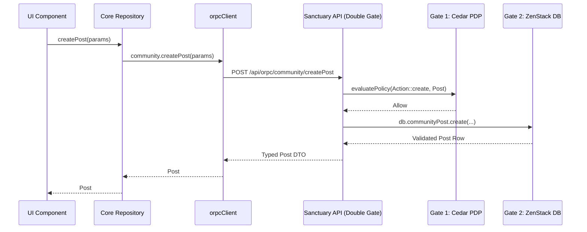

# Master Scaling Operational Plan & Holistic Architecture Covenant

> **Author**: Senior Principal Solutions Architect & Ruthless Hostile Critic  
> **Date**: 2026-10-17  
> **Target Substrate**: Polymath Monorepo (`@repo/core`, `@repo/policies`, `@repo/self`, `@repo/classroom`, `apps/sanctuary-api`, `apps/edlove-web`, `apps/gurudevi-mobile`)  
> **Operational Status**: Ready for Execution

---

## 1. Executive Architecture Covenant & Scaling Realities

### The Anti-Island Law & Invariant Ledger
The platform operates across three tightly bounded client surfaces (`gurudevi-mobile` on React Native 0.88 / Expo SDK 58 / Hermes; `gurudevi-web` on Next.js 16; `edlove-web` research atlas) backed by the sovereign API spine (`sanctuary-api` on Hono / oRPC / ZenStack V3 / PowerSync).

Under real-world scaling constraints (Hermes 64-bit GC pauses, low-bandwidth 2G/3G connectivity in rural Sri Lankan schools, offline-first SQLite WAL replication, and zero-trust multi-tenancy), code proposals must strictly adhere to:
1. **The Convivial Limit**: Software exists to automate administrative drudgery, never to enclose living human interactions.
2. **Contract-First Spine**: Zero un-typed or direct SQL/Supabase bypasses. All client-server interactions must flow through declarative oRPC contracts (`@repo/core/api/*.orpc.contract.ts`).
3. **The Double-Gate Security Model**:
   - **Gate 1 (Procedure Level)**: AWS Cedar PDP (`@repo/policies`) evaluates user action intent, principal bonds, and time/location context at the RPC boundary.
   - **Gate 2 (Data Level)**: ZenStack ZModel (`packages/schema/schema.zmodel`) evaluates row-level predicates (`@@allow`, `@@deny`) within the database transaction.
4. **The Deletion Veto**: Working fallback routes, error boundaries, and offline sync handlers must NEVER be deleted.
5. **Ratchet Invariant**: Architectural debt (loose `any`, direct `.from()` bypasses, files >800 LOC) can only ratchet downward.

---

## 2. Pillar 1: Direct Database Bypass Migration to oRPC (WS-5)

### Problem Statement
The codebase contains **533 direct `.from('table')` call sites** bypassing the oRPC procedure gateway. These direct queries:
- Bypass Cedar procedural authorization.
- Bypass ZenStack `@@allow` policies when executed via service role or unauthenticated clients.
- Bypass idempotency logging and typed telemetry.

### Hotspot Audit
| Target File | Call Sites | Target oRPC Procedure | Status in `sanctuary-api` |
| :--- | :--- | :--- | :--- |
| [`packages/core/src/adapters/supabase/communityRepository.ts`](file:///c:/x/packages/core/src/adapters/supabase/communityRepository.ts) | 25 | `communityORPCContract` (`posts`, `comments`, `reactions`, `polls`, `groups`) | ✅ Implemented in `apps/sanctuary-api/src/core/handlers/community.ts` |
| [`packages/core/src/adapters/supabase/educational/assignmentRepository.ts`](file:///c:/x/packages/core/src/adapters/supabase/educational/assignmentRepository.ts) | 12 | `educationalORPCContract` (`assignments.*`, `submissions.*`) | ✅ Implemented in `apps/sanctuary-api/src/core/handlers/educational.ts` |
| [`packages/core/src/adapters/supabase/educational/classroomRepository.ts`](file:///c:/x/packages/core/src/adapters/supabase/educational/classroomRepository.ts) | 10 | `educationalORPCContract` (`classrooms.*`) | ✅ Implemented in `apps/sanctuary-api/src/core/handlers/educational.ts` |
| [`packages/core/src/adapters/supabase/educational/attendanceRepository.ts`](file:///c:/x/packages/core/src/adapters/supabase/educational/attendanceRepository.ts) | 5 | `educationalORPCContract` (`attendance.*`) | ✅ Implemented in `apps/sanctuary-api/src/core/handlers/educational.ts` |
| [`packages/core/src/adapters/supabase/growth.adapter.ts`](file:///c:/x/packages/core/src/adapters/supabase/growth.adapter.ts) | 20 | `growthORPCContract` / `selfORPCContract` | ⏳ Needs oRPC cutover |

### Migration Execution Plan


1. **Step 1: Community Repository Cutover**:
   - Update `SupabaseCommunityRepository` in `packages/core/src/adapters/supabase/communityRepository.ts` to delegate mutating operations (`createPost`, `createComment`, `deleteComment`, `reactToPost`, `votePoll`) to `orpcClient.community.*`.
   - Preserve offline read fallbacks through PowerSync SQLite shims.
2. **Step 2: Educational Repositories Cutover**:
   - Refactor `assignmentRepository.ts`, `classroomRepository.ts`, and `attendanceRepository.ts` to invoke `orpcClient.educational.*`.
3. **Step 3: Ratchet Ceiling Downward**:
   - Run `node scripts/ratchet.mjs --update` to ratchet the ceiling from 533 down to <450.

---

## 3. Pillar 2: Monolithic File Decomposition (WS-8)

### Target Landscape (Files > 800 LOC)
Of the 37 files exceeding 800 lines, 2 are generated ZenStack ORM output (`packages/schema/schema.ts` and `input.ts`), and 35 are hand-authored application screens.

### Top Monolithic Targets
1. **`apps/edlove-web/app/atlas/page.tsx` (5,604 LOC)**:
   - *Problem*: Overloaded with leaflet maps, province filters, census data tables, spatial statistics, and modal dialogues.
   - *Refactoring Structure*:
     ```
     apps/edlove-web/app/atlas/
     ├── page.tsx                          # < 400 LOC: Layout & routing scaffold
     └── _components/
         ├── AtlasHeader.tsx               # Title, breadcrumbs, search bar
         ├── AtlasFilterPanel.tsx          # Province, district, school type filters
         ├── AtlasMapSurface.tsx           # Leaflet / Mapbox interactive viewport
         ├── AtlasSchoolTable.tsx          # Virtualized table of school nodes
         ├── AtlasSchoolDetailDrawer.tsx   # Census, teacher-student ratio, facilities
         └── AtlasExportModal.tsx          # CSV / GeoJSON export dialog
     ```
2. **`packages/library/src/screens/LibraryScreen.web.tsx` (2,129 LOC) & `LibraryScreen.tsx` (1,715 LOC)**:
   - *Refactoring Structure*:
     - Extract `BookReaderView.tsx`
     - Extract `PDFEditorDrawer.tsx`
     - Extract `LibraryFilterGrid.tsx`
3. **`packages/ui/src/screens/OnboardingScreen.web.tsx` (1,784 LOC) & `OnboardingScreen.tsx` (1,316 LOC)**:
   - Extract multi-step wizard slides into `packages/ui/src/screens/onboarding/steps/*` (`RoleSelectStep`, `CredentialsStep`, `SanctuaryIntroductionStep`).

---

## 4. Pillar 3: Double-Gate Security Covenant & Parity Validator (WS-6)

### Clarifying the Architecture
Cedar and ZenStack do not compete; they form a defense-in-depth pipeline:
```
Incoming HTTP/WebSocket Request
   │
   ▼
[1. Identity Bridge] ── Extracts JWT Bearer, verifies tenant & school bonds
   │
   ▼
[2. Gate 1: Cedar PDP] ── Evaluates procedure metadata (Action::grade, Resource::GradeMark)
   │                       Validates principal capacity, time-of-day, and institution scope
   │                       Exits 403 FORBIDDEN if unauthorized
   ▼
[3. Gate 2: ZenStack DAL] ── Binds request-scoped db = getClient(user, bond)
                           Executes ORM query where @@allow rules enforce row tenancy
                           Exits 403 / rejects row if entity isolation violated
   │
   ▼
Database (PostgreSQL / SQLite via PowerSync)
```

### Parity Validator Tooling
Create `packages/policies/src/__tests__/security-parity.test.ts`:
- Introspects `AUTHORIZATION_RESOURCES` and `AUTHORIZATION_ACTIONS` from `packages/policies/src/authorizationRegistry.ts`.
- Validates that every declared resource in Cedar corresponds to an existing ZModel model in `packages/schema/schema.zmodel`.
- Validates that every procedure in `apps/sanctuary-api` requiring double-gate protection has both a Cedar policy and a ZenStack model rule.

---

## 5. Pillar 4: Pristine Deterministic Seed & Demo Data Provider

### Problem Statement
Scattered mock files use `Math.random()`, inconsistent IDs, and missing relationships, leading to UI flicker, unstable tests, and demo state corruption.

### Unified Seed Architecture
1. **Deterministic Pseudo-Random Engine**:
   - Seeded PRNG (`mulberry32` or `crypto.subtle`) ensuring identical outputs for identical seeds across mobile and web.
2. **Domain Coverage in `demoProvider.ts`**:
   - **Schools**: 3 canonical institutions (National School, Rural Navodya, Suburban Maha Vidyalaya).
   - **Classrooms**: Science, Mathematics, English, Sinhala/Tamil Language sanctuaries with complete weekly timetables.
   - **Students**: 25 realistic student profiles per classroom with attendance streaks, growth metrics, and grade marks.
   - **Self Sadhana Workspace**: Pre-seeded mood logs, daily motivation cards, gratitude glimmers, and wisdom seeds.
3. **Clean Type-Safety**:
   - Zero `as any` casting in `demoProvider.ts` or `mockData.ts`. All objects satisfy core domain schemas.

---

---

## 6. Pillar 5: Holistic Edge & Somatic Expansion Architecture (WS-9)

### Executive Overview & The Edge Autonomy Loop
To serve teachers, students, and contemplative communities in rural Sri Lankan schools (often operating under 2G/3G connectivity or intermittent power), the platform establishes a zero-cloud, high-sensory **"Edge Autonomy Loop"**:

```
                       ┌──────────────────────────────────────────────┐
                       │           THE EDGE AUTONOMY LOOP             │
                       │   (Zero-Cloud, High-Sensory, Convivial)      │
                       └──────────────────────┬───────────────────────┘
                                              │
              ┌───────────────────────────────┼───────────────────────────────┐
              ▼                               ▼                               ▼
     [SOMATIC SANCTUARY]             [RURAL PEDAGOGY]                [RESEARCH ATLAS]
  • Pulsar Haptics (Worklets)     • Nitro Audio PCM DSP           • TypeGPU Compute Shaders
  • Harmonic Drone / Sound Bowl   • On-Device Whisper (Local AI)  • 50k School Census Heatmaps
  • Parasympathetic Pacing        • Offline SQLite WAL (PowerSync)• 60 FPS WebGPU Clustering
```

### 1. Tier 1 Animation & Worklets Radar (Reanimated 4.7.1 ➔ 4.8.0 Track)
- **Current Baseline**: `react-native-reanimated@4.7.1` + `react-native-worklets@0.13.0` + `react-native@0.88.0` (New Architecture Fabric/Hermes).
- **Upstream Radar Status**: Reanimated `4.8.0-nightly` branches are actively landing RN 0.88 memory optimizations and worklet-captured closure cleanup.
- **Cautious Upgrade Gate**: Under Tier 1 Native Architecture rules, no nightly or unpinned version may be merged. When `4.8.0` drops as stable on npm, it must pass the 4-step Cautious Upgrade Protocol (upstream changelog analysis ➔ peer matrix verification with `react-native-worklets` ➔ `node scripts/audit-seams.mjs` ➔ `node scripts/harmonize-dependencies.mjs --write` across all manifests).

### 2. Somatic Release via Haptics (`react-native-pulsar`)
- **Purpose**: Tactile somatic release, HRV bio-pacing, and parasympathetic breathwork (box breathing, 4-7-8) for stressed students and educators without requiring screen focus.
- **Runtime Seam**: Software Mansion's `react-native-pulsar` executes directly on the UI/Worklet thread via `react-native-worklets@0.13.0`, guaranteeing sub-millisecond tactile triggering with zero Hermes JS-bridge latency or GC interruptions.
- **Dual-Tier Hardware Fallback Sentinel**:
  - *Tier 1 (LRA / Apple Taptic Engine)*: Full continuous amplitude/frequency envelopes via `usePatternComposer`.
  - *Tier 2 (Coarse ERM Motors / Budget Android)*: Automatically throttles down to discrete micro-ticks (`click`, `soft-tap`) or optional soft acoustic clicks to prevent motor overheating and battery drain on low-end MediaTek/Snapdragon devices.

### 3. The Contemplative Resonator (Singing Bowl & Harmonic Drone)
- **Ruthless Veto on DAW Bloat**: A digital audio workstation, piano roll, or multi-track synth is strictly prohibited as unnecessary bloatware (>40MB binary weight, complex audio thread underruns on budget chipsets).
- **Approved Convivial Instrument**: A single-touch Tibetan/crystal singing bowl and harmonic drone:
  - Rotary gesture (`Gesture.Pan()`) tracking circular rim friction.
  - Coupled in real-time to `react-native-pulsar`'s `useRealtimeComposer` (tactile resistance rises with sound amplitude).
  - Micro-oscillator / multi-sampled acoustic resonance under 500KB total asset weight.

### 4. Native Jurisdictional Boundary: Nitro vs. Expo Inline Modules 2.0
- **Expo Inline Modules 2.0 (`apps/gurudevi-mobile/modules/`)**:
  - Purpose: App-local micro-sentinels (e.g. `ThermalSentinel.swift`/`.kt` querying battery temperature; ambient classroom noise decibel meter).
  - Shape: Plain Swift/Kotlin classes annotated with `@ExpoModule` and `@JS`. Zero monorepo package overhead; auto-discovered during prebuild.
- **Nitro Modules (`react-native-nitro-modules@0.37.1` / `0.36.1`)**:
  - Purpose: Heavy zero-copy C++ memory pipelines, high-throughput binary caching (MMKV v4), and direct `ArrayBuffer` transfer for audio DSP.
  - Shape: Statically typed `.nitro.ts` specs compiling via `npx nitrogen`.

### 5. TypeGPU Research Atlas Acceleration (`apps/edlove-web`)
- **Problem**: `apps/edlove-web/app/atlas/page.tsx` visualizes 50,000+ Sri Lankan schools, multi-variable census overlays, and poverty metrics, creating CPU bottlenecks during complex filtering.
- **Solution**: Implement client-side WebGPU compute shaders using Software Mansion's **TypeGPU** (`'use gpu'`).
- **Safety Fallback**: Feature-detect `navigator.gpu`; if unsupported on older educational laptops, cleanly fall back to Canvas2D/Leaflet clustering without error cascades.

### 6. Local On-Device AI & Whisper Inference
- **Problem**: Rural educators spend up to 45 minutes typing daily classroom reflections and attendance notes on tiny mobile screens with no internet connectivity.
- **Solution**: Quantized on-device speech-to-text (Whisper / Moonshine via `react-native-executorch` or `whisper.rn`).
- **Data Flow**: Audio recorded via zero-copy Nitro buffer ➔ transcribed locally in ~2s ➔ persisted directly to local SQLite WAL (PowerSync) ➔ synchronizes via oRPC double-gate when cellular connectivity is re-established.

---

## 7. Ruthless Pragmatic Hostile Critic Review

| Review Question | Hostile Finding | Mitigation in Plan |
| :--- | :--- | :--- |
| **"Will migrating `.from(` to oRPC break offline usage?"** | Direct Supabase calls fail completely offline anyway. However, naive oRPC calls could throw unhandled network exceptions when offline. | The core repositories must maintain the offline queue (`useMutationQueue` / PowerSync SQLite WAL) so write operations buffer locally before syncing. |
| **"Will splitting `atlas/page.tsx` break state sharing?"** | Props drilling between 6 new subcomponents could lead to re-render thrashing or state desynchronization. | Use a lightweight React Context or Zustand store (`useAtlasStore`) to encapsulate filter state, selected school, and zoom coordinates. |
| **"Are Cedar and ZenStack duplicating memory overhead?"** | Running Rust Cedar WebAssembly + Hermes V8 + ZenStack in-process could exhaust memory on low-end Android (2GB RAM). | Cedar runs exclusively on the server edge (`apps/sanctuary-api`). Gurudevi Mobile NEVER imports `@repo/policies` or the Cedar Wasm runtime; it receives cryptographically signed capability tokens (`PermissionSnapshot`). |
| **"Could removing `any` in `demoProvider` break legacy screens?"** | Some screens access un-typed properties on mock objects. | We will type the mock schemas accurately against `@repo/core/types` and adjust consumer call sites additively without deleting properties. |
| **"Will a music player/synth turn the app into an over-engineered toy?"** | DAWs or multi-track synths add 40MB+ bloat, heavy CPU wake locks, and audio-thread stutter on budget MediaTek chips. | VETOED. Only a lightweight (<500KB) single-touch Contemplative Resonator (singing bowl/drone) tied to Pulsar haptics is permitted. |
| **"Will continuous haptics destroy budget Android hardware?"** | Continuous complex vibration waveforms on cheap ERM motors buzz aggressively and overheat batteries at 35°C ambient temperatures. | Enforce Dual-Tier Tactile Fallback: only devices with advanced actuators receive continuous envelopes; budget ERM devices receive discrete micro-ticks or soft audio clicks. |
| **"Can we blindly upgrade to Reanimated 4.8?"** | Nightlies or premature minor bumps in Tier 1 native pins cause instant `SIGABRT` or Hermes JSI crashes in production. | Upgrade is frozen until 4.8.0 reaches official npm stable release and passes the Cautious Upgrade Protocol with `react-native-worklets@0.13.0`. |

---

## 8. Immediate Phased Action Matrix

```
[Phase 1: Community oRPC Cutover] ──► [Phase 2: Parity Test & Ratchet]
                 │                                      │
                 ▼                                      ▼
[Phase 3: Atlas Monolith Extraction] ──► [Phase 4: Seed Data Type-Hardening]
                 │                                      │
                 ▼                                      ▼
[Phase 5: Pulsar Somatic & Resonator] ──► [Phase 6: TypeGPU Atlas & Edge AI]
```

1. **Phase 1 (Immediate)**: Refactor `packages/core/src/adapters/supabase/communityRepository.ts` to call `orpcClient.community.*`, reducing direct database call sites.
2. **Phase 2**: Add `security-parity.test.ts` in `packages/policies` and run `pnpm run ratchet:update`.
3. **Phase 3**: Decompose `apps/edlove-web/app/atlas/page.tsx` into modular subcomponents under `_components/`.
4. **Phase 4**: Harden `packages/core/src/api/demoProvider.ts` with typed entities, removing remaining loose casts.
5. **Phase 5**: Prototype `react-native-pulsar` tactile breathwork and the Contemplative Resonator (singing bowl) on the worklet thread with ERM motor protection.
6. **Phase 6**: Integrate TypeGPU compute shaders for 50k school nodes in the extracted `AtlasMapSurface.tsx` and conduct the on-device Whisper spike for rural classroom reflections.

