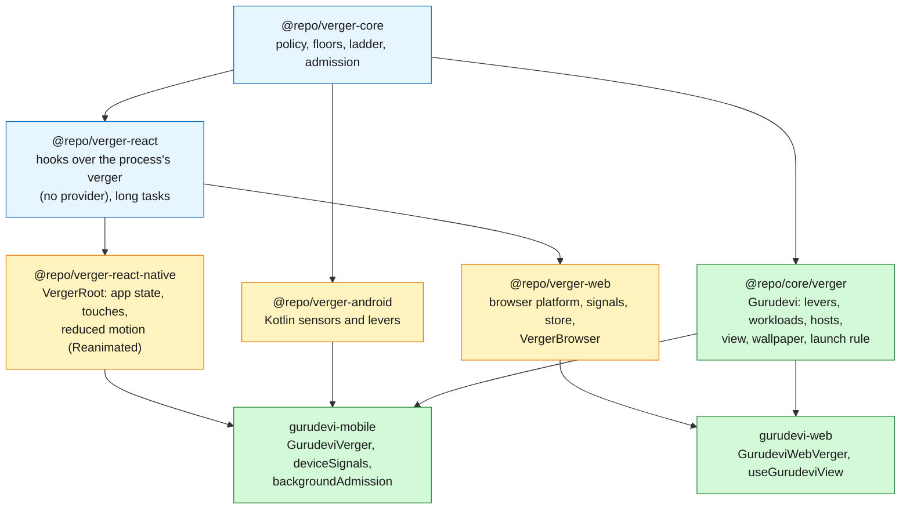

# Verger everywhere

Verger is the one regulator. Visuals, the wallpaper, online status and background work are
downstream: they read verger's decision and do not decide for themselves. The old governor
(`RealityProvider`, `visualPolicy`, `@repo/core/efficiency`, the web's `useBrowserVisualBudget`)
is retired; what it did is recorded in [drift-record.md](drift-record.md).

## The packages

## Why no provider

Verger is one per process, like the platform under it, and it is already an external store
(`subscribe`, `getSnapshot`). React reads external stores with `useSyncExternalStore` by plain
import, so the hooks need no Context ([react.dev](https://react.dev/reference/react/useSyncExternalStore)).
A platform shell (`VergerRoot`, `VergerBrowser`) owns the lifecycle and binds the instance; it
binds during its first render, so children read verger on their first frame, as a Context value
would. The shell renders only what must be in the tree: on React Native the touch-presence view
and Reanimated's reduced-motion config; on the web nothing (reduced motion is an attribute on
`<html>`, `data-verger-reduced-motion`).

## Readings: native where it exists, JavaScript where it does not

A platform declares what it senses natively (`VergerPlatform.senses`). The host feeds
JavaScript readings with `Verger.signal`: the floors always hear them; a running verger hears
them only for sensors the platform lacks, so a JavaScript reading never overwrites a native one.

| Reading | Android (native) | Mobile JS (`deviceSignals`) | Browser (`browserSignals`) |
|---|---|---|---|
| Network | `ConnectivityManager`, bandwidth, Data Saver | NetInfo: transport, reachability, cost | `onLine`, Network Information (`downlink`, `saveData`; Chromium) |
| Battery, plug | sticky broadcast | expo-battery | Battery Status (Chromium, secure contexts) |
| Battery saver | `PowerManager` | expo-battery | not exposed |
| Memory | trims, polled | (facts: expo-device) | (facts: `deviceMemory`, a power of two) |
| Frames, threads, heat | FrameMetrics, procfs, thermal | none | none (Compute Pressure: a later chair) |
| JS stalls | RN `longtask` | | `long-animation-frame` (Chromium 123+), else `longtask` |
| Visibility, motion, presence | AppState, AccessibilityInfo, responder capture | | `visibilitychange`, `prefers-reduced-motion`, pointer and key |

Sources: MDN pages on the Network Information, Device Memory and Battery Status APIs; Chrome's
Long Animation Frames and Compute Pressure docs (all found by search on 2026-10-24; most are
Chromium-only, so every use is feature-detected).

## Downstream of verger

| Concern | Reads | Was |
|---|---|---|
| Visual capabilities (every component) | `experienceOf(snapshot)` | `RealityProvider` + `visualPolicy` |
| Wallpaper (mobile and web) | `wallpaperOf(wallpaper, view, snapshot)` | `resolveRuntimeVisualBudget` + `useBrowserVisualBudget` |
| Online status (`isOnline` in the core store) | `snapshot.networkLimit !== 'offline'` | `NetworkStatusSync` (NetInfo) |
| Optional startup work | `snapshot.optionalConcurrency` | `workAdmission` |
| Background sync, storage compaction | `admitBackgroundWork` → `vergerFloors` + `admitWork` | `evaluateEfficiency` |

Background tasks run where verger does not (a headless JavaScript context), so they read the
device once, fold it into verger's floors (`vergerFloors`), and admit their workload from the
registry by its class and the accounts it spends (`admitWork`). Metered is home and unknown is
never a limit, as in the app. One change from the old policy: background sync no longer waits
for an unmetered network, which on prepaid mobile data meant it never ran.

## Launch rule, one for both apps

`resolveVergerLaunch` (`@repo/core/verger`): a development build runs the `lab` preset; a
release with nothing configured runs only the floors until its preset is chosen; a build preset
(`EXPO_PUBLIC_GURUDEVI_VERGER_PRESET`, `NEXT_PUBLIC_GURUDEVI_VERGER_PRESET`), a mode override
(`__GURUDEVI_RUNTIME_MODE__`, `off` is the kill switch) and a strictly parsed remote patch
(`__GURUDEVI_VERGER_ACTIVATION__`) refine it. The web host is its own (`gurudevi-web`), so its
memory never mixes with the phone's.
