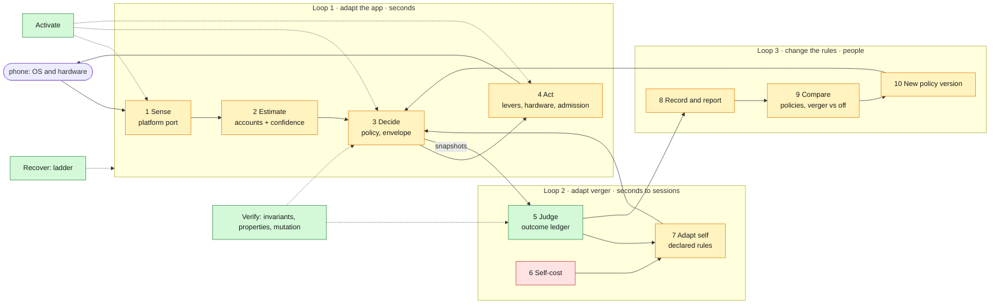

# Verger: the pipeline, needed against built

One page for the whole of verger, top-down, so work on any stage can be checked against the
whole. Three checks: what each stage needs against what is built; whether verger has **requisite
variety** (Ashby: a regulator can counter only the disturbances it can both see and act on); and
whether the stage gives the people working on it **full affordance** (see, change, replay,
compare). Update this page whenever a stage changes. Doctrine:
[stage-and-chairs.md](stage-and-chairs.md), [second-order-loop.md](second-order-loop.md).

## Build plan and progress

**Continuing this work?** Start with the [playbook](playbook/README.md) (rules, nuances, one
guide per remaining phase) and run `pnpm verger:check`. Remaining, in order of leverage: F
(phones), C (envelope), B3 (data budget), D (loops 2 and 3), the rest of B.

The one place the plan is tracked; update it with every phase. Verification rides with each item
(`verification.md`); evidence levels as in AGENTS.md section 6.

| Phase | Item | State | Evidence |
|---|---|---|---|
| A. Core stage | activation, policy contract, demand and accounts, outcome ledger, invariants | done | G2: properties, mutation check |
| A. Core stage | recovery ladder against its model | done (found a rung-4 hole, fixed) | G2: model-based |
| B. Sensing | B1 network and Data Saver | in code; metered treated as home | G2 contract (Kotlin and TS); Android part uncompiled |
| B. Sensing | B2 battery level, plugged in, temperature; heat fallback below API 29 | in code; low battery is a lever-declared limit | G2 contract (Kotlin and TS), properties; temperature unit to verify on a phone; Android part uncompiled |
| B. Sensing | B3 data budget: no network assumed free; daily allowances for metered and unmetered; Wi-Fi or night window. **Accounting core done** (`dataBudget.ts`: ledger across reboots and local midnight, budget state, wrapping night window). **Reducer limit done** (both policies): a `data-budget` event (heard through the network sensor; `unknown` until reported, forgotten when the sensor goes deaf) sets the snapshot's `dataBudget`; levers declare `whenDataBudgetSpent` (Gurudevi: prefetch 2), a limit like Data Saver; `admitWork` reads the snapshot's budget; the network account reads spent as overdrawn. **Next:** the Android byte counter (TrafficStats) that sends the event, and the allowances as host config (playbook/B3-data-budget.md) | in progress | G1: `dataBudget.test.ts` 6/6, `dataBudgetLimit.test.ts` 4/4 (spent holds the lever under p4 and p5 with only the floors running; unknown never a limit; deaf and forgotten; admission and account); G2: the data budget is in the generated streams, with the deaf-sensor invariant extended |
| B. Sensing | B4 storage and B7 input delay **in both policies**: a `storage` sensor (in every preset that senses, and in the floors) and event (free bytes, `null` when unknown) sets the snapshot's `storage` (`unknown`, `ample`, `low` below config `storageLowBytes`, 512 MiB provisional); levers declare `whenStorageLow` (Gurudevi: prefetch 2), a limit; the storage account reads it. An `input-delay` event (heard with long tasks) at or above config `inputDelayLongMs` (100 ms, provisional) counts as a long task for contention. Admission does not hold storage-spending work on low storage: eviction frees space and sync carries the attendance upload, so which work should wait is a chair for Naveen. Platform sources in JavaScript: mobile reads `Paths.availableDiskSpace` (expo-file-system 58; the old `getFreeDiskStorageAsync` throws) at start and on every return to the front, and in background tasks; the web reads the origin's `navigator.storage.estimate()` (quota minus usage: a web app's limit is its quota, not the disk) at start and on focus; both shells observe Event Timing (`observeInputDelay` in verger-react, `processingStart − startTime`, React Native 0.88's `PerformanceEventTiming` and the browsers', inert elsewhere) while verger runs. **Next:** Android `StatFs` natively, if the JS read proves too coarse. B5 verger's own cost: see D3 | in progress | G1: web mappings, focus re-read and the Event Timing observer (verger-web 11/11), mobile mapping (deviceSignals 4/4); `storageAndInput.test.ts` 6/6 (limit under p4 and p5 with the floors, unknown and deaf, account, invalid readings rejected, delay threshold, deaf long-task sensor); G2: both events in the generated streams, the deaf-sensor invariant extended to storage |
| G. Everywhere | G1 verger-core: platforms declare native sensors (`senses`); hosts feed JS readings with `Verger.signal` (floors always hear them, a running verger only where the platform lacks the sensor); the floors hear the network (`FLOORS_ACTIVATION`); `vergerFloors` for headless work; `admitWork` (class and accounts; metered is home) | done | G1: verger-core tests |
| G. Everywhere | G2 provider-less React: `@repo/verger-react` hooks over the process's verger (`useSyncExternalStore`, no Context), bound by a platform shell; `@repo/verger-react-native` `VergerRoot` | done | G1/G3: hooks under `VergerRoot` |
| G. Everywhere | G3 mobile downstream of verger: NetInfo and expo-battery as verger signals (`deviceSignals`), online status from `networkLimit`, background sync and compaction through `admitBackgroundWork`, wallpaper through `wallpaperOf`; `NetworkStatusSync` removed | done | G1: mappings, admission |
| G. Everywhere | G4 web: `@repo/verger-web` (browser platform, `browserSignals`, `localStorage` store, `VergerBrowser`), `GURUDEVI_WEB_HOST`, mounted in the sanctuary layout; the web wallpaper reads verger; `useBrowserVisualBudget` and all of `@repo/core/efficiency` removed. See [everywhere.md](everywhere.md) | done | G1: verger-web tests; web wallpaper test |
| C. Envelope | C1 done: floors split into `limitFloors` and `classFloors`; every snapshot publishes `envelope` (limit, ceiling, home, floor per lever). C2/C3 in code: `VERGER_POLICY_P5` (not the default) expands each lever on its own evidence (no relieved account strained, at least one ample with confidence ≥ `expandMinConfidence`, sustained `wait / confidence`), with per-lever back-off on a failed expansion. C5: `comparePolicies` (verger-core) replays one stream through each policy and reports strain, quality given up (overall and while calm), worst quality and moves; open loop, so it compares decisions, not effects. **Next:** run it on phone recordings (D1, D5), then Naveen decides the default | in progress | G1: p4 unchanged (all suites green); `p5.test.ts` 3/3 (frame-bound levers return while memory stays strained, where p4 holds all; deaf sensors give exactly p4; envelope ordered and every level inside it); G2: p5 under the generated property suite (every invariant, ordered envelope, determinism), 2000 cases per property; per-lever back-off: a failed expansion doubles only that lever's wait, the global wait stays; mutation check: p5 expanding past its ceiling, a lying envelope and an unordered envelope are each caught (envelope invariants in `checkSnapshot`); `compare.test.ts` 3/3 (on the p5 story p5 gives up less quality than p4 with the same strain; deterministic and input-order independent; nothing happening gives no moves) |
| D. Loop 2 and 3 | D2 mobile lab in code: the development-only route `/verger-lab` (`VergerLabScreen`: the read-out from `labSections`, every lever's level, proposal, envelope, pressure and findings; activation patch applied live and saved only if it applied; thresholds tuned through validation; the session recording shared as JSON for `pnpm compare`; every refusal shown). D2 lab model in code: `labReport` (verger-core: plan, activation, snapshot, every lever with its envelope, pressure and loop 2 findings, accounts, quality cost, outcomes and their totals, self-cost, recorded events), `labConfigure` and `labTune` (the strict parsers; a refusal is returned with its reason, never swallowed), `useVergerLab` (verger-react, live); development builds record sessions (`VERGER_LAB_RECORD_EVENTS`) and keep the lab's patch under `VERGER_LAB_PATCH_KEY`: the web reads it synchronously into `localPatch`, mobile applies it live once verger runs (AsyncStorage is asynchronous). D4 self-budget rule in code: `selfBudget` (a `createVerger` option, `maxDutyRatio` over `windowMs`; unset by default, a chair until a phone is measured) judges each window's reducer share; the first window over sheds the contention sensors (`SELF_BUDGET_SHED`: per-thread CPU and long tasks, kept on top of any `configure` patch), the next hands the session to the floors (verger stops cleanly); it never steps back within a session; each step sends `verger_self_budget`. D4 flapping rule in code (p5 only, inside the reducer): a lever lowered again after its own expansion `flapCycles` (3) times within `flapWindowMs` (2 min), judged as of its last lowering, waits `maxUpgradeAfterMs` over its confidence before it returns, with no decay, and starts over after a whole window without a flap; the expansion's reason says so. This covers slow flaps the C3 back-off misses (it sees only a lowering within 10 s of the expansion, and decays after 30 s). Found while testing: a sliding window lifted the rule during the very calm it should lengthen. D4 first rule in code (p5 only): the launcher reads the outcome ledger (`ineffectiveFindings`: a lever judged not-relieved for a target `INEFFECTIVE_AFTER_MOVES` = 3 times, never relieved, heat and storage never learned from) and sends each finding once as a `lever-ineffective` event, after the current dispatch; p5 stops lowering that lever for that target for the session and publishes `ineffective` in the snapshot; p4 ignores it. Being an event, the rule is recorded and replays. A two-step lever fails at most twice per strain episode, so the rule needs at least two episodes (intended). D2 seam in code: `resolveVergerLaunch` takes `localPatch` (the lab's saved patch), honoured only in a development build, under the remote patch (remote still overrules it; the kill switch beats both), rejected whole and reported as `rejectedLocal`; the lab screens and the stored patch are not built yet. D1 in code: `recordEvents` (a `createVerger` and controller option, development only) records the creation options and every reduced event in reduction order, head kept and drops counted; `Verger.recording()` returns it as plain JSON and `replayRecording` reproduces it (refusing another policy version). D3 in code: the controller measures every reduction (a `measure` clock, `performance.now()` by default) and counts timer wake-ups; `Verger.selfCost()` reports events, wake-ups, events per minute, reducer mean, max and p95 (bounded histogram) and duty ratio. No budget yet: measure on a phone first. Comparison: `comparePolicies` (C5). **Next:** D2 lab screens (show the snapshot, envelope, accounts, outcomes, self-cost, findings; export the recording; save the lab patch), D5 run on phone recordings (the script exists: `pnpm --filter @repo/verger-core compare <recording.json>...` replays each through off (floors only), p4 and p5; the floors are deaf to frames, memory and heat, so their strain prints as `deaf`) | in progress | G1: `VergerLabScreen.test.tsx` 2/2 (save only on apply, a failed save reported; every layer of a real bound verger rendered); G1: `lab.test.ts` 4/4 (with the read-out) (floors before start, the whole stage while running with ordered envelopes; configure and tune refuse malformed input whole, with the reason); G1: `selfBudget.test.ts` 3/3 (window arithmetic, one step per window over, never down, refused budgets; a running verger sheds, keeps the shed through `configure`, then hands over to the floors, reporting both); G1: `flapping.test.ts` 3/3 (slow flaps: ordinary returns, then the longest wait on the third, then a fresh start; flaps wider than the window are not flapping; p4 unchanged; fails with the rule disabled); G2: p5 with generated findings keeps every invariant and never lowers by pressure a lever marked for all it relieves (the property fails with the rule disabled); G1: `selfRules.test.ts` 6/6 (finder bounds; the rule in p5, p4 unchanged, no-op findings); launcher: three unrelieved strain episodes produce findings, each sent once, in the recording; G1: `launch.test.ts` 12/12 (lab patch applies in development, ignored in a release even malformed, remote overrules it, kill switch beats both, a malformed one reported apart); G2: a recording replays to exactly the snapshots the controller published, p4 and p5, over the generated streams (property; a recorder that drops trims is caught); G1: `recording.test.ts` 4/4 (bound, version refusal, reduction order differs from sorted replay, JSON round trip); G1: `selfCost.test.ts` 4/4 (counts, rates, duty ratio; p95 within a factor of two and never above the maximum, an outlier in the open last bucket reported at its true size; clock faults cost nothing; the controller times each reduction and counts a wake-up) |
| E. Cut-off | E1 floors without native code: while verger is off (mode off, kill switch, rung 4, launch error, before start, after stop) the host's policy runs under the `static` preset on JS-only facts (`facts`, Gurudevi: expo-device memory) | done | G1: verger tests (floors before start, kill switch, after stop, stable identity, facts that throw) |
| E. Cut-off | E2 drift test: the old governor as the differential oracle, every input it distinguishes (2,880 cases) against verger's static decision read through Gurudevi's view (`experienceOf`); every difference named with its cause: six intended (low fidelity honoured, reduce motion keeps blur, saver stills ambient, saver stops prefetch, low-phone blur named, safe mode respects the user), two to decide (3–6 GB class floor, slow network and prefetch: open chairs) | done | G1: exhaustive, with a planted mutant caught (480 cases) |
| E. Cut-off | Decisions from E2 built: capacity classes (low under 5 GiB, mid under 9 GiB, config; levers' `whenMidCapacity`; earned back by `capacityGrant`) and weak links (slow or back from offline under a minute; levers' `whenSlowNetwork`; one optional job at a time); snapshot carries `capacityClass` and `networkLimit`; the estimator reads the same limit | done | G1: class and network tests; drift test on six phone sizes (5,760 cases), no open difference, planted mutant caught |
| E. Cut-off | E3 view: `experienceOf` (levels to the fields consumers read, tier from verger's class; quiet, sound, haptics and safe mode as settings); the user's fidelity reaches verger (B6) | done | the drift test; G0 for the React shell |
| E. Cut-off | E4 `GurudeviVerger` mounted in `EntryShell`. Activation from configuration (`resolveVergerLaunch`): build preset `EXPO_PUBLIC_GURUDEVI_VERGER_PRESET` (`active`, `shadow`, `static`, `lab`); a development build defaults to `lab`; a release with nothing set stays off (floors only) until its preset is chosen; mode override `__GURUDEVI_RUNTIME_MODE__` (`off` is the kill switch); remote patch `__GURUDEVI_VERGER_ACTIVATION__`, parsed strictly, ignored whole if malformed. `useVerger` exposes `configure`, `tune`, `outcomes` | done | G1: launch resolution 8/8; mobile suite unchanged (20 failures in 8 files, identical before the change) |
| E. Cut-off | E5a every component that reads `useVisualCapabilities` (and `useEnvironment().visualCapabilities`) now reads verger inside its provider, through `experienceOf`; the old governor answers only outside a verger provider. The mobile host governs the seven levers the view reads (`EXPERIENCE_LEVER_IDS`), no lever nobody applies | done | G1/G3: hook under a real `VergerProvider` 3/3; ui suite and mobile suite: the same failures as before the change (ui 1 in 2 files, mobile 20 in 8 files) |
| E. Cut-off | E5b direct readers: optional startup work admitted by verger's `optionalConcurrency` (the registry's `optional-startup`); the mobile workspace wallpaper's budget from verger's readings (`visualSignalsOf`, the shared budget contract kept for the web); battery saver reaches the floors in JavaScript (`signals`, from the device adapter) so it holds while verger is off | done | G1/G3: hook tests 4/4; ui and mobile suites unchanged from before |
| E. Cut-off | E5c the old governor removed (signed off 2026-10-24): `RealityProvider`, `realitySignals`, `visualPolicy`, `experiencePolicy`, `applyVisualSafeMode`, the device and network detection in `utils`, `workAdmission`, and their tests; online status moved to `NetworkStatusSync`; components outside verger's provider get the view of an unknown phone. Kept, as not the governor: the web app's budget in `@repo/core/efficiency`, background tasks' efficiency policy, the user's settings, the safe-mode flag. What changed, and why: [drift-record.md](drift-record.md) | done | G1/G3: core 1067/1067; ui and mobile suites: the same failures as before, fewer tests by exactly the removed ones; ui type errors 88 before and after |
| E. Cut-off | E6 the name retired: `VergerEvent`, `VergerSnapshot`, `VergerState`, `VergerConfig`, `DEFAULT_VERGER_CONFIG`, `RunMode`, `createVergerState`, `reduceVerger`, `replayVerger`, `toVergerEvent`, `VergerTelemetry*`, `VERGER_POLICY_VERSION`; telemetry events `verger_started`, `verger_summary`, `verger_state`, `verger_lever`; `verger-core/src/reducer.ts`; Gurudevi's host at `@repo/core/verger` (`packages/core/src/verger`). "Governor" remains only in history (the ADR, the drift record, "the old governor") | done | G0: every package's typecheck as before; G1: suites as before; JVM 30/30 |
| F. Phones | first Gradle build; dev client on the A52, A24 and a 2–4 GB phone; Maestro CLI flows; Stryker | needs the laptop | — |

## The pipeline

Green: built and tested (G2). Amber: partly built. Red: missing.

Stage 4 is amber: inside verger's provider every component that reads visual capabilities
reads verger's levels (E5a); direct readers of the old governor move next (E5b). The full
sensing layer is specified in [sensing.md](sensing.md); verification in
[verification.md](verification.md).

## Needed against built

| # | Stage | Needed | Built | Gap |
|---|---|---|---|---|
| 1 | Sense ([spec](sensing.md)) | every disturbance below seen, each sensor switchable, cost-bounded, Android 9 to 16 | frames, thermal and headroom, trims and polled memory, battery saver, per-thread CPU, JS long tasks, app state, touches, reduce motion; switchable natively | network and Data Saver; battery level and temperature; storage; the user's fidelity (sent as `auto`); heat fallback below API 29 |
| 2 | Estimate | seven accounts, each with a state and a confidence | `estimateAccounts` (read model) | network and storage unknown; confidences provisional; no policy reads it yet |
| 3 | Decide | a swappable policy inside the envelope (limit, ceiling, home, floor); compress and expand | `VergerPolicy`, verger-p4: compresses, returns to start; static floors; live tuning | home, ceiling and in-session expansion (verger-p5) |
| 4 | Act | every lever reaches a component; hardware levers; deferrable work admitted | refresh cap and CPU hints (native), global reduced motion (React, and a document attribute on the web); on mobile every governed lever has a reader through `experienceOf`: ambient motion, transitions, blur, particles, prefetch, image cache and decode (expo-image), and since the stage 4 audit loading shimmer (`ShimmerBlock` holds still) and the list window (`SovereignVirtualList` passes FlashList's `drawDistance`: its own default, half, a quarter); the web governs only what its pages read (`WEB_VIEW_LEVER_IDS`: blur, plus app-wide motion); admission: optional startup (`optionalConcurrency`), background sync and storage eviction (`admitBackgroundWork`) | `glass-material` has no consumer (no refraction component exists), so no host governs it; `transitions` at level 1 (short fades) reads the same as 0; lists outside `SovereignVirtualList` keep their own window |
| 5 | Judge | every move judged: relieved, held or withdrawn, agility, quality cost | **outcome ledger** (`outcomes.ts`): every applied move by pressure judged; floor moves counted; joint attribution; kept by every launch, read with `Verger.outcomes()`; windows from config (`outcomeJudgeWindowMs`, `outcomeHoldWindowMs`, one source); every verdict joins the flight recorder (`verdictLine`); `verger_outcomes` (totals, agility, the lever failing most, self-cost) sent on going to the background and at stop; loop 2 reads it (D4) | shadow proposals are not judged, by nature: a move never applied cannot relieve anything, so judging it needs an experiment arm (A/B), not the ledger; a window changed by `tune` applies from the next launch |
| 6 | Self-cost | verger's own wakeups, CPU, bridge events, memory, against off | reducer time, events and wake-ups (`Verger.selfCost()`); native thread CPU not yet | self-cost meter on a phone; a budget |
| 7 | Adapt self | declared rules: stop unhelpful moves, slow flapping, withdraw failed growth, own budget | recovery ladder (on harm), failed-raise back-off, contention stop | the rules for every account |
| 8 | Record and report | telemetry sink, observe levels, session recordings, flight recorder | telemetry events defined, capped; flight recorder (48 lines); quality meter; session report | no sink connected; no session recording or export |
| 9 | Compare | two policies, or verger and off, on one recording | `replayVerger(options, events, policy)` | comparison report; recordings to feed it |
| 10 | New version | versioned policies, deterministic experiment arms | policy versions, `assignExperiment`, ladder keyed by policy | not called from the app |
| — | Activate | what may run, live, capped by the ladder | done; from build and remote configuration in Gurudevi | a local (lab) layer, written by the dev lab |
| — | Recover | the ladder, trust, growth across launches | done (G2) | open review items in the handoff note; ladder not yet under generated death schedules |
| — | Verify ([strategy](verification.md)) | invariants over generated streams, metamorphic relations, mutation adequacy, recordings, phones | `invariants.ts`; property suite with mutation check (G2) | controller and recovery properties; golden recorded sessions (G3); phones (G5) |

## Requisite variety: every disturbance, seen and countered

A disturbance verger cannot see, it cannot counter; one it can see but has no lever for, it can
only report. Each row is one source of variety on the phone.

| Disturbance | Seen by | Countered by | State |
|---|---|---|---|
| GPU-bound frames | frame stages (GPU time from API 31) | blur, glass, particles, ambient motion, refresh cap | seen; countered only by the refresh cap until components read levers |
| UI or render thread busy | frame stages, main-thread load | list window, transitions, refresh cap | seen; same gap |
| JS thread saturated | thread load, long tasks | CPU-primary levers; deferrable work paused; then "needs a code fix" | seen; same gap; admission unread |
| Heat | thermal status (API 29), headroom (API 30); battery temperature where the platform gives neither | everything warm-floored, refresh cap, no CPU boost | seen on every API level (the fallback is a weaker witness, confidence 0.4) |
| Memory pressure | trims, polled free memory | image decode and cache, list window | seen; levers unread |
| Battery saver | power broadcast | ambient and energy levers, GPU floors | seen |
| Battery low over a school day | battery level and plug state (in code, uncompiled) | levers' `whenBatteryLow` (Gurudevi: ambient motion, particles, prefetch); the school-day energy goal is not built | seen; countered by floors |
| Poor, metered or saved network | network callback, Data Saver status (in code, uncompiled) | levers' `whenMetered`, `whenDataSaver`, `whenOffline` (Gurudevi: prefetch); no optional work under Data Saver or offline | seen and countered in the reducer; native part awaits the Gradle build |
| Storage low | **not sensed** | eviction, caches | unseen |
| Other apps competing | free-memory trend, process CPU | as memory and CPU | partly seen |
| OS update, uncompiled code | build fingerprint (profile relearned) | the profile's caution | seen at launch; compile state unverified |
| User's choices (fidelity, quiet) | reduce motion only | limits in the envelope | **fidelity not sent** |
| Verger's own failure | exits, markers | the recovery ladder | seen and countered |
| Verger's own cost | **not measured** | its own budget rules | unseen |
| Moves that do not help | the outcome ledger, every account | stop rules (loop 2, phase 3) | seen; not yet countered except for contention |

## Affordance: what the stage lets people do

| Affordance | For | State |
|---|---|---|
| See every layer live | developers | snapshot and accounts exist; no lab view |
| Change activation and thresholds live | developers | `Verger.configure`, `Verger.tune`; in React through `useVerger`; no lab screen yet |
| Record a session and replay it | developers, loop 3 | replay exists; recording does not |
| Compare policies, or verger against off | loop 3 | `comparePolicies` reports per policy on a stream; no script over recordings yet (D5) |
| Bring a new policy | loop 3 | the `VergerPolicy` contract |
| Switch off everything at once | operations | kill switch, rung 4 |
| See why every decision was made | everyone | reasons on every snapshot; flight recorder |

## What the outcome ledger is, in this picture

Stage 5. It sits beside the policy, not inside it: it watches the published snapshots of any
policy, so it judges p4, p5 or a policy someone else brings by the same rule. Loop 2's rules and
loop 3's comparisons both read it, which is why it comes first.
