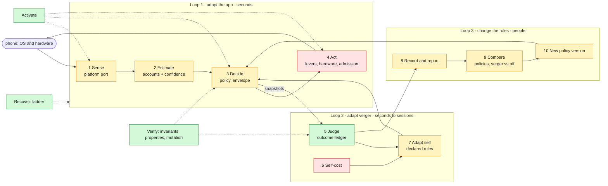

# Verger: the pipeline, needed against built

One page for the whole of verger, top-down, so work on any stage can be checked against the
whole. Three checks: what each stage needs against what is built; whether verger has **requisite
variety** (Ashby: a regulator can counter only the disturbances it can both see and act on); and
whether the stage gives the people working on it **full affordance** (see, change, replay,
compare). Update this page whenever a stage changes. Doctrine:
[stage-and-chairs.md](stage-and-chairs.md), [second-order-loop.md](second-order-loop.md).

## The pipeline

Green: built and tested (G2). Amber: partly built. Red: missing.

Stage 4 is red because no app component reads a lever yet: the policy decides, and only
verger's own refresh cap and global reduced motion carry a decision to the phone. The full
sensing layer is specified in [sensing.md](sensing.md); verification in
[verification.md](verification.md).

## Needed against built

| # | Stage | Needed | Built | Gap |
|---|---|---|---|---|
| 1 | Sense ([spec](sensing.md)) | every disturbance below seen, each sensor switchable, cost-bounded, Android 9 to 16 | frames, thermal and headroom, trims and polled memory, battery saver, per-thread CPU, JS long tasks, app state, touches, reduce motion; switchable natively | network and Data Saver; battery level and temperature; storage; the user's fidelity (sent as `auto`); heat fallback below API 29 |
| 2 | Estimate | seven accounts, each with a state and a confidence | `estimateAccounts` (read model) | network and storage unknown; confidences provisional; no policy reads it yet |
| 3 | Decide | a swappable policy inside the envelope (limit, ceiling, home, floor); compress and expand | `VergerPolicy`, verger-p4: compresses, returns to start; static floors; live tuning | home, ceiling and in-session expansion (verger-p5) |
| 4 | Act | every lever reaches a component; hardware levers; deferrable work admitted | refresh cap and CPU hints (native), global reduced motion (React); `optionalConcurrency` computed | **no app component reads a lever**; admission read by nothing; the old governor still decides the app |
| 5 | Judge | every move judged: relieved, held or withdrawn, agility, quality cost | **outcome ledger** (`outcomes.ts`): every applied move by pressure judged; floor moves counted; joint attribution; kept by every launch, read with `Verger.outcomes()` | not yet in telemetry or the flight recorder; shadow proposals not judged (counterfactual); judging windows are fixed defaults |
| 6 | Self-cost | verger's own wakeups, CPU, bridge events, memory, against off | none | self-cost meter |
| 7 | Adapt self | declared rules: stop unhelpful moves, slow flapping, withdraw failed growth, own budget | recovery ladder (on harm), failed-raise back-off, contention stop | the rules for every account |
| 8 | Record and report | telemetry sink, observe levels, session recordings, flight recorder | telemetry events defined, capped; flight recorder (48 lines); quality meter; session report | no sink connected; no session recording or export |
| 9 | Compare | two policies, or verger and off, on one recording | `replayGovernor(options, events, policy)` | comparison report; recordings to feed it |
| 10 | New version | versioned policies, deterministic experiment arms | policy versions, `assignExperiment`, ladder keyed by policy | not called from the app |
| — | Activate | what may run, live, capped by the ladder | done | the React shell does not yet expose `configure` or `tune` |
| — | Recover | the ladder, trust, growth across launches | done (G2) | open review items in the handoff note; ladder not yet under generated death schedules |
| — | Verify ([strategy](verification.md)) | invariants over generated streams, metamorphic relations, mutation adequacy, recordings, phones | `invariants.ts`; property suite with mutation check (G2) | controller and recovery properties; golden recorded sessions (G3); phones (G5) |

## Requisite variety: every disturbance, seen and countered

A disturbance verger cannot see, it cannot counter; one it can see but has no lever for, it can
only report. Each row is one source of variety on the phone.

| Disturbance | Seen by | Countered by | State |
|---|---|---|---|
| GPU-bound frames | frame stages (GPU time from API 31) | blur, glass, particles, ambient motion, refresh cap | seen; countered only by the refresh cap until components read levers |
| UI or render thread busy | frame stages, main-thread load | list window, transitions, refresh cap | seen; same gap |
| JS thread saturated | thread load, long tasks | CPU-primary levers; deferrable work paused; then "needs a code fix" | seen; same gap; admission unread |
| Heat | thermal status (API 29), headroom (API 30) | everything warm-floored, refresh cap, no CPU boost | seen from API 29; below that **unseen** (fallback not built) |
| Memory pressure | trims, polled free memory | image decode and cache, list window | seen; levers unread |
| Battery saver | power broadcast | ambient and energy levers, GPU floors | seen |
| Battery low over a school day | **not sensed** | prefetch, sync, refresh cap | unseen |
| Poor, metered or saved network | network callback, Data Saver status (in code, uncompiled) | levers' `whenMetered`, `whenDataSaver`, `whenOffline` (Gurudevi: prefetch); no optional work under Data Saver or offline | seen and countered in the reducer; native part awaits the Gradle build |
| Storage low | **not sensed** | eviction, caches | unseen |
| Other apps competing | free-memory trend, process CPU | as memory and CPU | partly seen |
| OS update, uncompiled code | build fingerprint (profile relearned) | the profile's caution | seen at launch; compile state unverified |
| User's choices (fidelity, quiet) | reduce motion only | limits in the envelope | **fidelity not sent** |
| Verger's own failure | exits, markers | the recovery ladder | seen and countered |
| Verger's own cost | **not measured** | its own budget rules | unseen |
| Moves that do not help | the outcome ledger, every account | stop rules (loop 2, phase 3) | seen; not yet countered except for contention |

## Affordance: what the stage lets people do

| Affordance | For | State |
|---|---|---|
| See every layer live | developers | snapshot and accounts exist; no lab view |
| Change activation and thresholds live | developers | `Verger.configure`, `Verger.tune` in core; not exposed in React |
| Record a session and replay it | developers, loop 3 | replay exists; recording does not |
| Compare policies, or verger against off | loop 3 | replay takes any policy; no comparison report |
| Bring a new policy | loop 3 | the `VergerPolicy` contract |
| Switch off everything at once | operations | kill switch, rung 4 |
| See why every decision was made | everyone | reasons on every snapshot; flight recorder |

## What the outcome ledger is, in this picture

Stage 5. It sits beside the policy, not inside it: it watches the published snapshots of any
policy, so it judges p4, p5 or a policy someone else brings by the same rule. Loop 2's rules and
loop 3's comparisons both read it, which is why it comes first.
