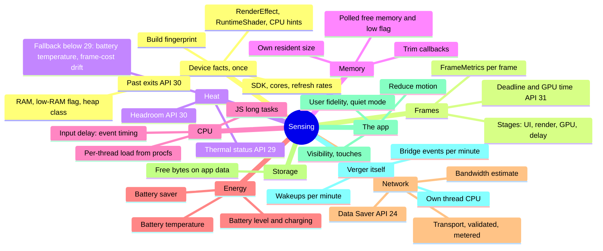

# Verger: the first full sensing layer

The starting point. Verger can counter only what it can see (Ashby's requisite variety), so the
first full layer is: **every disturbance in [pipeline.md](pipeline.md) seen by at least one
signal on Android 9 to 16, each switchable, cost-bounded and measured, each carrying a
confidence, and each tested.** Sensing measures; it never decides.

## The map

## Signal by signal

Built: in code and tested. Missing: needed for the full layer. API levels marked *verify* were not
confirmed in this session; the first Gradle build settles them, because Android lint's `NewApi`
check at minSdk 28 flags any call above the minimum.

| Signal | Mechanism | API | Cost | Fallback | State |
|---|---|---|---|---|---|
| Device facts | `ActivityManager`, `Build`, display modes | 28+ | once per launch | none needed | built |
| Past exits | `ApplicationExitInfo` | 30 | once per launch | session markers | built |
| Frames | `Window.OnFrameMetricsAvailableListener`; deadline and GPU time from 31 | 28+ (deadline, GPU time 31) | per frame, no allocation | refresh interval as budget | built |
| Thermal status | `PowerManager.addThermalStatusListener` | 29 | on change | heat fallback | built |
| Thermal headroom | `PowerManager.getThermalHeadroom`, every 10–60 s | 30 | one call per poll | status only | built |
| Memory trims | `ComponentCallbacks2.onTrimMemory` | 28+ | on change | polling | built |
| Free memory | `ActivityManager.getMemoryInfo`, every 10 s | 28+ | one binder call | none needed | built |
| Thread load | `/proc/self/task/*/stat`, 1 Hz | 28+ | one read per thread | none | built |
| JS long tasks | React Native `PerformanceObserver` | RN 0.88 | push | none | built |
| Battery saver | `PowerManager.isPowerSaveMode`, broadcast | 28+ | on change | none needed | built |
| Visibility, touches, reduce motion | React Native `AppState`, responder capture, `AccessibilityInfo` | — | on change | none needed | built |
| **Network** | `ConnectivityManager` default network callback; `NetworkCapabilities` (transport, validated, not metered, downstream bandwidth) | capabilities class 21; callback and field levels *verify* (all at or below minSdk 28 is enough) | on change; bandwidth bucketed to powers of two | none (unknown means unknown) | **in code** (`NetworkSignals.kt`, `VergerSense.kt`): contract-tested on the JVM and in TypeScript; Android part uncompiled until the first Gradle build |
| **Slow or unstable link** | derived: downstream estimate below `slowNetworkKbps`, or back from offline less than `networkSettleMs` ago | — | none (from the network events) | — | **in code**: `networkLimit` on the snapshot; levers' `whenSlowNetwork` |
| **Data Saver** | `ConnectivityManager.getRestrictBackgroundStatus` (disabled, whitelisted, enabled) | 24 (verified) | on change (`ACTION_RESTRICT_BACKGROUND_CHANGED`) | none | **in code**, as above |
| **Battery level, plugged in** | `ACTION_BATTERY_CHANGED` sticky broadcast (`EXTRA_LEVEL`, `EXTRA_SCALE`, `EXTRA_PLUGGED`) | 28+ | only a change of what verger reads | none | **in code** (`BatterySignals.kt`), contract-tested; Android part uncompiled |
| **Battery temperature** | `EXTRA_TEMPERATURE`, assumed tenths of a degree (**verify on a phone** against the system's battery info) | 28+ | with battery, rounded to 0.5 °C | — | **in code**, as above |
| **Heat fallback below API 29** | battery temperature where the platform gives no status or headroom; frame-cost drift not built | 28 | derived | — | **in code** (battery part), confidence 0.4 |
| **Storage** | `StatFs(filesDir).getAvailableBytes` | 18 (verified) | one call per minute | none | missing |
| **Input delay** | React Native `PerformanceObserver` `event` entries (threshold 104 ms since RN 0.86) | RN 0.88 | push | long tasks | missing |
| **User fidelity, quiet mode** | the host's settings, passed in | — | on change | `auto` | missing: sent as `auto` |
| **Verger's own cost** | its thread's CPU from procfs; counters of wakeups and bridge events | 28+ | counters only | none | missing (loop 2, phase 2) |
| JS heap and GC | Hermes instrumentation | *verify in the installed React Native* | — | — | open |
| Compile state after an update | unknown API | *verify* | — | build fingerprint | open |

## Data cost where most users are always metered

In Sri Lanka most teachers reach the internet on prepaid mobile data, so **metered is the normal
state, not strain**: limiting on the metered flag alone would put nearly everyone in a constrained
mode for good. The flag says only that the OS thinks bytes cost money, not how many the user can
afford. Verger therefore treats metered as home (no limit by default; `meteredOptionalConcurrency`
is a host's choice) and protects the user's data through:

| Protection | Signal | State |
|---|---|---|
| The user's explicit choice | Data Saver (`getRestrictBackgroundStatus`) | in code |
| A data budget | bytes this app received and sent (`TrafficStats.getUidRxBytes`, `getUidTxBytes`, since boot; API level *verify*) against a daily budget (a chair) | missing |
| Cheaper times | prepaid tariffs can price night data far below day data (Dialog's prepaid MyPlan lists 10 cents per MB by day and 1 cent per MB for night bonus data, source below; rates change) | missing: a schedule for large optional downloads is a chair |
| Free networks | Wi-Fi, unmetered | in code |

Critical work (an attendance save and its upload) is never gated by any of these.

**Transport does not say cost either.** Home broadband often has a quota, and a "Wi-Fi" network
may be a phone's hotspot or a mobile router, which Android usually reports as ordinary unmetered
Wi-Fi. Android lets the user mark any Wi-Fi "Treat as metered", and verger respects that through
the metered flag, but by default **no network is assumed free**. The design for the data budget
(B3), all of it configuration:

- optional data work (prefetch, warming, background extras) spends from a daily allowance of
  bytes, measured from this app's own traffic counters;
- separate allowances for metered and unmetered networks, the unmetered one larger because it is
  only probably cheaper; treating unmetered as free is an option, off by default;
- when an allowance is spent, optional data waits for the next day, a cheap night window, or a
  network the user calls free;
- critical work is never gated; the user decides through Android's "Treat as metered" and, later,
  an app setting.

Sources (found by search; not opened): [Dialog MyPlan prepaid](https://Dialog.lk/myplan-prepaid);
[Android Authority on metered hotspots](https://www.androidauthority.com/android-setting-metered-connected-wi-fi-mobile-hotspots-3649733/);
[Google: advanced network settings](https://support.google.com/nexus/answer/2819583?hl=en).

## What "complete" means for each signal

1. **Seen:** a native or JS source, with the API level checked against the installed SDK.
2. **Switchable:** a sensor flag in activation; off costs nothing natively.
3. **Cost-bounded:** reads only on change or at the slowest useful cadence; its wakeups counted.
4. **Confident:** the estimator gives its account a confidence that reflects the source.
5. **Tested:** the mapping on the JVM (Kotlin) and in Vitest; the reducer's handling under the
   property suite (deaf-sensor equivalence holds for it); on a phone at G5.

## Order of work

1. ~~Network and Data Saver~~ (in code 2026-10-24; levers declare `whenMetered`, `whenDataSaver`,
   `whenOffline`; Data Saver and offline admit no optional work, metered admits one at a time).
2. ~~Battery level, plugged in and temperature, with the heat fallback below API 29~~ (in code
   2026-10-24; `whenBatteryLow` at `batteryLowPercent`, default 20%; heat thresholds provisional).
2a. The data budget: this app's bytes against a daily budget, for prepaid users.
3. Storage.
4. Verger's own cost (loop 2, phase 2).
5. The user's fidelity and quiet mode passed through the React shell.
6. Input delay from event timing.

Each lands with its events in the reducer's vocabulary, its sensor flag, its estimator account,
and the deaf-sensor property extended to it.
