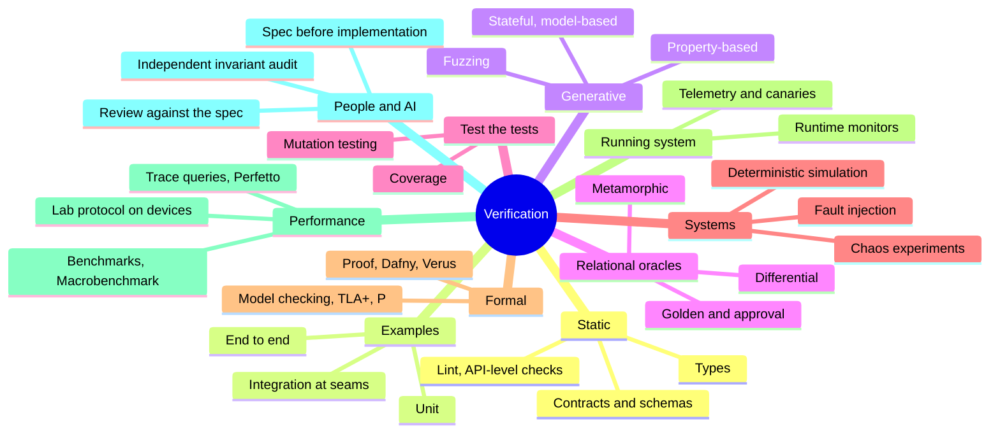
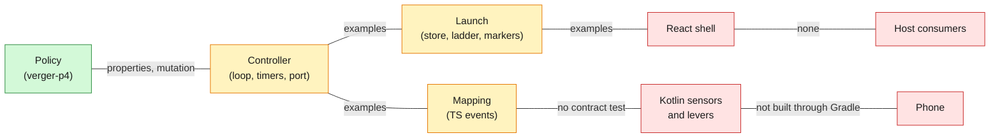

# Verger: verification engineering

The canonical guide to how verger earns trust: what testing is for, the whole landscape of
techniques, the principles behind them, what changed in the AI era, what this repository says
against what it does, and the plan for verger. It is written to teach as well as to decide.
Repository doctrine it builds on: `docs/architecture/verification-and-harness-engineering-2026.md`
and AGENTS.md section 6 (evidence levels G0 to G5, R1).

## Part 1. The ideas in plain words

A test is a question asked of the code, with an answer decided in advance. Everything in
verification comes down to two hard parts:

1. **The oracle problem.** Something must know the right answer. If the person (or model) who
   wrote the code also writes the expected answer, the test checks only that the code does what
   its author thought, including the author's mistakes. Barr, Harman and colleagues surveyed this
   as *the* central problem of testing (IEEE TSE, 2015). Most advanced techniques are ways of
   getting an oracle that is independent of the code.
2. **The input problem.** Programs face far more situations than anyone can list. Example tests
   check the few that someone thought of; bugs live in the ones nobody did.

Every technique below answers one or both. A test suite is good when it would **fail if the code
were wrong**, not when it passes.

### Words to steer with

Use these to ask for exactly what you want.

| Say | It means | Ask it when |
|---|---|---|
| **Invariant** | something that must always be true, whatever happens | "what must never happen here?" |
| **Property-based test** | the computer generates hundreds of random inputs and checks an invariant on each; on failure it **shrinks** to the smallest failing case | logic with many possible inputs |
| **Stateful / model-based test** | random *sequences of actions* checked against a simple model of what should happen | anything with memory: a ladder, a store, a cache |
| **Metamorphic test** | two related inputs must give related outputs (moving a session later changes nothing) | when the right answer is unknown but relations are known |
| **Differential test** | two implementations must agree (TypeScript and Kotlin estimators) | ports, rewrites, two platforms |
| **Golden test / approval test** | today's output is saved and every change is compared to it | outputs too rich to assert by hand |
| **Mutation testing** | the code is deliberately broken in small ways; a good suite catches each break | "are my tests any good?" |
| **Fault injection** | errors are forced in (a store that fails, a sensor that sends NaN) | anything that must survive failure |
| **Deterministic simulation** | the whole system runs under one random seed with fake clock, storage and faults, so any failure replays exactly | lifecycles, races, crashes |
| **Chaos experiment** | a real fault in a real environment, against a stated steady state | on a phone, in the field |
| **Contract test** | both sides of a boundary are checked against one shared description of what crosses it | a native bridge, an API |
| **Runtime verification / monitor** | the invariants are checked while the real system runs | dev builds, shadow mode in the field |
| **Fail to pass** | a new test must fail on the old code and pass on the fix | every bug fix |
| **Flaky test** | a test that passes or fails without the code changing; a bug in the test or the system | never tolerated |
| **Evidence level** | what a result proves and what it does not (G0 to G5, R1) | every report |

## Part 2. The landscape

| Family | What it gives | Its limit |
|---|---|---|
| Static | errors found without running | says nothing about behaviour |
| Examples | readable, fast, documents intent | only the cases someone imagined; the author is the oracle |
| Generative | finds cases nobody imagined; shrinks failures | needs a property (an oracle) to check |
| Relational | an oracle when the right answer is unknown | only as strong as the relation chosen |
| Test the tests | measures whether failures would be noticed | coverage measures execution, not checking; mutation is slow |
| Systems | exercises failure paths and timing | determinism must be engineered in |
| Formal | proof over all cases of a model | the model can differ from the code; costly |
| Running system | real conditions | late; the cost of a miss is a user |
| Performance | the physics: frames, heat, battery | noisy; emulators lie about performance |

**The shape of a suite.** The test pyramid (mostly unit tests) and the trophy and honeycomb
(mostly integration) argue about proportions; Martin Fowler's survey of the shapes concludes that
the split matters less than whether tests sit where the risk is. For verger the risk is in
seams (policy to controller, controller to native, launch to store) and in sequences over time,
so most new evidence belongs there, not in more small unit tests.

## Part 3. Principles

1. **Oracle first.** Before a test, decide what independent thing knows the answer: an invariant,
   a relation, a second implementation, a recorded real session. "The code returned X, so expect
   X" is not a test.
2. **Test the contract, not the implementation.** Assert what must hold for users and callers;
   leave how it is computed free to change.
3. **Properties over examples** where inputs vary; examples for documenting intent.
4. **Every failure reproducible.** Seeds, fake clocks, recorded event streams: a failure that
   cannot be replayed cannot be fixed with confidence.
5. **Shrink to the smallest case.** A failing stream of 60 events becomes one memory trim; that is
   what makes the bug obvious.
6. **Test the tests.** A suite that survives a deliberately broken program proves nothing
   (mutation testing). Coverage is necessary and far from sufficient.
7. **Fail to pass on every fix; pass to pass on every change.**
8. **Integration at the seams.** Mocks are allowed only where the real thing cannot run; every
   mock is a claim about the other side that a contract test must check.
9. **Test what you fly.** The same invariants run in tests, on recordings from phones, in the dev
   lab and, as monitors, in the field (Mars Pathfinder's lesson, in the lineage doc).
10. **State the evidence level.** What it proves, what it does not.
11. **No flakiness.** A test that sometimes fails is a defect, in the test or the system.

## Part 4. What changed by 2026

- **AI writes code and tests faster than people can review them.** Practitioners report a
  recurring failure: generated tests that assert what the code does rather than what the spec
  requires, so they pass while the code is wrong ("tautological" tests). The repeated remedy is to
  write the oracle from the spec before reading the implementation, and to gate suites on
  mutation testing rather than coverage.
- **Mutation testing became practical at scale with language models.** Meta's ACH (Foster,
  Harman and colleagues, 2025) generates a few targeted mutants for a concern, then generates
  tests that kill them; applied to 10,795 Android Kotlin classes, engineers accepted 73% of its
  tests.
- **Property-based testing is returning as the check on agents.** AWS's Kiro ties specifications
  to generated properties; research in 2025 had an agent infer properties and find real bugs in
  Python packages. Properties are a way to state intent that a machine can check.
- **Formal methods are getting cheaper.** Martin Kleppmann (December 2025) predicts AI will make
  formal verification mainstream, because proof checkers cannot be fooled by plausible text. AWS
  describes a spectrum from proofs and model checking (TLA+, then the P language) to property-based
  testing, fuzzing and runtime monitoring (Brooker and Desai, CACM, June 2025).
- **Deterministic simulation testing spread beyond databases.** FoundationDB built it;
  TigerBeetle's VOPR runs a whole cluster, its clock, disk and network under one seed and checks
  invariants per replica; Antithesis does it for whole machines with a deterministic hypervisor.

The common thread: **specifications and invariants are becoming the durable artefact**, and tests
are how they are enforced. That is the direction verger already took with `invariants.ts`.

## Part 5. This repository: what it says, what it does, what it could do

Measured on 2026-10-24.

| The doctrine says | What exists | Gap |
|---|---|---|
| Graduated evidence G0 to G5, R1 | `check:test-evidence` in CI, which audits how test scripts declare their level | it audits labels, not whether tests would catch a bug |
| Fail to pass, pass to pass | as a written protocol | not mechanically enforced anywhere |
| Structural impact check (`check:impact`), code graph (`pnpm codegraph`) | `scripts/codegraph.mjs` exists | no `codegraph` or `check:impact` script in `package.json` |
| Invariant audit by an independent reviewer | done by hand in verger's reviews | no tooling |
| Mutation testing | none in any workspace manifest | the strongest test of tests is absent |
| Property-based testing | `fast-check` in `packages/core` only; 2 property suites repo-wide (one is verger's) | — |
| Mobile end to end | Playwright in the mobile and web apps; no Detox or Maestro | no on-device scripted flows |
| Performance regression | device audit by hand; `hermes-bench.mjs` for two components | no Macrobenchmark, no trace assertions, no lab protocol in CI |

The repository has strong governance (labels, audits, gates) and a weak measure of whether its
tests would notice a defect. Verger can show the stronger pattern first and offer it back.

## Part 6. Verger: seams, what runs, what is needed

Green: verified at G2 by properties. Amber: example tests only. Red: no automated evidence.

### What runs today

| Suite | Level | What it proves | Where |
|---|---|---|---|
| Invariants over generated streams | G2 | 300 random runs per property, on Gurudevi's real levers and policy verger-p4, with random devices, activations and event streams: every published snapshot keeps every invariant | `packages/core/src/governor/verger.invariants.test.ts` |
| Determinism; time shift; deaf sensor | G2 | the same events decide the same; a session moved later decides the same; a switched-off sensor equals its readings never arriving | same |
| No guessing; no permanent degradation; no blind lowering | G2 | nothing lowered without readings (ADR D5.5); a calm phone gets every step back; nothing lowered for an unstrained account (D5.2) | same |
| Mutation adequacy (hand-made) | G2 | six broken policies are each caught | same |
| Golden vectors | G2 | Kotlin and TypeScript frame estimators agree | `goldenVectors.test.ts`, `FrameWindowEstimatorTest.kt` |
| Recovery across process deaths | G2 (examples) | chosen death and store-failure schedules fail closed | `recovery.test.ts`, `verger.test.ts` |
| Kotlin on the JVM | G2 | Android-free Kotlin | `android/src/test` |
| Example tests | G1 | named cases per module | `*.test.ts` |

The invariants are plain functions in `packages/verger-core/src/invariants.ts` (`checkSnapshot`,
`checkRun`), so they run on recordings and in the lab as well as in tests.

### The invariant catalogue

| Invariant | Meaning | Checked |
|---|---|---|
| levels-in-range | every published, proposed and baseline level is an integer in 0..maxLevel | every snapshot |
| off-lever-ungoverned | an `off` lever is published, proposed and based at 0 | every snapshot |
| apply-publishes-decision | an `apply` lever publishes the decision | every snapshot |
| shadow-publishes-baseline | a `shadow` lever publishes the baseline exactly | every snapshot |
| decision-respects-baseline | a decision never improves on the baseline | every snapshot |
| static-is-baseline | under `static`, the decision is the baseline | every snapshot |
| hardware-off | no refresh cap, CPU boost or forced motion without hardware | every snapshot |
| deaf-sensor-silent | a switched-off sensor's reading is unknown | every snapshot |
| no-reduction-when-reduce-off, no-growth-when-grow-off | under one activation, pressure never rises (or eases) when that direction is off | consecutive snapshots |
| time-forward, version-forward | snapshots never go back | consecutive snapshots |

### What the properties found (fail to pass)

4. **A guarded start could lift a phone off rung 4.** A corrupt record started at rung 3 even when
   the last session ran on rung 4, so native code suspected of crashing the app ran again. Found by
   the ladder's model-based test (item 1); a guarded start now never goes below the last marker's
   rung. ADR D12.1 amended.
5. **The ledger misjudged motion levers.** Main-thread contention rightly lowers ambient motion,
   which relieves CPU (animations run on the UI thread); the ledger mapped it to GPU only. Fixed in
   `accountsRelievedBy`; the counterexample is pinned.

6. **Main-thread contention lowered a GPU-only lever.** With animation levers at their floor
   (low fidelity), p4 fell through to blur, which does not relieve the main thread (ADR D5.2).
   Found by the no-blind-lowering property at 20,000 cases (`VERGER_RUNS`); main contention now
   targets CPU only, and animation levers declare that they relieve CPU. Pinned.
7. **The deaf-sensor relation was incomplete,** not the code: battery temperature is a heat
   reading, so deafening heat must remove it too. The property now says so. Pinned.

`VERGER_RUNS` raises the cases per property for a deep run (nightly, or before a release).

1. **A lever could stay lowered forever.** Pressure stored a level including the floor it was
   lowered from; giving back the last step left the floor's value owned by nothing. One memory
   trim on a 2 GB phone left `image-cache` lowered for good. Fixed in `raiseOne`. Found by the
   no-permanent-degradation property; the old code fails it, the fix passes.
2. **A sensor off from the start still reported memory as normal.** Fixed in `createGovernor`.
3. **A blind spot in the checks:** a policy publishing decisions for shadow levers passed until
   the snapshot carried `baselineLevels`; found by the mutation check.

verger-p4 was fixed in place: it has never run on a phone and has no field data. From the first
field data on, any rule change is a new policy version.

## Part 7. The plan

Ordered by risk retired per effort. Each item states its oracle.

| # | Build | Technique | Oracle | Level | Needs |
|---|---|---|---|---|---|
| 1 | The recovery ladder and launch as a **stateful model-based test**: random sequences of launch, run, die (each exit reason), die while starting, store read or write failure, new release, new policy; checked against a small model of rung arithmetic | stateful property-based (fast-check commands) | the model and fail-closed invariants (no native call after a death in `starting`; corrupt record never rung 0) | G2 | nothing new |
| 2 | A **seeded simulator** for verger in a process: fake clock and scheduler, store with injected faults, port that throws, sends NaN or reorders events; any failure replays from its seed | deterministic simulation, fault injection | `checkRun` on every snapshot; no exception escapes; hardware released on stop | G2 | nothing new |
| 3 | **Async ordering** of start, stop, remount and React strict mode | fast-check scheduler | one native singleton: never two starts without a stop | G2 | nothing new |
| 4 | **Outcome-ledger properties**: every move judged exactly once; verdicts final; joint credit only for moves sharing an account | property-based | ledger invariants | G2 | nothing new |
| 5 | **Contract tests for the native bridge**: one set of JSON payload fixtures; Kotlin tests assert what it emits matches them; TypeScript tests assert the mapping accepts exactly them | contract, golden | the shared fixtures | G2 | nothing new |
| 6 | **Mutation testing** of verger-core with Stryker (Vitest runner, incremental), with a score threshold for verger's packages | mutation | killed mutants | test of tests | approval: new dev dependencies |
| 7 | **Golden recorded sessions**: sessions recorded on phones, stored with their decisions, re-checked on every change; policy comparisons run on them | golden, differential | real sessions | G3 | session recording (task 9) |
| 8 | **Runtime monitors**: `checkSnapshot` on every snapshot in dev builds and shadow mode, violations counted in telemetry | runtime verification | the invariants | G3 to R1 | the dev lab, telemetry |
| 9 | **Android framework tests** for `VergerSense.kt` with Robolectric, and lint `NewApi` at minSdk 28 | unit on a simulated framework | listener registration per sensor flag | G1 to G2 | the Gradle build |
| 10 | **On-device lab**: Macrobenchmark (startup median, frame overrun on API 31+) with verger off, shadow, active; Perfetto trace queries for verger's own thread; physical phones only | benchmark, trace query | off as the control | G5 | the phones |
| 11 | **Chaos experiments on the phone**, scripted through adb: battery saver, Data Saver, memory trims, thermal conditions, process kills, against a stated steady state (no missed critical deadline, no crash) | chaos, fault injection | the essential variables | G5 | the phones |
| 12 | **Scripted user flows** (Maestro, black box, works with Expo) to drive repeatable sessions for 7, 10 and 11 | end to end | the steady state | G5 | approval: new tool |
| 13 | Only if 1 finds the ladder subtle: a small **model-checked spec** of the launch protocol (P or TLA+) | model checking | the spec | design | — |

**The golden mean (decided 2026-10-24).** Verification serves the foundation, not the other way
round. Item 1 is done (it found a real hole in the ladder). The rest ride along with the work they
protect, built when that work is built: item 5 with native network sensing (the first new
payloads across the bridge); items 2 and 3 with session recording and the React shell; item 4 with
loop 2's rules; item 6 (Stryker, local reports only, approved) once verger-core settles; item 12
(Maestro CLI, free and local, approved; never Maestro Cloud, which is paid) with the lab on the
phones. A new property is added when a new rule is added; a new technique when a new risk is.

## Sources

Found by web search on 2026-10-24. This session could not open the pages (its network policy
denies most hosts), so each point rests on search summaries; open the primary texts before
quoting them. Vendor sources are marked.

- [Barr et al., The Oracle Problem in Software Testing: A Survey, IEEE TSE 41(5), 2015](https://discovery.ucl.ac.uk/1471263/)
- [Chen et al., Metamorphic Testing: A Review of Challenges and Opportunities, ACM Computing Surveys 51(1), 2018](https://research.nottingham.edu.cn:443/en/publications/metamorphic-testing-a-review-of-challenges-and-opportunities); [Segura et al., A Survey on Metamorphic Testing, IEEE TSE 42(9), 2016](https://eprints.whiterose.ac.uk/110335/1/segura16-tse.pdf)
- [Hughes, Software testing with QuickCheck, LNCS 6299, 2010](https://research.chalmers.se/en/publication/154999)
- [fast-check: model-based testing](https://fast-check.dev/docs/advanced/model-based-testing/)
- [Foster, Harman et al., Mutation-Guided LLM-based Test Generation at Meta, 2025](https://arxiv.org/pdf/2501.12862)
- [Kiro: Does your code match your spec? (property-based testing)](https://kiro.dev/blog/property-based-testing/) (vendor)
- [Kleppmann, Prediction: AI will make formal verification go mainstream, 2025](https://martin.kleppmann.com/2025/12/08/ai-formal-verification.html)
- [Brooker and Desai, Systems Correctness Practices at Amazon Web Services, CACM 68(6), 2025](https://cacm.acm.org/practice/systems-correctness-practices-at-amazon-web-services)
- [TigerBeetle: VOPR](https://docs.tigerbeetle.com/about/vopr); [Antithesis: deterministic simulation testing](https://antithesis.com/docs/resources/deterministic_simulation_testing/) (vendor)
- [Fowler, On the Diverse and Fantastical Shapes of Testing, 2021](https://martinfowler.com/articles/2021-test-shapes.html)
- [AI-generated tests as ceremony, ploeh blog, 2026](https://blog.ploeh.dk/2026/01/26/ai-generated-tests-as-ceremony/)
- [Principles of Chaos Engineering](https://principlesofchaos.org/)
- [Perpetual Assurances for Self-Adaptive Systems (arXiv 1903.04771)](https://arxiv.org/pdf/1903.04771)
- [Android: Macrobenchmark metrics](https://developer.android.com/topic/performance/benchmarking/macrobenchmark-metrics); [AndroidX Benchmark Trace Processor](https://developer.android.com/reference/kotlin/androidx/benchmark/traceprocessor/package-summary)
- [Maestro: Detox vs Maestro](https://maestro.dev/insights/detox-vs-maestro-reducing-flakiness-react-native) (vendor)
