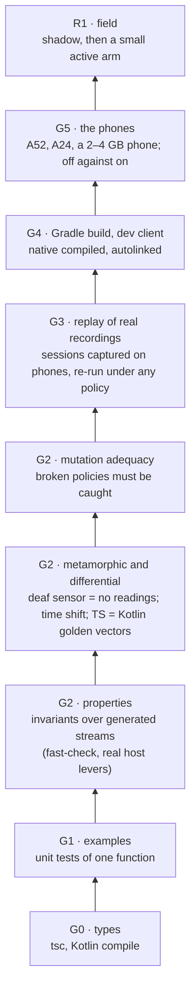

# Verger: verification engineering

Example tests show that the cases their author thought of work; the same mind wrote the code and
the expected answers (generator is not verifier). Verger is a controller acting on real phones,
so its evidence must show that **no** stream of events, device or activation breaks what must
always hold, that the checks themselves catch broken code, and, later, that real sessions on
real phones behave. This doc is the strategy and the ledger of what each level proves.
Repository doctrine: `docs/architecture/verification-and-harness-engineering-2026.md` (fail to
pass, pass to pass, golden surfaces, invariant audit) and AGENTS.md section 6 (G0 to G5, R1).

## The evidence ladder for verger

Each level answers a question the one below cannot. Types say the parts fit; examples say chosen
cases work; properties say no generated case breaks an invariant; mutation says the properties
would notice; recordings say real sequences behave; the phones say the physics does.

## What runs today

| Suite | Level | What it proves | Where |
|---|---|---|---|
| Invariants over generated streams | G2 | 300 random runs per property, on Gurudevi's real levers and policy verger-p4, with random devices, activations and event streams: every published snapshot keeps every invariant | `packages/core/src/governor/verger.invariants.test.ts` |
| Determinism | G2 | the same events give the same snapshots | same |
| Time shift (metamorphic) | G2 | a session moved later decides the same | same |
| Deaf sensor (metamorphic) | G2 | a sensor switched off makes the same difference as its readings never arriving | same |
| No guessing | G2 | without sensor readings, nothing is lowered by pressure (ADR D5.5) | same |
| No permanent degradation (liveness) | G2 | after any stream, a calm phone gets every step of pressure back | same |
| No blind lowering | G2 | no lever is lowered by pressure for an account that is not strained (ADR D5.2), judged by the outcome ledger | same |
| Mutation adequacy | G2 | six deliberately broken policies (ignores off, out of range, hardware leak, deaf leak, shadow applies, nondeterministic) are each caught | same |
| Golden vectors | G2 | the Kotlin and TypeScript frame estimators produce the same windows | `goldenVectors.test.ts`, `FrameWindowEstimatorTest.kt` |
| Recovery across process deaths | G2 | the ladder fails closed under simulated deaths and store failures | `recovery.test.ts`, `verger.test.ts` |
| Example tests | G1 | named cases of each module | `*.test.ts` |
| Kotlin on the JVM | G2 | Android-free Kotlin (estimator, sampler, exits, display modes, sensors) | `android/src/test` |

The invariants live in `packages/verger-core/src/invariants.ts` as plain functions (`checkSnapshot`,
`checkRun`), so the same checks run over recordings from phones and in the lab, not only in tests.

## The invariant catalogue

| Invariant | Meaning | Checked |
|---|---|---|
| levels-in-range | every published, proposed and baseline level is an integer in 0..maxLevel | every snapshot |
| off-lever-ungoverned | an `off` lever is published, proposed and based at 0 | every snapshot |
| apply-publishes-decision | an `apply` lever publishes the decision | every snapshot |
| shadow-publishes-baseline | a `shadow` lever publishes the baseline exactly | every snapshot |
| decision-respects-baseline | a decision never improves on the baseline | every snapshot |
| static-is-baseline | under `static`, the decision is the baseline | every snapshot |
| hardware-off | no refresh cap, CPU boost or forced motion without hardware | every snapshot |
| deaf-sensor-silent | a switched-off sensor's reading is unknown (thermal, frames, memory, power, contention) | every snapshot |
| no-reduction-when-reduce-off, no-growth-when-grow-off | under one activation, pressure never rises (or eases) when that direction is off | consecutive snapshots |
| time-forward, version-forward | snapshots never go back | consecutive snapshots |
| determinism, time shift, deaf sensor | as in the table above | whole runs |
| no guessing, no permanent degradation, no blind lowering | as above | whole runs |

## What the properties found (fail to pass)

Two defects that every example test had missed, each shown failing before its fix and passing
after (commit with this doc):

1. **A lever could stay lowered forever.** Pressure stores a level that includes the floor it
   was lowered from; giving back the last step left the floor's value behind, owned by nothing.
   On a 2 GB phone, one memory trim left `image-cache` lowered for good, and any floor lifting
   later (battery saver off, high fidelity, earned growth) would have left a lever degraded with
   no cause. Fixed in `raiseOne`: a lever off the loop's stack owns no pressure. Found by the
   no-permanent-degradation property; the shrunk counterexample was one moderate trim.
2. **A sensor off from the start still reported memory as normal.** Switching a sensor off while
   running forgot its readings; starting with it off did not, because the platform said memory
   is sensed. Fixed in `createGovernor`. Found by stating the deaf-sensor invariant.

And one blind spot in the checks themselves: a policy publishing its decision for shadow levers
passed every invariant until the snapshot carried the baseline. The mutation check found it;
`baselineLevels` is now on the snapshot and shadow is checked exactly.

Both fixes change verger-p4's behaviour. p4 has never run on a phone and has no field data, so
it is fixed in place rather than versioned; from the first field data on, any change to a rule
is a new policy version.

## Next, in order

| Next | Level | Why |
|---|---|---|
| Controller and launch under generated streams, with a fake scheduler and a faulty port (throws, NaN, out-of-order events) | G2 | the loop around the policy, not only the policy |
| Recovery ladder under generated death schedules and store faults | G2 | fail closed for every schedule, not three chosen ones |
| Outcome-ledger properties (every move judged exactly once; verdicts are final) | G2 | loop 2 reads it |
| Golden runs: recorded sessions with their expected decisions, re-checked on every change | G3 | pass to pass on real sequences |
| Policy comparison on recordings (p4 against p5; verger against off) | G3 | loop 3's evidence |
| Kotlin sources compiled against `android.jar`; Android lint `NewApi` at minSdk 28 | G0/G4 | the first Gradle build |
| Lab sessions on the A52 and A24, off against shadow against active, 15 minutes or more | G5 | the physics |
