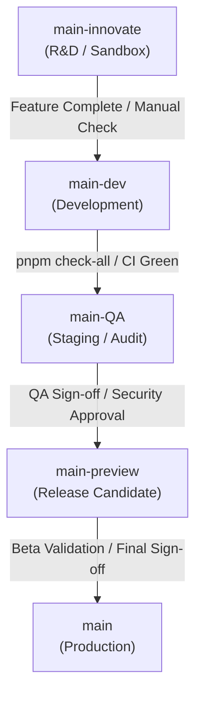

# Git Branching Model & Promotion Rules

To ensure stable, predictable deployments while facilitating rapid R&D and experimentation across the monorepo, `polymath-platform` adopts a pipeline-style branch promotion workflow. This system maps environments to branches with increasing levels of stability.

---

## 📁 Branch Hierarchy

| Tier | Branch Name | Stability | Purpose |
| :--- | :--- | :--- | :--- |
| **1** | `main-innovate` | **Volatile** | **Sandbox / R&D**: Experimental features, radical refactors, and spikes. |
| **2** | `main-dev` | **Semi-Stable** | **Development**: Features merged once they are "dev-stable" and integrated. |
| **3** | `main-QA` | **Stable** | **Staging & Audit**: Thorough regression testing, accessibility audits, and security checks. |
| **4** | `main-preview` | **Production-Ready** | **Release Candidate**: Beta testing environment for selected schools and feedback groups. |
| **5** | `main` | **Mission-Critical** | **Production**: Gold-standard branch for public-facing deployments. |

---

## 🚀 Promotion Rules

Changes must flow sequentially downstream through each quality gate:



### 1. `main-innovate` $\rightarrow$ `main-dev`
*   **Trigger**: Feature implementation or R&D cycle complete.
*   **Gate**: Basic manual verification and code check pass.
*   **Action**: 
    ```bash
    git checkout main-dev
    git merge main-innovate
    ```

### 2. `main-dev` $\rightarrow$ `main-QA`
*   **Trigger**: Stable feature set prepared for version milestone.
*   **Gate**: Global checks passing locally and in CI:
    *   Verify linting, type safety, translation fallbacks, and accessibility: `pnpm check-all`
    *   Automated test suite passing completely on remote CI.
*   **Action**:
    ```bash
    git checkout main-QA
    git merge main-dev
    ```

### 3. `main-QA` $\rightarrow$ `main-preview`
*   **Trigger**: QA testing validation complete and security audits approved.
*   **Gate**: Resolution of all critical/blocking bugs.
*   **Action**:
    ```bash
    git checkout main-preview
    git merge main-QA
    ```

### 4. `main-preview` $\rightarrow$ `main`
*   **Trigger**: Feedback from the beta preview integrated and stabilized.
*   **Gate**: Final deployment authorization.
*   **Action**:
    ```bash
    git checkout main
    git merge main-preview
    ```

---

## 🛡️ Emergency Hotfixes

Hotfixes bypass the standard downstream promotion pipeline but must remain synchronized across environments to prevent branch drift.

1. **Branching**: Create the hotfix branch directly from `main` (e.g., `hotfix/issue-description`).
2. **Testing**: Merge and validate the fix on `main-QA` first to run verification tests.
3. **Release**: Once approved, merge the hotfix branch into `main` and tag the release.
4. **Synchronization**: Propagate the fixes back down to upstream development branches to keep them current:
   ```mermaid
   graph LR
       main[main] -->|Sync Hotfix| dev[main-dev]
       main -->|Sync Hotfix| innovate[main-innovate]
   ```

---

## 💡 Practical Guidelines (Solo Development)

*   **Keep Pipelines Green**: A broken build on a branch blocks downstream promotion for all features. Fix issues immediately before promoting code.
*   **Self-PR Review**: Even when coding solo, use Pull Requests for merging. This establishes a clean audit trail, facilitates post-merge review, and simplifies rollbacks.
*   **CI/CD Integration**: Map target branches directly to corresponding environments (e.g., preview deployments trigger automatically from `main-preview`, production triggers only from `main`).
*   **Release Tagging**: Tag releases from the `main` branch (e.g., `v1.2.0`) and document a summary changelog.
