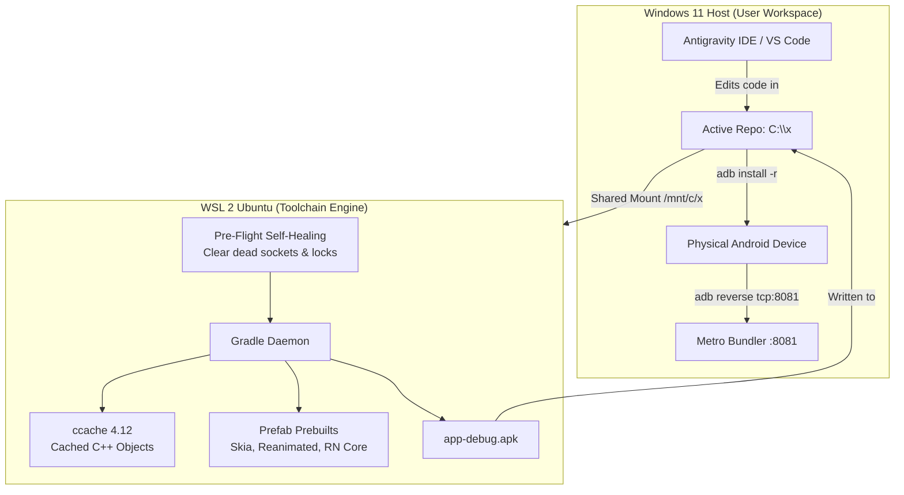

# WSL2 Android Native Build Architecture SOP

> **Purpose**: Establish an elegant, first-principles architecture for building Android APKs locally using the WSL2 Linux toolchain while preserving a seamless Windows desktop workflow and avoiding duplicate SSD storage.

---

## 1. Context & Motivation

Building modern React Native New Architecture apps (Expo SDK 57 / React Native 0.76+) on a Windows development workstation introduces a boundary conflict:
- **Windows Host UX**: Developers write code, manage Git, run Antigravity IDE / VS Code, and connect physical Android phones via USB on Windows.
- **Linux Native Toolchain**: Android NDK, CMake, Ninja, Clang, and Gradle require a Linux environment to avoid Windows path limits (`CMAKE_OBJECT_PATH_MAX`) and Ninja timestamp loops (`build.ninja dirty after 100 tries`).
- **The Naive Past**: Past attempts tried cloning the entire repository into WSL (`/home/nsk/polymath-platform-wsl`), which wasted 30–50 GB of SSD space and created dangerous out-of-sync "stale clone" bugs. When builds were subsequently run directly against `/mnt/c/x`, builds stalled or threw cryptic `ENOMEM: not enough memory, lstat` errors due to the 9P virtual filesystem.

This SOP defines how the platform resolves this tension cleanly.

---

## 2. Root Cause Analysis of Build Failures & Hangs

### A. The Kotlin Daemon Socket Hang
* **The Symptom**: Gradle sits completely frozen for 2 to 10 minutes with zero log output before failing or proceeding sluggishly.
* **The Mechanism**: The Kotlin compile daemon registry (`~/.local/share/kotlin/daemon/`) accumulates `.run` files from terminated builds. In WSL2, closed loopback ports do not return immediate TCP `RST`. The Windows virtual switch drops the SYN packet, causing Java to hang for Linux's full `tcp_syn_retries` timeout (~127 seconds per stale port file).
* **The Solution**: Pre-flight self-healing in the build runner purges dead `.run` files before Gradle starts.

### B. The 9P Virtual Filesystem Buffer Exhaustion (`ENOMEM`)
* **The Symptom**: React Native Codegen throws `Error: ENOMEM: not enough memory, lstat` when resolving pnpm symlinks on `/mnt/c/`.
* **The Mechanism**: WSL2 interfaces with Windows NTFS via Microsoft's Plan 9 (9P) network filesystem (`p9io.cpp`). Under parallel Gradle tasks, concurrent Node.js processes flood the 9P channel with thousands of `realpathSync` calls. The default 8KB 9P message buffer overflows, triggering `AcceptAsync` cancellation in the kernel.
* **The Solution**: 
  1. Increase 9P message size in `/etc/wsl.conf` (`msize=262144` — 256KB buffer).
  2. Set `NODE_OPTIONS="--max-old-space-size=4096"` in the build environment.

---

## 3. Prebuilt Native Artifacts vs. Local Compilation

A common misconception is that local builds compile the entirety of Skia, Hermes, and React Native from scratch. In reality:

| Dependency | How It Is Consumed | Local C++ Compilation? |
|---|---|---|
| **React Native Core (`ReactAndroid`)** | Prebuilt Maven AAR (`libreactnative.so`, `libhermes.so`) | **No** (precompiled by Meta) |
| **`@shopify/react-native-skia`** | Prebuilt Prefab AAR via `react-native-skia-android` | **No** (precompiled by Shopify) |
| **`react-native-reanimated`** | Prebuilt Prefab AAR with C++ headers | **No** (precompiled by Software Mansion) |
| **Hermes Engine** | Prebuilt AAR bytecode engine | **No** (precompiled) |
| **`react-native-nitro-modules`** | Generates thin C++ bindings matching app TypeScript specs | **Yes** (very small, < 5s with `ccache`) |
| **`@op-engineering/op-sqlite`** | Compiles `sqlite3.c` with SQLCipher encryption | **Yes** (one-time compile, cached by `ccache`) |

Because heavy 2D graphics and runtime engines are already prebuilt, local compilation only handles lightweight glue code. When `ccache` is hot, native compilation finishes in seconds.

---

## 4. The First-Principles Architecture (Zero SSD Waste, Native Speed)



### Key Principles

1. **Single Source of Truth**: The active repository lives exclusively on the Windows filesystem (`C:\x`). No duplicate Linux clones are ever created. SSD storage consumption is 1x.
2. **The Source Code vs. `node_modules` Asymmetry**:
   - The user's actual source code (`apps/gurudevi-mobile`, `packages/*`) is only **~45 Megabytes**.
   - `node_modules` accounts for **~2.8 Gigabytes across 85,000 files and symlinks**.
   - The 9P virtual filesystem bottleneck is almost entirely caused by `node_modules` traversals, NOT source code reads. By configuring `msize=262144` in `/etc/wsl.conf` (enlarging the 9P packet buffer from 8KB to 256KB), WSL2 can stream `node_modules` metadata 32x faster without dropping I/O buffers.
3. **The Daemon & Worker Model**:
   - **What is the Daemon?**: A background JVM process that keeps the JIT compiler warm, class definitions loaded, and build models cached in memory.
   - **Why was it off?**: In CI environments, ephemeral containers are destroyed after single runs, and naive local configs turned it off to prevent stuck processes. But `--no-daemon` actually spawns a single-use daemon that starts cold, adding 45s of JVM warmup on every build. For local dev, `org.gradle.daemon=true` keeps builds fast.
   - **Worker Concurrency**: Set to `workers.max=1` on CI to prevent OOM on 2-vCPU runners. On a multi-core developer workstation, scaling to `workers.max=2` or `4` allows parallel compilation of independent modules.
4. **Pre-Flight Self-Healing**: `scripts/build-wsl-dev-client.sh` enforces pre-flight cleanup before Gradle executes:
   - Removes stale `.run` socket files in `~/.local/share/kotlin/daemon/`.
   - Clears dangling `.lock` files in `~/.gradle/caches/modules-2/`.
   - Exports `NDK_CCACHE`, `CMAKE_C_COMPILER_LAUNCHER`, `CMAKE_CXX_COMPILER_LAUNCHER`, and `NODE_OPTIONS`.
5. **Gradle Build Cache Enabled**:
   - `org.gradle.caching=true` caches compiled Java/Kotlin bytecode and AAPT2 merged resources in `~/.gradle/caches/build-cache-1/` on native Linux `ext4`, so unchanged modules show `FROM-CACHE` in 0.05s.
6. **Hot C++ Caching via `ccache`**:
   - `~/.config/ccache/ccache.conf` is configured with `base_dir = /mnt/c/x` and `sloppiness = include_file_ctime, include_file_mtime, time_macros`.
   - All C++ compiler invocations normalize relative paths, ensuring cache hits persist across rebuilds.
7. **Single-Command Developer Workflow**:
   Developers run the build via a single command from PowerShell without needing to enter WSL or manage Linux daemons manually:
   ```powershell
   # Standard local development build:
   wsl -d Ubuntu -e /mnt/c/x/scripts/build-wsl-dev-client.sh
   
   # Install to connected device:
   adb reverse tcp:8081 tcp:8081
   adb install -r apps\gurudevi-mobile\android\app\build\outputs\apk\debug\app-debug.apk
   ```

---

## 5. Maintenance & Troubleshooting Runbook

### Clearing Build State Gracefully
If a build was abruptly interrupted (e.g., machine rebooted during compilation):
```bash
# In WSL 2:
killall -9 java 2>/dev/null || true
rm -rf ~/.local/share/kotlin/daemon/* /tmp/kotlin* 2>/dev/null || true
rm -f ~/.gradle/caches/modules-2/modules-2.lock 2>/dev/null || true
```

### Checking `ccache` Health
```bash
wsl -d Ubuntu -e ccache -s
```
Verify that `Hits` are incrementing and `base_dir` matches `/mnt/c/x`.
