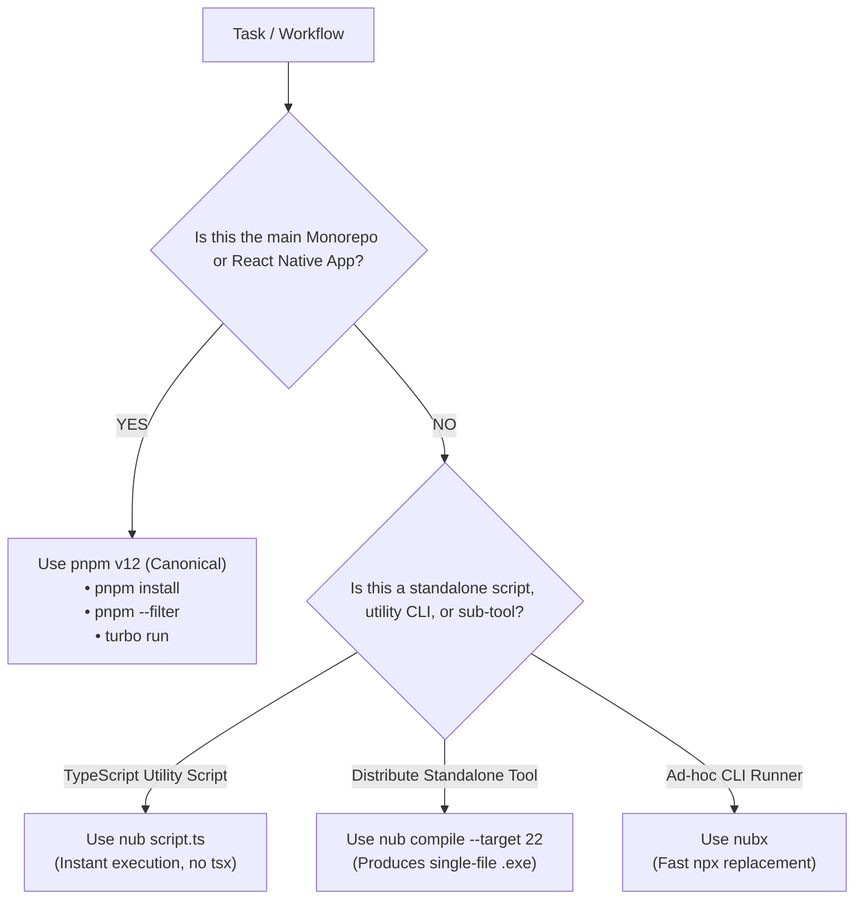

# Nub vs. pnpm v12 Evaluation & Ecosystem Use Cases

## 1. Executive Summary

This document captures the empirical analysis, stress tests, and strategic use cases for **Nub (`nub`)** in relation to the **pnpm v12** toolchain within the Polymath monorepo ecosystem.

---

## 2. What "Shiny Things" Nub ACTUALLY Adds

Nub is an **all-in-one Rust-powered Node.js toolchain**, not just a package manager. In our tests, Nub provided several high-value capabilities beyond standard `pnpm`:

### A. Zero-Config TypeScript / JSX Direct Execution (`nub <file.ts>`)
* **Capability**: Directly parses and executes TypeScript and JSX files on stock Node.js without requiring `tsx`, `ts-node`, `esbuild-register`, or custom `tsconfig.json` build steps.
* **Empirical Speed**: Cold-start execution of TypeScript scripts executed in **~240ms** using its Rust-based transpile cache.

### B. Single-Binary Executable Compiler (`nub compile`)
* **Capability**: Packages any JavaScript/TypeScript script into a standalone `.exe` (or ELF/Mach-O binary) with an embedded Node.js runtime compressed via `zstd`.
* **Empirical Test**: Compiled `cli.ts` into a self-contained `standalone-bin.exe` (26.1 MB) that executed natively with zero external dependencies.

### C. Unified Toolchain Orchestration
* **Node Versioning (`nub node` / `nub use`)**: Integrated version manager replacing standalone `nvm`/`fnm`.
* **Binary Runner (`nubx <pkg>`)**: Replaces `npx` with native caching and instant execution.
* **Watch Mode (`nub watch <file>`)**: Built-in file change tracking and hot restart.

---

## 3. Where Nub Breaks in Monorepos (Empirical Stress Test Failures)

When stress-tested against the Polymath monorepo configuration (`pnpm-workspace.yaml`, React Native hoisted singletons, patch files), the following critical issues occurred:

| Breakage Point | Root Cause | Impact on Polymath Platform |
| :--- | :--- | :--- |
| **`node_modules` Symlink Topology** | Nub deletes relative symlinks in `node_modules/.pnpm` and links directly to its own absolute global virtual store (`AppData\Local\nub/pm/store/v1`). | **Fatal for React Native & Metro**: Breaks Metro bundler package crawls and Android Gradle autolinking. |
| **Lockfile Metadata Stripping** | `nub add` removes multi-platform engine binaries (`@pnpm/exe.*`) from `pnpm-lock.yaml`. | **Breaks Linux/Docker CI**: Containerized environments (`dagger.ts`, GitHub Actions) fail without self-contained pnpm runners. |
| **Workspace Hoisting Flags** | Ignores `.pnpmrc` flags like `shamefully-hoist=true` and custom `publicHoistPattern` globs. | **Breaks Expo Native Modules**: Duplicate singleton copies trigger runtime crashes in native Android/iOS builds. |

---

## 4. Clear Decision Matrix & Recommended Use Cases

### When to ALWAYS Use `pnpm v12`:
1. **Root monorepo installs & updates (`pnpm install`, `pnpm add -W`, `pnpm --filter`)**.
2. **React Native & Expo development (`apps/gurudevi-mobile`)**.
3. **CI / CD Pipelines (`dagger.ts`, GitHub Actions, Docker builds)**.
4. **Any workflow with `patchedDependencies` or `.pnpmrc` hoisting directives**.

### When Nub is High Value:
1. **Ad-hoc Automation Scripts**: Running utility `.ts` scripts without configuring a `tsconfig.json` or installing `tsx` (`nub scripts/generate-data.ts`).
2. **Distributable Internal CLIs**: Compiling developer scripts into single `.exe` binaries for offline Windows/Linux execution (`nub compile my-tool.ts --out tool.exe`).
3. **Fast Binary Execution**: Rapidly trying one-off tools without bloating workspace dependencies (`nubx <package>`).
