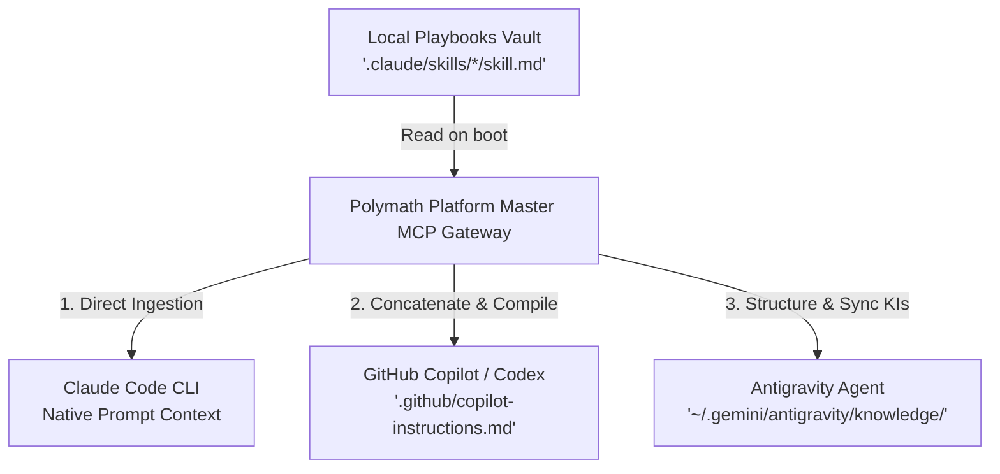

# Sovereign Agent Skills Framework: Architectural SSOT & Usage Guide

Welcome to the **Sovereign Agent Skills** workspace. This repository utilizes a centralized, multi-agent context synchronization pipeline. This framework guarantees that regardless of your choice of AI tool—whether **Claude Code (CLI)**, **GitHub Copilot/Codex (IDE)**, or **Antigravity (Advanced Coding Agent)**—every agent reasons with the exact same architectural guidelines and domain-specific playbooks.

---

## 1. Single Source of Truth (SSOT) Architecture

Our setup eliminates the need to manually copy rules, configurations, and playbooks across different agents' prompt systems. 

### The Three Operational Pillars:
1.  **Claude Code**: Reads individual folders under `.claude/skills/` natively to load specific operational trigger blocks during commands.
2.  **GitHub Copilot / Codex**: Automatically ingests `.github/copilot-instructions.md`, which is auto-compiled by the gateway to include all local playbooks.
3.  **Antigravity (IDE Agent)**: Ingests global Knowledge Items (KIs) inside `~/.gemini/antigravity/knowledge/`, which are synchronized dynamically with structural metadata manifests (`metadata.json`).

---

## 2. Active Playbooks Registry

Currently, the workspace contains three premium agent playbooks:

*   **`expo-rn-expert`**: Directives for Expo SDK 56, Expo Router file-based navigation, universal scrolling layouts (web/mobile), absolute imports, and item preloading.
*   **`supabase-expert`**: Operational procedures for schema planning, incremental SQL migrations, Row-Level Security (RLS) policies, and generating TypeScript types.
*   **`ui-polisher`**: Guidelines for design tokens, visual hierarchy, Outfit/Inter typography, interactive transitions/gradients, and responsive layouts.

---

## 3. How Agents Interact with These Skills

When you assign a task to an agent, here is what happens under the hood:

1.  **Trigger Detection**: The agent checks the user's prompt against the active playbooks' trigger tags (defined in the skill's front-matter or manifests).
2.  **Context Loading**:
    *   **Claude** loads the specific playbook file.
    *   **Copilot** reads the active block inside `.github/copilot-instructions.md`.
    *   **Antigravity** queries its local Knowledge Items and matches the playbook to your workspace paths.
3.  **Execution & Tool Binding**: The playbook guides the agent to use specialized MCP tools. For example, the `supabase-expert` skill directs the agent to run `mcp_supabase_get_advisors` or generate TypeScript type files, bridging the gap between passive guidelines and active tools.

---

## 4. How to Prompt Your Agents

To guarantee that the agents activate the correct playbooks, use clear, trigger-focused phrasing in your prompts.

### Recommended Prompting Patterns:

#### A. React Native & Expo Development
> **Prompt:** *"I need to build a new screen for user profiles in gurudevi-mobile. **Apply the expo-rn-expert skill** to ensure navigation follows Expo Router layouts, typing is strict, and scroll behavior is fully responsive on compact viewports."*

#### B. Database Schema Changes
> **Prompt:** *"Add a new table `classroom_schedules` to our database. **Use the supabase-expert playbook** to generate incremental SQL migrations under `supabase/migrations/`, verify Row-Level Security policies, and rebuild the database types."*

#### C. Interface Polish & Visual Upgrades
> **Prompt:** *"Review the landing screen on edlove-web. **Activate the ui-polisher skill** to replace solid colors with premium HSL gradients, inject hover transitions, and audit responsiveness using our browser tool."*

---

## 5. How to Share This Framework with Others

This synchronization pipeline is completely portable and built into the codebase. To share it with your team, follow these simple steps:

1.  **Commit the local folders**: Ensure `.claude/skills/` is committed to Git.
2.  **Install dependencies**: Run `pnpm install` in the monorepo root.
3.  **Start the MCP Gateway**: Running `@repo/platform-mcp` (or starting a pair programming session with any agent using the platform gateway) automatically triggers the synchronization script.
4.  **Instant Alignment**: The script instantly provisions `.github/copilot-instructions.md` for their GitHub Copilot environment and updates their global Antigravity/Gemini KIs!
