# Study 3: Canonical Authorization Architecture Model

**Subsystem:** Edlove Authorization Subsystem  
**Scope:** Reconciled End-to-End Architectural Model  
**Status:** Canonical Frozen Model  
**Baseline Anchor:** Commit `252bec65f746c362fec12472999cccfba187d0b9`  
**Date:** 2026-11-11  

---

## 1. Architectural Topology Overview

The Edlove authorization subsystem operates as a **two-tier, distributed security model**:
* **Tier 1 (Client Optimistic / Offline Barrier):** Combines in-memory UI presentation gating (`useSanctuaryFeature`) with local SQLite write interception (`secureDrizzleProxy`). Evaluates an Ed25519-signed permission snapshot pre-computed by the server and cached in local SQLite. Operates identically whether the device is online or offline.
* **Tier 2 (Server Authoritative Command Gate):** Enforces strict, transaction-locked authorization on all incoming API requests and sync streams at `apps/sanctuary-api`. Evaluates live Cedar policies via `@cedar-policy/cedar-wasm/nodejs` against PostgreSQL state under row locks.

---

## 2. Evidence-Coded Architecture Diagram

```mermaid
flowchart TD
    %% Node Definitions
    subgraph Client_UI [1. Client UI & Presentation Layer]
        UI_Screen["React UI Screen / Button<br/>apps/gurudevi-mobile/app/*"]
        Hook_Gate["useSanctuaryFeature Hook<br/>packages/core/src/logic/permissions/hooks/useSanctuaryFeature.ts:85"]
        Decision_Store[("useCedarDecisionStore In-Memory<br/>packages/core/src/store/useCedarDecisionStore.ts:45")]
    end

    subgraph Client_Storage_PEP [2. Client Local Database PEP Layer]
        Form_Action["Client Mutation Code<br/>e.g. Save Attendance"]
        Drizzle_PEP["secureDrizzleProxy Interceptor<br/>packages/core/src/adapters/powersync/secureDrizzleProxy.ts:97"]
        Sqlite_DB[("Local SQLite Database<br/>expo-sqlite WAL")]
        Upload_Queue[("PowerSync Upload Table ps_crud<br/>packages/core/src/adapters/powersync/v1Connector.adapter.ts:110")]
    end

    subgraph Client_Local_PDP [3. Client Offline PDP Orchestrator]
        Native_Eval["localEvaluator.native.ts<br/>packages/core/src/logic/permissions/localEvaluator.native.ts:35"]
        Snap_Table[("SQLite permission_snapshots<br/>Table")]
        Sig_Verify["verifySnapshotSignature<br/>packages/core/src/logic/permissions/signature.ts:15"]
        Dynamic_Cedar["cedarClientEvaluator.ts<br/>packages/core/src/logic/permissions/cedarClientEvaluator.ts:70"]
    end

    subgraph Server_Gateway [4. Sanctuary API Server Gateway]
        RPC_Endpoint["oRPC Procedure Handler<br/>apps/sanctuary-api/src/core/router.ts"]
        Assert_Identity["assertIdentity<br/>apps/sanctuary-api/src/security/security.ts:250"]
        Authz_Capability["authorizeCapability / authorizeCommand<br/>apps/sanctuary-api/src/security/security.ts:641,741"]
        Server_Cedar_Wasm["Server Cedar WASM Engine<br/>@cedar-policy/cedar-wasm/nodejs"]
        Postgres_DB[("PostgreSQL Production DB<br/>bonds, users, tenant tables")]
        Snapshot_Signer["Ed25519 Snapshot Signer<br/>apps/sanctuary-api/src/security/security.ts:480"]
    end

    subgraph Distribution [5. Snapshot Issuance & Distribution]
        Refresh_RPC["authority.refreshSnapshot Procedure<br/>packages/core/src/api/v1/contract.ts:63"]
        Refresh_Handler["snapshotRefresh.ts Client Handler<br/>packages/core/src/logic/permissions/snapshotRefresh.ts:40"]
    end

    subgraph PowerSync_Recon [6. PowerSync Sync Reconciliation]
        Sync_Worker["PowerSync Backend Worker<br/>packages/core/src/adapters/powersync/v1Connector.adapter.ts"]
    end

    %% Confirmed Runtime Execution (Solid Blue Edges)
    UI_Screen -->|1. Check Visibility| Hook_Gate
    Hook_Gate -->|2. Sync In-Memory Read| Decision_Store
    Form_Action -->|3. db.insert / update / delete| Drizzle_PEP
    Drizzle_PEP -->|4. Intercept Write| Native_Eval
    Native_Eval -->|5. Read Snapshot Row| Snap_Table
    Native_Eval -->|6. Verify Ed25519 Sig| Sig_Verify
    Sig_Verify -->|7. Sig Valid & ExpiresAt > now| Native_Eval
    Native_Eval -->|8. ALLOW: Permit Write| Drizzle_PEP
    Drizzle_PEP -->|9. Execute SQL WAL Insert| Sqlite_DB
    Sqlite_DB -->|10. Trigger Captures Mutation| Upload_Queue

    Form_Action ==>|Direct Online RPC Command| RPC_Endpoint
    RPC_Endpoint -->|Assert JWT & UUIDv8| Assert_Identity
    Assert_Identity -->|Verify Active Session| Postgres_DB
    RPC_Endpoint -->|Authorize Command| Authz_Capability
    Authz_Capability -->|Lock Active Scope & Load Resource| Postgres_DB
    Authz_Capability -->|Evaluate Cedar AST| Server_Cedar_Wasm
    Server_Cedar_Wasm -->|Decision: ALLOW| Authz_Capability
    Authz_Capability -->|Commit Mutation| Postgres_DB

    Refresh_RPC -->|Pre-Compute 2D Matrix| Server_Cedar_Wasm
    Refresh_RPC -->|Sign with Private Key| Snapshot_Signer
    Snapshot_Signer -->|Direct oRPC Response Body| Refresh_Handler
    Refresh_Handler -->|Verify Sig & Monotonic Version| Snap_Table
    Snap_Table -->|Boot Load| Decision_Store

    %% Configured but Unverified / Dormant Paths (Dashed Orange Edges)
    Upload_Queue -.->|Reconnection Uplink Stream| Sync_Worker
    Sync_Worker -.->|Re-Authorize Mutations with Live Cedar| Authz_Capability

    %% Inactive / Broken Runtime Paths (Dotted Red Edges)
    Native_Eval -.-x|IF EXPO_PUBLIC_DYNAMIC_CEDAR=true DORMANT| Dynamic_Cedar
    Dynamic_Cedar -.-x|Fails on Hermes: WebAssembly Undefined| Native_Eval
    Native_Eval -.->|Fallback to Snapshot ALLOW AMB-04| Drizzle_PEP

    %% Styling
    classDef verified stroke:#0288d1,stroke-width:2px,fill:#e1f5fe;
    classDef configured stroke:#f57c00,stroke-width:2px,stroke-dasharray: 5 5,fill:#fff3e0;
    classDef broken stroke:#c62828,stroke-width:2px,stroke-dasharray: 2 2,fill:#ffebee;

    class UI_Screen,Hook_Gate,Decision_Store,Form_Action,Drizzle_PEP,Sqlite_DB,Native_Eval,Snap_Table,Sig_Verify,RPC_Endpoint,Assert_Identity,Authz_Capability,Server_Cedar_Wasm,Postgres_DB,Snapshot_Signer,Refresh_RPC,Refresh_Handler verified;
    class Upload_Queue,Sync_Worker configured;
    class Dynamic_Cedar broken;
```

---

## 3. End-to-End Execution Trace by Lifecycle Phase

### Phase 1: Snapshot Generation & API Distribution
1. **Trigger:** User logs in online or calls `authority.refreshSnapshot({ bondId })`.
2. **Server Generation (`apps/sanctuary-api/src/security/security.ts:480`):**
   - Resolves active bond and user attributes from PostgreSQL.
   - Iterates through `AUTHORIZATION_RESOURCES` and `AUTHORIZATION_ACTIONS`.
   - Invokes server Cedar engine (`@cedar-policy/cedar-wasm/nodejs`) to pre-compute the 2D boolean permissions matrix.
3. **Signing (`security.ts:505`):**
   - Canonicalizes JSON string containing `userId`, `activeBondId`, `permissions`, `policyVersion`, and `expiresAt` (now + 24 hours).
   - Generates Ed25519 signature using `SNAPSHOT_SIGNING_PRIVATE_KEY`.
4. **Distribution (`packages/core/src/api/v1/contract.ts:63`):**
   - Directly returned in the HTTP response body of the oRPC procedure (commit `c6665f2cc`).
5. **Client Receipt (`packages/core/src/logic/permissions/snapshotRefresh.ts:65`):**
   - Client verifies Ed25519 signature using public key.
   - Enforces monotonicity: `newSnapshot.policyVersion >= existingSnapshot.policyVersion` (commit `3b613f3c8`).
   - Upserts into SQLite table `permission_snapshots`.

---

### Phase 2: Client Boot & UI Presentation Gating
1. **Store Hydration (`packages/core/src/store/useCedarDecisionStore.ts:25`):**
   - At app boot, loads the snapshot from local SQLite.
   - Verifies Ed25519 signature in memory.
   - Parses permissions JSON into synchronous decision map `decisions[resourceType][action]`.
2. **UI Hook (`packages/core/src/logic/permissions/hooks/useSanctuaryFeature.ts:85`):**
   - React component invokes `useSanctuaryFeature(action, subject)`.
   - Checks personal perspective fast-path (e.g. `LibraryResource`).
   - Synchronously queries `useCedarDecisionStore.getState().getDecision(action, subject)`.
   - Combines with Feature Flags, Entitlements, and Citizenship Tiers (4-Pillar Gate).
   - Returns `{ permitted: boolean, can, cannot }` in < 1ms with **0 network round-trips**.

---

### Phase 3: Local Database Mutation Interception (Offline / Online PEP)
1. **Mutation Invocation:** User submits a form; application executes Drizzle mutation:
   `db.insert(attendanceRecords).values(...)`.
2. **Proxy Interception (`packages/core/src/adapters/powersync/secureDrizzleProxy.ts:97`):**
   - Intercepts `insert`, `update`, `delete` (bypasses `select`).
   - Checks `_activeToken` (ADR-012 capability token). If null, invokes `_permissionValidator`.
3. **Evaluator Orchestration (`packages/core/src/logic/permissions/localEvaluator.native.ts:35`):**
   - Validates active user context and civic bond.
   - Loads SQLite snapshot row for active `userId`.
   - Verifies Ed25519 signature via `verifySnapshotSignature` (`signature.ts`). If tampered, returns `false`.
   - Checks temporal expiration: `new Date() <= expiresAt`. If expired, returns `false`.
   - Looks up `permissions[resourceType][action]`. If `false` or unlisted, returns `false`.
4. **Dynamic Cedar Branch (`localEvaluator.native.ts:131`):**
   - Evaluates `process.env.EXPO_PUBLIC_LOCAL_DYNAMIC_CEDAR === 'true'`.
   - In production, evaluates to `false` -> skipped.
   - Returns `isAllowed: true`.
5. **Commit:** `secureDrizzleProxy` permits execution. Row commits to SQLite WAL. PowerSync trigger copies write to `ps_crud` upload queue.

---

### Phase 4: Server Transactional Command Execution (Online Only)
1. **Invocation:** Client sends an RPC mutation: `POST /api/v1/attendance.submit`.
2. **Authentication (`apps/sanctuary-api/src/security/security.ts:250`):**
   - Validates Bearer JWT and Edlove Account UUIDv8 in PostgreSQL.
3. **Authoritative Authorization (`apps/sanctuary-api/src/security/security.ts:641,741`):**
   - Re-reads active bond inside database transaction with row-level locks (`SELECT ... FOR UPDATE`).
   - Resolves target resource attributes from PostgreSQL.
   - Evaluates Cedar policies live via `@cedar-policy/cedar-wasm/nodejs`.
   - If denied, throws HTTP 403 `FORBIDDEN`.
4. **Commit:** Executes SQL mutation in PostgreSQL; commits transaction; streams update via WAL.

---

### Phase 5: Reconnection Sync & Reconciliation
1. **Network Restore:** PowerSync detects online status.
2. **Uplink:** PowerSync uploads queued writes from `ps_crud` to backend sync handler.
3. **Server Re-Authorization:** Server processes mutations serially, executing `security.authorizeCommand` for each row before applying to PostgreSQL.
4. **Rollback on Deny:** If an offline write is denied by server policy, PostgreSQL transaction aborts, and PowerSync instructs the client to rollback the local SQLite row.

---

## 4. Architectural Invariants Ledger

| Invariant ID | Formulation | Enforcement Substrate | Violation Result |
| :--- | :--- | :--- | :--- |
| **INV-01** | Client UI gates never query the network for authorization checks. | `useSanctuaryFeature.ts`, `useCedarDecisionStore.ts` | Immediate synchronous decision or fail-closed. |
| **INV-02** | Local mobile writes are blocked if snapshot signature is invalid or expired. | `secureDrizzleProxy.ts:150`, `localEvaluator.native.ts:104` | Throws `LOCAL_WRITE_VIOLATION` (403). |
| **INV-03** | Server never trusts client offline authorization decisions upon sync. | `apps/sanctuary-api/src/security/security.ts:741` | Server re-evaluates live Cedar AST in Postgres tx. |
| **INV-04** | Client never accepts older policy versions from server responses. | `packages/core/src/logic/permissions/snapshotRefresh.ts:72` | Rejects stale snapshot; preserves current version. |
| **INV-05** | Dynamic Cedar can never elevate permissions beyond static snapshot grants. | `localEvaluator.native.ts:129` | Snapshot deny exits immediately before dynamic code. |
