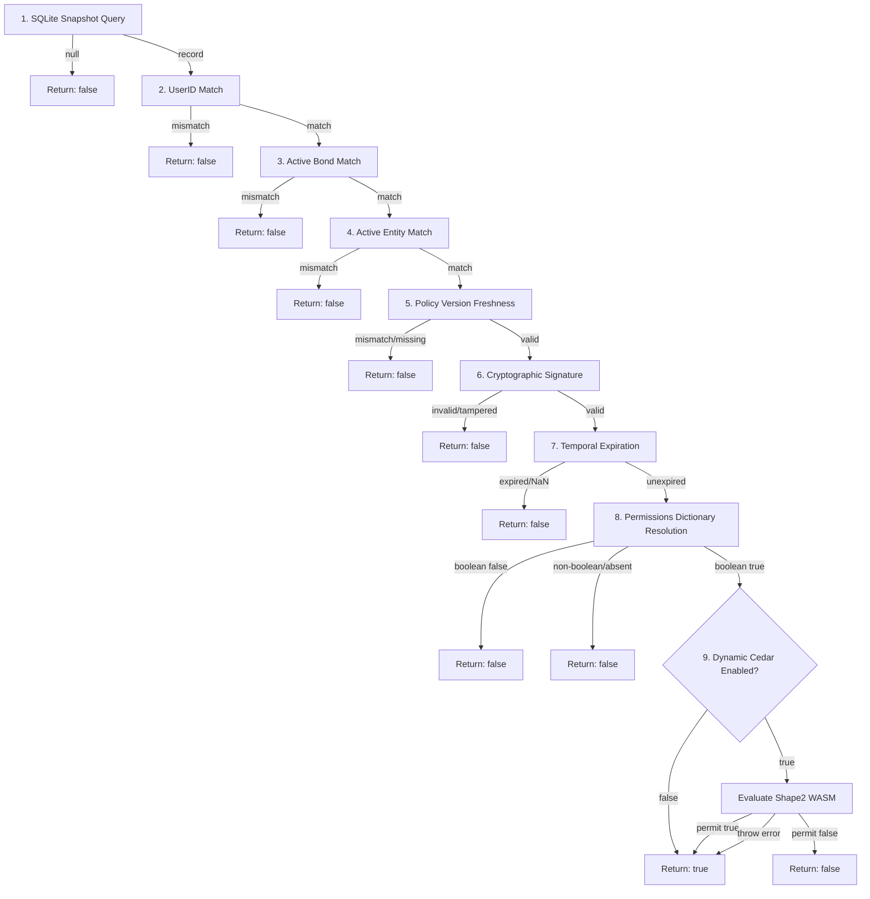

# E1 Behavioral Contract & Truth Table

**Subsystem:** Offline Permission Evaluation & Authorization Snapshot Verification  
**Module:** `packages/core/src/logic/permissions/localEvaluator.native.ts` (`checkLocalPermission`)  
**Baseline Anchor:** Commit `252bec65f746c362fec12472999cccfba187d0b9`  
**Purpose:** Precise characterization of existing evaluation invariants before extracting snapshot integrity verification into a pure helper.

---

## 1. Evaluation Order of Operations (Causal Pipeline)

The evaluator executes sequentially through eight deterministic gates. Failure at any gate short-circuits execution and returns `false`:

---

## 2. Exhaustive Behavioral Truth Table

| Row | Precondition / State | Input Context | Database Record State | Expected Decision | Mechanism / Failing Gate |
| :--- | :--- | :--- | :--- | :---: | :--- |
| **T01** | Standard Valid Snapshot | `user: 'u1', bond: 'b1', entity: 'e1'/'SCHOOL', action: 'read', resource: 'Classroom'` | Snapshot exists, matching user/bond/entity, valid policyVersion, valid signature, future expiresAt, `permissions: { Classroom: { read: true } }` | `true` | Gate 8/9: Static grant allows; dynamic cedar disabled. |
| **T02** | Explicit Negative Permission | Same as T01 | Same as T01, but `permissions: { Classroom: { read: false } }` | `false` | Gate 8: Explicit boolean `false` short-circuits. |
| **T03** | Domain Verb Mapping (`resolve` $\rightarrow$ `read`) | Context queries action `'resolve'` | Snapshot maps `'read': true` | `true` | Gate 8: `cedarActionFor('resolve', 'Classroom')` resolves to `'read'`. |
| **T04** | Missing Snapshot Record | Valid user context | SQLite returns `null` (no row matching where-clause) | `false` | Gate 1: Default-deny on missing record. |
| **T05** | User ID Mismatch | `userContext.userId = 'u1'` | SQLite row returned has `userId = 'u2'` | `false` | Gate 2: Account boundary violation. |
| **T06** | Active Bond Mismatch | `userContext.activeBond.id = 'b1'` | SQLite row returned has `activeBondId = 'b2'` | `false` | Gate 3: Bond isolation violation. |
| **T07** | Missing Active Entity ID | `userContext.activeEntityId = ''` (empty) | Snapshot has `activeEntityId = 'e1'` | `false` | Gate 4: Mandatory entity ID check fails. |
| **T08** | Missing Active Entity Type | `userContext.activeEntityType = undefined` | Snapshot has `activeEntityType = 'SCHOOL'` | `false` | Gate 4: Mandatory entity type check fails. |
| **T09** | Active Entity ID Mismatch | `userContext.activeEntityId = 'e1'` | Snapshot has `activeEntityId = 'e2'` | `false` | Gate 4: Scope boundary violation. |
| **T10** | Missing Snapshot Policy Hash (Bonded) | `activeBond` present | Snapshot `policyVersion = null`, DB `hash = 'v1'` | `false` | Gate 5: Stale/missing policy version check. |
| **T11** | Policy Version Hash Mismatch (Bonded) | `activeBond` present | Snapshot `policyVersion = 'v1'`, DB `hash = 'v2'` | `false` | Gate 5: Stale policy hash check. |
| **T12** | Database Policy Hash Absent (Bonded) | `activeBond` present | DB returns `{ hash: null }` | `false` | Gate 5: Unverified local policy substrate fails closed. |
| **T13** | Cryptographic Signature Tamper | All metadata valid | Snapshot `signature = 'invalid-sig'` or corrupted base64 | `false` | Gate 6: Ed25519 signature verification fails. Downstream policy queries are NOT executed. |
| **T14** | Expired Snapshot (Past Timestamp) | All metadata valid | Snapshot `expiresAt = '2020-01-01T00:00:00Z'` (past) | `false` | Gate 7: `expiresAt <= new Date()` returns false. |
| **T15** | Malformed Expiry String | All metadata valid | Snapshot `expiresAt = 'not-a-date'` | `false` | Gate 7: `Number.isFinite(expiresAt.getTime())` is false. |
| **T16** | Malformed Permissions JSON | All metadata valid | Snapshot `permissions = '{invalid json'` | `false` | Outer Boundary: `JSON.parse` throws SyntaxError; outer catch returns `false`. |
| **T17** | Non-Boolean Permission Value | All metadata valid | Snapshot `permissions: { Classroom: { read: 'true' } }` (string) | `false` | Gate 8: `typeof isAllowed !== 'boolean'` defaults to `false`. |
| **T18** | Undeclared Resource Type | `resourceType = 'Unknown'` | Snapshot has only `{ Classroom: { read: true } }` | `false` | Gate 8: Resource missing in permissions dict defaults to `false`. |
| **T19** | Dynamic Cedar Engine Restriction | `EXPO_PUBLIC_LOCAL_DYNAMIC_CEDAR='true'` | Snapshot maps `'read': true`, but Cedar policy evaluates to `Deny` | `false` | Gate 9: Dynamic Cedar evaluation further restricts grant. |
| **T20** | Dynamic Cedar WASM Crash Fallback | `EXPO_PUBLIC_LOCAL_DYNAMIC_CEDAR='true'` | Snapshot maps `'read': true`, Cedar engine throws WASM memory error | `true` | Gate 9: Catch block logs warning and falls back to verified static grant. |
| **T21** | Database I/O / Query Failure | Valid context | `db.query.permissionSnapshots.findFirst` throws SQLite Error | `false` | Outer Boundary: Outer try/catch traps error and returns `false`. |
