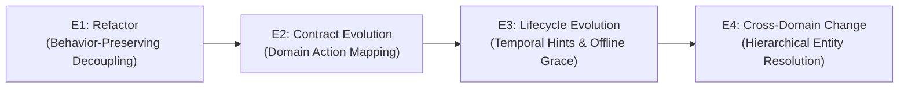

# Evolution Sequence Specification: E1–E4 (Phase 2)

**Study:** Study 3 — Longitudinal Brownfield Evolution  
**Subsystem:** Offline Permission Evaluation & Authorization Snapshot Verification  
**Repository Target:** `EdLove` (`c:\x`)  
**Status:** PROPOSED (Awaiting Human Review Before E2–E4 Implementation)  

---

## 1. Evolution Change Overview



---

## 2. Detailed Change Specifications

### E1. Behavior-Preserving Refactoring (Structural Decoupling)

- **Current Implementation:**
  In [`packages/core/src/logic/permissions/localEvaluator.native.ts`](file:///c:/x/packages/core/src/logic/permissions/localEvaluator.native.ts), `checkLocalPermission` is an unbroken monolithic 170-line procedure. It tightly couples database querying, payload unpacking, cryptographic verification, temporal comparison, and dynamic Cedar dispatch into a single block.
- **Proposed Refactoring:**
  Extract snapshot integrity validation into a pure, testable domain function:
  ```typescript
  export function validateSnapshotIntegrity(
    snapshot: PermissionSnapshotRecord | null,
    context: UserContextParams,
    currentPolicyHash?: string
  ): { valid: true; snapshot: PermissionSnapshotRecord } | { valid: false; reason: string }
  ```
  The core `checkLocalPermission` becomes a high-level orchestrator calling this validator.
- **Affected Components & Contracts:**
  - `packages/core/src/logic/permissions/localEvaluator.native.ts`
  - `packages/core/src/logic/permissions/snapshotIntegrity.ts` (new pure module)
  - Contracts remain 100% identical.
- **Acceptance Criteria:**
  1. `checkLocalPermission` retains exact input parameters and `Promise<boolean>` return signature.
  2. All 26 existing tests in `localEvaluator.native.test.ts` and `localEvaluator.native.dynamic.test.ts` pass with zero modifications.
  3. Parity checker `node scripts/check-authorization-parity.mjs` passes without regression.
- **Required Tests:**
  - Full existing test suite + isolated unit tests for `validateSnapshotIntegrity` covering all 5 denial branches.
- **Backward-Compatibility Risks:**
  - Zero (Internal refactoring only).
- **Independent Verification Evidence:**
  - AST diff analysis showing no public symbol changes; mutation run confirming parity of detection.
- **Human Approval Flag:** None required (behavior-preserving).

---

### E2. Authorization Contract Evolution (Domain Verb Mapping)

- **Current Implementation:**
  In [`packages/policies/src/authorizationRegistry.ts`](file:///c:/x/packages/policies/src/authorizationRegistry.ts), `cedarActionFor` translates high-level verbs to Cedar primitives (`resolve` $\rightarrow$ `read`, `submit` $\rightarrow$ `create`, `override` $\rightarrow$ `update`, `manage` $\rightarrow$ `update`). Any domain verb not declared in `cedarActionFor` falls back to raw string passthrough, which fails closed when queried against standard Cedar policies.
- **Proposed Behavioral Change:**
  Add domain verb mapping for content archiving and content retrieval:
  - `"archive"` maps to `"delete"` for transactional records (`FireJournal`, `AttendanceRecord`), and `"update"` for mutable institutional documents (`Classroom`, `Lesson`).
  - `"export"` maps to `"read"`.
- **Affected Components & Contracts:**
  - `packages/policies/src/authorizationRegistry.ts` (`cedarActionFor`)
  - `packages/policies/src/schema/schema.cedarschema` (verify action compatibility)
  - `scripts/check-authorization-parity.mjs` (ensure alignment)
- **Acceptance Criteria:**
  1. `checkLocalPermission({ action: 'archive', resourceType: 'Lesson', ... })` correctly resolves permission using the snapshot's `'update'` grant.
  2. `checkLocalPermission({ action: 'archive', resourceType: 'AttendanceRecord', ... })` resolves using the snapshot's `'delete'` grant.
  3. `checkLocalPermission({ action: 'export', resourceType: 'Classroom', ... })` resolves using `'read'`.
- **Required Tests:**
  - New test cases in `localEvaluator.native.test.ts` verifying that `'archive'` and `'export'` evaluate correctly against signed snapshots without requiring server schema migration.
- **Backward-Compatibility Risks:**
  - If existing clients pass `'archive'` expecting default-deny, they will now be evaluated against the mapped action.
- **Independent Verification Evidence:**
  - Static parity check passes; new unit tests pass; existing 26 tests pass unchanged.
- **Human Approval Flag:** ⚠️ **Requires Product Owner Confirmation** on whether `Lesson` archive should be treated as an `update` (soft-archive) or `delete` (removal).

---

### E3. Offline Snapshot Lifecycle Evolution (Temporal Hints & Grace Window)

- **Current Implementation:**
  In [`localEvaluator.native.ts` lines 110–116](file:///c:/x/packages/core/src/logic/permissions/localEvaluator.native.ts#L110-L116):
  ```typescript
  const expiresAt = new Date(snapshotRecord.expiresAt);
  if (!Number.isFinite(expiresAt.getTime()) || expiresAt <= new Date()) {
    return false;
  }
  ```
  Expiration is an immediate, binary cliff. A mobile device offline in a remote school loses all local permissions the second `expiresAt` passes, even if the user only needs read-only access to existing local content. Furthermore, `snapshotRecord.temporalHints` is synced to SQLite but completely ignored by the evaluator.
- **Proposed Behavioral Change:**
  Introduce an **Offline Read Grace Window**:
  - If a snapshot has expired, but is within a bounded grace window (e.g. 24 hours post-expiry) AND the requested action is `'read'`, allow access in an explicit degraded state with a logged warning.
  - All mutating actions (`'create'`, `'update'`, `'delete'`, `'use_ai'`) remain strictly denied immediately upon expiration.
- **Affected Components & Contracts:**
  - `packages/core/src/logic/permissions/localEvaluator.native.ts`
  - `packages/core/src/types/authorization.ts` (optional degraded context indicator)
- **Acceptance Criteria:**
  1. When `snapshot.expiresAt` is 1 hour in the past:
     - `checkLocalPermission({ action: 'read', ... })` returns `true`.
     - `checkLocalPermission({ action: 'update', ... })` returns `false`.
  2. When `snapshot.expiresAt` is 48 hours in the past:
     - `checkLocalPermission({ action: 'read', ... })` returns `false` (hard cliff).
- **Required Tests:**
  - Time-mocked tests in `localEvaluator.native.test.ts` verifying read-allow and write-deny inside the grace window.
- **Backward-Compatibility Risks:**
  - Extends read capabilities past the signed server timestamp.
- **Independent Verification Evidence:**
  - Time-travel test matrix proving write operations cannot be forged during the grace period.
- **Human Approval Flag:** ⚠️ **Requires Security Authority Approval** before implementing grace-window duration and read-only scope boundaries.

---

### E4. Cross-Domain Authorization Change (Hierarchical Entity Scoping)

- **Current Implementation:**
  In `localEvaluator.native.ts` lines 74–84:
  ```typescript
  if (
    !activeEntityId ||
    !activeEntityType ||
    snapshotRecord.activeEntityId !== activeEntityId ||
    snapshotRecord.activeEntityType !== activeEntityType
  ) {
    return false;
  }
  ```
  A snapshot issued for a `School` (e.g. `entity_type: 'SCHOOL', entity_id: 'school-1'`) is rejected immediately if the user context requests permission for a child `Classroom` (`activeEntityType: 'CLASSROOM', activeEntityId: 'class-9'`).
- **Proposed Behavioral Change:**
  Allow **Hierarchical Entity Fallback**:
  - If `snapshotRecord.activeEntityType === 'SCHOOL'` and context specifies `activeEntityType === 'CLASSROOM'`, the evaluator queries the local SQLite `classrooms` table via Drizzle.
  - If `classroom.schoolId === snapshotRecord.activeEntityId`, the evaluator permits evaluation under the school-level institutional snapshot.
- **Affected Components & Contracts:**
  - `packages/core/src/logic/permissions/localEvaluator.native.ts`
  - `packages/core/src/adapters/powersync/schema.ts` (references `classrooms` table)
- **Acceptance Criteria:**
  1. A user with a signed `SCHOOL` snapshot can read classrooms belonging to that school without requiring an explicit classroom-scoped snapshot.
  2. If the classroom belongs to a different school or does not exist in local SQLite, access is denied.
- **Required Tests:**
  - Mocked Drizzle queries testing multi-school containment and rejection of orphan or cross-school classrooms.
- **Backward-Compatibility Risks:**
  - Moderate: Changes the assumption that snapshot scope is strictly 1:1 with `activeEntityId`.
- **Independent Verification Evidence:**
  - Integration test verifying tenant isolation remains unbreachable.
- **Human Approval Flag:** ⚠️ **Requires Institutional Architecture Review** (Domain boundary change between School and Classroom domains).
