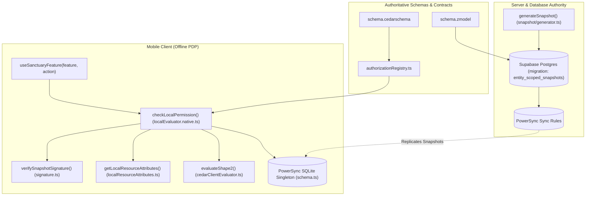

# Subsystem Dependency Map: Authorization & Offline Permissions (Phase 1)

**Subsystem:** Offline Permission Evaluation & Authorization Snapshot Verification  
**Repository Target:** `EdLove` (`c:\x`)  
**Commit:** `252bec65f746c362fec12472999cccfba187d0b9`  

---

## 1. Architectural Overview & Component Topology

The subsystem implements an **offline-first Policy Decision Point (PDP)** for mobile devices (React Native/Expo) with dynamic fallback to in-memory Cedar WASM policies.

---

## 2. Component Dependency Table (Confirmed vs. Inferred)

| Component Path | Architectural Role | Confirmed Dependencies (Verified on Disk) | Inferred Dependencies |
| :--- | :--- | :--- | :--- |
| `packages/core/src/logic/permissions/localEvaluator.native.ts` | Authoritative Mobile Offline PDP | `@repo/core/adapters/powersync/database`, `drizzle-orm`, `permissionSnapshots`, `policyVersion`, `cedarPolicies`, `signature.ts`, `cedarClientEvaluator.ts`, `localResourceAttributes.ts`, `authorizationRegistry.ts` | Dynamic Cedar WASM assumed to execute on Hermes engine on device. |
| `packages/core/src/logic/permissions/signature.ts` | Ed25519 Cryptographic Snapshot Verification | `isomorphic-webcrypto`, `AUTHORIZATION_ACTIONS`, `AUTHORIZATION_RESOURCES` | Expects public key in `process.env.EXPO_PUBLIC_SNAPSHOT_SIGNING_PUBLIC_KEY`. |
| `packages/core/src/logic/permissions/cedarClientEvaluator.ts` | In-Memory Cedar WASM Evaluator | `@cedar-policy/cedar-wasm`, `@repo/policies/authorizationRegistry` | Evaluator assumes Cedar policies in SQLite do not exceed memory limits (100KB guard). |
| `packages/core/src/logic/permissions/localResourceAttributes.ts` | SQLite Attribute Extractor for Dynamic PDP | `@repo/core/adapters/powersync/database`, Drizzle query engine | Maps `Classroom` and `School` attributes from SQLite tables. |
| `packages/core/src/adapters/powersync/schema.ts` | SQLite Client Schema for PowerSync | Drizzle ORM SQLite column definitions | Declares `permissionSnapshots`, `policyVersion`, `cedarPolicies` tables. |
| `packages/policies/src/schema/schema.cedarschema` | Authoritative Cedar Policy Syntax | Cedar Policy Specification v3+ | Contains 58 entities and actions (`read`, `create`, `update`, `delete`, `use_ai`, `grade`, `publish`). |
| `packages/schema/schema.zmodel` | Authoritative ZenStack / Database Model | ZenStack v3 ORM | Defines relational models, access policies (`@@allow`), and foreign keys. |
| `packages/policies/src/authorizationRegistry.ts` | Shared Vocabulary Translation Boundary | None (Pure TS types & arrays) | Maps domain verbs (`resolve` $\rightarrow$ `read`, `submit` $\rightarrow$ `create`, `override` $\rightarrow$ `update`). |
| `packages/policies/src/snapshot/generator.ts` | Server Snapshot Compiler & Signer | Node.js `node:crypto`, `authorizationRegistry.ts` | Generates signed Ed25519 payload using server private key. |
| `apps/gurudevi-mobile/supabase/migrations/20260726000001_entity_scoped_permission_snapshots.sql` | Postgres Schema & RLS Policies | Supabase Postgres | Creates `permission_snapshots` table and enforces RLS security. |
| `scripts/check-authorization-parity.mjs` | Static Cross-Schema Alignment Linter | Reads raw source files via regex and string matching | Assumes file locations and specific method call patterns (`AuthClient.ts`). |

---

## 3. Runtime Decision Sequence & Invariant Ledger

When a client queries permission via `checkLocalPermission`:

1. **Step 1: SQLite Snapshot Lookup**
   - Queries `permissionSnapshots` table where `userId === activeUserId` and (`activeBondId === activeBond.id` OR `schoolId === school.id`).
   - *Invariant:* If no record found, returns `false` (Defensive Default-Deny).
2. **Step 2: Account & Entity Boundary Assertion**
   - Asserts `snapshotRecord.userId === activeUserId`.
   - Asserts `snapshotRecord.activeBondId === activeBond.id` (if bond is present).
   - Asserts `snapshotRecord.activeEntityId === activeEntityId` and `snapshotRecord.activeEntityType === activeEntityType`.
   - *Invariant:* Any mismatch logs security error and returns `false`.
3. **Step 3: Policy Version Freshness Assertion**
   - Queries `policyVersion` table for current hash.
   - Compares `snapshotRecord.policyVersion === currentPolicyVersion.hash`.
   - *Invariant:* Stale or missing policy version causes instant denial (`return false`).
4. **Step 4: Cryptographic Signature Verification**
   - Calls `verifySnapshotSignature(snapshotRecord)`.
   - Reconstructs strictly ordered payload JSON and verifies Ed25519 signature against `EXPO_PUBLIC_SNAPSHOT_SIGNING_PUBLIC_KEY`.
   - *Invariant:* Tampered signature logs tamper error and returns `false`.
5. **Step 5: Temporal Expiration Assertion**
   - Evaluates `new Date(snapshotRecord.expiresAt) <= new Date()`.
   - *Invariant:* Expired timestamp returns `false`.
6. **Step 6: Static JSON Permissions Resolution**
   - Parses `snapshotRecord.permissions[resourceType][action]`.
   - Resolves via `cedarActionFor(action, resourceType)`.
   - *Invariant:* If explicitly boolean `false`, returns `false`.
7. **Step 7: Dynamic Cedar WASM Evaluation (Optional)**
   - Only executed if `EXPO_PUBLIC_LOCAL_DYNAMIC_CEDAR === 'true'`.
   - Reads `cedarPolicies` table from SQLite.
   - Invokes `evaluateShape2()` with user context, resource attributes, and Cedar WASM engine.
   - *Invariant:* If dynamic evaluation succeeds, returns dynamic decision; if WASM fails/crashes, gracefully falls back to static snapshot decision.
