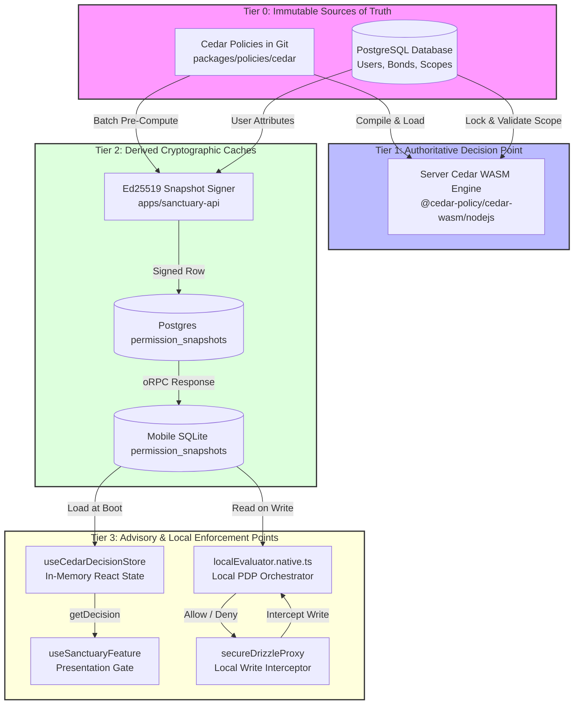

# Phase G: Authority and Consistency Model

**Study:** Study 3 — Longitudinal Brownfield Evolution  
**Subsystem:** Authority Tiers, Data Flow & Consistency Invariants  
**Status:** Grounded Architectural Specification  
**Baseline Commit:** `252bec65f746c362fec12472999cccfba187d0b9`  
**Evidence Standard:** [OBSERVED], [CONFIGURED], [DOCUMENTED], [INFERRED], [UNKNOWN], [CONFLICTING]

---

## 1. Executive Summary: The 4 Authority Tiers

In a distributed, offline-capable architecture like Edlove, confusion over "who is in charge" can introduce catastrophic security vulnerabilities (e.g., trusting a client timestamp or allowing an offline cache to override server state).

Edlove enforces a strict **4-Tier Authority Model**:
* **Tier 0: Source of Truth (Immutable Canon):** The server-side Cedar DSL policies committed in git, and the PostgreSQL database state managed under transactional row locks.
* **Tier 1: Authoritative Policy Engines (PDPs):** The server-side Cedar WASM evaluator running in `apps/sanctuary-api`.
* **Tier 2: Derived Cryptographic Caches:** The Ed25519-signed permission snapshot persisted in PostgreSQL and replicated to client SQLite.
* **Tier 3: Advisory & Presentation Gates:** In-memory client stores (`useCedarDecisionStore`, `useSanctuaryFeature`) and local Drizzle write proxies.

---

## 2. Comprehensive Authority Matrix

| Component / Substrate | Producer | Consumer | Authority Tier | Update Mechanism | Consistency Guarantee | Conflict Resolution Rule |
| :--- | :--- | :--- | :--- | :--- | :--- | :--- |
| **1. Cedar DSL Policies (`packages/policies/cedar`)** | Security Engineers & Domain Teams (Git commits) | Server Cedar Engine, Snapshot Generator | **Tier 0 (Source of Truth)** | Git deployment & application build | Immutable per deployment | Repository versioning / Git commit SHA |
| **2. PostgreSQL State (`users`, `bonds`, `scopes`)** | Backend API mutations & administrative actions | `apps/sanctuary-api` Security Subsystem | **Tier 0 (Source of Truth)** | ACID Transactions with row-level locks (`FOR UPDATE`) | Strict Serializable / Snapshot Isolation | PostgreSQL transaction serialization failure -> Retry/Abort |
| **3. Server Cedar Engine (`@cedar-policy/cedar-wasm/nodejs`)** | Upstream Cedar WASM binaries & Node runtime | `apps/sanctuary-api` Gateway & Command Handlers | **Tier 1 (Authoritative PDP)** | Evaluated live on incoming oRPC requests | Immediate Strict Evaluation | Server decision is final; throws `FORBIDDEN` or `UNAVAILABLE` |
| **4. Permission Snapshots (`permission_snapshots` in Postgres)** | `issueSnapshot` in `security.ts` | oRPC `authority.refreshSnapshot` response | **Tier 2 (Derived Cache)** | Generated via `generateSnapshot` on bond creation or refresh | 24-Hour Bounded Cache | Re-generated on demand when expired |
| **5. Client SQLite Snapshots (`permission_snapshots` in SQLite)** | oRPC response handler (`snapshotRefresh.ts`) | `localEvaluator.native.ts`, `useCedarDecisionStore.ts` | **Tier 2 (Derived Cryptographic Cache)** | Direct RPC response delivery (commit `c6665f2cc`) | Bounded Eventual (24-hour expiration window) | Monotonic Policy Version check (commit `3b613f3c8`); older rejected |
| **6. Client Decision Store (`useCedarDecisionStore.ts`)** | Snapshot Loader reading SQLite table at boot | `useSanctuaryFeature.ts`, UI Components | **Tier 3 (Advisory Presentation Cache)** | Zustand store update on boot or snapshot refresh | Optimistic In-Memory Cache | Overwritten on new snapshot load |
| **7. Local Drizzle Proxy PEP (`secureDrizzleProxy.ts`)** | Mobile Application runtime wrapping DB | SQLite WAL engine (`expo-sqlite`) | **Tier 3 (Local Pre-Commit Gate)** | Intercepts Drizzle SQL builder executions | Immediate Local Evaluation | Rejects with `LOCAL_WRITE_VIOLATION` if snapshot invalid |
| **8. Dynamic Cedar SQLite Table (`cedar_policies`)** | Historical sync stream (now dormant) | `cedarClientEvaluator.ts` (when flag active) | **Tier 2 (Dormant Policy Cache)** | PowerSync table replication | Eventual Consistency | Max size check (100KB); fallback to static snapshot |

---

## 3. Data Flow and Invariant Topology

---

## 4. Conflict Resolution & Consistency Invariants

### Invariant 1: Monotonic Policy Versioning
* **Substrate [OBSERVED]:** `packages/core/src/logic/permissions/snapshotRefresh.ts:65-80` (commit `3b613f3c8`).
* **Rule:** When the client receives a new snapshot from the server, it compares `newSnapshot.policyVersion` with `existingSnapshot.policyVersion`.
* **Enforcement:** If `newSnapshot.policyVersion < existingSnapshot.policyVersion`, the client **rejects** the snapshot. An older snapshot delivered out-of-order can never roll back an already-upgraded policy version on the client.

### Invariant 2: Cryptographic Tamper Rejection
* **Substrate [OBSERVED]:** `packages/core/src/logic/permissions/signature.ts`, `localEvaluator.native.ts:100`.
* **Rule:** The client never trusts its own SQLite database contents without verifying the Ed25519 signature on every write.
* **Enforcement:** If a local row's `signature` does not match the canonical JSON hash of its `userId`, `activeBondId`, `permissions`, and `expiresAt`, the evaluator returns `false` (tamper fail-closed).

### Invariant 3: Server Non-Trust of Client Decisions
* **Substrate [OBSERVED]:** `apps/sanctuary-api/src/security/security.ts:741` (`authorizeCommand`).
* **Rule:** When an offline client reconnects and syncs mutations, the server **never accepts** the client's local authorization decision as proof of permission.
* **Enforcement:** The server executes a complete, authoritative evaluation of Cedar policies against live PostgreSQL state before committing any synced write.

### Invariant 4: Bounded Eventual Consistency (The 24-Hour Revocation Window)
* **Substrate [OBSERVED]:** `packages/policies/src/snapshot/generator.ts:45`, `localEvaluator.native.ts:114`.
* **Rule:** If an administrator revokes a teacher's permissions on the server, an offline client will continue to authorize local writes **until the snapshot expires** (maximum 24 hours).
* **Implication:** The system accepts a maximum 24-hour window of eventual consistency for disconnected operations in exchange for 100% offline uptime.
