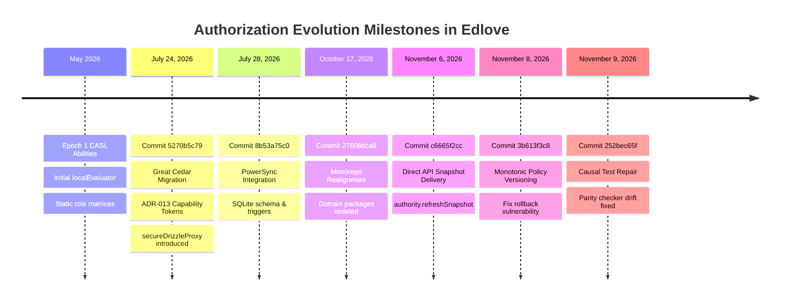

# Phase I: Authorization Evolution History

**Study:** Study 3 — Longitudinal Brownfield Evolution  
**Subsystem:** Longitudinal Git Commit History & Architectural Evolution  
**Status:** Grounded Architectural Specification  
**Baseline Commit:** `252bec65f746c362fec12472999cccfba187d0b9`  
**Evidence Standard:** [OBSERVED], [CONFIGURED], [DOCUMENTED], [INFERRED], [UNKNOWN], [CONFLICTING]

---

## 1. Executive Summary

The authorization subsystem in Edlove did not emerge from a single monolithic design. Rather, it evolved over a 6-month period across four distinct architectural epochs:
1. **The CASL & Client Store Epoch (May – July 2026):** Role-based capability arrays evaluated on client devices via CASL abilities (`usePermissionStore`).
2. **The Cedar & Capability Token Great Migration (July 2026, Commit `5270b5c79`):** Complete elimination of CASL; introduction of Cedar DSL, `secureDrizzleProxy`, `useCedarDecisionStore`, and `cedarClientEvaluator`.
3. **The PowerSync & Offline Hardening Epoch (August – October 2026):** Local SQLite storage, snapshot signatures, and memory bounds on low-end hardware.
4. **The Sanctuary API v1 Reset & Monotonic Authority Epoch (November 2026, Commits `308aa4f35`, `c6665f2cc`, `3b613f3c8`, `252bec65f`):** Retirement of legacy RPC endpoints; delivery of signed snapshots directly via API response; monotonic policy version enforcement; and causal test repair.

---

## 2. Chronological Git Commit Timeline

---

## 3. Deep-Dive on Key Evolution Milestones

### Milestone 1: The Great Cedar Migration (ADR-013)
* **Commit SHA:** `5270b5c7921832f1834d72cdc0a490a583aec1be`
* **Date:** Fri Jul 24 14:57:27 2026 +0530
* **Author:** Naveen Sandeepa Kumara
* **Commit Message:** `refactor(permissions): migrate CASL → Cedar + capability tokens`
* **Substantive Changes [OBSERVED]:**
  * **Deleted:** All CASL ability files (`abilities/admin.ts`, `abilities/teacher.ts`, `abilities/student.ts`, etc.), `FeatureGuard`, `RouteGuard`, `CitizenGate`, `AuthorityInterceptor`, and `usePermissionStore`.
  * **Added:** `packages/core/src/adapters/powersync/secureDrizzleProxy.ts` (the local Drizzle write interceptor).
  * **Added:** `packages/core/src/logic/permissions/cedarClientEvaluator.ts` (Shape 1 & Shape 2 dynamic WASM evaluator).
  * **Added:** `packages/core/src/store/useCedarDecisionStore.ts` (in-memory decision cache).
  * **Refactored:** `packages/core/src/logic/permissions/localEvaluator.native.ts` from CASL rules to Cedar capability checks.

### Milestone 2: PowerSync Offline Adapters
* **Commit SHA:** `8b53a75c0`
* **Date:** Tue Jul 28 2026
* **Substantive Changes [OBSERVED]:**
  * Linked `secureDrizzleProxy` with the PowerSync database singleton (`registerPermissionValidator(checkLocalPermission)`).
  * Introduced the `ps_crud` upload queue table in local SQLite to buffer mutations during network partitions.

### Milestone 3: Direct Snapshot Delivery via API Response
* **Commit SHA:** `c6665f2cc1e630fd1499ec753fd42e0509b65bcc`
* **Date:** Fri Nov 6 20:16:26 2026 +0530
* **Commit Message:** `feat(authority): deliver signed snapshots through the API response`
* **Architectural Rationale [OBSERVED]:**
  * Previously, snapshots were expected to replicate over background PowerSync sync streams. If a user had poor connectivity, sync would stall, preventing the device from acquiring its permission snapshot.
  * Commit `c6665f2cc` modified `apps/sanctuary-api/src/security/security.ts:issueSnapshot` and `packages/core/src/api/v1/contract.ts` to return the signed snapshot payload directly in the HTTP response of `authority.refreshSnapshot`. The client writes the row into SQLite immediately upon receiving the response.

### Milestone 4: Monotonic Policy Versioning
* **Commit SHA:** `3b613f3c848c880538fd45bfeb1acf46ec40f08e`
* **Date:** Sun Nov 8 15:06:04 2026 +0530
* **Commit Message:** `fix(authority): verify snapshots before storing and never roll back the policy version`
* **Security Defect Fixed [OBSERVED]:**
  * *Vulnerability:* A stale or out-of-order network response could overwrite a newer snapshot delivered by background sync, rolling back security rules to an older policy version.
  * *Fix:* In `snapshotRefresh.ts`, the client checks `newSnapshot.policyVersion >= existingSnapshot.policyVersion` and verifies the Ed25519 signature before writing to SQLite.

### Milestone 5: Causal Test Sensitivity & Parity Checker Drift
* **Commit SHA:** `252bec65f746c362fec12472999cccfba187d0b9`
* **Date:** Mon Nov 9 2026
* **Commit Message:** `fix(tests, governance): repair invalid-signature test causal sensitivity and resolve auth parity checker drift`
* **Impact [OBSERVED]:**
  * Repaired `localEvaluator.native.test.ts` to assert that invalid signatures specifically trigger cryptographic rejection rather than passing due to missing tokens or unhandled errors.
  * Fixed `scripts/check-authorization-parity.mjs` which was failing with `ENOENT` due to referencing the deleted `AuthManager.ts`.

---

## 4. Shift in the Definition of "Authorization" Across Epochs

| Epoch | Primary Locus of Decision | Definition of "Permission" | Enforcement Seam | Offline Support |
| :--- | :--- | :--- | :--- | :--- |
| **CASL Era (May 2026)** | Client Device | Array of rule objects: `{ action, subject }` | React Component Guards (`<CapabilityGuard>`) | Local memory array (no cryptographic verification) |
| **Cedar Migration (July 2026)** | Client WASM + Server | Cedar DSL rules evaluated via WASM on device | Drizzle Proxy Interception + UI Gating | Proposed dynamic WASM evaluation |
| **Snapshot Era (Nov 2026)** | Server Pre-Computation | 2D Boolean Matrix signed with Ed25519 | Local Drizzle Proxy + Server Gateway | Cryptographic snapshot cache with 24h expiration |
