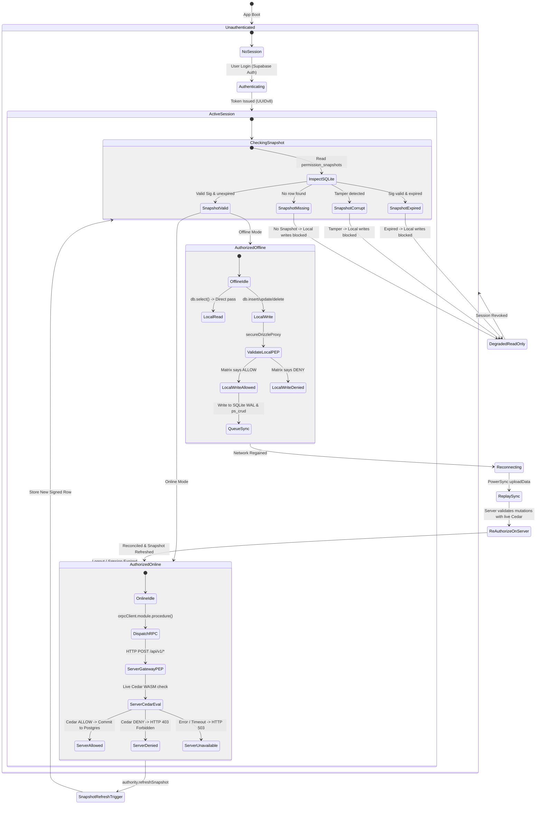

# Phase F: Authorization State Machine & Failure Modes

**Study:** Study 3 — Longitudinal Brownfield Evolution  
**Subsystem:** Authorization Lifecycle State Machine & Failure Modes  
**Status:** Grounded Architectural Specification  
**Baseline Commit:** `252bec65f746c362fec12472999cccfba187d0b9`  
**Evidence Standard:** [OBSERVED], [CONFIGURED], [DOCUMENTED], [INFERRED], [UNKNOWN], [CONFLICTING]

---

## 1. Executive Summary

The authorization subsystem in Edlove functions as a distributed, event-driven state machine operating across two physical domains:
1. **The Client Domain (Mobile/Web):** Managing local session credentials, cached Ed25519-signed snapshots, in-memory decision maps, and local SQLite write interception.
2. **The Server Domain (Sanctuary API):** Managing PostgreSQL active bonds, real-time database locks, server Cedar WASM policy evaluation, and snapshot issuance.

This document formalizes the state machine across the 10 required operational and failure scenarios.

---

## 2. Mermaid State Transition Diagram

---

## 3. Comprehensive State Transition Matrix

| Scenario # | Current State | Event / Trigger | Guard Condition | Next State | System Action & Side Effect | Fail-Safe Posture | Evidence Citation |
| :--- | :--- | :--- | :--- | :--- | :--- | :--- | :--- |
| **1. Online Normal Allow** | `AuthorizedOnline` | User executes action (e.g. submit attendance) | Scope active; Cedar policy evaluates `decision: allow` | `AuthorizedOnline` | PostgreSQL transaction commits; RPC returns HTTP 200; WAL streams update to client. | **Permitted** | [OBSERVED] `security.ts:641-680` |
| **2. Online Normal Deny** | `AuthorizedOnline` | User attempts forbidden action | Scope active; Cedar policy evaluates `decision: deny` | `AuthorizedOnline` | Server throws `FORBIDDEN` (HTTP 403); transaction rolled back; audit logged. | **Fail-Closed** | [OBSERVED] `security.ts:598` |
| **3. Online Server Timeout / Partition** | `AuthorizedOnline` | Network drops or API timeout during RPC | AbortSignal triggers or TCP timeout | `AuthorizedOffline` | RPC fails with `NETWORK_ERROR`; client falls back to local SQLite and PowerSync queue. | **Graceful Degradation** | [OBSERVED] `v1Connector.adapter.ts:85` |
| **4. Offline Startup (Valid Snapshot)** | `Unauthenticated` | App boots in airplane mode | User logged in; snapshot exists; Ed25519 signature valid; `expiresAt > now` | `AuthorizedOffline` | Snapshot loaded into `useCedarDecisionStore`; UI controls rendered; local writes permitted via `secureDrizzleProxy`. | **Permitted (Offline Authorized)** | [OBSERVED] `localEvaluator.native.ts:100-184` |
| **5. Offline Startup (Expired Snapshot)** | `Unauthenticated` | App boots offline after >24 hours | Snapshot exists; signature valid; `expiresAt <= now` | `DegradedReadOnly` | `localEvaluator.native.ts` logs warning and returns `false`. All local writes throw `LOCAL_WRITE_VIOLATION` (403). Reads continue. | **Fail-Closed** | [OBSERVED] `localEvaluator.native.ts:118` |
| **6. Offline Startup (Missing Snapshot)** | `Unauthenticated` | App boots offline after clean install | No snapshot row in SQLite (`permission_snapshots`) | `DegradedReadOnly` | Evaluator logs error and returns `false`. UI shows warning; writes blocked. | **Fail-Closed** | [OBSERVED] `localEvaluator.native.ts:74` |
| **7. Reconnection & Sync Replay** | `AuthorizedOffline` | Device reconnects to network | Network available; PowerSync online | `AuthorizedOnline` | PowerSync replays local writes from `ps_crud`; server re-evaluates each mutation against live Cedar; calls `authority.refreshSnapshot`. | **Authoritative Reconciliation** | [OBSERVED] `snapshotRefresh.ts:35`, `v1Connector.adapter.ts:110` |
| **8. Revocation While Offline** | `AuthorizedOffline` | Admin revokes teacher bond on server | Device remains disconnected from network | `AuthorizedOffline` (Temporary Window) | Client continues to trust snapshot until expiration (max 24h). Upon reconnection, server rejects queued writes and deletes bond. | **Window of Eventual Consistency** | [OBSERVED] `security.ts:605` |
| **9. Policy Update While Offline** | `AuthorizedOffline` | New Cedar policy deployed to server | Device disconnected; server policy version incremented | `AuthorizedOffline` | Client operates under old policy version until reconnecting. Upon refresh, monotonicity check accepts newer version. | **Deterministic Versioning** | [OBSERVED] `snapshotRefresh.ts:72` |
| **10. Dynamic Cedar Failure (AMB-04)** | `AuthorizedOffline` | Write intercepted with `EXPO_PUBLIC_LOCAL_DYNAMIC_CEDAR === 'true'` | Dynamic WASM throws error or parser fails | `AuthorizedOffline` | Catch block logs warning and returns static `isAllowed` (`true`), bypassing the dynamic restriction. | **Fail-Open (Relative to Dynamic Rule)** | [OBSERVED] `localEvaluator.native.ts:178` |

---

## 4. Detailed Failure Mode Analysis

### Failure Mode 1: Cryptographic Tampering of Local Snapshot
* **Mechanism:** An attacker directly edits the local SQLite database file on a rooted Android device, flipping `"AttendanceRecord": { "create": false }` to `true`.
* **Detection [OBSERVED]:** When `localEvaluator.native.ts:100` calls `verifySnapshotSignature(snapshotRecord)`, the Ed25519 signature verification fails against the modified string.
* **Result [OBSERVED]:** Evaluator logs `[LocalEvaluator.native] Cryptographic Tamper Detected on mobile permission snapshot!` and returns `false`. Local write is aborted with HTTP 403.
* **Security Posture:** **Fail-Closed (Verified in Acceptance Test ATC-03).**

### Failure Mode 2: Snapshot Expiration (The 24-Hour Boundary)
* **Mechanism:** A device stays in airplane mode for 25 hours.
* **Detection [OBSERVED]:** `localEvaluator.native.ts:114` computes `new Date(snapshotRecord.expiresAt) <= new Date()`.
* **Result [OBSERVED]:** Evaluator logs `Mobile permission snapshot has expired. Access denied.` and returns `false`.
* **Security Posture:** **Fail-Closed (Verified in Acceptance Test ATC-04).**

### Failure Mode 3: Server Rejection of Offline Replay
* **Mechanism:** A teacher marks attendance while offline, but the school administrator revoked the teacher's bond 2 hours earlier on the server.
* **Detection [OBSERVED]:** During reconnection, PowerSync uploads the queued SQL insert. The backend sync worker executes `security.resolveScope`. The bond is marked inactive or deleted in PostgreSQL.
* **Result [OBSERVED]:** Server rejects the mutation with `FORBIDDEN` (403). The record is not committed to the primary database, and conflict reconciliation rolls back the local SQLite state.
* **Security Posture:** **Fail-Closed (Authoritative Server).**
