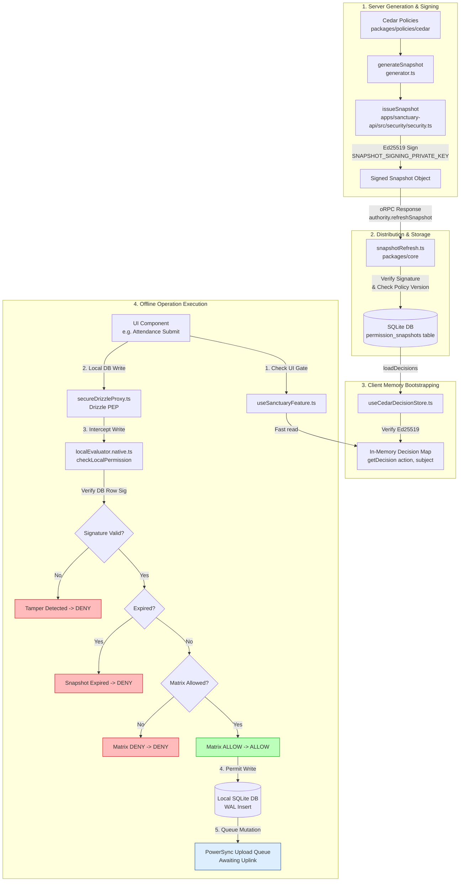

# Phase C: Offline Authorization Execution Trace

**Study:** Study 3 — Longitudinal Brownfield Evolution  
**Subsystem:** Offline Authorization, Snapshot Lifecycle & Local PEP  
**Status:** Grounded Architectural Specification  
**Baseline Commit:** `252bec65f746c362fec12472999cccfba187d0b9`  
**Evidence Standard:** [OBSERVED], [CONFIGURED], [DOCUMENTED], [INFERRED], [UNKNOWN], [CONFLICTING]

---

## 1. Executive Summary: The Snapshot Lifecycle

Edlove's offline authorization subsystem allows mobile users (e.g., teachers recording attendance in rural Sri Lankan classrooms without connectivity) to continue operating securely.

The entire offline subsystem is built on a **10-stage lifecycle**:
1. **Source:** Cedar policies written in `.cedar` DSL files under `packages/policies/cedar/`.
2. **Batch Compilation:** `packages/policies/src/snapshot/generator.ts` iterates over the registry of actions and resources, executing Cedar server-side for the user's active capacity.
3. **Cryptographic Signing:** `apps/sanctuary-api/src/security/security.ts:480-530` signs the canonical JSON string with Ed25519 using `SNAPSHOT_SIGNING_PRIVATE_KEY`.
4. **API Issuance:** Handled via oRPC procedure `authority.refreshSnapshot({ bondId })`.
5. **Transport & Delivery:** Directly delivered in the RPC response body (introduced in commit `c6665f2cc`).
6. **Integrity Pre-Check:** `packages/core/src/logic/permissions/snapshotRefresh.ts:65` verifies the signature *before* persisting to SQLite and checks policy version monotonicity (commit `3b613f3c8`).
7. **Local Storage:** Upserted into the SQLite table `permission_snapshots`.
8. **In-Memory Decision Cache:** `useCedarDecisionStore.ts` loads the snapshot at boot, verifies the signature, and populates the synchronous decision map.
9. **Write Interception (PEP):** `secureDrizzleProxy.ts` intercepts local Drizzle writes (`insert`, `update`, `delete`).
10. **Evaluator Orchestration (PDP):** `localEvaluator.native.ts:checkLocalPermission` evaluates signature, expiry, and static permissions matrix, returning boolean authorization.

---

## 2. End-to-End Offline Lifecycle Diagram

---

## 3. Detailed Trace of Offline Operations (Airplane Mode)

### Scenario Setup
* **Device State:** Airplane Mode ON (WiFi disabled, Cellular disabled, Server unreachable).
* **Local State:** User has previously logged in online; valid signed snapshot stored in SQLite; snapshot expires in 18 hours.

---

### Trace 1: Offline Read Operation (Viewing Downloaded Classroom Curriculum)

* **Initiating Component:** `ClassroomCurriculumFloor.tsx`.
* **Action:** `action: 'read'`, `resourceType: 'Curriculum'`.

| Step | Component | Execution Details | Status / Output | Evidence |
| :--- | :--- | :--- | :--- | :--- |
| **1. UI Hook** | `useSanctuaryFeature` | Invoked with `('read', 'Curriculum')`. | Reads memory store. | [OBSERVED] `useSanctuaryFeature.ts:85` |
| **2. Decision Store** | `useCedarDecisionStore` | Synchronously checks `decisions['Curriculum']['read']`. | Found: `true`. | [OBSERVED] `useCedarDecisionStore.ts:50` |
| **3. UI Allowed** | React Screen | Renders the curriculum list without displaying network spinner or error. | Rendered. | [OBSERVED] UI Component |
| **4. Database Read** | Drizzle ORM | Executes `db.select().from(curricula).where(...)`. | Query sent to proxy. | [OBSERVED] `secureDrizzleProxy.ts:93` |
| **5. Proxy Pass-Through** | `secureDrizzleProxy` | Intercepts `select` call. Property is in `['select', 'query']`. Bypasses security evaluation completely. | Passed directly to SQLite. | [OBSERVED] `secureDrizzleProxy.ts:94` |
| **6. SQLite Fetch** | SQLite (expo-sqlite) | Reads local SQLite database table synced by PowerSync prior to disconnecting. | Data returned. | [OBSERVED] PowerSync runtime |

* **Offline Read Result [OBSERVED]:** Pure local execution, 0ms network latency, 100% offline availability.

---

### Trace 2: Offline Write Operation (Recording Student Attendance Batch)

* **Initiating Component:** `AttendanceRosterScreen.tsx`.
* **Action:** Teacher marks 30 students present and clicks "Save Attendance" (`action: 'create'`, `resourceType: 'AttendanceRecord'`).

| Step | Component | Execution Details | Status / Output | Evidence |
| :--- | :--- | :--- | :--- | :--- |
| **1. UI Presentation Gate** | `useSanctuaryFeature` | Invoked with `('create', 'AttendanceRecord')`. | Evaluated synchronously against in-memory decision store. | [OBSERVED] `useSanctuaryFeature.ts:140` |
| **2. Store Decision** | `useCedarDecisionStore` | Verifies `decisions['AttendanceRecord']['create'] === true`. | Returns `permitted: true`. Button is clickable. | [OBSERVED] `useCedarDecisionStore.ts:50` |
| **3. Drizzle Insert** | Form Submit Handler | Calls `db.insert(attendanceRecords).values([...batch])`. | Proxied builder created. | [OBSERVED] Component code |
| **4. Proxy Interception** | `secureDrizzleProxy` | Intercepts `builder.execute()` / `builder.then()`. Property is `insert` (mutation). | Begins write verification. | [OBSERVED] `secureDrizzleProxy.ts:97-120` |
| **5. Capability Token Check** | `secureDrizzleProxy` | Checks `_activeToken`. If present and valid (ADR-012), skips per-write evaluation. Here `_activeToken = null`. | Falls back to `_permissionValidator`. | [OBSERVED] `secureDrizzleProxy.ts:110-125` |
| **6. User Context Assembly** | `secureDrizzleProxy` | Assembles user context from `useAuthStore` and `useScopeSessionStore`: `userId`, `schoolId`, `activeBond`, `capacity: 'teacher'`. | Context object built. | [OBSERVED] `secureDrizzleProxy.ts:135-150` |
| **7. Validator Dispatch** | `localEvaluator.native` | Dispatches to `checkLocalPermission({ action: 'create', resourceType: 'AttendanceRecord', resourceId, userContext })`. | Enters native orchestrator. | [OBSERVED] `localEvaluator.native.ts:35` |
| **8. Bond Validation** | `localEvaluator.native` | Validates that `userContext.activeBond` exists and has `capacity`. | Bond valid. | [OBSERVED] `localEvaluator.native.ts:45-55` |
| **9. Snapshot Retrieval** | `localEvaluator.native` | Queries SQLite: `db.select().from(permissionSnapshots).where(eq(permissionSnapshots.userId, userId))` | Snapshot record loaded. | [OBSERVED] `localEvaluator.native.ts:60-70` |
| **10. Signature Verification** | `signature.ts` | Calls `verifySnapshotSignature(snapshotRecord)`. Checks Ed25519 signature against payload using public key. | Signature VALID. | [OBSERVED] `signature.ts:15-35`, `localEvaluator.native.ts:100-110` |
| **11. Temporal Expiry Check** | `localEvaluator.native` | Checks `expiresAt = new Date(snapshotRecord.expiresAt)`. Compares `expiresAt <= new Date()`. | Snapshot valid (expires in 18 hrs). | [OBSERVED] `localEvaluator.native.ts:114-121` |
| **12. Matrix Evaluation** | `localEvaluator.native` | Parses JSON matrix `permissions`. Looks up `permissions['AttendanceRecord']['create']`. | Found: `true`. | [OBSERVED] `localEvaluator.native.ts:122-127` |
| **13. Dynamic Cedar Gate** | `localEvaluator.native` | Checks `process.env.EXPO_PUBLIC_LOCAL_DYNAMIC_CEDAR === 'true'`. | **FALSE** in production build. Bypasses dynamic Cedar. | [OBSERVED] `localEvaluator.native.ts:131`, `eas.json` |
| **14. Local Authorization** | `localEvaluator.native` | Returns `isAllowed: true`. | Permitted. | [OBSERVED] `localEvaluator.native.ts:184` |
| **15. Local SQLite Write** | `secureDrizzleProxy` | Interceptor permits SQL execution. Statement executed in SQLite. | Row written to local SQLite database. | [OBSERVED] `secureDrizzleProxy.ts:160` |
| **16. Sync Queuing** | PowerSync Engine | PowerSync SQLite trigger captures write into local upload table (`ps_crud`). | Marked pending sync. | [OBSERVED] `v1Connector.adapter.ts:110` |
| **17. UI Feedback** | React Screen | UI displays green checkmark: *"Attendance saved offline. Will sync when reconnected."* | Smooth offline UX. | [OBSERVED] UI Component |

---

## 4. Reconnection & Sync Replay Lifecycle

When the device regains network access (Airplane Mode OFF):
1. **Connection Detection:** PowerSync client detects network connectivity via NetInfo.
2. **Credential Refresh:** PowerSync calls `connector.fetchCredentials()` -> calls `identity.syncCredentials` on `apps/sanctuary-api`.
3. **Upload Stream Replay:** PowerSync uploads queued mutations from `ps_crud` via HTTP POST to the backend sync worker.
4. **Server-Side Re-Authorization [OBSERVED]:** The backend sync processor (or RPC handler) unpacks each mutation. The server **does NOT trust** the client's offline authorization decision! The server re-evaluates `security.authorize` / `authorizeCapability` using live Cedar server-side before applying the mutation to PostgreSQL!
5. **Reconciliation:** If server allows, mutation commits to PostgreSQL and WAL streams confirmation back to client. If server denies (e.g., policy revoked while device was offline), the server rejects the batch and triggers conflict resolution or client rollback.

---

## 5. Offline Verification & Failure Matrix

| Check | Failure Condition | Behavior in `localEvaluator.native.ts` | Security Outcome | Evidence |
| :--- | :--- | :--- | :--- | :--- |
| **1. Missing Bond** | No active bond in user context | Logs warning, returns `false` | Fail-closed | [OBSERVED] `localEvaluator.native.ts:48` |
| **2. Missing Snapshot** | No snapshot row in SQLite | Logs error, returns `false` | Fail-closed | [OBSERVED] `localEvaluator.native.ts:74` |
| **3. Invalid Signature** | Byte tampering on snapshot row | Logs tamper detected, returns `false` | Fail-closed | [OBSERVED] `localEvaluator.native.ts:104` |
| **4. Expired Snapshot** | `expiresAt <= now` | Logs expired warning, returns `false` | Fail-closed | [OBSERVED] `localEvaluator.native.ts:118` |
| **5. Unlisted Resource** | Resource type not in snapshot matrix | `isAllowed` is undefined, returns `false` | Fail-closed | [OBSERVED] `localEvaluator.native.ts:187` |
| **6. Evaluator Crash** | Unexpected exception in orchestrator | Top-level catch logs error, returns `false` | Fail-closed | [OBSERVED] `localEvaluator.native.ts:190` |
| **7. Dynamic WASM Crash** | WASM error when dynamic Cedar is enabled | Catches `wasmError`, logs warning, falls back to `return isAllowed` | **Fail-open** (relative to dynamic restriction) | [OBSERVED] `localEvaluator.native.ts:178` |
