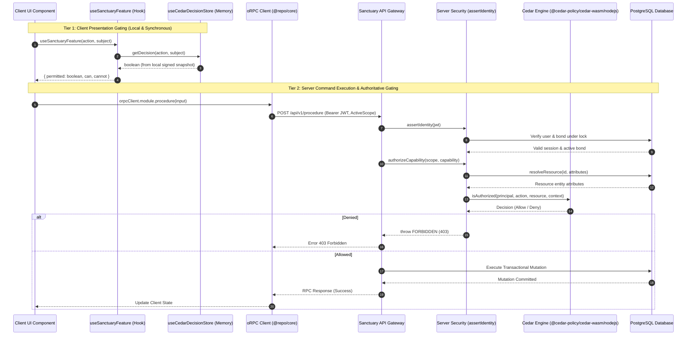

# Phase B: Online Authorization Execution Trace

**Study:** Study 3 — Longitudinal Brownfield Evolution  
**Subsystem:** Online Authorization & RPC Execution Lifecycle  
**Status:** Grounded Architectural Specification  
**Baseline Commit:** `252bec65f746c362fec12472999cccfba187d0b9`  
**Evidence Standard:** [OBSERVED], [CONFIGURED], [DOCUMENTED], [INFERRED], [UNKNOWN], [CONFLICTING]

---

## 1. Executive Summary: The Non-Existent Remote Authorization Query

A central question in the authorization investigation was:  
*Does the client ever call a remote API specifically to ask "is user X authorized to perform action Y"?*

**Finding [OBSERVED]:**  
**No. There is no remote authorization query API in Edlove.**

Inspection of `packages/core/src/api/v1/contract.ts:40-85` and `apps/sanctuary-api/src/core/router.ts:50-120` confirms that the v1 API contract exposes zero endpoints for remote permission queries (e.g., no `can(...)`, `/authorize`, or `/permissions/check` endpoints exist). 

Instead, online authorization operates via a **two-tier architecture**:
1. **Client-Side Presentation PEP [OBSERVED]:** UI components evaluate permission checks synchronously against a locally cached, cryptographically signed permission snapshot loaded into memory (`useCedarDecisionStore`). The client does not make a network round-trip to render a button or guard a route.
2. **Server-Side Gateway PEP [OBSERVED]:** When an RPC mutation or data access request reaches `apps/sanctuary-api`, authorization is enforced directly inside the API gateway and transactional command pipeline (`security.authorize` / `authorizeCapability`) using the server-side Cedar WASM engine (`@cedar-policy/cedar-wasm/nodejs`).

---

## 2. Hop-by-Hop Topology Architecture

---

## 3. Concrete Operation Traces

### Trace 1: Online Read Operation (Classroom / Library Resource)

* **Initiating Component:** `apps/gurudevi-web/app/(sanctuary)/library/LibraryFloor.tsx:85` or mobile equivalent.
* **Intended Action:** Read a published educational resource (`action: 'read'`, `resourceType: 'LibraryResource'`).

| Hop | From | To | Mechanism / File | Payload / State | Evidence |
| :--- | :--- | :--- | :--- | :--- | :--- |
| **1. UI Gate** | `LibraryFloor.tsx` | `useSanctuaryFeature.ts` | React Hook invocation: `useSanctuaryFeature('read', 'LibraryResource')` | `action: 'read'`, `subject: 'LibraryResource'` | [OBSERVED] `LibraryFloor.tsx:85` |
| **2. Fast-Path** | `useSanctuaryFeature.ts` | Local Constant | Checks `PERSONAL_SANCTUARY_READ_SUBJECTS.has('LibraryResource')` | Personal perspective bypass | [OBSERVED] `useSanctuaryFeature.ts:32` |
| **3. Memory Check** | `useSanctuaryFeature.ts` | `useCedarDecisionStore.ts` | Reads `getDecision('read', 'LibraryResource')` | Returns `true` if present in signed matrix | [OBSERVED] `useCedarDecisionStore.ts:45` |
| **4. UI Render** | Hook | Component | Returns `{ permitted: true }` | Component renders reader view | [OBSERVED] `useSanctuaryFeature.ts:160` |
| **5. Data Fetch** | Component | Local SQLite / PowerSync | Drizzle ORM query: `db.select().from(libraryResources)...` | Read query executed | [OBSERVED] `secureDrizzleProxy.ts:93` |
| **6. Proxy Bypass** | `secureDrizzleProxy.ts` | Underlying DB | Intercepts `db.select`. Property matches `select`/`query` -> bypassed directly without security checks! | Zero overhead for reads | [OBSERVED] `secureDrizzleProxy.ts:93-96` |
| **7. Return** | SQLite | Component | PowerSync returns reactive rows to UI | UI displays book / media | [OBSERVED] `v1Connector.adapter.ts` |

* **Key Takeaway [OBSERVED]:** Online reads for cached/synced resources require **zero network hops** and **zero server CPU cycles**. The security model trusts the PowerSync sync rules for row distribution and the local snapshot for presentation gating.

---

### Trace 2: Online Write Operation (Attendance Record / Tuition Batch)

* **Initiating Component:** Teacher attendance submission floor / workspace.
* **Intended Action:** Record student attendance batch (`action: 'create'`, `resourceType: 'AttendanceRecord'`).

| Hop | From | To | Mechanism / File | Payload / State | Evidence |
| :--- | :--- | :--- | :--- | :--- | :--- |
| **1. Presentation Gate** | Attendance View | `useSanctuaryFeature.ts` | `useSanctuaryFeature('create', 'AttendanceRecord')` | Checks 4 pillars: Flag, Entitlement, Citizenship, Cedar snapshot | [OBSERVED] `useSanctuaryFeature.ts:140` |
| **2. Decision Resolution** | `useCedarDecisionStore` | Component | Returns `permitted: true` | "Submit Attendance" button enabled | [OBSERVED] `useCedarDecisionStore.ts:50` |
| **3. Client Local Write** | Form submit | `secureDrizzleProxy.ts` | Calls `db.insert(attendanceRecords).values(...)` | Local mutation intercepted by Proxy PEP | [OBSERVED] `secureDrizzleProxy.ts:97-105` |
| **4. Local Write PEP** | `secureDrizzleProxy.ts` | `localEvaluator.native.ts` | Executes `_permissionValidator` (`checkLocalPermission`) | Verifies snapshot signature & matrix before local write! | [OBSERVED] `localEvaluator.native.ts:100` |
| **5. SQLite Commit** | `secureDrizzleProxy.ts` | Local SQLite | Executes raw insert in SQLite WAL | Row persisted locally with sync flag | [OBSERVED] `secureDrizzleProxy.ts:155` |
| **6. Sync Stream** | Local SQLite | PowerSync Service | PowerSync sync queue captures local insertion | Uplink payload generated | [OBSERVED] `v1Connector.adapter.ts:110` |
| **7. RPC Command (Direct Path)** | Component (or Worker) | `apps/sanctuary-api` | Calls oRPC procedure: `POST /api/v1/attendance.submit` | HTTP POST with Bearer JWT & payload | [OBSERVED] `contract.ts:40` |
| **8. Gateway Authentication** | API Gateway | `security.ts:assertIdentity` | Validates JWT, verifies account UUIDv8, checks expiration | Account ID resolved | [OBSERVED] `security.ts:250` |
| **9. Scope Resolution** | API Gateway | `security.ts:resolveScope` | Re-reads active bond in DB under transaction lock | Ensures bond is not revoked | [OBSERVED] `security.ts:605` |
| **10. Server Authorization** | API Gateway | `security.ts:authorizeCapability` | Calls Cedar engine: principal (teacher), action (`create`), resource (`AttendanceRecord`) | Cedar policy evaluated | [OBSERVED] `security.ts:641` |
| **11. Policy Execution** | `security.ts` | `@cedar-policy/cedar-wasm/nodejs` | Evaluates `.cedar` policies compiled from `@repo/policies` | WASM engine returns `decision: allow` | [OBSERVED] `evaluator.ts:50` |
| **12. DB Transaction** | API Gateway | PostgreSQL | Executes SQL INSERT into `public.attendance_records` inside transaction | Database commit | [OBSERVED] `platform.integration.ts:1120` |
| **13. API Response** | `apps/sanctuary-api` | Client | Returns `{ status: 'success', recordId: '...' }` | HTTP 200 OK | [OBSERVED] `router.ts:80` |
| **14. Downlink Sync** | PostgreSQL | PowerSync -> Client | Change captured in WAL and streamed back to update local state | Local DB reconciles state | [OBSERVED] `v1Connector.adapter.ts` |

---

## 4. Evidence Matrix for Online Execution

| Layer | Responsibility | Actual Implementation | Evidence Level | File Citation |
| :--- | :--- | :--- | :--- | :--- |
| **Presentation Gating** | Prevents rendering unauthorized UI | Synchronous read from `useCedarDecisionStore` | [OBSERVED] | `packages/core/src/logic/permissions/hooks/useSanctuaryFeature.ts:85-135` |
| **Client Decision Cache** | Holds pre-computed Cedar answers | Zustand store loaded from SQLite `permission_snapshots` | [OBSERVED] | `packages/core/src/store/useCedarDecisionStore.ts:20-75` |
| **Local Write PEP** | Blocks direct local DB mutation | `createSecureDrizzleProxy` interceptor on `insert`/`update`/`delete` | [OBSERVED] | `packages/core/src/adapters/powersync/secureDrizzleProxy.ts:90-165` |
| **Remote AuthZ Endpoint** | Remote check endpoint | **NON-EXISTENT**. No endpoint exists. | [OBSERVED] | `packages/core/src/api/v1/contract.ts:40-85` |
| **Server Authentication** | Validates session token & bond | `security.ts:assertIdentity` & `resolveScope` | [OBSERVED] | `apps/sanctuary-api/src/security/security.ts:250-320` |
| **Server Authorization** | Authoritative gateway authorization | `security.ts:authorizeCapability` via Cedar Node WASM | [OBSERVED] | `apps/sanctuary-api/src/security/security.ts:641-680` |
| **Server Policy Engine** | Evaluates Cedar AST | `@cedar-policy/cedar-wasm/nodejs` | [OBSERVED] | `packages/policies/src/engine/evaluator.ts:15-60` |
